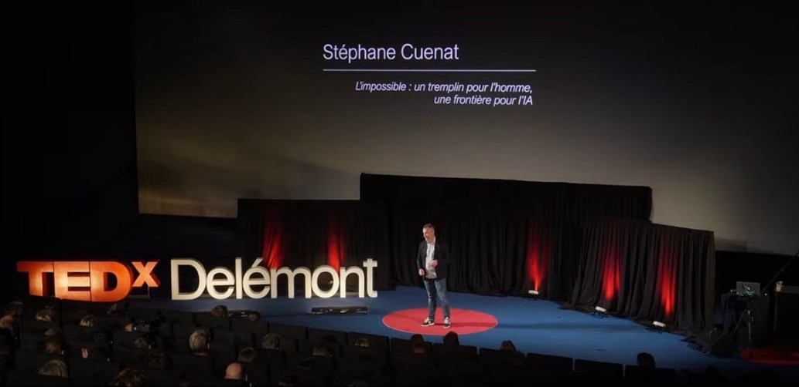

```{=html}
<section class="profile">
  <div class="profile-text">
    <p class="profile-kicker">About</p>
    <h1 class="profile-name">Stéphane Cuenat</h1>
    <p class="profile-role">Principal Software Architect · PhD in computer science · Porrentruy, Swiss Jura</p>
    <p class="profile-links">
      <a href="https://www.linkedin.com/in/st%C3%A9phane-cuenat-87116b5/">LinkedIn</a>
      <a href="https://www.linkedin.com/newsletters/ai-honestly-7484605558868844544">Newsletter</a>
      <a href="https://www.femto-st.fr/en/femto-people/stephanecuenat">FEMTO-ST</a>
      <a href="https://www.researchgate.net/profile/Stephane-Cuenat">ResearchGate</a>
      <a href="https://github.com/scuenat/scuenat.github.io">GitHub</a>
    </p>
  </div>
  <a class="profile-photo" href="talks.html"><span>On the TEDxDelémont stage</span></a>
</section>
<ul class="profile-facts">
  <li><strong>Principal Software Architect</strong><span>Mastercam, bringing AI into CAM software</span></li>
  <li><strong>PhD in computer science</strong><span>FEMTO-ST, deep learning and holography</span></li>
  <li><strong>SwissCube</strong><span>Switzerland's first satellite, early in my career</span></li>
  <li><a href="talks.html"><strong>TEDxDelémont</strong><span>The Impossible: a springboard for humans, a frontier for AI</span></a></li>
</ul>
```

I'm Stéphane Cuenat, based in Porrentruy, in the Swiss Jura. By day I'm Principal Software Architect at Mastercam, where I work on Mastercam Copilot, bringing AI into CAM software. Before that I led development and research teams, and early in my career I had the chance to take part in SwissCube, Switzerland's first satellite.

I hold a PhD in computer science from FEMTO-ST and the Université Marie et Louis Pasteur (formerly Université de Franche-Comté), and I still write research papers with FEMTO-ST, especially with Raphaël Couturier. The papers, the thesis and the data are [below](#research).

## This site {#site}

This site is where I think in public. I write about what AI really changes and what it doesn't: learning and the time it takes, why we need less data rather than more, what machines can and can't rebuild, and what wisdom means next to intelligence. Lately that has taken five directions: what agents change in building software and in the teams around it, why small, fast, local models can do more than we expect, what stays ours when machines do more of the work, what a dashboard should really show, and, some evenings, physics. Some pieces are short essays from my newsletter [*AI, Honestly*](https://www.linkedin.com/newsletters/ai-honestly-7484605558868844544). Others are longer working papers, often with the code and data to check them.

```{=html}
<nav class="ways-in" aria-label="Ways into the site">
  <a href="index.html#start-here"><strong>Start here</strong><span>A few posts picked for a first visit</span></a>
  <a href="series.html"><strong>Series</strong><span>One question, step by step, like Agentic Coding</span></a>
  <a href="index.html#topics"><strong>Themes</strong><span>Posts grouped by what they are about</span></a>
  <a href="archive.html"><strong>All writing</strong><span>Everything, newest first, with filters</span></a>
</nav>
```

I'm interested in ideas more than hype, so challenges and counter-arguments are always welcome.

**How I write.** The questions, ideas and arguments here are mine, and so is the responsibility for them. But I don't write alone: I use AI to challenge my ideas, shape them, tighten the text and help with code and experiments. The French versions are translated automatically from English and may contain a few errors; when in doubt, the English text is the reference. It would be odd to write about AI honestly and hide that.

### What I write {#kinds}

Every piece carries a small label on its card, so you know what to expect before you start:

- **Essay.** One idea, argued in the first person. It may be personal, speculative or philosophical, and it is honest about what is opinion. Ten to twenty minutes.
- **Analysis.** A close reading of a paper, a post or a system, or a working paper that tests an idea with a model, data or a simulation. Numbers are sourced or computed, and limits are stated.
- **Note.** Short and practical. It puts existing ideas together into something you could build this week, gives the recipe, and says how to check that it works.
- **Position paper.** A deliberately provocative thesis in the form of a short scientific paper: a precise claim, arguments and often a model, and predictions that could prove it wrong.
- **Overview.** A map of a research area: the main lines of work, how they relate, what is established and what is still open, built from openly accessible sources and linked throughout. A way in, not a verdict.

## Research {#research}

My research asks how a small neural network can read a precise 3D position straight from a hologram. A digital holographic microscope records an object in a single shot, but finding where the object is usually means reconstructing a stack of images and searching for the sharpest one. That is slow. The papers below replace the search with small transformer and convolutional networks that infer the focus distance and the pose directly: to about a micrometer, in milliseconds, on an ordinary CPU.

The work was done at [FEMTO-ST](https://www.femto-st.fr/en/femto-people/stephanecuenat) in Besançon, with Raphaël Couturier, Maxime Jacquot, Patrick Sandoz and Guillaume J. Laurent, and became my PhD. I still write papers with the institute; the newest, with Rémi Kieber and Mohammad Saim Khan, build the physics of light into the networks themselves. The same conviction runs through the essays on this site, most directly [Fast AI](posts/2026-10-11-fast-ai/index.qmd): learn slowly, once; act fast, every time.

::: {#publications}
:::

New publications will appear here as they come out. Work that isn't public yet is listed under *In progress*, with its question but not its results. The longer pieces on this site that test an idea with code and data are the [working papers](archive.qmd#category=paper).

## Reuse {#reuse}

The essays, papers and figures on this site are licensed under [CC BY 4.0](https://creativecommons.org/licenses/by/4.0/): you can share, translate and adapt them, including commercially, as long as you credit Stéphane Cuenat and link to the original. The code (figure scripts, simulations, experiments) is under the [MIT License](https://github.com/scuenat/scuenat.github.io/blob/main/LICENSE). Quotes, translations and counter-arguments are welcome.

*Opinions here are my own and not those of my employer.*

*This site counts visits anonymously with [GoatCounter](https://www.goatcounter.com): no cookies, no personal data, no tracking across sites.*
