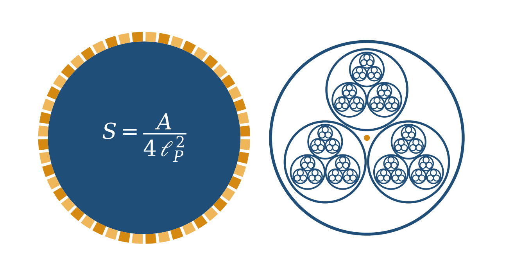
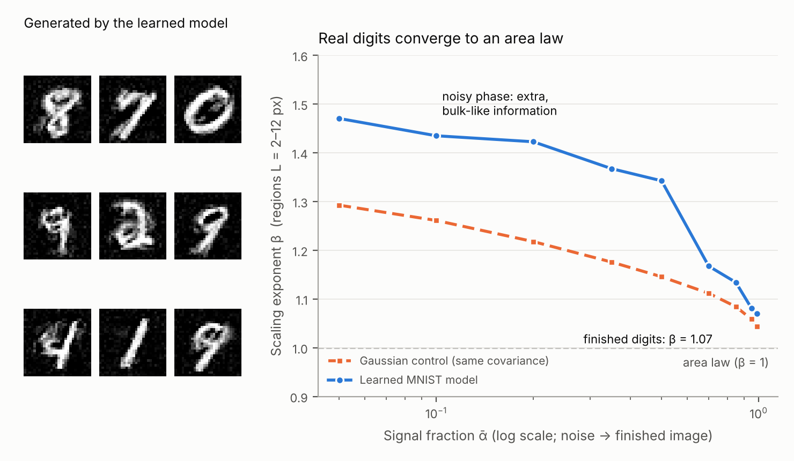
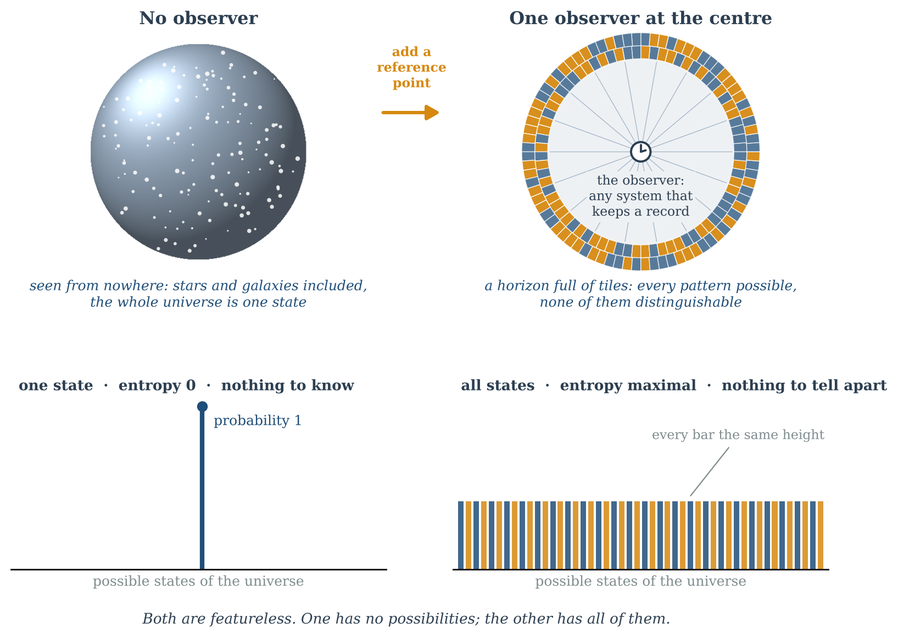
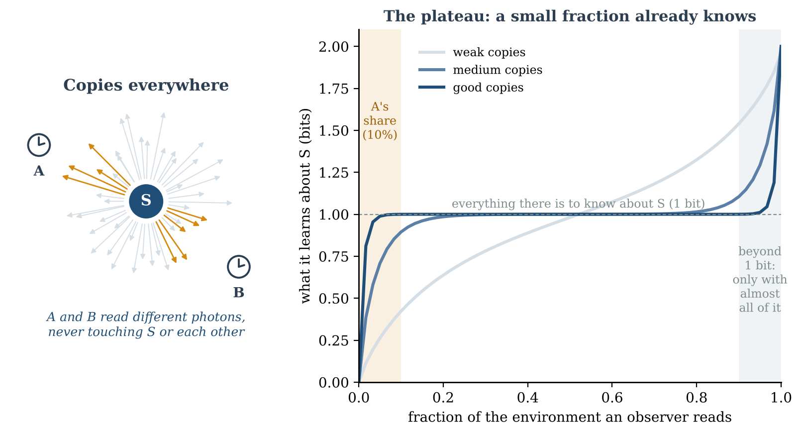
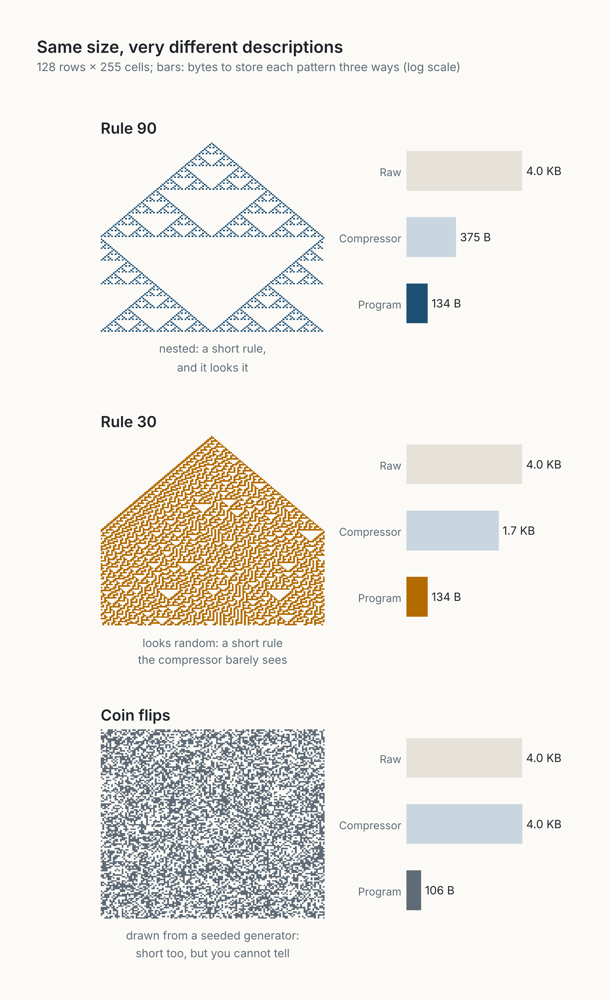

[← All series](series.qmd){.series-back}

These four essays are not about my field. They started one evening with a physics paper I could not follow, and a feeling I could not shake: *it must be simpler than this*. I am not a physicist or a mathematician, and I say so in each of them. What I tried to do is follow the questions honestly, check what could be checked, and bring them back to what I know better: AI and software.

Each evening starts where the previous one stopped. The second turns the question into an experiment on an AI image generator. The third and fourth ask what changes when someone is inside the universe, looking.

If you only have time for one, read [A Universe Without a Bottom](posts/2026-10-15-a-universe-without-a-bottom/index.qmd): the others grow out of it.

```{=html}
<ol class="series-strip">
  <li><a href="#step-1"><span>1</span>The question</a></li>
  <li><a href="#step-2"><span>2</span>The experiment</a></li>
  <li><a href="#step-3"><span>3</span>The observer</a></li>
  <li><a href="#step-4"><span>4</span>Two observers</a></li>
</ol>
```

::: {.series-step data-step="1"}

```{=html}
<a class="series-step-media" href="posts/2026-10-15-a-universe-without-a-bottom/index.html" tabindex="-1" aria-hidden="true"></a>
```

## 1. The question: it must be simpler than this {#step-1}

**[A Universe Without a Bottom](posts/2026-10-15-a-universe-without-a-bottom/index.qmd)** · *essay*

One evening with *Holograms and Standard Models* by Miyashita, Sekino and Susskind, and the questions it left. The information a black hole holds grows with its surface, not its volume. Maybe nothing creates everything. Maybe there are grains inside grains, with no final layer.

*Takeaway: I did not find the answer. I found better questions.*

:::

::: {.series-step data-step="2"}

```{=html}
<a class="series-step-media" href="posts/2026-10-16-decided-in-the-bulk/index.html" tabindex="-1" aria-hidden="true"></a>
```

## 2. The experiment: where an image keeps its information {#step-2}

**[Decided in the Bulk, Written on the Boundary](posts/2026-10-16-decided-in-the-bulk/index.qmd)** · *essay*

While an AI image generator turns noise into a picture, where does the picture's information live: inside a region, or on its border? I ran the experiment in one evening, on two CPU cores, with an AI as lab partner. Finished images follow an area law, like black holes. But the big decisions are made across the whole image first, and only later settle onto the edges.

*Takeaway: decided in the bulk, written on the boundary. And an evening is now enough to test a question from outside your field.*

:::

::: {.series-step data-step="3"}

```{=html}
<a class="series-step-media" href="posts/2026-10-23-nothing-from-outside/index.html" tabindex="-1" aria-hidden="true"></a>
```

## 3. The observer: nothing from outside {#step-3}

**[Nothing From Outside, Everything From Inside](posts/2026-10-23-nothing-from-outside/index.qmd)** · *essay*

The two thoughts from the first evening turn out to be one. "Nothing" is not empty: it is the state with the most possibilities. A closed universe seen from nowhere has only one state. Put an observer inside, and the possibilities come back.

*Takeaway: there is no view from nowhere. What exists, exists for someone inside.*

:::

::: {.series-step data-step="4"}

```{=html}
<a class="series-step-media" href="posts/2026-10-27-what-survives-comparison/index.html" tabindex="-1" aria-hidden="true"></a>
```

## 4. Two observers: what survives comparison {#step-4}

**[What Survives Comparison](posts/2026-10-27-what-survives-comparison/index.qmd)** · *essay*

A reader asked: if two observers inside one closed universe each keep their own records, do they end up agreeing on one world? Nobody holds the master copy, so the world cannot guarantee agreement. The observers have to produce it, by comparing their records at the right scale.

*Takeaway: agreement is always agreement for someone.*

:::

## After the series

::: {.series-step .is-followup}

```{=html}
<a class="series-step-media" href="posts/2026-11-08-it-must-be-simpler-than-this/index.html" tabindex="-1" aria-hidden="true"></a>
```

**[It Must Be Simpler Than This](posts/2026-11-08-it-must-be-simpler-than-this/index.qmd)** · *position paper* · follows the first evening

The feeling from that first evening, turned into a claim that can be tested. What we call complex is usually a short rule seen at the wrong level, in the wrong frame, or under layers we kept. A measure, a rule, and predictions that could prove it wrong.

*Takeaway: most complexity is in the description, not in the thing.*

:::

## The thread

Each evening moved the question one step closer to home. From a surface that knows everything, to an image generator on my laptop, to an observer who has to be inside, to two observers who have to compare. And underneath, the same feeling every time: it must be simpler than this. Not simpler as in easy, but simpler seen from another angle.

The same feeling runs through the rest of the site, from [Show What Changed, Not the Data](posts/2026-09-29-show-what-changed/index.qmd) to [Agentic Coding](agentic-coding.qmd). Physicists who read these: corrections are very welcome.
