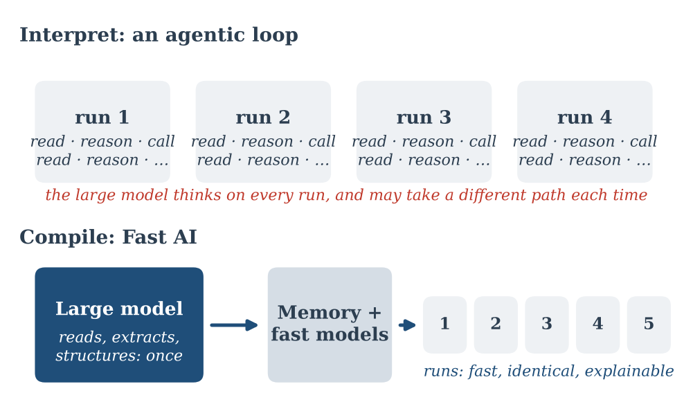
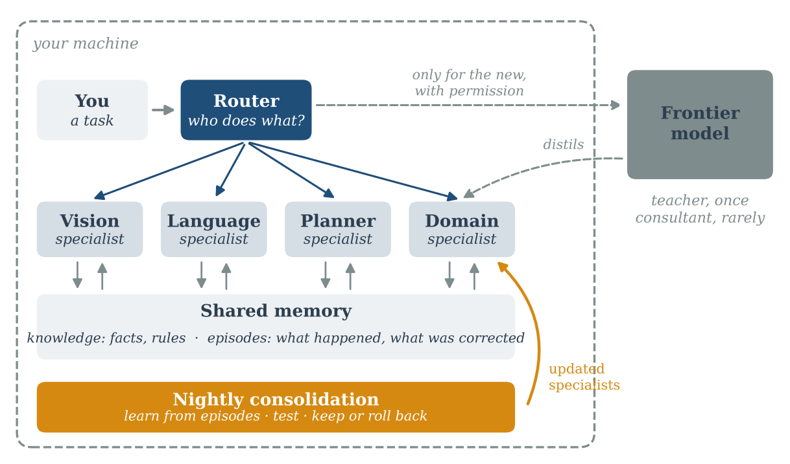
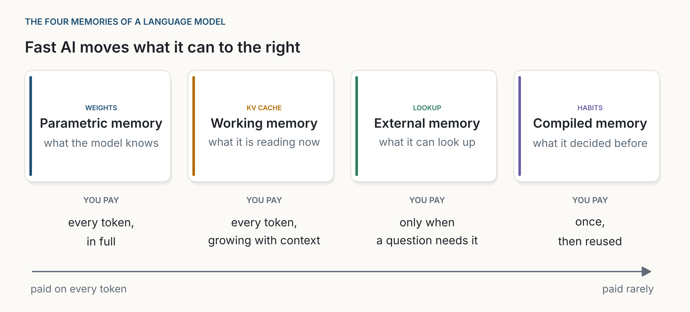
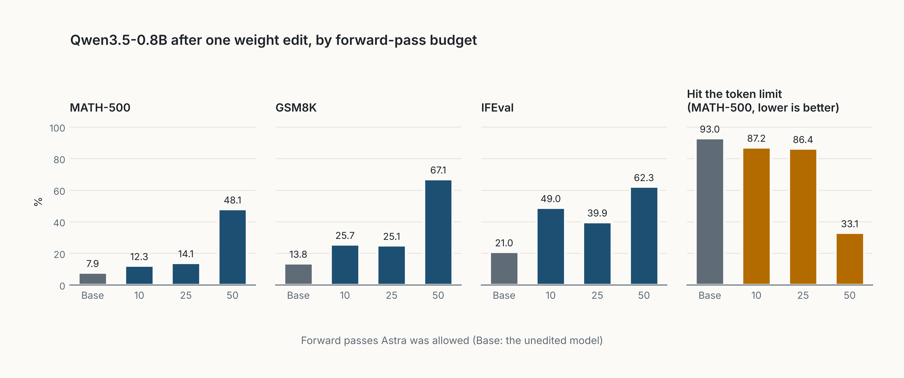
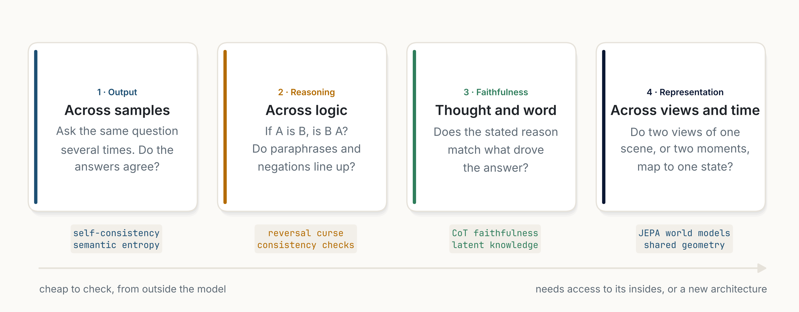
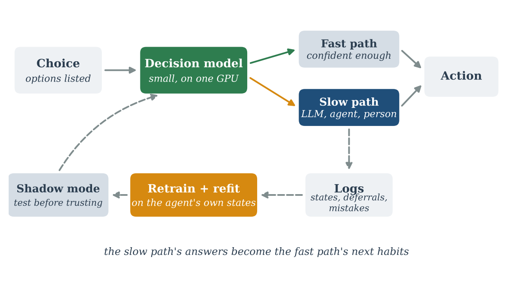
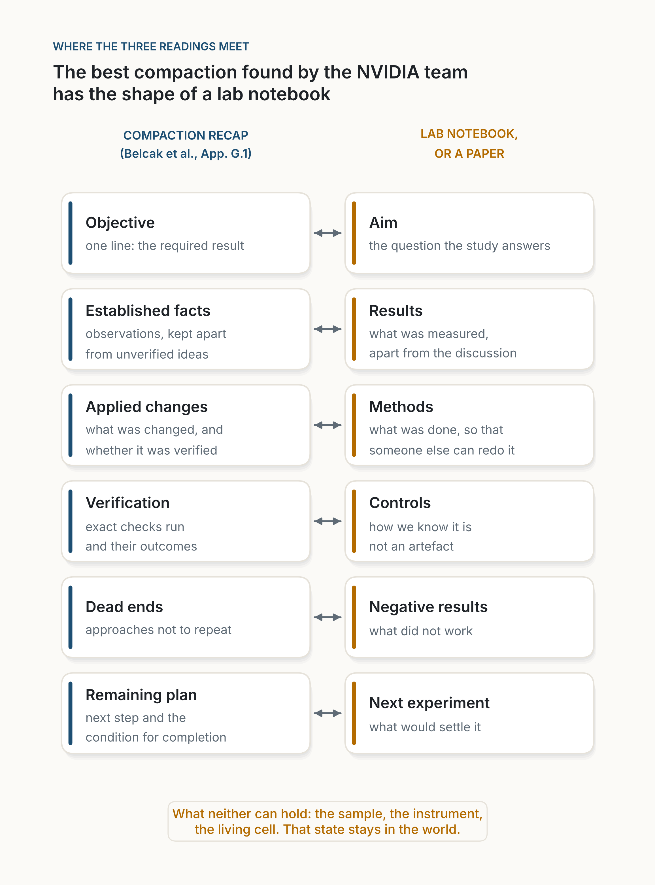

[← All series](series.qmd){.series-back}

Experts learn slowly, once, and then act fast on habit. Most AI today does the opposite: it reasons from scratch on every run. These four pieces follow one idea, that AI should learn slowly and act fast, from a principle to an architecture you could run on your own machine.

They go from the general to the concrete. First the principle. Then the shape of the system: many small specialists, not one big model made small. Then the question every small system meets first: what to remember, and where. And last, a new way to teach small models: a large model that writes their weights directly.

If you only have time for one, read [Fast AI](posts/2026-10-11-fast-ai/index.qmd): it holds the idea, and the others build on it.

```{=html}
<ol class="series-strip">
  <li><a href="#step-1"><span>1</span>The principle</a></li>
  <li><a href="#step-2"><span>2</span>The ecosystem</a></li>
  <li><a href="#step-3"><span>3</span>The memory</a></li>
  <li><a href="#step-4"><span>4</span>The teacher</a></li>
</ol>
```

::: {.series-step data-step="1"}

```{=html}
<a class="series-step-media" href="posts/2026-10-11-fast-ai/index.html" tabindex="-1" aria-hidden="true"></a>
```

## 1. The principle: learn slowly, once {#step-1}

**[Fast AI](posts/2026-10-11-fast-ai/index.qmd)** · *essay*

An agent that reasons from scratch on every run compounds errors, costs time and forgets what it learned. Fast AI uses the large model before the loop, as a compiler: it builds a structured memory once, and fast, explainable models run the process. The agentic loop is kept for the exceptions, and what it learns there becomes the next habit.

*Takeaway: learn slowly, once. Act fast, every time.*

:::

::: {.series-step data-step="2"}

```{=html}
<a class="series-step-media" href="posts/2026-10-17-an-ecosystem-not-an-oracle/index.html" tabindex="-1" aria-hidden="true"></a>
```

## 2. The ecosystem: many small specialists {#step-2}

**[An Ecosystem, Not an Oracle](posts/2026-10-17-an-ecosystem-not-an-oracle/index.qmd)** · *essay*

Local AI is usually pictured as one big model made small enough for a laptop. I see many specialised models, a memory they share, a thin harness around them, and a careful loop that lets them keep learning. Four reasons: where the largest models already went, the arithmetic of memory and bandwidth, what a harness still adds to small models, and how our own brain most likely works.

*Takeaway: local AI will be an ecosystem, not an oracle.*

:::

::: {.series-step data-step="3"}

```{=html}
<a class="series-step-media" href="posts/2026-10-26-where-memory-lives/index.html" tabindex="-1" aria-hidden="true"></a>
```

## 3. The memory: what to keep, what to look up {#step-3}

**[Where Memory Lives](posts/2026-10-26-where-memory-lives/index.qmd)** · *essay*

A model keeps what it knows in four places: its weights, its working memory, what it can look up, and the habits it has compiled. Each is paid for at a different moment. Four experiments measure how many facts fit in a small network, what it costs to change one, how fast an external memory answers, and when the working memory outweighs the model.

*Takeaway: keep in the weights what is used on every token; look up everything else, and keep what you look up short.*

:::

::: {.series-step data-step="4"}

```{=html}
<a class="series-step-media" href="posts/2026-11-03-the-teacher-who-writes-the-weights/index.html" tabindex="-1" aria-hidden="true"></a>
```

## 4. The teacher: writing weights directly {#step-4}

**[The Teacher Who Writes the Weights](posts/2026-11-03-the-teacher-who-writes-the-weights/index.qmd)** · *analysis*

Weights have always been written by an optimizer. A recent post claims that a frontier model, used as it is, can read a network's raw weights, say what it was trained to do, and write weights directly around a goal stated in plain language. My reading: the results are real, but narrower than the headline. What it could mean for small, fast models that run on premise.

*Takeaway: the results are real but narrow; if they hold, a large model could become the teacher that writes small, local models.*

:::

## After the series

::: {.series-step .is-followup}

```{=html}
<a class="series-step-media" href="posts/2026-10-26-coherence-is-measurable/index.html" tabindex="-1" aria-hidden="true"></a>
```

**[Coherence Is Measurable](posts/2026-10-26-coherence-is-measurable/index.qmd)** · *essay* · a signal for the loop

In AI, coherence is not a mystery but a family of checks: do the answers agree, does the logic run both ways, does the stated reason match the real one. Each can be measured, used at run time and trained for. One small experiment shows where it helps and where it goes blind.

*Takeaway: coherence will not replace scale, but it is a cheap signal for when a model should stop and look.*

:::

::: {.series-step .is-followup}

```{=html}
<a class="series-step-media" href="posts/2026-10-18-the-junior-colleague/index.html" tabindex="-1" aria-hidden="true"></a>
```

**[The Junior Colleague](posts/2026-10-18-the-junior-colleague/index.qmd)** · *analysis* · Fast AI inside an agent

A small decision model, trained on an agent's own runs and trusted only when it is sure, takes over most of the agent's routine choices in milliseconds. The large model is kept for what is new, and for teaching. Also the first step of [Agentic Coding](agentic-coding.qmd).

*Takeaway: the fast path, in practice.*

:::

::: {.series-step .is-followup}

```{=html}
<a class="series-step-media" href="posts/2026-11-07-a-finite-state-of-mind/index.html" tabindex="-1" aria-hidden="true"></a>
```

**[A Finite State of Mind](posts/2026-11-07-a-finite-state-of-mind/index.qmd)** · *analysis* · follows step 3

What a system must hold in mind while it works, and what that costs: grouped-query attention shrinks the memory per token, compaction shrinks how many tokens an agent keeps, and AI in science goes where work can be written down.

*Takeaway: you may not own the model; you can own the notepad.*

:::

## The thread

Each step moves work from the expensive moment to the cheap one. We stop reasoning from scratch and compile habits. We stop asking one big model and let small specialists share a memory. We stop putting everything in the weights and look up what changes. And we may stop training small models by trial and error, and have a teacher write them.

What stays expensive is what should be: the first time, the exception, the new case. The same idea shapes [Agentic Coding](agentic-coding.qmd), where it starts with the junior colleague.
