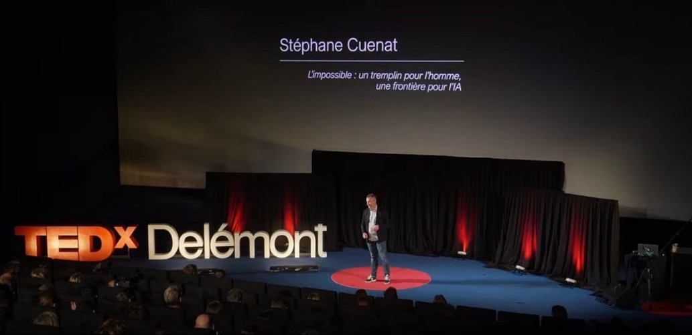

```{=html}
<section class="profile">
  <div class="profile-text">
    <p class="profile-kicker">À propos</p>
    <h1 class="profile-name">Stéphane Cuenat</h1>
    <p class="profile-role">Principal Software Architect · Docteur en informatique · Porrentruy, Jura suisse</p>
    <p class="profile-links">
      <a href="https://www.linkedin.com/in/st%C3%A9phane-cuenat-87116b5/">LinkedIn</a>
      <a href="https://www.linkedin.com/newsletters/ai-honestly-7484605558868844544">Newsletter</a>
      <a href="https://www.femto-st.fr/fr/femto-people/stephanecuenat">FEMTO-ST</a>
      <a href="https://www.researchgate.net/profile/Stephane-Cuenat">ResearchGate</a>
      <a href="https://github.com/scuenat/scuenat.github.io">GitHub</a>
    </p>
  </div>
  <a class="profile-photo" href="talks.html"><span>Sur la scène de TEDxDelémont</span></a>
</section>
<ul class="profile-facts">
  <li><strong>Principal Software Architect</strong><span>Mastercam, l'IA dans les logiciels de FAO</span></li>
  <li><strong>Docteur en informatique</strong><span>FEMTO-ST, apprentissage profond et holographie</span></li>
  <li><strong>SwissCube</strong><span>Le premier satellite suisse, au début de ma carrière</span></li>
  <li><a href="talks.html"><strong>TEDxDelémont</strong><span>L'impossible : un tremplin pour les humains, une frontière pour l'IA</span></a></li>
</ul>
```

Je suis Stéphane Cuenat et je vis à Porrentruy, dans le Jura suisse. Le jour, je suis Principal Software Architect chez Mastercam, où je travaille sur Mastercam Copilot, pour amener l'IA dans les logiciels de FAO. Auparavant, j'ai dirigé des équipes de développement et de recherche, et au début de ma carrière, j'ai eu la chance de participer à SwissCube, le premier satellite suisse.

Je suis titulaire d'un doctorat en informatique de FEMTO-ST et de l'Université Marie et Louis Pasteur (anciennement Université de Franche-Comté), et j'écris toujours des articles de recherche avec FEMTO-ST, en particulier avec Raphaël Couturier. Les articles, la thèse et les données sont [plus bas](#research).

## Ce site {#site}

Ce site est l'endroit où je réfléchis à voix haute. J'écris sur ce que l'IA change vraiment et sur ce qu'elle ne change pas : l'apprentissage et le temps qu'il demande, pourquoi nous avons besoin de moins de données plutôt que de plus, ce que les machines peuvent reconstruire ou non, et ce que signifie la sagesse à côté de l'intelligence. Ces derniers temps, cela a pris cinq directions : ce que les agents changent dans la construction des logiciels et dans les équipes qui les entourent, pourquoi de petits modèles rapides et locaux peuvent faire plus qu'on ne le pense, ce qui reste à nous quand les machines font davantage du travail, ce qu'un tableau de bord devrait vraiment montrer, et, certains soirs, la physique. Certains textes sont de courts essais tirés de ma newsletter [*AI, Honestly*](https://www.linkedin.com/newsletters/ai-honestly-7484605558868844544) (en anglais). D'autres sont des documents de travail plus longs, souvent avec le code et les données pour les vérifier.

```{=html}
<nav class="ways-in" aria-label="Entrées dans le site">
  <a href="index.html#par-où-commencer"><strong>Par où commencer</strong><span>Quelques textes choisis pour une première visite</span></a>
  <a href="series.html"><strong>Séries</strong><span>Une question, pas à pas, comme Le codage agentique</span></a>
  <a href="index.html#topics"><strong>Thèmes</strong><span>Les textes regroupés par sujet</span></a>
  <a href="archive.html"><strong>Tous les textes</strong><span>Tout, du plus récent au plus ancien, avec des filtres</span></a>
</nav>
```

Les textes existent aussi [en anglais](../index.qmd), la langue dans laquelle ils sont écrits. Les idées m'intéressent plus que l'emballement : les objections et les contre-arguments sont toujours les bienvenus.

**Comment j'écris.** Les questions, les idées et les arguments présentés ici sont les miens, tout comme la responsabilité qui va avec. Mais je n'écris pas seul : j'utilise l'IA pour mettre mes idées à l'épreuve, les façonner, resserrer le texte et m'aider avec le code et les expériences. Les versions françaises sont traduites automatiquement de l'anglais avec l'IA et peuvent contenir quelques erreurs ; en cas de doute, le texte anglais fait foi. Il serait étrange d'écrire honnêtement sur l'IA en le cachant.

### Ce que j'écris {#kinds}

Chaque texte porte une petite étiquette sur sa carte, pour savoir à quoi s'attendre avant de commencer :

- **Essai.** Une idée, défendue à la première personne. Il peut être personnel, spéculatif ou philosophique, et il dit honnêtement ce qui relève de l'opinion. Dix à vingt minutes.
- **Analyse.** Une lecture attentive d'un article, d'un billet ou d'un système, ou un document de travail qui met une idée à l'épreuve avec un modèle, des données ou une simulation. Les chiffres sont sourcés ou calculés, et les limites sont dites.
- **Note.** Court et pratique. Elle assemble des idées existantes en quelque chose que l'on pourrait construire cette semaine, donne la recette et dit comment vérifier que cela fonctionne.
- **Article de position.** Une thèse volontairement provocatrice, sous la forme d'un court article scientifique : une affirmation précise, des arguments et souvent un modèle, et des prédictions qui pourraient la réfuter.
- **Panorama.** Une carte d'un domaine de recherche : les grandes lignes de travail, leurs liens, ce qui est établi et ce qui reste ouvert, construite à partir de sources librement accessibles et citées tout du long. Une porte d'entrée, pas un verdict.

## Recherche {#research}

Mes recherches portent sur une question : comment un petit réseau de neurones peut-il lire une position 3D précise directement dans un hologramme ? Un microscope holographique numérique enregistre un objet en une seule prise, mais trouver où se trouve l'objet demande d'habitude de reconstruire une pile d'images et de chercher la plus nette. C'est lent. Les articles ci-dessous remplacent cette recherche par de petits réseaux transformers et convolutifs qui déduisent directement la distance de mise au point et la pose : à environ un micromètre près, en quelques millisecondes, sur un CPU ordinaire.

Ce travail a été mené à [FEMTO-ST](https://www.femto-st.fr/fr/femto-people/stephanecuenat) à Besançon, avec Raphaël Couturier, Maxime Jacquot, Patrick Sandoz et Guillaume J. Laurent, et il est devenu ma thèse de doctorat. J'écris toujours des articles avec l'institut ; les plus récents, avec Rémi Kieber et Mohammad Saim Khan, intègrent la physique de la lumière dans les réseaux eux-mêmes. La même conviction traverse les essais de ce site, le plus directement [Fast AI](posts/2026-10-11-fast-ai/index.qmd) : apprendre lentement, une fois ; agir vite, à chaque fois.

Les titres et les références des publications restent dans leur langue d'origine.

::: {#publications}
:::

Les nouvelles publications apparaîtront ici dès leur parution. Les travaux qui ne sont pas encore publics figurent sous *En cours*, avec leur question mais sans leurs résultats. Les textes plus longs de ce site qui mettent une idée à l'épreuve avec code et données sont les [documents de travail](archive.qmd#category=article).

## Réutilisation {#reuse}

Les essais, documents de travail et figures de ce site sont sous licence [CC BY 4.0](https://creativecommons.org/licenses/by/4.0/deed.fr) : vous pouvez les partager, les traduire et les adapter, y compris à des fins commerciales, à condition de citer Stéphane Cuenat et de mettre un lien vers l'original. Le code (scripts des figures, simulations, expériences) est sous [licence MIT](https://github.com/scuenat/scuenat.github.io/blob/main/LICENSE). Citations, traductions et contre-arguments sont les bienvenus.

*Les opinions exprimées ici sont les miennes et non celles de mon employeur.*

*Ce site compte les visites de façon anonyme avec [GoatCounter](https://www.goatcounter.com) : pas de cookies, pas de données personnelles, pas de suivi d'un site à l'autre.*
