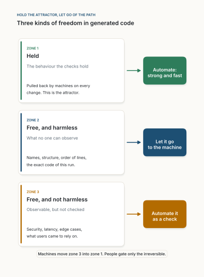

::: {.callout-warning appearance="simple"}
**Article de position, novembre 2026. Provocateur à dessein.** La thèse est énoncée plus nettement que les preuves ne le permettent encore, pour ouvrir un débat. Ce n'est pas une mise en garde contre le codage par IA ; c'est une remise en cause de la façon dont nous l'utilisons. Il prolonge [Arrêtez de relire les pull requests](../../posts/2026-10-23-stop-reviewing-pull-requests/index.qmd) et [Relire l'intention, pas le diff](../../posts/2026-10-22-review-the-intent-not-the-diff/index.qmd). Les figures 1 à 3 viennent des simulations de [sim.py](../../../drafts/let-the-code-be-chaotic/sim.py) (nombres dans [results.json](../../../drafts/let-the-code-be-chaotic/results.json)) ; les figures 4 et 5 sont des schémas de moi. Les figures sont en anglais. *Traduit automatiquement de l'anglais ; quelques erreurs sont possibles. [Version originale](../../../drafts/let-the-code-be-chaotic/index.qmd).*
:::

**Résumé.** Les agents d'IA résolvent désormais la plupart des tickets réels du banc d'essai de référence, et écrivent une large part du nouveau code dans de grandes entreprises. Pourtant, le contrôle par défaut n'a pas changé : une personne lit chaque modification. Je soutiens que cela place les humains au mauvais endroit. Le code généré est chaotique : de petites différences de prompt ou de contexte donnent des programmes très différents. C'est le plus souvent sans conséquence. La stabilité vient d'un *attracteur*, des vérifications qui ramènent le comportement à la promesse après chaque modification, pas d'une trajectoire prévisible. Les machines devraient faire tourner cette boucle partout. Les humains ne gardent que l'irréversible, et pour le reste se placent au-dessus de la boucle : ils fixent la promesse, les vérifications exigées, la structure et la direction.

::: {.callout-tip appearance="simple" icon="false"}
## Thèses

1. **Provocation.** Cessez de lire chaque ligne qu'écrit une IA. Son imprévisibilité est réelle et le plus souvent sans conséquence.
2. **Stabilité.** Elle vient de vérifications rapides qui ramènent le comportement à la promesse (un attracteur), ni d'une génération déterministe ni d'une lecture attentive.
3. **Trois zones, toutes automatisées.** Les machines tiennent ce qui est vérifié, ignorent ce que personne ne peut observer, et transforment ce qui est observable mais non vérifié en vérifications.
4. **Une mince barrière.** Les humains n'approuvent que l'irréversible : supprimer des données, déplacer de l'argent, mettre en production, ajouter une dépendance.
5. **Les humains au-dessus de la boucle.** Ni dedans, ni absents : ils guident et structurent l'ensemble. Le niveau de leur travail change, pas son importance.
6. **La sécurité aussi.** Elle se tient de la même façon : vérifications automatisées, bacs à sable, et une barrière au point de non-retour.
:::

## 1. Une année remarquable, une habitude inchangée

Ce que la dernière année a accompli :

- **Les agents résolvent de vrais tickets.** Sur SWE-bench Verified (500 vrais tickets GitHub), le meilleur modèle en résolvait 33,2 % en août 2024 [@openai2024] et 80,9 % en novembre 2025 [@anthropic2025].
- **L'IA écrit du code de production.** Plus d'un quart du nouveau code de Google était généré par l'IA fin 2024 [@pichai2024].
- **L'adoption est la norme.** 84 % des développeurs utilisent des outils d'IA ou prévoient de le faire [@stackoverflow2025].

Ce qui n'a pas changé : la phrase de Google continue, le code est *« puis relu et accepté par des ingénieurs »* [@pichai2024]. C'est la norme du secteur. Nous avons construit un générateur qui écrit en quelques minutes ce qui prenait des jours à une équipe, et gardé une personne à sa sortie pour en lire chaque ligne. La confiance est faible (46 % des développeurs se méfient de l'exactitude de l'IA, 33 % lui font confiance [@stackoverflow2025]), et la réponse habituelle à la méfiance, c'est de lire davantage.

La provocation :

> **Cessez de lire chaque ligne qu'écrit votre IA. Automatisez la boucle, gardez une mince barrière, et placez les humains au-dessus.**

L'objection habituelle tient en un mot : *chaos*. Le code généré n'est pas reproductible. La même tâche de programmation, envoyée plusieurs fois au même modèle, renvoie souvent des programmes qui se comportent différemment, même à température nulle [@ouyang2023] ; même un service « déterministe » varie selon la façon dont les requêtes sont regroupées [@he2025]. Cet article prend *chaos* au pied de la lettre, et soutient que c'est une bonne nouvelle.

## 2. Ce que disent les faits

À la question *où les choses tournent-elles mal ?*, la recherche depuis 2021 répond de façon cohérente :

- **Le domaine juge déjà le comportement, pas le code.** HumanEval note les programmes sur leur réussite aux tests (pass@k), pas sur leur ressemblance avec une référence [@chen2021] ; SWE-bench compte un correctif si les tests du dépôt passent [@jimenez2024]. Les progrès ci-dessus sont des progrès *mesurés par des vérifications*.
- **Des tests faibles cachent du code faux.** Ajouter des tests à HumanEval a fait baisser les taux de réussite de 19 à 29 % sur 26 modèles [@liu2023]. Le code n'avait pas changé ; la vérification, si.
- **La sécurité échoue là où rien ne vérifie.** Environ 40 % des programmes de Copilot dans des scénarios sensibles contenaient une faiblesse connue [@pearce2022]. Les utilisateurs d'assistants écrivaient du code moins sûr et se sentaient *plus* confiants [@perry2023]. Les modèles proposent des paquets inexistants (au moins 5,2 % pour les modèles commerciaux, 21,7 % pour les modèles ouverts) que des attaquants peuvent enregistrer [@spracklen2025].
- **Vitesse et stabilité sont contrastées.** Les utilisateurs de Copilot ont été 55,8 % plus rapides sur une tâche contrôlée [@peng2023] ; des développeurs expérimentés sur des projets matures ont été 19 % plus lents tout en se croyant plus rapides [@becker2025]. DORA a associé une adoption plus large de l'IA à une stabilité des livraisons inférieure de 7,2 %, probablement à cause de modifications plus grosses [@dora2024]. Le code copié-collé augmente et le remaniement recule [@gitclear2025].
- **Les vérifications peuvent être générées.** TestGen-LLM, chez Meta, a étendu des suites de tests ; 73 % de ses propositions filtrées ont été acceptées pour la production [@alshahwan2024].

**Lecture.** Presque aucun de ces échecs n'est *le fait que le code diffère de ce qu'une personne aurait écrit*. Ce sont du comportement non vérifié, une rétroaction tardive et une masse accumulée. Aucun n'a été évité parce qu'une personne lisait le diff.

## 3. L'image : un attracteur

Lorenz a montré en 1963 qu'un modèle météorologique simple et déterministe ne se prévoit pas longtemps [@lorenz1963]. L'autre moitié de sa leçon compte davantage ici : toutes les trajectoires imprévisibles vivent sur la *même forme*, l'attracteur, et le climat du modèle est stable [@strogatz2015] (figure 1). L'ingénierie du chaos de Netflix applique la même idée au logiciel : injecter volontairement des pannes, et ne juger le système que sur le maintien d'un *état stable* [@basiri2016].

.](../../../drafts/let-the-code-be-chaotic/figures/fig01.svg){fig-alt="Deux panneaux. En haut, une courbe de x en fonction du temps, de 0 à 40, pour deux exécutions, bleu marine et ambre. Les courbes se superposent exactement jusqu'à une ligne pointillée vers le temps 18, marquée « paths part », puis oscillent indépendamment entre moins 18 et plus 18. En bas, la projection x–z des deux exécutions après le temps 20 : deux spirales en forme de papillon, bleu marine et ambre, qui remplissent la même forme à deux lobes. Une note en bas à gauche indique « average height z: 23.6 and 23.4 »."}

Pour le code généré, l'image donne trois zones :

| Zone | Ce que c'est | Exemples |
|---|---|---|
| **1. Tenue** | Le comportement que les vérifications contrôlent ; ramené à chaque modification. L'attracteur. | Tests, types, contrats, scanners, budgets |
| **2. Libre, sans danger** | Ce que personne ne peut observer de l'extérieur. | Noms, structure, ordre des lignes, choix entre algorithmes équivalents |
| **3. Libre, pas encore sans danger** | Le comportement observable qu'aucune vérification ne tient encore. Il dérive avec le code. | Propriétés de sécurité, latence, cas limites, ce sur quoi comptent les utilisateurs |

: **Tableau 1.** Trois zones de liberté dans le code généré. {tbl-colwidths="[24,42,34]"}

Contrôler la zone 2 n'achète presque aucune stabilité. Faire passer la zone 3 dans la zone 1 en achète presque toute. Les deux sont des travaux que les machines peuvent faire à chaque modification, plus vite que n'importe quel relecteur.

::: {.callout-note collapse="true" appearance="simple"}
## Pour qui aime les équations

Le code est un état $x$ ; le comportement, une observation plus petite $y = \phi(x)$. La plupart des directions de $x$ ne changent rien à $y$ (zone 2, le noyau de $\phi$). Si l'agent écarte le comportement à un taux $\lambda$, et si chaque cycle de vérification et de correction, de durée $\Delta t$, supprime une part $\kappa$ de l'erreur, le comportement vérifié tient quand

$$
-\frac{\ln(1-\kappa)}{\Delta t} \;>\; \lambda ,
$$

la condition de synchronisation des systèmes chaotiques [@pecora1990]. Elle récompense un $\kappa$ élevé et un $\Delta t$ court : une vérification automatique dans la session de l'agent, pas une lecture humaine lente.
:::

## 4. Une expérience jouet

Un agent jouet chaotique [@sompolinsky1988] écrit un « code » de 300 nombres ; le « comportement » est fait de 30 nombres calculés à partir de lui ; des « tests » vérifient une partie des 30 et corrigent 80 % de l'erreur après chaque étape. Rien d'autre n'est contrôlé.

- **Deux exécutions parties à $10^{-8}$ l'une de l'autre** finissent avec des codes sans rapport, tandis que le comportement testé reste dans une bande environ cent fois plus étroite ; le comportement non testé dérive avec le code (figure 2).
- **La couverture, pas le déterminisme.** À couverture complète, l'erreur de comportement tombe à 2,7 % du niveau sans tests, tandis que les codes des différentes exécutions restent entre 66 et 99 % aussi différents que des programmes sans rapport (figure 3a).
- **La boucle compte, pas le chaos.** Sur sept niveaux de chaos, l'erreur ne dépend que de la fermeté de la correction (figure 3b).

.](../../../drafts/let-the-code-be-chaotic/figures/fig02.svg){fig-alt="Courbes en échelle logarithmique de la distance entre deux exécutions en fonction du temps, de 0 à 250. Une courbe bleu marine, le code, monte depuis 1e-8 de façon à peu près exponentielle, annotée « grows like e^0.12 t », et se stabilise vers 10 après le temps 140, marquée « as far apart as two unrelated programs ». Une courbe ambre, le comportement qu'aucun test ne vérifie, monte avec elle et se stabilise vers 2. Une courbe verte, le comportement que les tests vérifient, monte depuis moins de 1e-9 et se stabilise vers 0,1, marquée « held within a narrow band »."}

.](../../../drafts/let-the-code-be-chaotic/figures/fig03.svg){fig-alt="Deux graphiques empilés. En haut, panneau a : en abscisse, « share of the observable behaviour that tests check », de 0 à 100 %. Une courbe grise, « how different the code is between runs », part de près de 1,0 et se stabilise autour de 0,7. Une courbe bleu marine, « how far behaviour is from the spec », part de 1,0, baisse lentement jusqu'à environ 0,7 à 60 %, puis fortement jusqu'à 0,03 à 100 %. En bas, panneau b : en abscisse, la force de la boucle kappa de 0,05 à 1,0 ; en ordonnée, l'erreur de comportement relative à l'absence de tests. Sept courbes superposées, pour des gains g de 1,5 à 5, descendent ensemble d'environ 0,65 à kappa 0,05 à 0,3 à 0,2, 0,14 à 0,4, 0,03 à 0,8 et 0 à 1,0."}

Un jouet ne prouve rien sur de vraies bases de code. Il montre que l'image est cohérente, et que la couverture et la vitesse de rétroaction, que l'automatisation fournit, décident du résultat.

## 5. Automatiser les zones, garder une mince barrière

{fig-alt="Trois cartes empilées, chacune avec une flèche vers une case colorée. Zone 1, verte, « Held » : le comportement que les vérifications tiennent ; ramené par les machines à chaque modification, c'est l'attracteur ; case : « Automate: strong and fast ». Zone 2, bleu marine, « Free, and harmless » : ce que personne ne peut observer ; noms, structure, ordre des lignes, code exact de cette exécution ; case : « Let it go to the machine ». Zone 3, ambre, « Free, and not harmless » : observable mais non vérifié ; sécurité, latence, cas limites, ce sur quoi les utilisateurs comptent ; case : « Automate it as a check ». En bas : « Machines move zone 3 into zone 1. People gate only the irreversible. »"}

- **Zone 1, automatisée.** Les vérifications tournent dans la session de l'agent après chaque modification ; l'agent lit les échecs et les corrige. Les mêmes vérifications, lancées plus tôt, tiennent davantage.
- **Zone 2, laissée à la machine.** Si une structure compte pour quelqu'un (un budget de taille, une frontière, une dépendance interdite), elle est observable et devient une vérification de la zone 1. Sinon, ce n'est pas un problème.
- **Zone 3, réduite par les machines.**
  - Des agents étendent les tests, filtrés comme chez Meta : ils doivent compiler, passer de façon fiable et ajouter de la couverture [@alshahwan2024].
  - Les tests de mutation mesurent la fermeté des vérifications [@petrovic2018] ; les tests de propriétés tiennent des familles entières de comportements [@claessen2000].
  - *Exercices de régénération* : régénérer un module à partir de sa promesse et de ses vérifications, comparer l'ancienne et la nouvelle version sur des entrées aléatoires (test différentiel [@mckeeman1998]) ; chaque désaccord est un morceau de zone 3, et une vérification manquante.
  - L'usage réel devient des tests de contrat, pour suivre la loi de Hyrum : tout ce qui est observable finira par être utilisé [@winters2020].
  - Un audit quotidien de l'ensemble du code, comme dans [Arrêtez de relire les pull requests](../../posts/2026-10-23-stop-reviewing-pull-requests/index.qmd).
- **Une mince tranche, gardée par des humains.** Seulement les actions dont le dommage survit à un retour arrière : supprimer ou migrer des données, paiements, mises en production, octroi d'accès, nouvelles dépendances. Une personne décide au point de non-retour, avec les éléments que les machines ont rassemblés. *Approuvez ce que vous ne pouvez pas défaire ; surveillez tout le reste.*

## 6. Les humains au-dessus de la boucle

Hors de la boucle ne veut pas dire hors du système. **L'humain est toujours là, au-dessus de la boucle, à guider et à structurer l'ensemble.** Le niveau du travail change, pas son importance.

{fig-alt="Trois cartes empilées. En haut, bleu marine, « Above the loop · people, continuously » : « Guide and structure » ; la promesse, les vérifications qui doivent exister, budgets et indicateurs, architecture et frontières, quoi construire ensuite, quoi retirer. Une flèche pleine vers le bas marquée « sets the attractor », et une flèche pointillée vers le haut marquée « metrics, drills, incidents ». Au milieu, verte, « The loop · machines, on every change » : « Generate, check, fix » ; les agents écrivent le code et les tests, les vérifications tournent dans la session, scanners et budgets, exercices de régénération, audit quotidien ; une flèche courbe à droite indique le cycle. Une flèche ambre vers le bas marquée « only what cannot be undone » mène à la carte du bas, « The gate · people, rarely » : « Decide the irreversible » ; suppression de données, paiements, mises en production, nouvelles dépendances. En bas : « People leave the loop, not the system: they move up a level. »"}

Au-dessus de la boucle, les humains :

- **Possèdent la promesse.** L'intention est la source ; le code en est le produit ([L'intention est la source](../../posts/2026-10-21-intent-is-the-source/index.qmd)). La compréhension vient de la promesse, pas des diffs ([Relire l'intention, pas le diff](../../posts/2026-10-22-review-the-intent-not-the-diff/index.qmd)).
- **Décident des vérifications qui doivent exister.** Pas de chaque test, que les agents écrivent, mais de ce qui doit toujours tenir : propriétés, frontières, budgets, règles de sécurité.
- **Structurent le système.** L'architecture et les dépendances sont la forme de l'attracteur ; une fois décidées, elles deviennent des vérifications.
- **Lisent les instruments.** Défauts échappés, scores de mutation, durée des boucles, exercices, incidents. Ils modifient le système qui produit le code, pas chaque modification, comme le soutenait [Fast AI](../../posts/2026-10-11-fast-ai/index.qmd) : le travail lent et soigné fait une fois, pour que le chemin rapide tourne seul.
- **Choisissent quoi construire et quoi retirer.** Fabriquer ne coûte plus grand-chose ; choisir, si ([La joie de la question](../../posts/2026-10-27-the-joy-of-the-question/index.qmd), [Le travail a une masse](../../posts/2026-10-24-work-has-mass/index.qmd)).

Une personne qui lit mille lignes par jour protège mille lignes. Une personne qui fait de « chaque point d'accès a un test d'autorisation » une vérification protège chaque ligne que tous les agents écriront jamais à cet endroit.

## 7. Ce que cela veut dire pour une équipe

**L'équipe possède** la promesse, les vérifications et les barrières, pas le texte du code. Si elle ne peut pas régénérer un module à partir de ces éléments, elle ne le possède pas vraiment.

| Arrêter | Commencer |
|---|---|
| Lire chaque diff généré comme contrôle par défaut | La promesse et les vérifications exigées avant que l'agent construise |
| Exiger une génération reproductible [@he2025] | Toutes les vérifications dans la session de l'agent |
| Les débats de style dont rien ne dépend | Des machines qui trouvent la zone 3 : tests de mutation, exercices, contrats tirés de l'usage, audit quotidien |
| Demander « qui a écrit cette ligne ? » | Demander « quelle vérification manquait ? » |
| Compter les lignes relues | Des budgets de taille, de duplication et de couplage [@gitclear2025] |
| | Une courte liste écrite de barrières |

: **Tableau 2.** Ce qui change pour une équipe. {tbl-colwidths="[45,55]"}

**Les rôles.** Chaque module a un responsable de son attracteur : la promesse, les vérifications exigées, les barrières. Les ingénieurs sécurité et plateforme possèdent les vérifications partagées que toute session d'agent exécute. Personne ne répond de la lecture de chaque ligne.

**Les indicateurs.**

- Défauts échappés, classés par zone (comportement non vérifié, ou vérifications faibles).
- Score de mutation : la fermeté des vérifications.
- Délai entre une modification et le résultat des vérifications : la vitesse de la boucle.
- Accord de comportement entre régénérations : ce qui reste de la zone 3.
- Part des modifications passées par une barrière humaine : est-elle toujours mince ?
- Évolution de la taille, de la duplication et du couplage : le code prend-il de la masse ?

**Un test de toute l'idée.** Supprimez un module et régénérez-le à partir de sa promesse et de ses vérifications. Le livreriez-vous sans le lire ? Sinon, vos raisons sont les vérifications qui vous manquent, et cette liste est le vrai carnet de travail de l'équipe.

## 8. La sécurité et le reste, en bref

La sécurité n'est pas une exception. C'est la part la plus importante de la zone 3, et elle se tient de la même façon.

| Exigence | Comment la tenir | Qui agit |
|---|---|---|
| Injections, API dangereuses, faiblesses connues [@pearce2022] | Analyse statique et linters de sécurité dans chaque session ; tests de sécurité par point d'entrée | Les machines |
| Secrets | Détection des secrets avant que quoi que ce soit ne quitte la session ; aucun identifiant à portée de l'agent | Les machines |
| Chaîne d'approvisionnement [@spracklen2025] | Listes autorisées de paquets et de registres, fichiers de verrouillage, contrôle de provenance | Les machines ; une personne approuve une *nouvelle* dépendance |
| Contrôle d'accès, vie privée | Tests d'autorisation par point d'accès ; contrôle des flux de données ; règles sous forme de code | Les machines ; les humains fixent les règles |
| L'agent lui-même | Sessions en bac à sable ; jamais à la fois des données privées, une entrée non fiable et un moyen de sortir ([Le contexte est le fil](../../posts/2026-11-01-the-context-is-the-wire/index.qmd)) | Les machines appliquent ; les humains fixent la règle |
| Actions irréversibles | Suppression de données, paiements, mises en production | Une personne, à la barrière |
| Performance, coût | Budgets de latence, de mémoire et de coût, vérifiés comme des tests | Les machines ; les humains fixent les budgets |
| Maintenabilité | Budgets de taille, de duplication et de couplage ; règles d'architecture sous forme de tests | Les machines ; les humains fixent la structure |
| Accessibilité, licences, conformité | Contrôles et analyses automatiques ; règles sous forme de code | Les machines ; les humains échantillonnent là où l'automatisation est faible |
| Goût, équité, sens du produit | Jugement sur la promesse et le produit | Les humains, au-dessus de la boucle |

: **Tableau 3.** La sécurité et les autres exigences : presque tout est tenu par les machines, quelques actions passent par une barrière, le reste se décide au-dessus de la boucle. {tbl-colwidths="[28,46,26]"}

Rien de tout cela ne dépend de quelqu'un qui lirait le code ; la relecture humaine manquait déjà ces failles avant l'IA, et les utilisateurs d'assistants devenaient plus confiants, pas plus prudents [@perry2023]. Une règle transformée en vérification protège chaque modification future ; une lecture attentive en protège une.

## 9. Prédictions

Chacune nomme ce qui la réfuterait.

- **P1. Régénération.** Le code régénéré varie beaucoup ; le comportement concorde sur les vérifications et diverge ailleurs en proportion de ce qui n'est pas vérifié. *Réfutée si* la ressemblance des codes prédit mieux le bon comportement que la couverture et le score de mutation.
- **P2. Échecs.** Les défauts échappés du code écrit par l'IA viennent surtout de la zone 3 ou de vérifications faibles, pas d'un « code à l'allure étrange ». *Réfutée si* l'impression de code inhabituel des relecteurs les prédit mieux.
- **P3. L'automatisation bat la lecture.** L'effort consacré aux vérifications automatiques, aux tests de mutation et aux exercices évite plus de défauts échappés que le même effort consacré à lire des diffs. *Réfutée si* la lecture en évite au moins autant.
- **P4. Boucles rapides.** Les mêmes vérifications lancées dans la session de l'agent réduisent les défauts et les reprises par rapport à une intégration continue plus tardive. *Réfutée si* le moment ne fait aucune différence.
- **P5. Équipes.** Les équipes qui ne gardent que l'irréversible et travaillent au-dessus de la boucle livrent au moins aussi vite, sans plus d'incidents. *Réfutée si*, dans un essai en escalier comme dans [Arrêtez de relire les pull requests](../../posts/2026-10-23-stop-reviewing-pull-requests/index.qmd), elles ont plus d'incidents ou se rétablissent plus lentement.

## 10. Objections, en bref

- **« Sortir les humains de la boucle est imprudent. »** Ils quittent la boucle, pas le système, et gardent la barrière pour l'irréversible. L'imprudence, c'est la norme actuelle : un contrôle lent et partiel à chaque modification, qui n'attrape pas de façon fiable le code non sécurisé [@perry2023].
- **« C'est du hasard, pas du chaos. »** L'argument n'a besoin que de petites différences d'entrée qui grandissent et d'un code qui reste borné ; le code généré fait les deux à toute température [@ouyang2023; @he2025]. Le jouet est déterministe à dessein : même un déterminisme parfait ne rendrait pas le contrôle.
- **« Le comportement non testé est le danger. »** Oui ; c'est la thèse. Il se manifeste quand le code s'exécute, pas quand on le lit : des machines qui exécutent le code autrement le trouvent, et une vérification le tient.
- **« Tout ce qui est observable devient une dépendance. »** La loi de Hyrum fait grandir la zone 3 avec le temps [@winters2020]. Ce coût existe aussi pour le code écrit à la main, et l'automatisation le paie le mieux.
- **« Il faut bien lire le code. »** Parfois : incidents, audits, domaines sans vérifications. Lire reste permis ; ce n'est plus le contrôle par défaut.
- **« Les régénérations partagent des angles morts. »** C'est vrai [@knight1986]. La thèse n'est pas la redondance, mais que leurs *différences* sont surtout sans conséquence.
- **« Les vérifications peuvent être fausses. »** Un attracteur n'est pas une vérité. C'est pourquoi les humains ont leur place au-dessus de la boucle, à décider de ce qui doit tenir, pas dedans.
- **« Les résultats sont contradictoires. »** Comme on l'attendrait d'équipes qui ont adopté un générateur chaotique en gardant l'ancien contrôle [@peng2023; @becker2025; @dora2024]. P5 en est le test.

## 11. Conclusion

La dernière année a prouvé que les machines savent écrire du code qui fonctionne. Elle n'a pas encore changé l'endroit où se tiennent les humains pendant qu'elles le font : à la sortie, à lire.

Le code généré est la météo ; le comportement promis est le climat. Les humains n'ont pas besoin de prévoir chaque rafale. Ils décident du climat, construisent les instruments qui le maintiennent, et n'interviennent que là où le dommage serait irréversible.

**Automatisez la boucle, gardez une mince barrière, et placez les humains au-dessus.** Laissez le code être chaotique : l'essentiel du chaos n'a jamais été là où était le risque.

::: {.read-next}
**À lire ensuite** · [Arrêtez de relire les pull requests](../../posts/2026-10-23-stop-reviewing-pull-requests/index.qmd)
Le versant économique du même argument : approuvez ce que vous ne pouvez pas défaire, surveillez tout le reste.
:::

::: {.small}
*Les opinions exprimées dans cet article sont les miennes et ne décrivent aucun produit ni aucun projet de mon employeur.*
:::

## Références

::: {#refs}
:::
