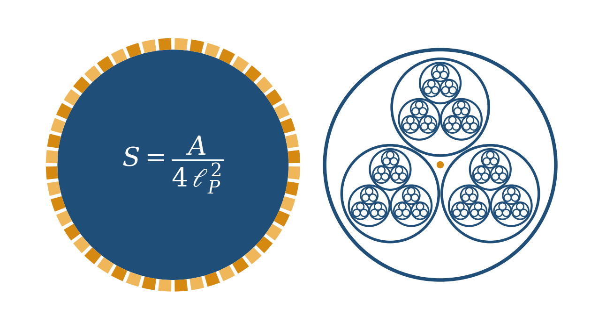
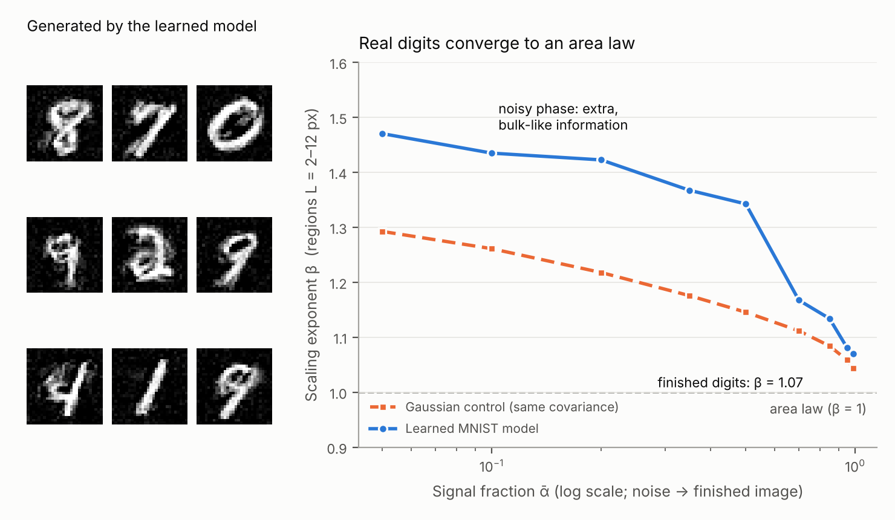
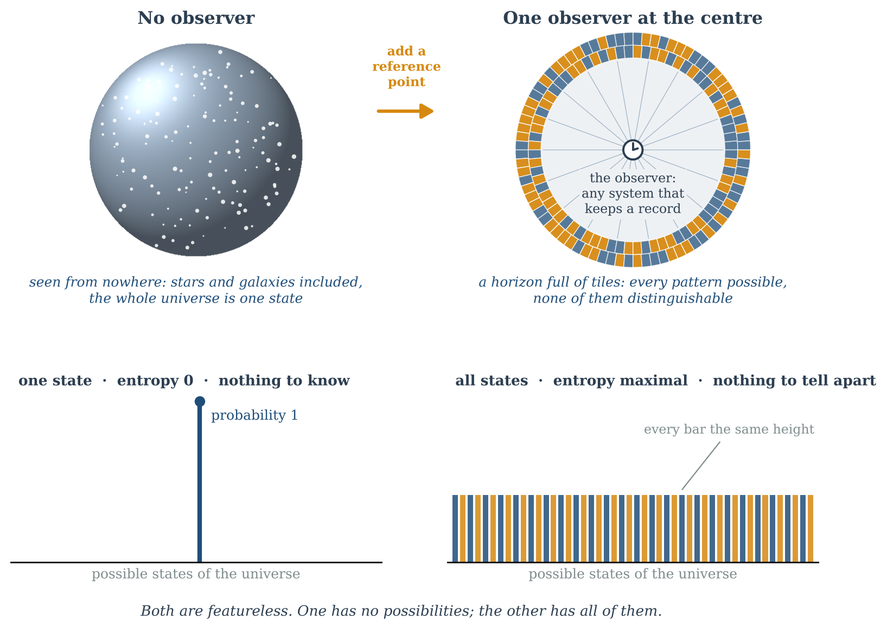
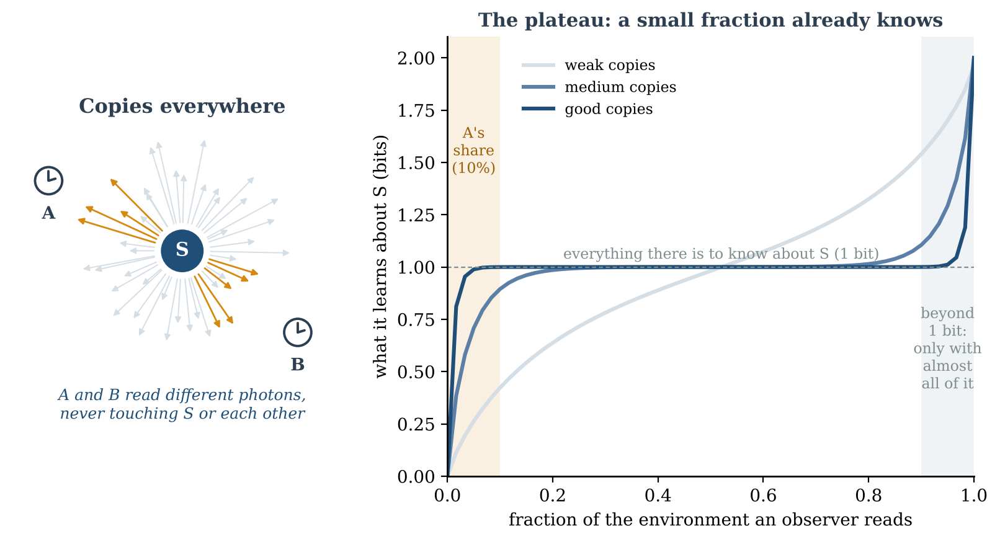
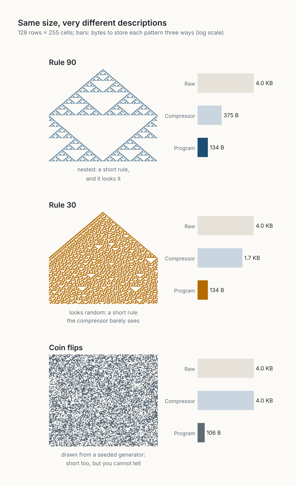

[← Toutes les séries](series.qmd){.series-back}

Ces quatre essais ne relèvent pas de mon domaine. Ils sont nés un soir, devant un article de physique que je n'arrivais pas à suivre, et d'une intuition qui ne me lâchait pas : *ça doit être plus simple que ça*. Je ne suis ni physicien ni mathématicien, et je le dis dans chacun d'eux. J'ai essayé de suivre les questions honnêtement, de vérifier ce qui pouvait l'être, et de les ramener à ce que je connais mieux : l'IA et le logiciel.

Chaque soirée commence là où la précédente s'est arrêtée. La deuxième transforme la question en expérience sur un générateur d'images. La troisième et la quatrième demandent ce qui change quand quelqu'un est à l'intérieur de l'univers, et regarde.

Si vous n'avez le temps d'en lire qu'un, lisez [Un univers sans fond](posts/2026-10-15-a-universe-without-a-bottom/index.qmd) : les autres en découlent.

```{=html}
<ol class="series-strip">
  <li><a href="#step-1"><span>1</span>La question</a></li>
  <li><a href="#step-2"><span>2</span>L'expérience</a></li>
  <li><a href="#step-3"><span>3</span>L'observateur</a></li>
  <li><a href="#step-4"><span>4</span>Deux observateurs</a></li>
</ol>
```

::: {.series-step data-step="1"}

```{=html}
<a class="series-step-media" href="posts/2026-10-15-a-universe-without-a-bottom/index.html" tabindex="-1" aria-hidden="true"></a>
```

## 1. La question : ça doit être plus simple que ça {#step-1}

**[Un univers sans fond](posts/2026-10-15-a-universe-without-a-bottom/index.qmd)** · *essai*

Une soirée avec *Holograms and Standard Models* de Miyashita, Sekino et Susskind, et les questions qu'il m'a laissées. L'information que contient un trou noir croît avec sa surface, pas avec son volume. Peut-être que le rien crée tout. Peut-être qu'il y a des grains dans les grains, sans dernière couche.

*À retenir : je n'ai pas trouvé la réponse. J'ai trouvé de meilleures questions.*

:::

::: {.series-step data-step="2"}

```{=html}
<a class="series-step-media" href="posts/2026-10-16-decided-in-the-bulk/index.html" tabindex="-1" aria-hidden="true"></a>
```

## 2. L'expérience : où une image garde son information {#step-2}

**[Décidé dans le volume, écrit sur le bord](posts/2026-10-16-decided-in-the-bulk/index.qmd)** · *essai*

Pendant qu'un générateur d'images transforme du bruit en image, où vit l'information de l'image : à l'intérieur d'une région, ou sur son bord ? J'ai mené l'expérience en une soirée, sur deux cœurs de CPU, avec une IA comme partenaire de laboratoire. Les images finies suivent une loi d'aire, comme les trous noirs. Mais les grandes décisions se prennent d'abord sur toute l'image, et ne se fixent que plus tard sur les bords.

*À retenir : décidé dans le volume, écrit sur le bord. Et une soirée suffit désormais pour tester une question hors de son domaine.*

:::

::: {.series-step data-step="3"}

```{=html}
<a class="series-step-media" href="posts/2026-10-23-nothing-from-outside/index.html" tabindex="-1" aria-hidden="true"></a>
```

## 3. L'observateur : rien du dehors {#step-3}

**[Rien du dehors, tout du dedans](posts/2026-10-23-nothing-from-outside/index.qmd)** · *essai*

Les deux idées de la première soirée n'en font qu'une. Le « rien » n'est pas vide : c'est l'état qui contient le plus de possibilités. Un univers fermé vu de nulle part n'a qu'un seul état. Placez un observateur à l'intérieur, et les possibilités reviennent.

*À retenir : il n'y a pas de point de vue de nulle part. Ce qui existe existe pour quelqu'un, à l'intérieur.*

:::

::: {.series-step data-step="4"}

```{=html}
<a class="series-step-media" href="posts/2026-10-27-what-survives-comparison/index.html" tabindex="-1" aria-hidden="true"></a>
```

## 4. Deux observateurs : ce qui survit à la comparaison {#step-4}

**[Ce qui survit à la comparaison](posts/2026-10-27-what-survives-comparison/index.qmd)** · *essai*

Un lecteur a demandé : si deux observateurs, dans un même univers fermé, tiennent chacun leurs propres archives, finissent-ils par s'accorder sur un seul monde ? Personne ne détient l'exemplaire de référence, donc le monde ne peut pas garantir l'accord. Les observateurs doivent le produire, en comparant leurs archives à la bonne échelle.

*À retenir : un accord est toujours un accord pour quelqu'un.*

:::

## Après la série

::: {.series-step .is-followup}

```{=html}
<a class="series-step-media" href="../posts/2026-11-08-it-must-be-simpler-than-this/index.html" tabindex="-1" aria-hidden="true"></a>
```

**[It Must Be Simpler Than This](../posts/2026-11-08-it-must-be-simpler-than-this/index.qmd)** (en anglais) · *article de position* · prolonge la première soirée

L'intuition de cette première soirée, transformée en thèse que l'on peut tester. Ce que nous appelons complexe est souvent une règle courte vue au mauvais niveau, dans le mauvais repère, ou sous des couches que nous avons gardées. Une mesure, une règle, et des prédictions qui pourraient la réfuter.

*À retenir : l'essentiel de la complexité est dans la description, pas dans la chose.*

:::

## Le fil

Chaque soirée a rapproché la question un peu plus de chez moi. D'une surface qui sait tout, à un générateur d'images sur mon ordinateur, à un observateur qui doit être à l'intérieur, à deux observateurs qui doivent comparer. Et dessous, la même intuition chaque fois : ça doit être plus simple que ça. Pas simple au sens de facile, mais plus simple vu sous un autre angle.

La même intuition traverse le reste du site, de [Montrer ce qui a changé, pas les données](posts/2026-09-29-show-what-changed/index.qmd) au [Codage agentique](agentic-coding.qmd). Physiciens qui lisez ceci : les corrections sont les bienvenues.
