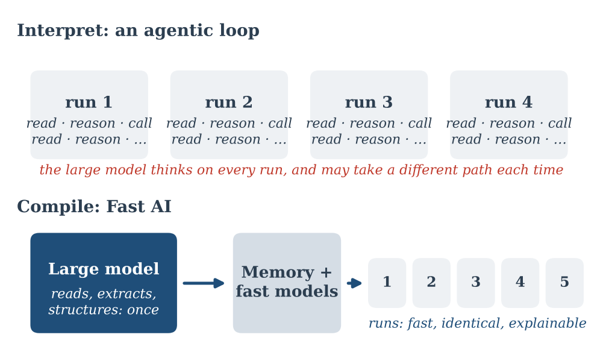
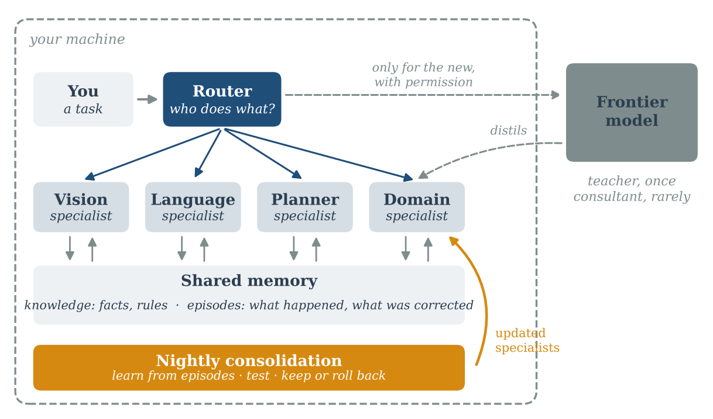
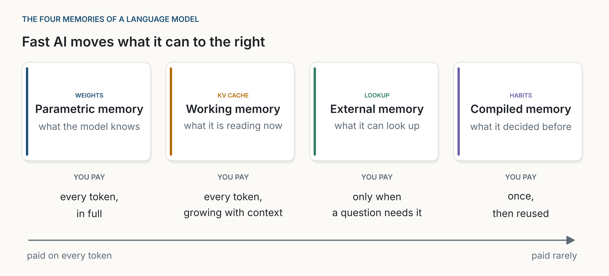
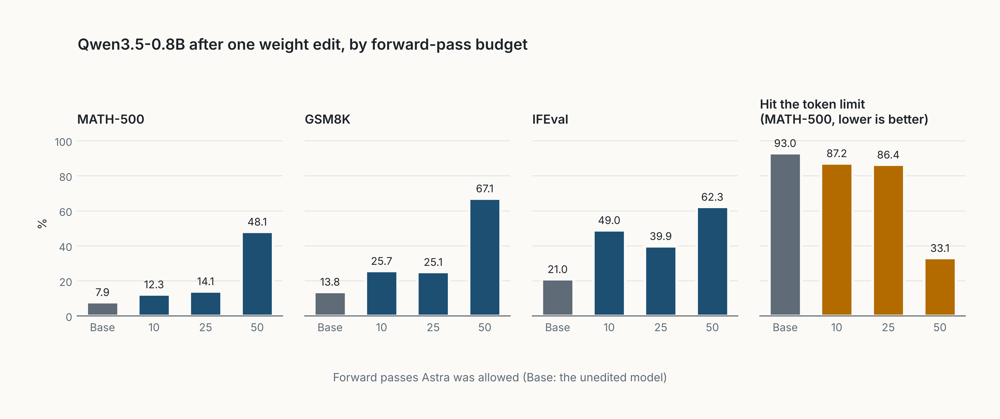
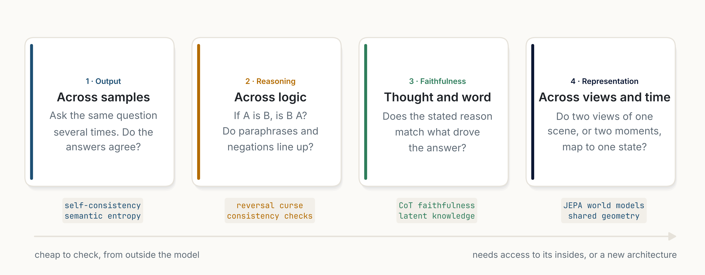
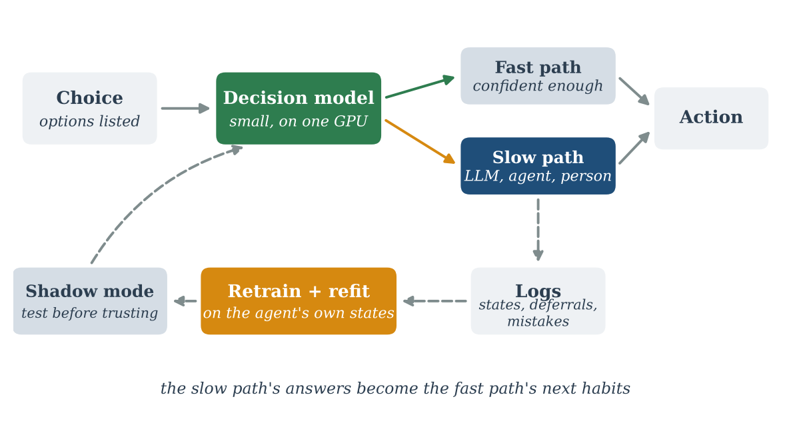
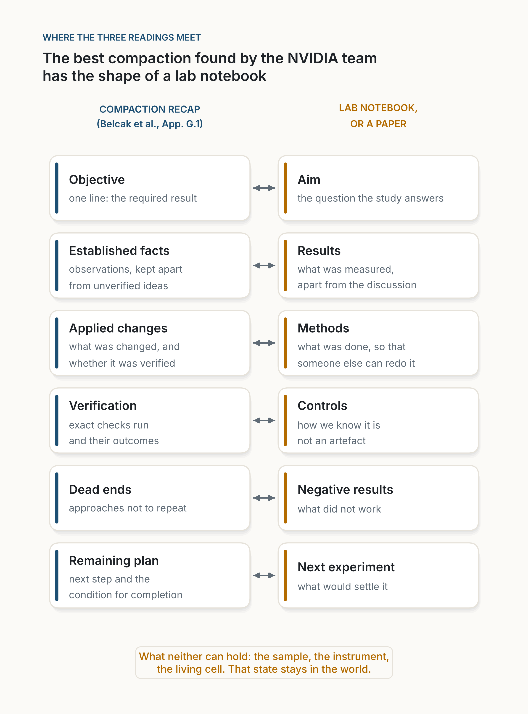

[← Toutes les séries](series.qmd){.series-back}

Les experts apprennent lentement, une fois, puis agissent vite, par habitude. La plupart des IA font aujourd'hui l'inverse : elles raisonnent à partir de zéro à chaque exécution. Ces quatre textes suivent une idée, qu'une IA devrait apprendre lentement et agir vite, d'un principe jusqu'à une architecture que l'on pourrait faire tourner sur sa propre machine.

Ils vont du général au concret. D'abord le principe. Puis la forme du système : beaucoup de petits spécialistes, pas un grand modèle réduit. Puis la question que tout petit système rencontre en premier : quoi retenir, et où. Et enfin, une nouvelle façon d'enseigner aux petits modèles : un grand modèle qui écrit directement leurs poids.

Si vous n'avez le temps d'en lire qu'un, lisez [Fast AI](posts/2026-10-11-fast-ai/index.qmd) : il porte l'idée, et les autres s'appuient dessus.

```{=html}
<ol class="series-strip">
  <li><a href="#step-1"><span>1</span>Le principe</a></li>
  <li><a href="#step-2"><span>2</span>L'écosystème</a></li>
  <li><a href="#step-3"><span>3</span>La mémoire</a></li>
  <li><a href="#step-4"><span>4</span>Le maître</a></li>
</ol>
```

::: {.series-step data-step="1"}

```{=html}
<a class="series-step-media" href="posts/2026-10-11-fast-ai/index.html" tabindex="-1" aria-hidden="true"></a>
```

## 1. Le principe : apprendre lentement, une fois {#step-1}

**[Fast AI](posts/2026-10-11-fast-ai/index.qmd)** · *essai*

Un agent qui raisonne à partir de zéro à chaque exécution accumule les erreurs, coûte du temps et oublie ce qu'il a appris. Fast AI utilise le grand modèle avant la boucle, comme un compilateur : il construit une mémoire structurée une fois, et des modèles rapides et explicables font tourner le processus. La boucle agentique est gardée pour les exceptions, et ce qu'elle y apprend devient la prochaine habitude.

*À retenir : apprendre lentement, une fois. Agir vite, à chaque fois.*

:::

::: {.series-step data-step="2"}

```{=html}
<a class="series-step-media" href="posts/2026-10-17-an-ecosystem-not-an-oracle/index.html" tabindex="-1" aria-hidden="true"></a>
```

## 2. L'écosystème : beaucoup de petits spécialistes {#step-2}

**[Un écosystème, pas un oracle](posts/2026-10-17-an-ecosystem-not-an-oracle/index.qmd)** · *essai*

On imagine souvent l'IA locale comme un grand modèle réduit pour tenir sur un portable. J'y vois de nombreux modèles spécialisés, une mémoire qu'ils partagent, un harnais léger autour d'eux, et une boucle prudente qui leur permet de continuer à apprendre. Quatre raisons : la direction qu'ont déjà prise les plus grands modèles, l'arithmétique de la mémoire et de la bande passante, ce qu'un harnais apporte encore aux petits modèles, et la façon dont notre propre cerveau fonctionne très probablement.

*À retenir : l'IA locale sera un écosystème, pas un oracle.*

:::

::: {.series-step data-step="3"}

```{=html}
<a class="series-step-media" href="posts/2026-10-26-where-memory-lives/index.html" tabindex="-1" aria-hidden="true"></a>
```

## 3. La mémoire : quoi garder, quoi consulter {#step-3}

**[Là où vit la mémoire](posts/2026-10-26-where-memory-lives/index.qmd)** · *essai*

Un modèle garde ce qu'il sait à quatre endroits : ses poids, sa mémoire de travail, ce qu'il peut consulter, et les habitudes qu'il a compilées. Chacun se paie à un moment différent. Quatre expériences mesurent combien de faits tiennent dans un petit réseau, ce que coûte d'en changer un, à quelle vitesse répond une mémoire externe, et quand la mémoire de travail pèse plus que le modèle.

*À retenir : garder dans les poids ce qui sert à chaque token ; consulter tout le reste, et garder court ce que l'on consulte.*

:::

::: {.series-step data-step="4"}

```{=html}
<a class="series-step-media" href="posts/2026-11-03-the-teacher-who-writes-the-weights/index.html" tabindex="-1" aria-hidden="true"></a>
```

## 4. Le maître : écrire directement les poids {#step-4}

**[Le maître qui écrit les poids](posts/2026-11-03-the-teacher-who-writes-the-weights/index.qmd)** · *analyse*

Les poids ont toujours été écrits par un optimiseur. Un billet récent affirme qu'un modèle de pointe, utilisé tel quel, peut lire les poids bruts d'un réseau, dire pour quoi il a été entraîné, et écrire des poids directement autour d'un objectif formulé en langage courant. Ma lecture : les résultats sont réels, mais plus étroits que le titre. Ce que cela pourrait signifier pour de petits modèles rapides qui tournent sur site.

*À retenir : les résultats sont réels mais étroits ; s'ils tiennent, un grand modèle pourrait devenir le maître qui écrit de petits modèles locaux.*

:::

## Après la série

::: {.series-step .is-followup}

```{=html}
<a class="series-step-media" href="posts/2026-10-26-coherence-is-measurable/index.html" tabindex="-1" aria-hidden="true"></a>
```

**[La cohérence se mesure](posts/2026-10-26-coherence-is-measurable/index.qmd)** · *essai* · un signal pour la boucle

En IA, la cohérence n'est pas un mystère mais une famille de vérifications : les réponses concordent-elles, la logique tient-elle dans les deux sens, la raison donnée est-elle la vraie. Chacune se mesure, s'utilise à l'exécution et s'entraîne. Une petite expérience montre où elle aide et où elle devient aveugle.

*À retenir : la cohérence ne remplacera pas la taille, mais c'est un signal peu coûteux pour savoir quand un modèle doit s'arrêter et regarder.*

:::

::: {.series-step .is-followup}

```{=html}
<a class="series-step-media" href="posts/2026-10-18-the-junior-colleague/index.html" tabindex="-1" aria-hidden="true"></a>
```

**[Le collègue junior](posts/2026-10-18-the-junior-colleague/index.qmd)** · *analyse* · Fast AI dans un agent

Un petit modèle de décision, entraîné sur les propres exécutions d'un agent et utilisé seulement quand il est sûr de lui, prend en charge la plupart des choix de routine de l'agent en quelques millisecondes. Le grand modèle est gardé pour ce qui est nouveau, et pour enseigner. C'est aussi la première étape du [Codage agentique](agentic-coding.qmd).

*À retenir : la voie rapide, en pratique.*

:::

::: {.series-step .is-followup}

```{=html}
<a class="series-step-media" href="posts/2026-11-07-a-finite-state-of-mind/index.html" tabindex="-1" aria-hidden="true"></a>
```

**[Un état d'esprit fini](posts/2026-11-07-a-finite-state-of-mind/index.qmd)** · *analyse* · prolonge l'étape 3

Ce qu'un système doit garder en tête pendant qu'il travaille, et ce que cela coûte : l'attention à requêtes groupées réduit la mémoire par token, la compaction réduit le nombre de tokens qu'un agent garde, et l'IA en science va là où le travail peut s'écrire.

*À retenir : le modèle n'est peut-être pas à vous ; le carnet de notes peut l'être.*

:::

## Le fil

Chaque étape déplace le travail du moment coûteux vers le moment bon marché. Nous cessons de raisonner à partir de zéro et compilons des habitudes. Nous cessons d'interroger un seul grand modèle et laissons de petits spécialistes partager une mémoire. Nous cessons de tout mettre dans les poids et consultons ce qui change. Et nous cesserons peut-être d'entraîner les petits modèles par essais et erreurs, pour qu'un maître les écrive.

Ce qui reste coûteux est ce qui doit l'être : la première fois, l'exception, le cas nouveau. La même idée façonne le [Codage agentique](agentic-coding.qmd), où elle commence avec le collègue junior.
