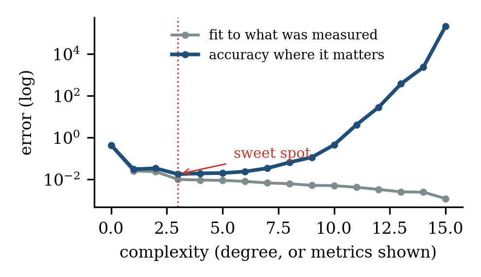
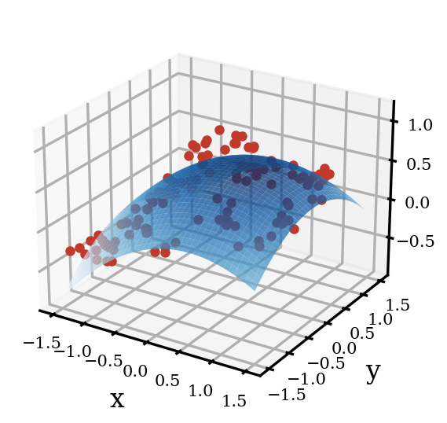
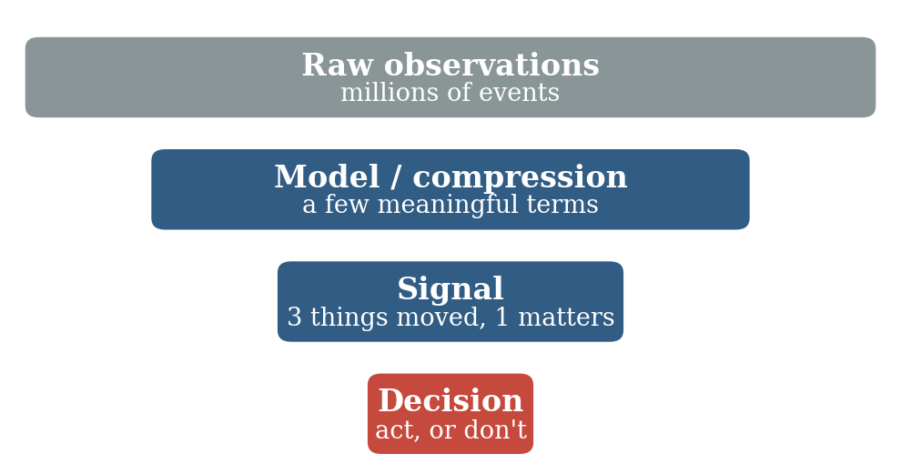
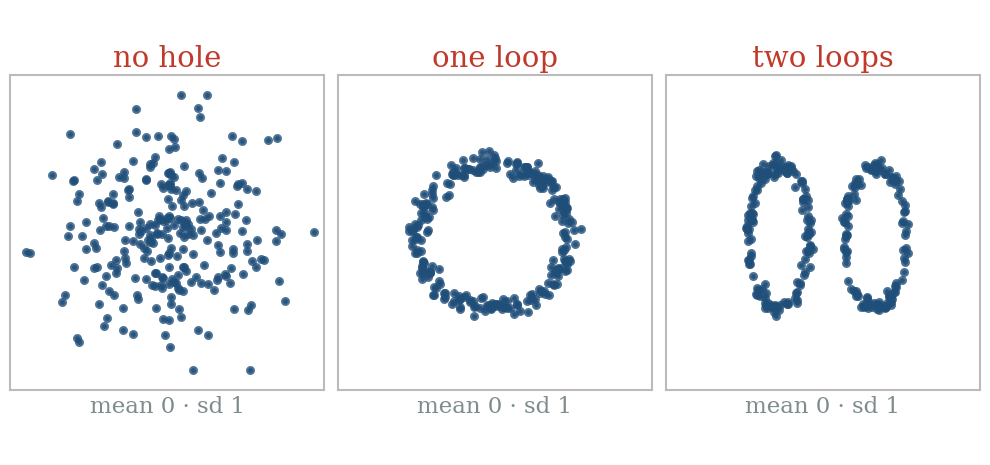
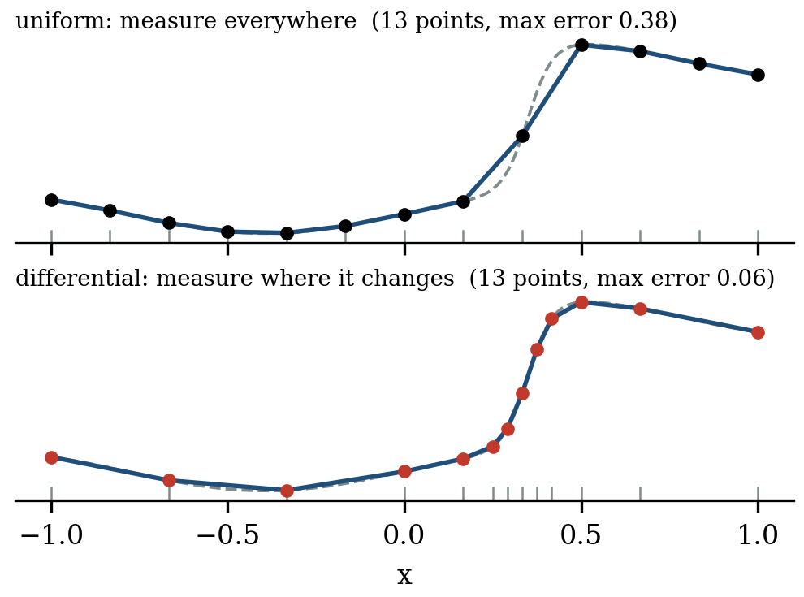
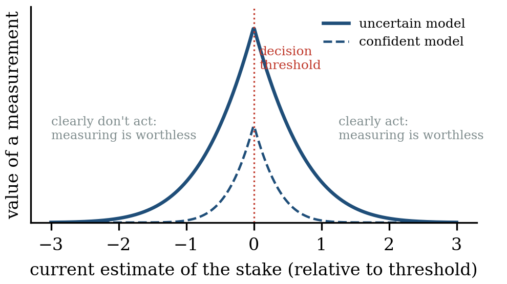
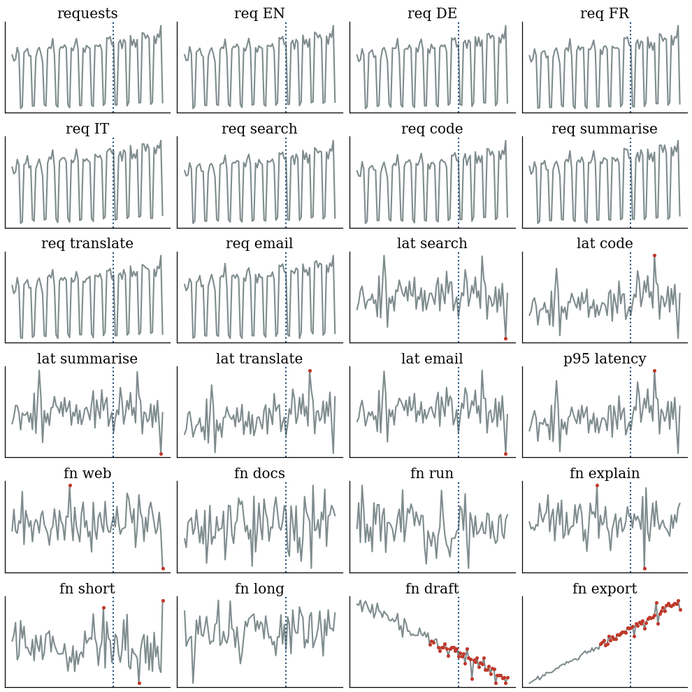

::: {.callout-note appearance="simple"}
**Document de travail, septembre 2026.** [Télécharger le PDF](../../../posts/2026-09-29-show-what-changed/Cuenat_Show_What_Changed.pdf){download="Cuenat_Show_What_Changed.pdf"} (en anglais). Suite dans [Ce qu'un écran silencieux ne peut pas voir](../2026-10-11-what-a-quiet-screen-cannot-see/index.qmd), qui répond à l'objection d'un lecteur. Les figures sont en anglais. *Traduit de l'anglais : [version originale](../../../posts/2026-09-29-show-what-changed/index.qmd).*
:::

**Résumé.** Beaucoup d'organisations utilisent l'IA pour produire davantage : plus d'indicateurs, plus de rapports, plus de tableaux de bord. Et nous finissons par regarder des données. Ce document soutient que les données ne sont pas ce dont nous avons besoin. Une leçon simple des mathématiques montre pourquoi plus de chiffres expliquent mieux le passé mais guident moins bien les décisions. Le document soutient ensuite que bien résumer des données et trouver les règles qui les sous-tendent sont une seule et même tâche, et que le résultat est une forme : une petite description du fonctionnement d'un système. Sa proposition principale est que le tableau de bord ne devrait montrer ni les données ni la forme, mais la différence entre la forme d'aujourd'hui et la précédente : ce qui a changé dans notre compréhension. Un cas simulé, fondé sur la télémétrie d'un copilote IA, montre le gain.

::: {.callout-tip appearance="simple" icon="false"}
## À retenir

- Les données ne sont pas ce dont nous avons besoin, et en produire davantage n'est pas un progrès.
- Bien résumer des données et trouver leurs règles sont une seule et même tâche. Le résultat est une forme : notre compréhension du système.
- Le tableau de bord devrait montrer comment la forme a changé, pas les données. La plupart du temps, il est vide.
- Un tableau de bord vide est une bonne nouvelle, mais seulement si le système prouve qu'il continue de vérifier.
- Les données deviennent des preuves : collectées là où les choses changent, conservées dans une archive, rarement montrées.
:::

# Partie I · Les données ne sont pas ce dont nous avons besoin

## 1. Le problème du tableau de bord

L'IA rend la production d'information bon marché, alors nous en produisons davantage : plus de rapports, plus de résumés, plus de tuiles sur des tableaux de bord qui en ont déjà quarante. Mais lire prend toujours autant de temps qu'avant. L'attention humaine est la vraie limite.

Et nous finissons ainsi par regarder des données. L'écran se remplit de chiffres, et la compréhension est laissée au lecteur. Nous mesurons plus que jamais, et pourtant les décisions ne semblent pas mieux éclairées. Ce document soutient que les données ne sont pas ce dont nous avons besoin, et qu'en produire davantage n'est pas un progrès. Ce dont nous avons besoin, c'est de compréhension et, surtout, de savoir quand notre compréhension doit changer.

## 2. La courbe qui colle trop bien

Imaginons que nous ayons quelques mesures bruitées et que nous voulions faire passer une courbe à travers elles. Un outil courant est le polynôme, une somme de termes :

$$
p(x) = a_0 + a_1 x + a_2 x^2 + \dots + a_n x^n
$$

Plus nous ajoutons de termes, plus la courbe se rapproche de chaque point. Avec assez de termes, elle passe par tous. Cela semble parfait, mais ce ne l'est pas. Entre les points, la courbe oscille violemment (Figure 1). Elle a appris le bruit, pas la vraie forme.

{fig-alt="Graphique de 16 points noirs. Une courbe rouge de degré 15 passe par chaque point mais oscille violemment entre eux ; une courbe bleue de degré 3 suit de près la réalité sous-jacente, en pointillés gris."}

Un tableau de bord fait la même chose, sauf que l'ajustement se fait dans la tête des gens. Montrez quarante indicateurs à quelqu'un, et il trouvera une histoire : cette baisse a été causée par cet événement. Avec assez d'indicateurs, une histoire finit toujours par coller au passé. Le lecteur devient la courbe qui a trop de termes. C'est pourquoi chaque chiffre de plus a un coût, même quand il est juste.

## 3. Expliquer le passé ou prédire l'avenir

La Figure 2 montre le compromis. Ajouter des termes améliore toujours l'ajustement aux données passées. Mais la capacité à prédire de nouveaux cas ne s'améliore que jusqu'à un certain point, puis se dégrade fortement. Le meilleur résultat vient d'un petit nombre de termes.

{fig-alt="Graphique à échelle logarithmique de l'erreur en fonction de la complexité, de 0 à 15. La ligne grise de l'ajustement au passé ne cesse de baisser ; la ligne bleue de l'erreur de prédiction est au plus bas à 3, marquée sweet spot, puis monte en flèche."}

Il en va de même pour les tableaux de bord. Trois chiffres bien choisis peuvent sembler moins complets que trente, mais ils guident mieux l'action. Être complet et être juste ne sont pas le même objectif.

# Partie II · La compression donne une forme

## 4. Beaucoup de données, peu de chiffres

Cela ne veut pas dire que nous devrions collecter moins de données. Pour trouver les quelques bons chiffres, il faut souvent beaucoup de mesures. La vraie question est : qui fait le résumé ? Dans la Figure 3, 120 mesures sont réduites à six chiffres qui décrivent toute la surface, même là où rien n'a été mesuré. Les machines devraient traiter le volume ; les personnes devraient recevoir le résultat.

{width=60% fig-alt="Graphique en 3D de points rouges dispersés autour d'une surface bleue courbe et lisse."}

Le meilleur usage de l'IA ici n'est donc pas de produire davantage, mais de réduire : prendre des données volumineuses et désordonnées et rendre les quelques chiffres qui les expliquent, avec une indication honnête de leur degré de certitude (Figure 4). Trois tests simples aident à décider quoi garder :

- **Test de la décision.** Cela changerait-il ce que quelqu'un fait ? Sinon, supprimez-le.
- **Test de la prédiction.** Cela aide-t-il à prédire ce qui vient, ou cela ne fait-il que décrire le passé ?
- **Test de la simplicité.** Pourrions-nous dire la même chose avec moins de chiffres ? Si oui, les chiffres en trop sont du bruit.

{fig-alt="Entonnoir de quatre boîtes, chacune plus étroite que la précédente : observations brutes (des millions d'événements), modèle ou compression (quelques termes), signal (3 choses ont bougé, 1 compte), décision (agir ou non)."}

## 5. Résumer, c'est découvrir

Une courbe montre la forme des données, mais pas pourquoi elles ont cette forme. Pour cela, il faut des règles. On pourrait penser que trouver des règles est une étape distincte, qui vient après le résumé. Ce n'est pas le cas. C'est la même tâche.

Voici pourquoi. La façon la plus courte de décrire un ensemble de données a deux parties : une règle, plus les exceptions que la règle n'explique pas.

$$
\text{données} = \text{règle} + \text{exceptions}
$$

Le meilleur résumé garde les deux parties aussi courtes que possible, et la règle qui y parvient est la meilleure explication des données. Pour le dire simplement : les données brutes sont un fichier, un résumé est un fichier compressé, et une règle est la recette qui produit le fichier.

L'histoire le montre bien. Tycho Brahe a passé des décennies à noter la position des planètes. Kepler a résumé ses tables en trois lois courtes. Newton a ensuite découvert la gravitation, non pas à partir des tables brutes de Tycho, mais à partir des trois lois de Kepler. La règle a été trouvée dans le résumé, pas dans les données brutes.

{fig-alt="Deux schémas. En haut : Tycho (données), puis Kepler (3 lois, compression), puis Newton (1 règle). En bas : une boucle des données vers compresser, puis extraire la règle, puis les résidus, qui reviennent vers la compression."}

L'IA moderne peut fonctionner de la même manière. D'abord, un réseau de neurones apprend à résumer les données en quelques variables. Ensuite, une seconde méthode cherche des équations simples dans ces quelques variables. Des chercheurs s'en sont servis pour redécouvrir des lois connues de la physique à partir de mesures brutes, et même de vidéos. À la question « comment l'IA trouverait-elle les règles ? », la réponse est donc : résumer d'abord, puis chercher des règles dans le résumé.

Trois précautions s'appliquent :

- **Garder ce qui prédit, pas ce qui est gros.** Un résumé qui ne garde que les effets les plus importants peut jeter un petit signal qui contient la règle.
- **C'est une boucle, pas une ligne droite.** Pour bien résumer, il faut une idée de la règle ; pour trouver la règle, il faut un bon résumé. Alors on tourne : résumer, deviner une règle, regarder ce qu'elle manque, résumer à nouveau.
- **Une régularité n'est pas une cause.** Une règle trouvée dans des données passées peut se briser dès que les gens agissent en fonction d'elle. Comme le dit la loi de Goodhart, quand une mesure devient un objectif, elle cesse d'être une bonne mesure. Les règles doivent être testées en pratique.

## 6. La forme d'un système

Nous pouvons maintenant nommer ce que produit ce travail. Appelons-le la *forme* du système : la plus petite description qui explique ses données. Elle a trois couches.

- **La structure :** de quel type de système s'agit-il ? Un groupe ou plusieurs ? Se répète-t-il en cycles, ou dérive-t-il ?
- **Les règles :** comment il fonctionne. Qu'est-ce qui entraîne quoi, et avec quelle force.
- **L'échelle :** quelques chiffres clés qui disent combien.

La structure mérite un mot, car les moyennes ne la voient pas. Dans la Figure 6, trois jeux de données ont exactement la même moyenne et la même dispersion, et pourtant l'un est un nuage, l'autre une boucle, le troisième deux boucles. Un processus qui se répète et un processus qui dérive sont très différents, même si leurs moyennes sont égales. Une branche des mathématiques, l'analyse topologique des données, détecte ce genre de structure et la décrit avec quelques chiffres : combien de groupes, combien de boucles.

{fig-alt="Trois nuages de points avec la même moyenne 0 et le même écart type 1 : un nuage sans forme, un anneau unique, et deux anneaux côte à côte."}

En pratique, une forme tient sur une petite fiche de quelques dizaines de chiffres. C'est notre compréhension actuelle du système. Elle est bien plus petite que les données, et bien plus utile.

# Partie III · Le tableau de bord est la différence des formes

## 7. Montrer ce qui a changé, pas ce qui est

Voici l'idée centrale de ce document. Les données arrivent en permanence, donc la forme est mise à jour régulièrement, par exemple chaque semaine. La plupart des semaines, la nouvelle forme est presque identique à l'ancienne : le système se comporte comme nous le comprenons. De temps en temps, la forme change : une règle cesse de tenir, un nouveau groupe apparaît, un chiffre clé bouge.

Le tableau de bord devrait montrer exactement cela : la différence entre la nouvelle forme et la précédente.

$$
\text{tableau de bord} = \text{forme}(\text{cette semaine}) - \text{forme}(\text{semaine dernière})
$$

Les mathématiciens appellent cela une différence finie. Le tableau de bord ne montre alors ni les données ni même la forme, mais comment notre compréhension a changé (Figure 7).

{fig-alt="Trois rangées sur cinq semaines. En bas : des points de données dispersés. Au milieu : la forme, une ellipse les semaines 1 à 3, deux ellipses à partir de la semaine 4. En haut : le tableau de bord, vide sauf une case rouge new loop en semaine 4."}

Cela donne trois couches, chacune avec son rôle. **Les données sont des preuves :** elles sont conservées, mais rarement montrées. **La forme est la compréhension :** chacun peut la consulter pour savoir comment le système fonctionne. **La différence est l'information nouvelle :** c'est la seule chose qui demande de l'attention.

Cela sépare aussi deux sortes de surprise. Une surprise *dans* la forme est une mesure isolée qui ne colle pas aux règles : une demande inhabituelle, une mauvaise journée. Le système les gère lui-même. Un changement *de* forme veut dire que les règles elles-mêmes ont bougé. C'est cela que les gens ont besoin de savoir.

La plupart du temps, la différence est nulle et le tableau de bord est vide. C'est le but, pas un défaut. Un tableau de bord vide veut dire que notre compréhension tient toujours.

## 8. Cinq précautions pour calculer des différences

L'idée est simple, mais calculer des différences comporte des pièges bien connus. Chacun a une réponse simple.

- **Les différences amplifient le bruit.** Soustraire deux nombres bruités donne un nombre encore plus bruité. Si l'on compare les formes trop souvent, des variations aléatoires ressemblent à des changements. Le pas de temps doit être assez long pour que la forme soit mesurée de façon fiable. Les mathématiciens font le même choix quand ils choisissent le pas d'une différence finie.
- **Soustraire le changement déjà attendu.** Si l'usage croît chaque semaine, la différence brute montre de la croissance chaque semaine. Ce n'est pas une nouvelle. Le tableau de bord devrait montrer la différence moins ce que les règles prévoyaient : le changement du changement.
- **Comparer ce qui est comparable.** Deux formes ne peuvent être soustraites que si elles sont décrites dans les mêmes termes. Si le résumé est reconstruit de zéro à chaque fois, ses termes peuvent changer de sens. Garder le cadre fixe, ou aligner les formes avant de les comparer.
- **Regarder plus d'une échelle de temps.** Une dérive lente peut être trop faible pour être remarquée d'une semaine à l'autre et pourtant s'additionner en un grand changement. Comparer la forme non seulement avec la semaine précédente, mais aussi avec une référence fixe, comme le trimestre précédent.
- **Pondérer le changement par ce qu'il touche.** Un petit changement près d'un point de décision peut compter plus qu'un grand changement ailleurs. Seuls les changements assez grands pour affecter une décision devraient apparaître, et ce sont les responsables des décisions, et non les analystes, qui devraient décider de ce qui est assez grand.

## 9. Les données deviennent des preuves

Dans cette vision, les données changent de rôle. Elles ne sont plus quelque chose à regarder. Ce sont des preuves : elles servent à construire la forme, à la vérifier, et à montrer quand elle doit changer. Trois idées expliquent quelles données valent la peine d'être collectées.

**L'information est la surprise.** Un chiffre que nous attendions déjà ne nous apprend rien. Seul l'écart entre ce qui s'est passé et ce que la forme prévoyait porte de l'information. Une théorie importante en neurosciences suggère que le cerveau fonctionne de façon semblable : il transmet surtout ce qui diffère de l'attente.

**Mesurer là où les choses changent.** Une règle nous dit comment les choses évoluent ; à partir d'un point de départ, elle peut reconstruire le reste. Les données sont donc surtout nécessaires là où la forme est incertaine ou en train de changer. Dans la Figure 8, les mêmes 13 mesures, placées là où la courbe change, donnent une erreur six fois plus petite. En pratique, nous ne savons pas à l'avance où les choses changent, alors nous le découvrons pas à pas : mesurer un peu partout, puis davantage là où sont les surprises.

{fig-alt="Deux graphiques de la même courbe échantillonnée en 13 points. Des points régulièrement espacés ratent la montée brusque (erreur max 0,38) ; des points regroupés là où la courbe change la suivent de près (erreur max 0,06)."}

**Une donnée vaut ce qu'elle change.** Une mesure n'a de valeur que si elle pourrait changer une décision. Quand le choix est déjà clair, plus de données n'apportent rien (Figure 9). Une bonne forme rend les choix plus clairs, et réduit donc la quantité de données nécessaire.

{fig-alt="Courbes culminant au seuil de décision et tombant à zéro des deux côtés. Le modèle incertain (trait plein) culmine plus haut que le modèle confiant (pointillés). Loin du seuil, mesurer ne vaut rien."}

En pratique : collecter un peu partout, et beaucoup plus là où la forme change. Garder les données brutes dans une archive pour le jour où une nouvelle règle sera nécessaire. Ne les montrer que quand quelqu'un le demande.

## 10. Ce qui remplace le tableau de bord

Ce que les gens voient devient petit. Le système produit trois choses :

- **Un avis de changement,** quand la forme change d'une façon qui compte : ce qui a changé, de combien, pourquoi cela compte et quoi faire.
- **Un battement de cœur,** à chaque période : « forme vérifiée sur les données de cette semaine, aucun changement significatif ». Sans lui, un tableau de bord vide est ambigu, car un système en panne est vide lui aussi.
- **La forme elle-même,** à la demande, pour qui veut comprendre le système ou poser une question.

Les tableaux de bord servent aussi à d'autres choses : une image partagée par l'équipe, la redevabilité, les audits et la confiance. Ces besoins demeurent, et cette approche les sert mieux. La forme est l'image partagée. L'historique des changements est la piste d'audit. Le battement de cœur fait de « rien n'a changé » une affirmation claire et vérifiable plutôt qu'une impression.

Il y a de vrais risques. Les gens qui cessent de regarder peuvent perdre leur sens du système, et un système ne peut pas voir un changement que sa forme ne décrit pas. Trois garde-fous aident : réexaminer régulièrement la forme elle-même ; laisser les gens explorer de temps en temps les données brutes, à la recherche de ce que la forme manque ; et laisser aux personnes, et non au système, la responsabilité des seuils et des décisions.

Construire un tel système suit une méthode courte :

- **Partir des décisions.** Lister les décisions que les gens prennent réellement.
- **Compresser en une forme qui prédit.** Garder ce qui prédit, et faire en sorte que chaque règle connaisse son propre bruit.
- **Fixer le cadre,** pour que les formes puissent être comparées dans le temps.
- **Choisir le pas,** assez long pour mesurer la forme de façon fiable.
- **Calculer la différence moins le changement attendu,** par rapport à la période précédente et à une référence fixe.
- **Ne garder que les changements significatifs,** les publier avec un battement de cœur, et archiver les données.

## 11. Un cas simulé : la télémétrie d'un copilote

Pour rendre cela concret, nous avons simulé 90 jours de télémétrie d'un copilote IA à cinq agents : recherche, code, résumé, traduction et e-mail. Chaque requête enregistre sa langue (anglais, allemand, français ou italien), l'agent, la fonction utilisée, la longueur de la requête et le temps de réponse. L'usage croît lentement et baisse le week-end, et une nouvelle fonction d'export remplace peu à peu l'ancienne fonction de brouillon. Les temps de réponse montent et descendent aussi chaque jour pour tout le monde, parce que les serveurs sont partagés.

Nous avons caché deux vrais problèmes. À partir du jour 45, l'agent de traduction commence à ralentir très progressivement, de 0,2 % par jour. Le jour 60, l'agent de code devient soudain 25 % plus lent, pour les requêtes en allemand seulement. Au total, la simulation produit 1,6 million de requêtes et environ 10 millions de chiffres.

**Le tableau de bord habituel.** Un tableau de bord typique montre 24 tuiles : les requêtes par langue et par agent, le temps de réponse par agent, et la fréquence d'utilisation de chaque fonction (Figure 10). Chaque tuile est signalée quand elle sort de sa plage normale. Sur les 60 derniers jours, les tuiles lèvent 106 alertes. La croissance normale et la nouvelle fonction d'export ressemblent à des anomalies. Chaque vrai problème n'est signalé qu'une fois, les deux le jour 74 pendant un pic des serveurs, sans rien pour les distinguer des 104 fausses alertes. Aucune cause n'est nommée. Cette référence est volontairement simple. Un analyste soigneux ajusterait chaque tuile pour les week-ends et la croissance, et supprimerait la plupart des fausses alertes. Mais les deux vrais problèmes resteraient cachés dans les variations quotidiennes des serveurs, et aucune tuile ne nommerait la cause.

{fig-alt="Grille de 24 petites séries temporelles (requêtes, latence et fonctions) sur 90 jours, avec de nombreux points rouges qui signalent des jours hors plage, et une ligne pointillée au jour 60."}

**La forme.** Le système résume d'abord les requêtes brutes en 7 200 petits groupes, un par jour, agent, langue et longueur de requête. À partir de ce résumé, il apprend les règles : les jours de semaine apportent quatre fois plus de requêtes que le week-end ; l'usage croît d'environ 0,3 % par jour ; l'export remplace régulièrement le brouillon ; et le temps de réponse croît comme la racine carrée de la longueur de la requête (valeur apprise 0,54, contre 0,5 utilisé pour créer les données). Chaque semaine, il décrit ensuite le copilote avec une fiche de forme de 33 chiffres : le volume global, la répartition des langues, la vitesse de chaque agent dans chaque langue (après avoir retiré l'effet de la longueur des requêtes et les variations communes des serveurs), et la part de chaque fonction dans son agent. Douze semaines de formes font moins de 400 chiffres, au lieu de 10 millions.

**Le tableau de bord.** La Figure 11 montre la différence entre la forme de chaque semaine et la précédente. À gauche, la différence brute : de nombreuses cases s'allument semaine après semaine, parce que le volume croît et que l'export remplace le brouillon. À droite, la différence moins le changement attendu, en ne gardant que les changements significatifs (5 % pour la vitesse et le volume, deux points de pourcentage pour l'usage). Ces seuils ne sont pas des choix techniques ; ils devraient être fixés par les responsables des décisions, par exemple l'équipe chargée des temps de réponse. Pendant douze semaines, tout le tableau de bord est vide, sauf une ligne : agent de code, allemand. L'avis apparaît à la fin de la semaine 9, deux jours après le début du problème, et nomme la cause. Il réapparaît en semaine 10, parce que la forme de la semaine 9 ne contenait que trois jours du problème. Ensuite, la nouvelle vitesse fait partie de la forme, et le tableau de bord redevient silencieux.

{fig-alt="Deux cartes de chaleur des 33 chiffres de la fiche de forme sur 12 semaines. À gauche, les différences brutes montrent beaucoup de cases pâles. À droite, après soustraction du changement attendu, tout est vide sauf speed code DE en semaines 9 et 10."}

**La dérive lente.** Le ralentissement de la traduction ne bouge jamais de plus de 1,7 % d'une semaine à l'autre, donc il n'apparaît jamais sur le tableau de bord hebdomadaire. Comparé à une forme de référence fixe (semaines 1 à 6), il franchit la ligne des 5 % en semaine 12 et il est signalé (Figure 12). C'est la quatrième précaution à l'œuvre.

{fig-alt="Graphique sur 12 semaines. Les barres grises du changement d'une semaine à l'autre restent petites. Une ligne bleue du changement par rapport à une forme de référence monte après le début de la dérive en semaine 7 et franchit la ligne des 5 % en semaine 12."}

**Le pas de temps.** Si l'on compare les formes chaque jour au lieu de chaque semaine, le bruit seul produit 51 changements de vitesse supérieurs à 5 % pendant les 59 premiers jours, avant que rien de réel ne se soit produit. La comparaison hebdomadaire n'en produit aucun. C'est la première précaution à l'œuvre.

**Une limite.** Nous avons caché les deux problèmes le long de dimensions que suit la fiche de forme : l'agent et la langue. Un problème le long d'une dimension qu'elle ne suit pas, comme le type d'appareil, n'apparaîtrait pas du tout. C'est la vraie limite de l'approche, et la raison pour laquelle la forme elle-même doit être réexaminée, et les données brutes explorées de temps en temps (section 10).

|                                      | Tableau de bord habituel        | Différence de formes             |
|--------------------------------------|---------------------------------|----------------------------------|
| Ce que les gens voient               | 24 graphiques, chaque jour      | 12 battements de cœur, 3 avis    |
| Fausses alertes                      | 104                             | 0                                |
| Problème soudain détecté             | jour 74, une alerte parmi d'autres | fin de semaine 9 (jour 62)    |
| Cause nommée                         | non                             | agent de code, allemand          |
| Dérive lente détectée                | jour 74, une alerte parmi d'autres | semaine 12, via la référence  |
| Ce qui est gardé pour comprendre     | 24 graphiques                   | 33 chiffres par semaine          |

: **Tableau 1.** Les deux approches sur les mêmes données simulées. Les chiffres du tableau de bord couvrent 90 jours, les formes 12 semaines complètes. Les 3 avis sont deux pour le problème soudain (semaines 9 et 10) et un pour la dérive.

Deux leçons sont venues de la construction du cas lui-même. Notre premier résumé avait laissé de côté la longueur des requêtes, et la règle de longueur ne pouvait pas être trouvée : le système apprenait 0,33 au lieu de 0,5. *Un résumé doit garder ce qui prédit.* Une première version ignorait aussi que les week-ends ont moins de requêtes, ce qui rend l'usage plus bruité ces jours-là ; elle levait dix fausses alertes. *Une règle doit connaître son propre bruit.* Les deux sont la boucle de la section 5 à l'œuvre : les surprises nous ont montré ce qui manquait à la forme.

Le gain est clair. Les gens ne lisent plus des données. Ils lisent, au plus, quelques lignes sur ce qui a changé dans le système, et une confirmation hebdomadaire que rien d'autre n'a changé. Les données sont toujours là, utilisées comme preuves plutôt que montrées comme contenu.

## 12. Conclusion

Nous sommes partis d'une observation simple : l'IA rend facile de produire davantage, et nous finissons par regarder des données. Les données ne sont pas ce dont nous avons besoin. Ce dont nous avons besoin, c'est de compréhension, et de la capacité à remarquer quand elle doit changer. Bien résumer des données et trouver les règles qui les sous-tendent sont une seule tâche, et son résultat est une forme. Le tableau de bord, enfin, devrait être la différence entre les formes : une page vide la plupart des jours, et quelques lignes précises quand notre compréhension du monde doit bouger. Nous n'avons pas besoin de plus de données sur plus d'écrans. Nous avons besoin d'une bonne forme, d'une façon soigneuse de mesurer comment elle change, et de l'humilité de continuer à vérifier qu'elle tient toujours.

::: {.read-next}
**À lire ensuite** · [Ce qu'un écran silencieux ne peut pas voir](../2026-10-11-what-a-quiet-screen-cannot-see/index.qmd)  
L'objection d'un lecteur, prise au sérieux : et si quelque chose cassait là où la forme ne voit pas ?
:::

## Pour aller plus loin

::: {.small}
- Akaike, H. (1974). A new look at the statistical model identification. *IEEE Transactions on Automatic Control*, 19(6), 716–723.
- Anscombe, F. J. (1973). Graphs in statistical analysis. *The American Statistician*, 27(1), 17–21.
- Bainbridge, L. (1983). Ironies of automation. *Automatica*, 19(6), 775–779.
- Berger, M. J., & Oliger, J. (1984). Adaptive mesh refinement for hyperbolic partial differential equations. *Journal of Computational Physics*, 53(3), 484–512.
- Brunton, S. L., Proctor, J. L., & Kutz, J. N. (2016). Discovering governing equations from data by sparse identification of nonlinear dynamical systems. *PNAS*, 113(15), 3932–3937.
- Carlsson, G. (2009). Topology and data. *Bulletin of the American Mathematical Society*, 46(2), 255–308.
- Champion, K., Lusch, B., Kutz, J. N., & Brunton, S. L. (2019). Data-driven discovery of coordinates and governing equations. *PNAS*, 116(45), 22445–22451.
- Cranmer, M., et al. (2020). Discovering symbolic models from deep learning with inductive biases. *Advances in Neural Information Processing Systems*, 33.
- Edelsbrunner, H., Letscher, D., & Zomorodian, A. (2002). Topological persistence and simplification. *Discrete & Computational Geometry*, 28, 511–533.
- Goodhart, C. A. E. (1975). Problems of monetary management: the U.K. experience. *Papers in Monetary Economics*, Reserve Bank of Australia.
- Howard, R. A. (1966). Information value theory. *IEEE Transactions on Systems Science and Cybernetics*, 2(1), 22–26.
- Matejka, J., & Fitzmaurice, G. (2017). Same stats, different graphs. *Proceedings of CHI 2017*, 1290–1294.
- Miller, G. A. (1956). The magical number seven, plus or minus two. *Psychological Review*, 63(2), 81–97.
- Rao, R. P. N., & Ballard, D. H. (1999). Predictive coding in the visual cortex. *Nature Neuroscience*, 2(1), 79–87.
- Rissanen, J. (1978). Modeling by shortest data description. *Automatica*, 14(5), 465–471.
- Runge, C. (1901). Über empirische Funktionen und die Interpolation zwischen äquidistanten Ordinaten. *Zeitschrift für Mathematik und Physik*, 46, 224–243.
- Shannon, C. E. (1948). A mathematical theory of communication. *Bell System Technical Journal*, 27(3), 379–423.
- Tishby, N., Pereira, F. C., & Bialek, W. (1999). The information bottleneck method. *Proceedings of the 37th Allerton Conference on Communication, Control and Computing*, 368–377.
- Udrescu, S.-M., & Tegmark, M. (2020). AI Feynman: a physics-inspired method for symbolic regression. *Science Advances*, 6(16), eaay2631.
:::
