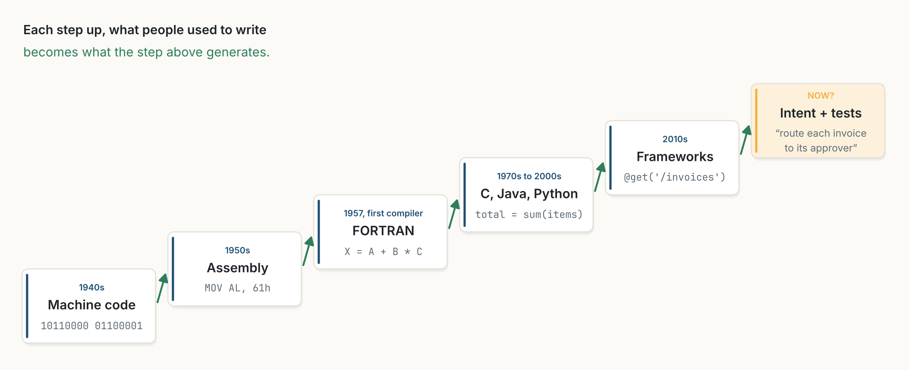

::: {.callout-warning appearance="simple"}
**Un article provocateur, à dessein.** Ceci est un article de position, écrit pour défendre un seul camp aussi fortement que possible, sous la forme d'un court article scientifique. Il énonce une thèse, définit ses termes, donne des arguments et des éléments de preuve, et se termine par des prédictions qui pourraient lui donner tort. Ce n'est pas une revue neutre. Il fait suite à [L'interface est une donnée](../2026-10-20-the-interface-is-data/index.qmd). Les figures sont de moi, dessinées avec le code de [figs.py](../../../posts/2026-10-21-intent-is-the-source/figs.py), et leurs libellés sont en anglais. *Traduit de l'anglais : [version originale](../../../posts/2026-10-21-intent-is-the-source/index.qmd).*
:::

**Résumé.** Chaque génération de la programmation a transformé ce que les gens écrivaient en quelque chose que la machine génère : le code machine est devenu le produit des assembleurs, l'assembleur celui des compilateurs, le code répétitif celui des frameworks. Je soutiens que le codage agentique, où un modèle de langage planifie, modifie, exécute et répare du code à l'intérieur d'une boucle, est l'échelon suivant de cette échelle, et un échelon plus grand qu'il n'y paraît. La thèse est que *la boucle agentique est à la fois le prochain IDE et le prochain langage de programmation*. Je définis un programme comme un quadruplet $P = (I, T, K, \Gamma)$ formé de l'intention, des vérifications exécutables, du contexte et des outils, et l'agent comme un *compilateur stochastique*, correct seulement au regard des vérifications. De cette définition découlent quatre arguments (historique, structurel, économique, empirique), une conséquence centrale (la précision du nouveau langage est la force de ses vérifications) et quatre prédictions mesurables d'ici quelques années. Je termine par les objections les plus fortes, dont celle de Dijkstra, et par les données qui vont aujourd'hui contre moi.

::: {.callout-tip appearance="simple" icon="false"}
## Thèses

1. **Le langage.** Dans le codage agentique, la source est l'intention plus des vérifications exécutables, plus le contexte et les outils que l'agent peut utiliser. Le code devient une représentation intermédiaire : toujours lisible, rarement écrit.
2. **Le compilateur.** L'agent se comporte comme un compilateur stochastique plutôt que déterministe, correct seulement au regard des vérifications qu'on lui donne.
3. **La précision.** Le nouveau langage est exactement aussi précis que ses vérifications. Les tests et les types deviennent le système de types de l'intention.
4. **L'IDE.** L'environnement de développement passe d'un éditeur conçu pour taper à une boucle conçue pour piloter et relire : plan, différences, vérifications, journal des décisions.
5. **Le test.** Ces thèses prédisent des changements mesurables dans la façon dont le logiciel professionnel est écrit. Si ces changements n'apparaissent pas, la thèse est fausse.
:::

## 1. Introduction

On décrit d'habitude les langages de programmation par leur syntaxe et leur sémantique. Pour l'argument de cet article, une description plus utile est *ce qu'une personne doit écrire* et *ce que la machine en produit*. À cette aune, l'histoire de la programmation est une échelle. À chaque échelon, les gens ont cessé d'écrire une chose pour en écrire une plus abstraite, tandis que l'ancienne continuait d'exister comme produit.

{fig-alt="Un escalier de six cartes qui monte vers la droite : années 1940, code machine (10110000 01100001) ; années 1950, assembleur (MOV AL, 61h) ; 1957, premier compilateur, FORTRAN (X = A + B * C) ; des années 1970 aux années 2000, C, Java, Python (total = sum(items)) ; années 2010, frameworks (@get('/invoices')) ; maintenant ?, intention et tests (« acheminer chaque facture vers son approbateur »), en orange. Légende : à chaque échelon, ce que les gens écrivaient devient ce que l'échelon supérieur génère."}

Depuis l'apparition des modèles de langage qui génèrent du code [@chen2021], la question évidente est de savoir s'ils sont une meilleure autocomplétion ou autre chose. Andrej Karpathy a présenté les réseaux de neurones comme le « Software 2.0 » [@karpathy2017] et, plus récemment, a décrit le fait de diriger des modèles en anglais comme une nouvelle forme de programmation [@karpathy2025]. Je prends une position plus étroite et plus vérifiable. Je ne prétends pas que l'anglais remplace les langages de programmation. Je prétends que *l'unité qu'une personne écrit* passe du code à un ensemble d'intention et de vérifications, et que *l'environnement où elle travaille* passe d'un éditeur à une boucle. Si les deux sont vrais, alors la boucle agentique est, au sens historique le plus simple, le prochain langage et le prochain IDE.

## 2. Contexte

**L'échelle.** Quand FORTRAN est apparu en 1957, ses concepteurs se sont heurtés à un profond scepticisme : du code généré par la machine pouvait-il approcher l'assembleur écrit à la main ? Une grande part de leur effort est allée à l'optimiseur, précisément pour gagner ce débat [@backus1978]. Ils l'ont gagné, et le même schéma s'est répété à chaque niveau d'abstraction suivant.

**La langue naturelle comme code.** L'idée de programmer en anglais est ancienne. Jean Sammet l'a discutée en 1966 [@sammet1966] ; Edsger Dijkstra l'a jugée insensée à la fin des années 1970, en soutenant que la précision de la notation formelle est une qualité et non un fardeau [@dijkstra667]. La recherche en synthèse de programmes a poursuivi ce but pendant des décennies à partir de spécifications et d'exemples [@gulwani2017], avec succès dans des domaines étroits.

**Des agents qui codent.** Les modèles de langage entraînés sur du code ont atteint une précision utilisable sur de petites fonctions en 2021 [@chen2021]. Depuis, des agents qui lisent un dépôt, modifient des fichiers, lancent les tests et itèrent ont été évalués sur de vrais tickets GitHub [@jimenez2024; @yang2024]. Les données sur la productivité sont mitigées : une expérience contrôlée a trouvé des développeurs 55,8 % plus rapides sur une petite tâche bien spécifiée avec un assistant d'IA [@peng2023], tandis qu'une étude randomisée auprès de développeurs open source expérimentés, travaillant sur leurs propres dépôts matures, les a trouvés 19 % *plus lents* avec les outils du début de 2025 [@becker2025].

## 3. Une définition minimale

Je définis un programme, au sens agentique, comme un quadruplet

$$
P = (I,\; T,\; K,\; \Gamma),
$$

où $I$ est l'**intention**, ce qui est voulu, exprimé en mots et en exemples ; $T$ est un ensemble de **vérifications exécutables** (tests, types, propriétés, analyseurs) qu'une implémentation candidate doit passer ; $K$ est le **contexte**, le dépôt et ses conventions ; et $\Gamma$ est l'ensemble des **outils** et interfaces que l'agent peut utiliser, décrits comme des données au sens de [L'interface est une donnée](../2026-10-20-the-interface-is-data/index.qmd).

Un agent $A$ associe du code à un programme, $c = A(P)$. Un compilateur classique est déterministe et préserve le sens par construction. Un agent ne fait ni l'un ni l'autre. C'est un **compilateur stochastique** : son produit peut varier d'une exécution à l'autre, et il n'est correct qu'au sens faible où

$$
T(c) = \text{succès}.
$$

Appelons **écart de spécification** de $P$ l'ensemble des comportements qui passent $T$ mais ne correspondent pas à ce que $I$ voulait dire. Toute la discipline du nouveau langage consiste à réduire cet écart : en précisant $I$, en renforçant $T$, et en faisant relire ce qui reste par une personne.

{fig-alt="Quatre cartes d'entrée à gauche : I, intention, ce qui est voulu en mots ; T, vérifications, tests, types, propriétés ; K, contexte, dépôt et conventions ; Gamma, outils, interfaces utilisables. Elles alimentent une carte sombre, l'agent, un compilateur stochastique, c = A(P). Il produit le code c, le produit, toujours lisible, qui va vers la vérification T(c), automatique. En cas de succès, il passe à la relecture par une personne, qui lit les différences et le journal des décisions. Une flèche verte en pointillés de la vérification vers l'agent indique : échec, recommencer. Une flèche orange en pointillés de la relecture vers les entrées indique : affiner l'intention, renforcer les vérifications."}

Avec cette définition, les notions de la chaîne d'outils habituelle trouvent de nouveaux équivalents.

| Aujourd'hui | Dans la boucle agentique |
|---|---|
| Fichier source | Intention, exemples et vérifications : $(I, T)$ |
| Compilateur | Agent : $c = A(P)$, stochastique |
| Vérificateur de types | Tests, types et propriétés : $T(c)$ |
| Bibliothèque standard | Outils et interfaces : $\Gamma$ |
| Configuration de build | Contexte du dépôt et conventions : $K$ |
| Débogueur | Journal des décisions et trace d'exécution de l'agent |
| Revue de code | Relecture de l'intention d'abord, puis des différences |
| Éditeur | Volets du plan, des différences et des vérifications ; la frappe en dernier recours |

: **Tableau 1.** La chaîne d'outils, traduite. Correspondance de mon cru.

## 4. Quatre arguments

**4.1 Historique.** Chaque échelon précédent a rencontré la même résistance : le produit généré serait plus lent, moins précis ou moins fiable que ce que les experts écrivaient à la main [@backus1978]. Chaque fois, le produit généré s'est amélioré, le coût de l'écriture à la main est resté le même, et les courbes se sont croisées. Rien dans la situation actuelle n'indique que ce schéma s'est arrêté ; les objections soulevées aujourd'hui sont les trois mêmes.

**4.2 Structurel.** Brooks distinguait la complexité *essentielle* du logiciel, décider précisément ce qu'il doit faire, de sa complexité *accidentelle*, l'effort d'exprimer cette décision dans un langage et des outils particuliers [@brooks1987]. Selon la définition ci-dessus, une personne écrit $I$ et $T$, qui portent la complexité essentielle, et l'agent se charge de l'expression, qui est accidentelle. C'est la division du travail que visait chaque abstraction, atteinte à un niveau plus élevé qu'avant. Les tests, longtemps défendus comme une discipline de conception [@beck2002], deviennent le moyen principal d'*énoncer* cette part essentielle.

**4.3 Économique.** Le coût d'une modification correcte a trois parties : l'écrire, la vérifier, et la comprendre plus tard. Le codage agentique pousse la première vers zéro et laisse les deux autres. Une équipe rationnelle placera donc ses personnes là où le coût demeure, sur l'intention, les vérifications et la relecture, ce qui est exactement le passage de l'éditeur à la boucle que prédit la thèse. L'IDE suit le travail : quand la frappe n'est plus le goulet d'étranglement, un environnement organisé autour de la frappe n'a plus la bonne forme.

**4.4 Empirique.** Les agents résolvent désormais une part significative de vrais tickets de dépôts en évaluation contrôlée [@jimenez2024; @yang2024], une tâche qui exige de lire le contexte, de modifier plusieurs fichiers et de passer les tests existants : toute la boucle de la figure 2, pas de l'autocomplétion. Le résultat négatif de @becker2025 est important et j'y reviens au §6, mais il mesure une génération d'outils précoce, sur de grands dépôts matures, avec des développeurs peu habitués à cette nouvelle façon de travailler. C'est un peu comme mesurer FORTRAN en 1957 avec des experts de l'assembleur.

## 5. Prédictions

Un article de position doit être réfutable. Si la thèse est juste, on devrait observer ce qui suit dans le logiciel professionnel au cours des prochaines années ; sinon, elle est fausse.

- **H1. L'auteur change.** La part des modifications fusionnées dont le code a été produit principalement par un agent continue d'augmenter dans les dépôts professionnels, ce qui se mesure à partir des métadonnées des commits et des journaux d'outils.
- **H2. Les vérifications croissent par rapport au code.** Dans les lignes écrites par des personnes, la part des tests, des types et des spécifications augmente par rapport à l'implémentation.
- **H3. La relecture devient le principal coût humain.** Le temps passé à relire et à spécifier dépasse le temps passé à écrire du code, dans les équipes qui adoptent des agents.
- **H4. Les gains suivent la force des vérifications.** Les gains de productivité des agents sont plus grands là où $T$ est solide (code bien testé, conventions claires) que là où il est faible, toutes choses égales par ailleurs. C'est le test le plus direct de la thèse 3.

## 6. Objections

**La langue naturelle est trop imprécise (Dijkstra).** C'est vrai, et c'est l'objection la plus importante. Mais le programme du §3 n'est pas de la prose seule. Sa précision réside dans $T$, dans $K$ et dans la relecture, comme cela a toujours été le cas dans les équipes où une personne exprime un besoin et un ingénieur le réalise. L'objection devient une règle de conception : partout où la précision compte, l'énoncer sous forme de vérification, pas de phrase.

**On ne peut pas faire confiance à un compilateur stochastique.** On peut faire confiance aux compilateurs déterministes parce que leur préservation du sens peut se démontrer une fois pour toutes. Pas un compilateur stochastique : il doit être vérifié à chaque fois. Cela augmente la valeur de $T$ et de la relecture, et cela signifie que pour le code où les vérifications sont faibles et les erreurs coûteuses, l'ancienne façon de faire doit rester. La thèse prédit un changement de la pratique par défaut, pas la fin du code écrit à la main.

**Les développeurs sont plus lents, pas plus rapides [@becker2025].** Si des réplications sur des dépôts aux vérifications solides, avec des utilisateurs expérimentés des outils actuels, continuent de trouver des ralentissements, H4 échoue, et avec elle une grande partie de cet article. C'est, selon moi, la façon la plus probable dont je pourrais avoir tort.

**Le code reste l'artefact qui s'exécute.** Oui, comme l'assembleur s'exécute toujours. La thèse ne dit pas que le code disparaît ; elle dit qu'il cesse d'être ce que les gens écrivent principalement. Comme l'assembleur, il reste la couche qu'on peut toujours lire, et celle à laquelle la machine est tenue.

**La programmation lettrée a déjà essayé.** Knuth soutenait que les programmes devaient d'abord être écrits pour des personnes [@knuth1984]. La programmation lettrée gardait la personne comme autrice du code. La différence ici est que la personne est l'autrice de l'intention et des vérifications, et que le code en est dérivé.

## 7. Conclusion

À chaque génération, on a dit aux programmeurs que le niveau d'abstraction suivant était un jouet, et chaque fois le jouet est devenu le langage. J'ai soutenu, volontairement sans nuances, que la boucle agentique est le prochain de ces niveaux : la source devient l'intention plus les vérifications, le compilateur devient un agent stochastique tenu par ces vérifications, et l'IDE devient un lieu où l'on pilote et où l'on relit. La définition rend une conséquence précise. Le nouveau langage est exactement aussi rigoureux que ses vérifications ; le métier de programmeur ne disparaît donc pas, il se déplace vers la spécification, les tests et le jugement. Quatre prédictions rendent la thèse vérifiable. Je m'attends à avoir en partie tort. Je préfère avoir tort d'une façon qui se mesure.

::: {.read-next}
**À lire ensuite** · [L'interface est une donnée](../2026-10-20-the-interface-is-data/index.qmd)
Comment MCP et la boucle agentique changent ce que nous appelons une API.
:::

::: {.small}
*Les opinions exprimées dans cet article sont les miennes et ne décrivent aucun produit ni aucun projet de mon employeur.*
:::

## Références

::: {#refs}
:::
