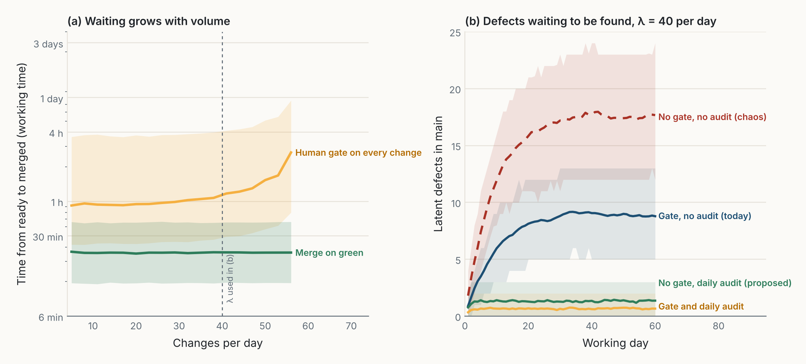

::: {.series-note}
**Le codage agentique** · Partie 5 sur 5 · [Lire toute la série](../../agentic-coding.qmd)
:::

::: {.callout-warning appearance="simple"}
**Un article provocateur, à dessein.** Un article de position sous la forme d'un court article scientifique : une thèse, un modèle, une simulation et des prédictions qui pourraient lui donner tort. Il fait suite à [Relire l'intention, pas le diff](../2026-10-22-review-the-intent-not-the-diff/index.qmd), qui gardait la revue en changeant son objet ; celui-ci demande si la revue est encore nécessaire. Les figures sont de moi, dessinées et simulées avec le code de [figs.py](../../../posts/2026-10-23-stop-reviewing-pull-requests/figs.py), et leurs libellés sont en anglais. *Traduit de l'anglais : [version originale](../../../posts/2026-10-23-stop-reviewing-pull-requests/index.qmd).*
:::

**Résumé.** L'approbation humaine de chaque pull request est devenue la norme quand le code était écrit à la main et que les défauts trouvés tard coûtaient cher. Je modélise la barrière de revue comme un investissement rentable lorsque $p \cdot d \cdot \Delta C > r$ : la probabilité qu'une modification contienne encore un défaut après les vérifications automatiques, multipliée par la part qu'un relecteur détecte et par le coût de correction tardive évité, doit dépasser le coût de la barrière. Le codage agentique réduit le coût de correction tardive de la plupart des modifications, mais pas lorsque le dommage survit à un retour arrière. Le modèle donne donc une règle plutôt qu'une interdiction : *approuvez ce que vous ne pouvez pas défaire ; surveillez tout le reste*. Surveiller signifie des règles dans chaque session et un audit quotidien de l'ensemble du code. L'approbation qui reste est une barrière légère placée tard, au point de non-retour, plutôt qu'à la fusion. Dans une simulation d'une équipe qui fusionne 40 modifications par jour, l'audit et la barrière légère laissent un tiers des défauts latents d'aujourd'hui et le même nombre d'incidents irréversibles, pour environ 80 minutes de temps humain par jour au lieu de 16 heures. J'énonce les conditions dans lesquelles ce résultat tient et cinq prédictions pour le tester.

::: {.callout-tip appearance="simple" icon="false"}
## Thèses

1. **La règle.** Approuvez ce que vous ne pouvez pas défaire. Surveillez tout le reste.
2. **Pourquoi.** Une barrière n'est rentable que si $p \cdot d \cdot \Delta C > r$. Des corrections bon marché et des retours arrière rapides rendent $\Delta C$ petit, sauf là où le dommage survit à un retour arrière.
3. **Surveiller.** Des règles que chaque session doit suivre, la fusion dès que les vérifications passent, et un audit quotidien dont le rapport oriente le travail de l'équipe.
4. **La barrière qui reste.** Légère et tardive : au point de non-retour, quelques questions avec des preuves, rarement sollicitée. Elle garde l'acte, pas le code.
5. **La condition.** Surveiller vaut mieux qu'approuver seulement si l'audit voit assez loin et assez vite : $c > d \, (1 + h_{\text{users}} / h_{\text{audit}})$.
6. **Le test.** Les équipes qui adoptent la règle ne devraient pas échouer plus souvent et devraient trouver les défauts plus tôt. Sinon, la thèse est fausse.
:::

## 1. Introduction

Pour la plupart des modifications, personne ne devrait avoir à approuver la pull request. On répond d'habitude que ce serait le chaos. Je ne le crois pas, et la raison est économique. La revue est un contrôle, et tout contrôle a un prix. Nous le payions parce que la barrière était l'endroit le moins cher pour attraper un défaut : quelques minutes en revue contre des jours une fois arrivé chez les utilisateurs.

Le codage agentique change le prix des deux côtés. Les règles peuvent être appliquées à l'intérieur de chaque session plutôt qu'à sa fin. Une correction prend quelques minutes à un agent, et un drapeau de fonctionnalité peut désactiver une modification en quelques secondes. Corriger est devenu bon marché, et je crois que c'est ce qui change toute la donne. L'attention humaine reste chère, et la barrière la dépense sur chaque modification, qu'elle en ait besoin ou non.

Corriger n'est pas bon marché partout. Des données supprimées, des identifiants divulgués ou de l'argent envoyé au mauvais compte ne se récupèrent pas par un retour arrière. D'où la règle : **approuvez ce que vous ne pouvez pas défaire ; surveillez tout le reste.** Là où l'approbation demeure, elle doit venir tard et rester légère, sinon elle n'apporte pas grand-chose.

{fig-alt="Deux bandes. En haut, aujourd'hui, une personne approuve chaque modification : écrire, vérifications, une personne approuve (en surbrillance, chaque modification attend ici), fusion. En bas, la proposition, approuvez ce que vous ne pouvez pas défaire, surveillez tout le reste : écrire avec des règles, vérifications, fusion (tout est fusionné), puis point de non-retour ? Si oui, barrière légère, une personne décide, puis mise en production ; sinon, directement la mise en production. De la mise en production, une flèche marquée chaque nuit mène à l'audit quotidien de l'ensemble du code, puis à l'équipe qui corrige ce qui compte et resserre les règles, et remonte vers l'écriture."}

## 2. Contexte : à quoi servait la revue

**Les inspections.** L'inspection formelle du code est née chez IBM dans les années 1970 comme étape d'élimination des défauts [@fagan1976], justifiée par l'idée qu'un défaut coûte un à deux ordres de grandeur de plus à corriger en exploitation qu'en développement [@boehm1981]. Le fondement empirique de cette courbe est plus mince que sa célébrité [@bossavit2015], et les pratiques agiles ont soutenu que l'intégration et les tests automatisés l'aplatissent [@beck1999].

**Ce que trouve la revue moderne.** La revue légère a remplacé les inspections dans la plupart des équipes [@rigby2013]. Chez Microsoft, les développeurs citaient la recherche de défauts comme première motivation, mais la plupart des commentaires portaient sur l'amélioration et la compréhension du code [@bacchelli2013] ; une étude ultérieure s'intitulait *Code Reviews Do Not Find Bugs* [@czerwonka2015]. Environ trois quarts des problèmes trouvés concernent l'évolutivité plutôt que le comportement [@mantyla2009; @beller2014]. Chez Google, on valorisait surtout l'apprentissage, le respect des normes, le filtrage et la prévention des accidents [@sadowski2018].

**Les arguments pour la revue.** Dans trois projets open source, les composants peu relus avaient plus de défauts après publication [@mcintosh2014], et une lecture attentive améliore la qualité [@kemerer2009]. Sur l'approbation, la plus grande enquête sur la performance de livraison a montré qu'une approbation externe ralentissait la livraison sans réduire les modifications en échec, et recommandait plutôt une revue légère par les pairs [@forsgren2018].

**La revue agentique aujourd'hui.** L'équipe Claude Code d'Anthropic laisse déjà les modifications à faible risque être fusionnées sans personne lorsque la revue automatique réussit, et rapporte plus de modifications fusionnées et moins de retours arrière [@anthropic2026review]. La règle proposée ici remplace leur score de risque par une question plus simple et fait de l'absence d'approbation la règle par défaut.

## 3. Un modèle de coût de la barrière

Considérons une modification. Soit $p$ la probabilité qu'elle contienne encore un défaut après toutes les vérifications automatiques ; $d$ la part de ces défauts qu'un relecteur humain détecte ; $\Delta C = C_{\text{late}} - C_{\text{review}}$ le coût évité en l'attrapant en revue ; et $r$ le coût complet de la barrière pour une modification, lecture, attente et changements de contexte compris. La barrière est rentable lorsque

$$
p \, d \, \Delta C > r .
$$ {#eq-break-even}

Le coût tardif est le travail de correction plus le dommage causé tant que le défaut vit. Si le dommage s'accumule à un taux $k$ et que le défaut est trouvé après un temps $\tau$,

$$
C_{\text{late}} \approx c_{\text{fix}} + k \, \tau .
$$ {#eq-late}

**Ce que changent les agents.** Les règles de session peuvent faire baisser $p$ : on peut exiger d'un agent qu'il ajoute des tests pour chaque comportement modifié, qu'il garde la couverture des lignes modifiées au-dessus d'un seuil et qu'il suive un fichier de conventions, et les vérifications délivrées pendant l'écriture sont celles sur lesquelles les développeurs agissent [@sadowski2018cacm]. Ce n'est pas automatique, car le code écrit avec des assistants d'IA peut être moins sûr [@pearce2022; @perry2023] ; la simulation garde donc $p$ identique pour toutes les politiques. Pendant ce temps, $r$ ne baisse pas : une revue attentive avance à quelques centaines de lignes par heure [@kemerer2009], le volume augmente, et l'attente croît à peu près comme $\rho/(1-\rho)$ avec le taux d'occupation des relecteurs $\rho$ [@kingman1961].

**L'hypothèse principale.** Le terme qui bouge le plus est $\Delta C$. *Hypothèse A : pour la plupart des défauts, un agent peut produire une correction juste dans l'heure qui suit le signalement, et un drapeau ou un retour arrière peut arrêter le dommage en quelques minutes.* Sous A, $c_{\text{fix}}$ est petit, les drapeaux plafonnent $k$ [@humble2010] et un audit plafonne $\tau$. Les agents résolvent une part significative de vrais tickets de dépôts dans des évaluations contrôlées [@jimenez2024], et les meilleures équipes étudiées par @forsgren2018 rétablissaient déjà le service en moins d'une heure ; aucune de ces données ne mesure les corrections faites par des agents en production, si bien que la prédiction H3 teste A directement.

![**Figure 2.** Schéma. Avant les agents, un défaut coûtait d'autant plus cher à corriger qu'il était trouvé tard, une courbe dont la forme exacte est contestée [@bossavit2015]. Avec les agents, sous l'hypothèse A, une correction tardive coûte à peine plus qu'une correction précoce. Le dommage irréversible reste cher.](../../../posts/2026-10-23-stop-reviewing-pull-requests/figures/fig02.png){fig-alt="Graphique en échelle logarithmique du coût de correction, de 1x à 100x, selon le moment où le défaut est trouvé : pendant l'écriture, en revue, le lendemain, des mois plus tard. Une ligne grise en pointillés, avant les agents, monte de 1x à 100x. Une ligne verte, avec les agents (supposé), ne monte que de 1x à environ 2,4x. Une ligne rouge, irréversible, commence à 40x le lendemain et reste haute."}

**D'où vient la règle.** L'hypothèse A n'aplatit la courbe des coûts que pour le dommage qu'un retour arrière efface. Quand le dommage persiste après un retour arrière, $k\tau$ reste grand si vite que le défaut soit trouvé, et la barrière reste rentable (le point rouge de la figure 3). Tout le reste glisse sous la ligne d'équilibre. Le modèle ne dit pas « ne relisez jamais » ; il dit exactement où la revue reste rentable.

{fig-alt="Graphique avec en abscisse le coût d'une correction tardive rapporté au coût d'une revue, et en ordonnée la probabilité qu'une modification contienne encore un défaut, tous deux croissants. Une diagonale sépare une zone orange en haut à droite, la revue est rentable, d'une zone verte en bas à gauche, la revue coûte plus qu'elle ne rapporte. Un point marqué avant les agents se trouve dans la zone orange ; une flèche courbe le relie à un point marqué avec les agents dans la zone verte. Un point rouge marqué irréversible se trouve dans la zone orange."}

## 4. La règle en pratique

**Ce qui ne peut pas être défait.** Une modification est une porte à sens unique [@bezos2016] lorsque son dommage survit à un retour arrière : données détruites ou exposées, argent transféré, identifiants ou clés de signature modifiés, interface publique livrée hors de l'équipe, message envoyé aux clients. La liste est explicite, versionnée et fait partie du contrat de session. Le code qui la touche est fusionné comme les autres ; son étape irréversible attend à la barrière légère (§5). Les sessions pilotées depuis l'extérieur de l'équipe entrent dans la même catégorie : le ticket d'un inconnu ou une page web peut diriger un agent [@greshake2023], et une porte dérobée implantée ou un secret divulgué ne peuvent pas être défaits non plus. Le contrat enregistre d'où viennent les instructions de chaque session, si bien que ces sessions sont signalées automatiquement.

**Ce que signifie surveiller.** Chaque modification est fusionnée dès que les vérifications passent, et tout ce qui n'est pas une porte à sens unique est mis en production sans attendre. La surveillance s'exerce à trois endroits (tableau 1) : avant la fusion, par un *contrat de session* appliqué par l'agent et l'intégration continue ; après, par des *drapeaux et une supervision* en production ; et une fois par jour, par un *audit* qui lit l'ensemble du code et les signaux de production et rédige un court rapport que l'équipe lit au lieu de quarante diffs. Quand un problème revient, l'équipe en fait une règle, si bien que le contrat absorbe peu à peu ce que les relecteurs écrivaient en commentaires.

**Ce que l'audit voit et qu'une vérification avant fusion ne voit pas.** Les vérifications rapides vont dans le contrat. L'audit ajoute les vérifications *lentes*, comme le test par mutation et le fuzzing, les motifs *transversaux* à plusieurs modifications, les signaux de *production* depuis les fusions de la veille, et les *tendances* que des personnes peuvent juger avant qu'une règle ne les encode. Un relecteur qui lit une modification à la fois ne voit pas non plus les deuxième et troisième catégories.

| | Contrat de session (chaque modification, bloquant) | Audit quotidien (tout le code, consultatif) |
|---|---|---|
| Tests | Tests ajoutés ou mis à jour pour chaque comportement modifié | Score de mutation par module, et son évolution |
| Couverture | Couverture des lignes modifiées ≥ seuil ; la couverture totale ne baisse jamais | Points chauds non testés : code souvent modifié et peu testé |
| Intégrité | Aucun test supprimé ni assertion affaiblie sans décision liée | Tests affaiblis ou ignorés, par session |
| Conventions | Fichier de conventions, linters et types respectés | Écarts aux conventions et aux règles d'architecture |
| Intention | Une modification d'un contrat ou d'un invariant met à jour son registre de décision | Registres de décision modifiés depuis la veille |
| Production | Comportement visible par les utilisateurs derrière un drapeau | Erreurs et performances depuis les dernières fusions |
| Portes à sens unique | Les actions listées attendent à la barrière légère ; les sessions pilotées de l'extérieur sont signalées | Charge de la barrière : part des modifications qui l'atteignent, minutes par décision |

: **Tableau 1.** Un contrat de session et un audit minimaux. Les seuils et les vérifications exactes appartiennent à chaque équipe ; c'est la répartition qui compte. Ce qui peut être décidé modification par modification est appliqué par des machines ; ce qui demande du jugement est regroupé une fois par jour pour des personnes.

La règle d'intégrité empêche l'échec le plus courant des agents de code, celui qui modifie un test jusqu'à ce qu'il passe. La couverture est associée au test par mutation, parce que la couverture seule mesure mal la qualité des tests [@inozemtseva2014] et devient une cible dès qu'elle est imposée [@strathern1997] ; le test par mutation mesure si les tests remarquent un changement de comportement [@papadakis2019].

**Qui est responsable.** La personne qui lance une session est responsable de ce qu'elle fusionne. Piloter l'agent et regarder ce qu'il produit fait partie de l'écriture, et cela demeure. Ce qui disparaît, c'est la seconde personne dont l'approbation était exigée.

**Les changements d'intention.** L'essai précédent envoyait chaque changement d'intention à une personne avant la fusion. La règle affine cette position : une modification d'un contrat ou d'un invariant qui peut être annulée est fusionnée, mais jamais en silence. Elle met à jour son registre de décision, et l'équipe la lit le lendemain matin. Seule l'intention qui garde une porte à sens unique passe par la barrière légère.

## 5. La barrière légère

L'endroit où se trouve la barrière restante et ce qu'elle demande décident si elle en vaut la peine. Une barrière placée tôt et rendue lourde, avec une personne qui lit chaque diff de chaque modification risquée, apporte peu. Une barrière placée tard et gardée légère conserve l'essentiel de la valeur qui reste.

**Tardive : au point de non-retour, pas à la fusion.** Fusionner est réversible ; le code qui touche une porte à sens unique est sans danger tant qu'il ne s'exécute pas. L'acte irréversible vient plus tard : lancer la migration, changer la clé, envoyer le message, activer le drapeau qui déplace de l'argent. C'est là que la barrière doit se trouver. La personne juge ce qui va réellement s'exécuter, avec les vraies données et la vraie configuration ; l'approbation ne peut pas devenir caduque ; et la barrière retient une action, pas l'équipe.

**Légère : quelques questions avec des preuves, pas un diff.** Lire du code est lent, et les revues deviennent plus superficielles à mesure que les modifications grossissent [@kemerer2009]. Au point de non-retour, cinq questions suffisent (figure 4). Qu'est-ce qui, exactement, ne peut pas être défait ? Qu'a montré une répétition, comme une exécution à blanc sur une copie de la production ? Qu'est-ce qui est touché, et l'action peut-elle être échelonnée ? Quel est le chemin du retour, et a-t-il été testé ? Qui l'a demandé, et une instruction est-elle venue de l'extérieur de l'équipe ? L'agent prépare les réponses ; la personne les vérifie et choisit d'y aller, d'échelonner l'action ou de l'arrêter. Les déploiements échelonnés sont une pratique courante quand l'effet d'une modification est incertain [@beyer2016].

{fig-alt="À gauche, une carte de décision intitulée point de non-retour : supprimer la colonne customers.legacy_email. Cinq lignes de questions et de preuves : ce qui ne peut pas être défait, supprime 1 284 301 valeurs stockées en production ; preuves, exécution à blanc sur la copie de la nuit, aucune lecture en 30 jours ; périmètre, une table, trois services, exécutable région par région ; chemin du retour, sauvegarde faite à 02:00, restauration testée à 02:20 ; qui l'a demandé, ticket de l'équipe, aucune instruction venue de l'extérieur. Trois boutons : Go, Stage it, Stop. À droite, trois notes : tardive, au point de non-retour, pas à la fusion, la personne juge ce qui va réellement s'exécuter ; légère, cinq questions, l'agent prépare les preuves, personne ne lit le diff, des minutes et non des heures ; rare, peu de modifications l'atteignent, on la garde légère en rendant plus de choses réversibles, pas en ajoutant des personnes."}

Dans les termes de l'@eq-break-even, une barrière légère et tardive augmente $d$, parce que la personne examine des preuves sur la seule chose qui compte, diminue $r$, parce que la décision prend quelques minutes et est rarement nécessaire, et se place là où $\Delta C$ est le plus grand. Une barrière lourde et précoce fait l'inverse sur les trois plans. Un cas demande plus que cinq questions : une session pilotée de l'extérieur de l'équipe, où le danger se cache dans le code lui-même. Une personne lit alors le diff ou, mieux, le travail est refait dans une session que l'équipe pilote.

**Rare : la garder légère à dessein.** Les barrières grossissent. Chaque incident ajoute un élément à la liste, et une liste assez longue refait de la barrière légère l'ancienne, approuvée par des personnes fatiguées qui ne lisent plus. Il faut mesurer sa charge : la part des modifications qui l'atteignent et les minutes par décision. Quand le même genre d'action revient sans cesse, il faut le rendre réversible plutôt qu'ajouter des approbateurs : suppressions logiques, modifications de schéma qui s'étendent avant de se contracter [@ambler2006], clés que l'on peut rétablir, déploiements région par région. Chaque gain de réversibilité fait passer une catégorie de modifications d'« approuver » à « surveiller ». La meilleure barrière est celle qui a de moins en moins à faire.

## 6. Une simulation

J'ai simulé une équipe sous cinq politiques : une barrière sur chaque modification (la pratique courante aujourd'hui), ni barrière ni audit, un audit seul, l'audit avec la barrière légère (la proposition), et une barrière sur chaque modification avec l'audit. Chaque modification peut contenir un défaut réversible ; une sur vingt porte aussi une étape irréversible, elle-même susceptible d'être défectueuse. Une étape irréversible défectueuse qui s'exécute sans être arrêtée est un *incident irréversible* : l'audit nocturne arrive trop tard pour elle. Les paramètres (tableau 2) sont choisis plutôt que mesurés et, quand il fallait choisir, favorables à la revue.

| Paramètre | Valeur |
|---|---|
| Modifications par jour, $\lambda$ | 40 |
| Vérifications automatiques (intégration continue et revue par IA) | log-normale, moyenne 24 min |
| Tours de revue | premier log-normal, moyenne 20 min, coefficient de variation 1 ; un second, moyenne 10 min, pour 40 % des modifications après 2 h de délai de l'auteur |
| Capacité de revue | 3 équivalents temps plein, premier arrivé premier servi, sans regroupement |
| Probabilité de défaut résiduel, $p$ | 0,05 par modification, pour toutes les politiques |
| Part détectée par un relecteur, $d$ | 0,5 |
| Chance quotidienne que les utilisateurs trouvent un défaut latent, $h_{\text{users}}$ | 0,10 |
| Chance quotidienne que l'audit trouve un défaut qu'il peut voir, $h_{\text{audit}}$ | 0,50 (variée dans la figure 6) |
| Part des défauts que l'audit peut voir, $c$ | 1 (variée dans la figure 6) |
| Modifications avec une étape irréversible | 5 %, défectueuses avec la probabilité $p$ |
| Part des étapes défectueuses arrêtées par la barrière légère | 0,5, comme une revue complète (0,8 testé) |
| Temps par décision à la barrière légère | 10 min |
| Horizon | 60 jours ouvrés, 300 exécutions |

: **Tableau 2.** Paramètres de la simulation. L'audit inclut les signaux de production : la supervision fait partie de la surveillance, pas des utilisateurs. La file de revue est optimiste pour la barrière : les relecteurs commencent dès qu'ils sont libres. Une valeur $d = 0,5$ est élevée pour des défauts fonctionnels, vu ce que la revue est connue pour trouver [@mantyla2009; @czerwonka2015].

{fig-alt="Deux graphiques en barres horizontales pour cinq politiques. Défauts en attente d'être trouvés : ni barrière ni audit 19,2 ; barrière sur chaque modification (aujourd'hui) 9,7 ; audit seul 3,3 ; audit et barrière légère (proposition) 3,3 ; barrière sur chaque modification et audit 1,6. Incidents irréversibles par mois : 2,0 ; 1,0 ; 2,0 ; 1,0 ; 1,0. Temps humain par jour : 0 h, 16 h, 1 h, 1,3 h, 17 h."}

| Politique | Délai médian jusqu'à la fusion (90e centile) | Temps humain par jour | Défauts latents dans la branche principale | Incidents irréversibles par mois |
|---|---|---|---|---|
| Ni barrière ni audit | 0,4 h (0,7 h) | 0 | 19,2 | 2,0 |
| Barrière sur chaque modification (aujourd'hui) | 1,1 h (4,0 h) | 16 h | 9,7 | 1,0 |
| Audit seul | 0,4 h (0,7 h) | 1 h | 3,3 | 2,0 |
| Audit et barrière légère (proposition) | 0,4 h (0,7 h) | 1 h 20 min | 3,3 | 1,0 |
| Barrière sur chaque modification et audit | 1,1 h (4,0 h) | 17 h | 1,6 | 1,0 |

: **Tableau 3.** Résultats de la simulation à 40 modifications par jour. Les défauts latents sont ceux présents dans la branche principale au cours d'une journée, en moyenne sur les jours 21 à 60. Les erreurs types sont de 0,15 au plus pour les défauts latents et de 0,05 au plus pour les incidents. Lancez `python figs.py` pour les reproduire.

**Le chaos existe, mais ce n'est pas la proposition.** Sans barrière ni audit, les défauts latents doublent, et les incidents irréversibles aussi. Les critiques ont raison sur cette politique, pas sur l'alternative.

**Chaque mécanisme fait un travail.** L'audit seul ramène les défauts latents à un tiers de ceux d'aujourd'hui, mais laisse les incidents irréversibles au niveau du chaos, parce qu'un audit nocturne les trouve après le dommage. La barrière légère ramène les incidents au niveau d'aujourd'hui, pour 20 minutes par jour. Ensemble, ils font mieux que la pratique actuelle sur les défauts réversibles et autant qu'elle sur les irréversibles, pour un douzième du temps humain. Si les preuves présentées à la barrière légère lui permettent d'arrêter 80 % des étapes défectueuses au lieu de 50 %, les incidents tombent à 0,4 par mois, bien en dessous d'aujourd'hui.

**Le prix de la barrière complète.** Ajouter à l'audit une barrière sur chaque modification fait passer les défauts latents de 3,3 à 1,6 sans réduire les incidents irréversibles, pour 16 heures par jour : environ **10 heures d'ingénieur pour chaque jour de défaut latent évité** (16 h ÷ 1,7 ≈ 9,4). Un défaut latent dans cette partie du système coûte-t-il plus de 10 heures d'ingénieur par jour ? Pour un défaut réversible dans un outil interne, rarement. Pour un flux de paiement, facilement, et c'est une porte à sens unique avec sa propre barrière légère.

**Vitesse et portée de la surveillance.** Selon la loi de Little [@little1961], le nombre de défauts latents est égal au rythme auquel ils entrent multiplié par la durée de leur séjour. Une barrière retire au mieux le facteur $(1-d)$, ici une moitié ; un audit raccourcit le séjour, ici d'un facteur six. Mais l'audit peut ne voir qu'une part $c$ des défauts, le reste étant trouvé par les utilisateurs. La proposition fait alors mieux que la pratique actuelle lorsque

$$
c > d \left(1 + \frac{h_{\text{users}}}{h_{\text{audit}}}\right).
$$ {#eq-watch}

En clair, *la surveillance doit voir plus de sortes de défauts qu'un relecteur n'en aurait attrapé, et plus elle est lente, plus elle doit en voir.* Avec les valeurs du tableau 2, un audit qui trouve ce qu'il voit en deux jours environ doit voir au moins 60 % des défauts, et un audit qui met cinq jours, 75 % (figure 6). Si les défauts d'une équipe sont surtout d'un genre qu'aucune machine ne remarque, la règle échoue pour cette équipe, et l'@eq-watch le dit avant tout dommage. Mesurez $c$ d'abord et, là où cette part reste sous le seuil, continuez à relire les modifications de cette partie du code jusqu'à ce que la surveillance s'améliore.

{fig-alt="Graphique avec en abscisse la part des défauts que l'audit peut voir, de 0 à 100 %, et en ordonnée les défauts en attente d'être trouvés comparés à aujourd'hui, de 0 à 2x. Une ligne noire horizontale à 1x est marquée aujourd'hui : une personne approuve chaque modification ; la zone en dessous, en vert, est marquée mieux qu'aujourd'hui. Deux courbes descendantes partent de 2x : un audit qui trouve les défauts en deux jours environ croise 1x à 60 % et finit près de 0,33x ; un audit qui les trouve en cinq jours environ croise 1x à 75 % et finit près de 0,67x."}

## 7. Prédictions et protocole de test

La vitesse n'est pas un bon test : supprimer une barrière accélère évidemment les fusions. La thèse tient ou tombe sur la qualité et sur ses hypothèses. Pour les équipes qui adoptent la règle, comparées à des équipes semblables qui gardent la barrière :

- **H1. Pas de perte de stabilité.** Le taux de modifications en échec et le temps de rétablissement du service [@forsgren2018] ne sont pas pires, dans une marge fixée à l'avance, et les incidents irréversibles n'augmentent pas.
- **H2. La surveillance voit assez loin.** La part des défauts trouvés d'abord par l'audit ou la supervision plutôt que par les utilisateurs, une estimation de $c$, dépasse le seuil de l'@eq-watch, et les défauts sont trouvés plus tôt.
- **H3. Les corrections sont bon marché (hypothèse A).** Pour les défauts trouvés par l'audit, le délai médian entre le signalement et la correction fusionnée est inférieur à une heure ouvrée, et un drapeau ou un retour arrière contient le dommage avant l'arrivée de la correction.
- **H4. Le rapport est utilisé.** Au moins la moitié des constats de l'audit sont corrigés ou explicitement écartés en une semaine. Un audit que personne ne lit ramène la proposition au cas du chaos.
- **H5. La barrière reste légère.** La part des modifications qui atteignent la barrière légère et les minutes par décision restent faibles, et baissent à mesure que plus d'actions deviennent réversibles.

**Protocole.** Dans un plan en escalier (*stepped wedge*), les équipes adoptent la règle l'une après l'autre, dans un ordre aléatoire, sur plusieurs mois, de sorte que chaque équipe est observée sous les deux politiques et que les effets de calendrier sont contrôlés. H1 est un test de non-infériorité préenregistré ; H2 à H5 et le délai de livraison sont des critères secondaires, mesurés à partir des journaux du dépôt, du pipeline et des incidents plutôt que de déclarations, puisque les équipes ne peuvent pas être mises en aveugle. Si H1, H2 ou H3 échoue, la thèse est fausse pour les équipes étudiées.

## 8. Objections et limites

**« La revue réduit manifestement les défauts » [@mcintosh2014].** Comparée à l'absence de revue, sur du code écrit à la main, oui. La comparaison pertinente oppose la revue à la surveillance, ce que testent H1 et H2. La recommandation de la revue par les pairs dans @forsgren2018 repose sur des données antérieures aux agents ; l'étendre est une extrapolation.

**« La revue est la façon dont les équipes partagent le savoir » [@bacchelli2013; @sadowski2018].** Elle l'était. Le remplacement est délibéré : registres de décision, conventions, et un rapport quotidien lu par toute l'équipe plutôt que quarante diffs lus chacun par une personne.

**Les gens s'adaptent.** Sans relecteur, les auteurs peuvent devenir négligents, ou plus attentifs puisqu'ils sont seuls responsables du résultat. La simulation garde $p$ fixe ; H1 mesure l'effet net.

**La conformité.** Certaines normes exigent que le code spécifique soit relu avant sa mise en production ; PCI DSS fixe des conditions sur qui peut relire lorsque la revue est manuelle [@pcidss2022]. Savoir si une revue automatisée y satisfait relève des auditeurs ; quand ce n'est pas le cas, le code concerné rejoint la liste des portes à sens unique.

**La perte de compétence.** L'automatisation laisse aux personnes les cas rares et difficiles tout en supprimant la pratique qui les y prépare [@bainbridge1983]. Les équipes doivent entretenir cette compétence à dessein : lire dans le code les constats de l'audit, remonter des incidents à la main, faire tourner qui s'en charge.

**Les limites du modèle.** Il est linéaire et traite les défauts comme indépendants. Il ne pondère pas les défauts par leur gravité : si les relecteurs attrapent surtout les plus graves, il est biaisé contre la barrière ; les cas irréversibles, qui gardent leur barrière, sont censés couvrir les pires. Il compte l'audit comme une heure de lecture, sans son coût de calcul ni ses fausses alertes. Il tient $d$ pour constant, alors que les relecteurs se fatiguent et que les grosses modifications sont relues plus superficiellement, et il ignore ce que les relecteurs apprennent. Le taux d'arrêt de la barrière légère est supposé égal à celui d'un relecteur, non mesuré. Les paramètres décrivent une équipe à un rythme donné : le sens du résultat tient partout où l'@eq-watch tient, pas son ampleur. Enfin, l'article suppose que l'écriture du code n'est plus le goulot d'étranglement, et les données sur l'accélération des développeurs expérimentés par l'IA sont partagées [@becker2025].

## 9. Conclusion

La revue des pull requests était le bon contrôle tant que les défauts tardifs coûtaient cher et que la lecture d'une personne était la principale vérification. Avec le codage agentique, les règles s'appliquent à l'intérieur de chaque session, la plupart des défauts se corrigent à peu de frais le lendemain, et la seule étape qui ne s'est pas accélérée est la personne qui lit le diff.

Ce qui garde un code en bonne santé, c'est la vitesse à laquelle les défauts sont trouvés et le faible coût auquel ils sont défaits, pas le fait que quelqu'un ait regardé chaque modification avant sa fusion. Là où le dommage ne peut pas être défait, une personne décide encore, tard et brièvement, au point de non-retour : la barrière garde l'acte, pas le code. Là où une machine ne voit pas, l'équipe doit le mesurer avant de lâcher prise.

Cela demande de renoncer au contrôle de chaque modification. En échange, nous pouvons simplifier nos processus au lieu d'ajouter des couches pour protéger une forme de contrôle qui, autrefois, était la seule possible. Approuvez ce que vous ne pouvez pas défaire. Surveillez tout le reste.

::: {.read-next}
**À lire ensuite** · [Relire l'intention, pas le diff](../2026-10-22-review-the-intent-not-the-diff/index.qmd)
Comment l'équipe Claude Code a résolu la revue de code, et la seule chose que je lâcherais.
:::

::: {.small}
*Les opinions exprimées dans cet article sont les miennes et ne décrivent aucun produit ni aucun projet de mon employeur.*
:::

## Références

::: {#refs}
:::
