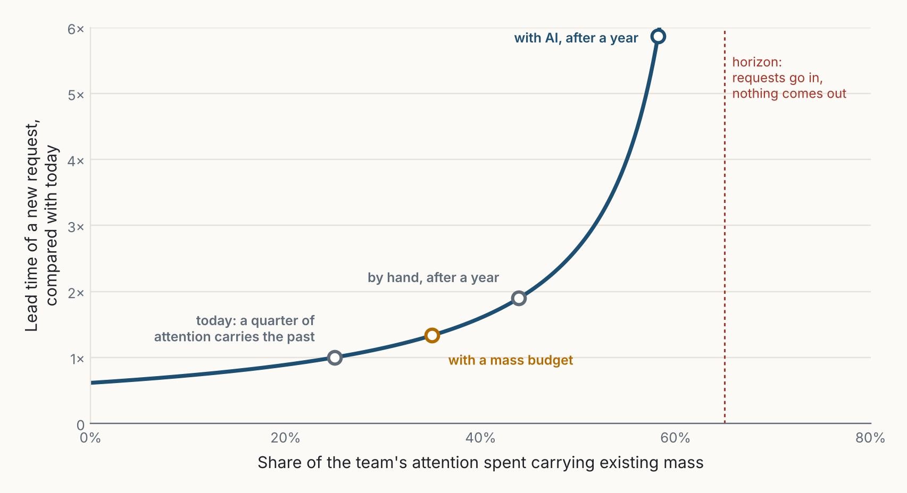
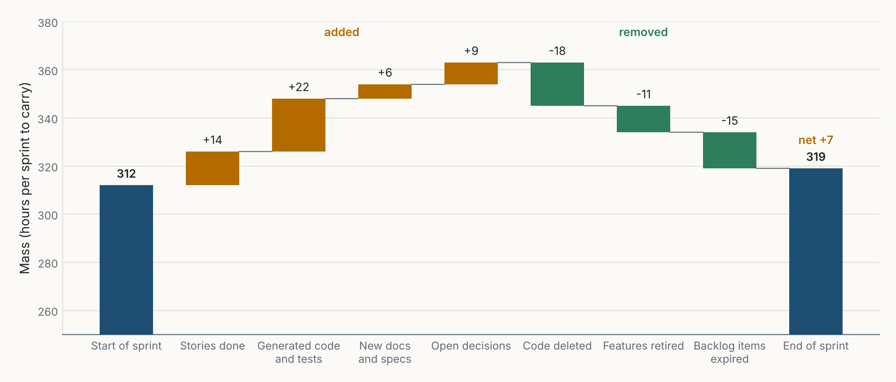

::: {.callout-note appearance="simple"}
**Un regard extérieur.** Je connais Scrum par des années de pratique ; SAFe, je ne le connais que par son cadre public, et les praticiens sauront où les vrais trains diffèrent. La physique est une métaphore, utilisée à dessein ; les chiffres viennent d'un modèle jouet décrit en entier. Les figures sont de moi, faites avec le code de [figs.py](../../../posts/2026-10-24-work-has-mass/figs.py), et leurs libellés sont en anglais. Cet essai fait suite à la série [Le codage agentique](../../agentic-coding.qmd), qui regardait le code ; ici, je regarde l'organisation autour. *Traduit de l'anglais : [version originale](../../../posts/2026-10-24-work-has-mass/index.qmd).*
:::

::: {.callout-tip appearance="simple" icon="false"}
## Trois lois de la masse du travail

1. **Tout ce que vous fabriquez, vous le portez.**
2. **L'IA baisse le coût de fabriquer, pas celui de porter.**
3. **Un processus aussi a une masse.** Dans un univers plus lourd, les cadres doivent s'alléger.
:::

## Le mauvais débat

Les discussions sur l'IA et les cadres agiles se rangent en deux camps. Le premier dit que l'IA rend Scrum et SAFe obsolètes : si un agent construit une fonctionnalité en un après-midi, pourquoi planifier en sprints de deux semaines, ou en incréments de dix semaines avec cent personnes dans une salle ? Le second dit que rien ne change : l'IA n'est qu'un outil plus rapide dans un bon processus.

Les deux camps regardent la *production* : la vitesse à laquelle le travail est fait. Mais les cadres n'ont jamais porté seulement sur la production. Ils portent sur la manière dont un groupe de personnes porte, dans la durée, un ensemble de travail qui grandit, sans en perdre le contrôle. Ce qui devrait les changer n'est pas ce que l'IA fabrique, mais ce qu'elle *laisse derrière elle*. Et la réponse, je vais le soutenir, n'est pas plus de cadre. C'est moins.

## Chaque élément a une masse

Chaque élément qui entre dans le système y reste un moment, et certains y restent pour de bon : une story, une pull request, une fonctionnalité, un test, un document, une dépendance, une décision ouverte, un élément de backlog que quelqu'un « traitera plus tard ». Chacun demande de l'attention pour être gardé : quelqu'un doit le comprendre, le maintenir, répondre aux questions qu'il soulève, ou au moins se souvenir qu'il existe.

J'appelle ce coût permanent la **masse** de l'élément. La masse n'est pas la valeur. Une petite fonctionnalité utilisée par des milliers de personnes peut être légère ; un module généré que personne ne comprend vraiment peut être lourd.

En relativité générale, la masse courbe l'espace-temps : les objets proches d'une grande masse suivent des trajectoires courbes, et le temps s'écoule plus lentement pour eux. C'est une bonne image de ce que le travail accumulé fait à une équipe :

- **Les trajectoires se courbent.** Une nouvelle demande est attirée vers les parties lourdes du système : le module historique, l'intégration dont tout le monde dépend, la décision que personne n'a prise.
- **Le temps ralentit près de la masse.** Le même changement prend plus de temps dans un système lourd, parce que chaque étape doit tenir compte de davantage de choses qui existent déjà.
- **Il y a un horizon.** Si la masse continue de croître, toute l'attention de l'équipe finit par porter ce qui existe. Les demandes entrent toujours. Rien ne sort.

{fig-alt="Deux surfaces en fil de fer vues en perspective. À gauche, un système léger, un léger creux : une grille presque plate avec une masse sombre qui forme un petit creux et deux petits cercles ; un chemin ambre en pointillés de neuf points régulièrement espacés la traverse presque en ligne droite. À droite, un système lourd, un puits profond : la grille s'enfonce en un entonnoir profond autour d'une grande masse sombre au fond, avec une trentaine de cercles sur ses pentes ; le chemin ambre de neuf points part du bord gauche, les points se rapprochent et le chemin descend dans le puits."}

Rien de tout cela n'est nouveau. Lehman l'a énoncé comme une loi de l'évolution du logiciel : la complexité augmente, sauf si l'on travaille à la réduire [@lehman1980]. Le Lean appelle le travail inachevé un stock [@reinertsen2009]. Brooks a montré que les chemins de communication croissent plus vite que l'effectif [@brooks1975]. Ce qui est nouveau, c'est le rythme.

## Ce que l'IA change : le coût de créer de la masse

L'IA rend *produire* un élément beaucoup moins cher. Elle ne rend pas, ou pas encore, le *porter* beaucoup moins cher. Quelqu'un doit toujours décider si une fonctionnalité doit exister, comprendre comment elle s'insère, en répondre quand elle casse, et se souvenir pourquoi elle a été construite. Sous forme de bilan :

$$
\frac{dM}{dt} = \text{production} - \text{retrait}, \qquad \text{capacité pour du travail nouveau} = H - k \cdot M,
$$

où $M$ est la masse du système, $H$ l'attention totale de l'équipe et $k$ l'attention qu'une unité de masse demande. La production est devenue bon marché ; le retrait n'a presque jamais été planifié. Donc $M$ croît plus vite, et $H - kM$ diminue plus vite.

Le plus petit modèle que j'ai pu construire : une équipe dispose de 100 heures d'attention par sprint. Le système commence avec 250 éléments qui demandent chacun 0,1 heure, si bien qu'un quart de l'équipe porte déjà le passé. Un nouvel élément demande 6 heures pour être produit à la main ou 1,5 heure avec l'IA, plus 3 heures pour être absorbé (relire, décider, intégrer). Ce qui reste après le portage va à de nouveaux éléments, et chaque nouvel élément reste. Ces hypothèses font l'essentiel du travail ; j'y reviens dans les objections.

{fig-alt="Deux graphiques en lignes sur 26 sprints. À gauche, la masse : à la main, elle passe de 250 à environ 440 éléments ; avec l'IA, à environ 580 ; avec l'IA et un budget de masse, à environ 350 au sprint 6, puis reste stable. Une ligne rouge pointillée à 1000 marque l'horizon. À droite, le flux : à la main, il baisse de 8,3 à 6,3 éléments par sprint ; avec l'IA, de 16,7 à 9,5, avec la mention moins 43 % après un an ; avec l'IA et un budget de masse, de 16,7 à environ 13 au sprint 8, puis reste stable."}

- **À la main**, l'équipe livre 8,3 éléments au premier sprint et 6,3 au dernier ; le portage passe de 25 % à 44 % de son attention.
- **Avec l'IA**, elle livre 16,7 éléments au premier sprint, et tous les tableaux de bord sont superbes. À la fin de l'année, elle en livre 9,5, avec 58 % de son attention consacrée au portage. La deuxième année, le gain a presque disparu : 5,3 éléments par sprint contre 4,7 à la main.
- **Avec l'IA et un budget de masse**, dès que le portage dépasserait 35 % de l'attention, l'équipe retire des éléments (supprime du code, retire des fonctionnalités, ferme des éléments de backlog) avant d'en ajouter. Elle livre 13 éléments par sprint, la première année comme la deuxième.

Sur la première année, le budget rapporte peu : 356 éléments contre 332, environ 7 % de plus. Ce qui diffère, c'est la situation de chaque équipe à la fin : l'une livre 13 éléments par sprint avec un tiers de son attention sur le passé, l'autre 9,5 et en baisse, avec près de 60 % sur le passé. L'IA ne change pas la *forme* du problème, seulement sa *vitesse*. Un système qui mettait dix ans à devenir lourd peut maintenant le devenir en un an, et nos cadres ont été réglés, implicitement, pour la décennie.

## La dilatation du temps

Le délai de livraison dépend de la capacité disponible. La théorie des files d'attente sait depuis soixante ans que, lorsque la charge approche de la capacité, l'attente ne croît pas régulièrement : elle explose [@kingman1961; @little1961]. La masse mange la capacité disponible. La figure 3 ajoute une hypothèse au modèle : les demandes arrivent à un rythme régulier qui mobilise 35 % de l'équipe.

{fig-alt="Une courbe qui monte lentement, puis fortement. Abscisse : part de l'attention consacrée à porter la masse existante, de 0 à 80 %. Ordonnée : délai comparé à aujourd'hui, de 0 à 6 fois. Points : aujourd'hui à 25 %, 1 fois ; avec un budget de masse à 35 %, environ 1,3 fois ; à la main après un an à 44 %, environ 1,9 fois ; avec l'IA après un an à 58 %, environ 5,9 fois. Une ligne rouge pointillée à 65 % marque l'horizon."}

Cela concorde avec ce que rapportent les équipes : *nous produisons plus que jamais, et tout prend plus de temps*. En 2024, DORA a associé une adoption plus forte de l'IA à un débit de livraison légèrement plus faible (environ 1,5 %) et à une stabilité plus faible (environ 7,2 %) [@dora2024]. En 2025, le débit est devenu positif mais la stabilité est restée négative, et l'explication des auteurs est proche de celle de cet essai : le volume de changements dépasse les contrôles en aval, et les équipes dans des systèmes fortement couplés en tirent peu ou pas de bénéfice [@dora2025]. Des développeurs expérimentés se sont même révélés plus lents avec les outils du début de 2025, dans leurs propres dépôts, grands et matures [@becker2025]. Aucune de ces études n'a mesuré la masse, mais toutes vont dans le même sens : le gain d'une fabrication plus rapide est le plus faible là où il y a le plus à porter.

## Mesurer la masse

La masse n'a pas besoin d'être précise pour être vue. Deux chiffres suffisent pour commencer.

- **La part de portage.** Étiquetez chaque ticket, ou chaque heure, comme *nouveau* ou *portage*. Le portage, c'est tout ce qui est consacré à ce qui existe déjà : support, incidents, mises à jour, questions, relectures de changements qui y touchent. C'est l'abscisse de la figure 3.
- **Les éléments les plus lourds.** Une fois par trimestre, attribuez les heures de portage aux éléments qui les ont causées et dressez la liste des dix premiers. La masse est très inégale ; quelques services, intégrations ou décisions ouvertes en portent généralement l'essentiel. C'est par cette liste que commence le retrait.

## Un cadre aussi a une masse

La troisième loi est celle que je trouve la plus importante. Chaque événement, rôle, artefact, indicateur et outil d'un cadre est un élément du système, et coûte de l'attention à chaque sprint, qu'il aide ou non. Les cadres grandissent par ajout, et presque rien n'est jamais retiré. Quand l'IA alourdit le travail, un processus plus lourd est la dernière chose dont le système a besoin. J'appliquerais donc un seul test à chaque élément de Scrum et de SAFe :

> **Le test de masse.** Cet élément retire-t-il ou évite-t-il plus de masse qu'il n'en ajoute ?

{fig-alt="Un nuage de points coupé par une diagonale. Abscisse : la masse ajoutée, l'attention coûtée à chaque sprint. Ordonnée : la masse retirée ou évitée. Zone en haut à gauche, en vert : garder, retire plus de masse qu'il n'en ajoute. On y trouve l'itération IP utilisée pour le retrait, la Definition of Done, le Sprint Goal, la Sprint Review, la System Demo et la rétrospective. Le Daily Scrum est sur la ligne. Zone en bas à droite : alléger ou couper, ajoute plus qu'il ne retire. On y trouve le WSJF sur chaque fonctionnalité, les réunions de synchronisation d'un grand train, les couches au-dessus du train, le PI Planning avec tout le train pendant deux jours, avec une flèche pointillée marquée slim it qui monte vers le PI Outcome Planning d'une journée, la version AI-Native de SAFe, dans la zone à garder ; l'affinage d'un long backlog, et les story points et la vélocité comme ajouts."}

Mes placements comptent moins que le motif. **Les parties qui disent non passent. Les parties qui comptent échouent.** Un Sprint Goal, une Definition of Done, une revue, une itération réservée au retrait : chacun décide de ce qu'il ne faut *pas* porter, et coûte peu. Estimer chaque élément, affiner un long backlog, synchroniser un grand train : chacun gère une quantité de travail, et la quantité est exactement ce que l'IA a rendu bon marché. Certains éléments sont entre les deux et peuvent être allégés plutôt que coupés. Le PI Planning est le cas le plus clair, et SAFe le fait déjà évoluer : ses recommandations AI-Native remplacent l'événement de deux jours par un PI Outcome Planning d'une journée, et fondent la System Demo et l'Inspect and Adapt dans un événement de deux heures à chaque itération [@safeai2026]. Appliqué honnêtement, le test ne rejette aucun des deux cadres. Il les réduit tous deux à leur noyau.

## Scrum : plus léger, pas plus lâche

Le Scrum Guide est déjà court : empirisme et pensée lean, une équipe de dix personnes au plus, une durée fixe d'un mois au plus, cinq événements et trois engagements, le Product Goal, le Sprint Goal et la Definition of Done [@scrumguide2020]. Il ne dit rien des story points ni de la vélocité ; ce sont des ajouts courants, et l'essentiel de ce qui alourdit Scrum en pratique se trouve dans les ajouts.

| Élément | Calibré pour | Dans un univers plus lourd |
|---|---|---|
| **Sprint** | Un rythme pour produire un incrément utilisable | Un rythme pour l'*absorber* : décider, intégrer, comprendre. |
| **Sprint Goal** | La concentration pendant le sprint | À garder. La façon la moins chère de dire non. |
| **Definition of Done** | La qualité qu'un incrément doit atteindre | À garder, en ajoutant : ce qu'il coûte à porter, ce qui a été retiré pour lui faire de la place. |
| **Product Backlog** | Une liste ordonnée, affinée au besoin | Courte, avec des éléments qui *expirent*. L'IA peut la remplir sans limite. |
| **Sprint Review** | Inspecter l'incrément | Inspecter l'incrément *et le registre de masse* (figure 6). |
| **Daily Scrum** | Une inspection quotidienne vers l'objectif | Le garder court, ou asynchrone pour une petite équipe. |
| **Story points, vélocité** *(ajouts, absents du Guide)* | Ce que l'équipe peut fabriquer | À abandonner. Avec l'IA, ils mesurent la masse ajoutée. Utiliser le délai et la part de portage. |
| **Taille de l'équipe** | Dix au plus, pour garder une communication gérable | La limite est la masse que chaque personne porte. Cinq personnes avec l'IA peuvent porter la masse de vingt. |

: **Tableau 1.** Scrum, relu avec la masse en tête. La colonne du milieu est ma lecture du Scrum Guide et de la pratique courante ; la colonne de droite est ma proposition.

**Le backlog a besoin d'évaporation.** Quand écrire un élément de backlog demandait de l'effort, l'effort servait de filtre. Aujourd'hui, une IA peut transformer chaque réunion en dix stories bien écrites, et chaque story est une promesse qui a une masse. Sans activité pendant trois sprints, un élément expire, sauf si quelqu'un le renouvelle. Les trous noirs s'évaporent lentement. Les backlogs devraient en faire autant.

Ce qui reste, c'est Scrum dans son noyau : un objectif, un standard, une liste courte, un rythme d'inspection et un registre de ce que l'équipe porte. Moins de cadre que ce que la plupart des équipes font tourner aujourd'hui, pas plus.

## SAFe : des trains plus petits, moins de couches

La structure centrale de SAFe est l'Agile Release Train (ART), une équipe d'équipes agiles durable, généralement de 50 à 125 personnes [@safe6], qui planifie ensemble toutes les 8 à 12 semaines [@safepi]. Le travail est classé par Weighted Shortest Job First (WSJF) : le coût du retard divisé par la taille du travail, une idée issue du flux de développement produit [@reinertsen2009].

SAFe sait déjà que le travail existant pèse. À chaque fin d'intervalle, les trains conviennent d'une *allocation de capacité* : la part de capacité consacrée aux nouvelles fonctionnalités face aux enablers, à la dette technique et à la maintenance [@safebacklog]. C'est proche d'un budget de masse, et les trains qui l'utilisent bien ont de l'avance. La différence tient à ce qui est limité. Une allocation de capacité plafonne l'effort consacré à l'existant ; un budget de masse plafonne l'existant lui-même, et oblige à retirer quand il grossit.

### Le WSJF ne départage plus

Avec l'IA, les tailles de travail diminuent, mais de façon inégale : les petites fonctionnalités atteignent un plancher, les complexes diminuent moins. Le dénominateur perd son étendue, et le classement se réduit au seul coût du retard. Et la taille du travail n'a jamais mesuré ce qu'une fonctionnalité coûte à *porter*, qui en est maintenant la plus grande part.

{fig-alt="Un graphique de pente avec trois colonnes de huit fonctionnalités. WSJF classique à la main, de haut en bas : Export to PDF 3,0, Checkout redesign 2,2, Faster search 1,6, New partner API 1,6, Admin dashboard 1,6, Chat assistant 1,2, Fraud rules v2 1,0, Second mobile app 0,8 ; écart 3,8 fois. WSJF classique avec l'IA : Checkout redesign 9,0, Export to PDF 9,0, Admin dashboard 8,0, Chat assistant 7,5, New partner API 7,0, Faster search 6,5, Second mobile app 5,3, Fraud rules v2 4,0 ; écart 2,2 fois. WSJF avec coût de portage : Export to PDF 4,5, Checkout redesign 3,6, Faster search 3,2, Fraud rules v2 1,5, Admin dashboard 1,3, New partner API 1,3, Chat assistant 1,0, Second mobile app 0,7 ; écart 6,8 fois. Faster search, Fraud rules v2 et Chat assistant sont mis en évidence parce que leur rang bouge d'au moins trois places entre les deux dernières colonnes."}

La correction est petite : ajouter le coût de portage au dénominateur,

$$
\text{WSJF}_{\text{masse}} = \frac{\text{coût du retard}}{\text{taille du travail} + \text{coût de portage}},
$$

où le coût de portage est une estimation relative de l'attention que la fonctionnalité demandera pendant sa première année. Un assistant conversationnel est rapide à construire et lent à porter : il descend. Une recherche plus rapide n'ajoute presque rien à porter : elle monte. Et il suffit de noter le haut du backlog : classer des fonctionnalités qui ne seront jamais construites est en soi de la masse.

### Des trains plus petits, moins de couches

De 50 à 125 personnes, c'est une limite de coordination, apprise d'équipes qui produisaient à vitesse humaine. Mais un train ne coordonne pas des personnes ; il coordonne ce qu'elles produisent et doivent garder cohérent : interfaces, dépendances, données partagées, décisions partagées. Si chaque personne ajoute trois fois plus de masse, un train atteint cette limite à environ un tiers de sa taille.

La réponse tentante est plus de structure. Le test de masse indique l'inverse. Découpez les trains selon la masse, bien avant 125 personnes, pour que chacun porte moins. Des trains plus petits ont besoin de moins de réunions de synchronisation et de moins de rôles de coordination, et peut-être de moins de la structure au-dessus d'eux. La planification rétrécit avec eux : chaque équipe apporte un **budget de masse** à côté de sa capacité, le tableau ne montre que les dépendances qui traversent les équipes, et l'itération Innovation and Planning devient le lieu du retrait. SAFe avec l'IA devrait ressembler moins à un SAFe plus gros qu'à quelques trains petits et légers, chacun avec un budget clair de ce qu'il a le droit de porter.

## Ce que je ferais concrètement

1. **Mesurer la part de portage** et dresser la liste des dix éléments les plus lourds.
2. **Fixer un budget de masse,** et traiter son dépassement comme un build rouge : arrêter d'ajouter, commencer à retirer.
3. **Faire du retrait un livrable,** montré à la Sprint Review et à la System Demo à côté de ce qui a été ajouté.
4. **Laisser les éléments expirer :** éléments de backlog, questions ouvertes, documents générés.
5. **Intégrer la masse dans la priorité :** WSJF avec coût de portage, pour le haut du backlog seulement.
6. **Dimensionner les équipes et les trains selon la masse,** pas selon l'effectif.
7. **Soumettre le cadre au test de masse,** ces sept propositions comprises.

Ce dernier point compte, car ce sont de nouvelles pratiques, et un essai contre la masse des cadres ne devrait pas en ajouter en douce. Chacune remplace quelque chose de plus lourd. La part de portage et le délai remplacent les story points et la vélocité. L'expiration remplace l'affinage d'un long backlog. Le registre remplace un rapport d'avancement, et n'est qu'un graphique dans une revue qui existe déjà. Le budget de masse est un chiffre dans un événement de planification qui existe déjà, pas un nouvel événement. Si l'une d'elles ne retire pas plus qu'elle n'ajoute dans votre équipe, abandonnez-la.

{fig-alt="Un graphique en cascade. Début de sprint 312. Ajouts, en ambre : stories terminées +14, code et tests générés +22, nouveaux documents et spécifications +6, décisions ouvertes +9. Retraits, en vert : code supprimé -18, fonctionnalités retirées -11, éléments de backlog expirés -15. Fin de sprint 319, solde +7."}

## Objections

**« C'est de la dette technique, ou du stock au sens du Lean, sous un nouveau nom. »** En partie. Mais une fonctionnalité bien construite et utilisée n'est ni une dette ni un stock, et elle doit pourtant être portée. Le stock du Lean, c'est surtout du travail inachevé ; la masse qui croît le plus vite avec l'IA, c'est du travail *achevé*. Le Lean dit aussi de piloter un système à sa contrainte [@goldratt1984], et la contrainte s'est déplacée de la fabrication vers le portage.

**« L'IA portera aussi la masse. »** En partie, oui : les agents lisent déjà le code et résument les documents, ce qui fait baisser $k$. Si $k$ baisse aussi vite que les coûts de production, cet essai a tort. J'en doute, parce que la masse qui compte le plus a besoin d'une personne : répondre d'une fonctionnalité, décider de la garder ou de la supprimer, le client qui en dépend.

**« Personne n'est promu pour avoir supprimé quelque chose. »** C'est vrai, et c'est la raison la plus sérieuse pour laquelle un budget de masse pourrait échouer. Les organisations récompensent ce qui est ajouté. C'est pourquoi le retrait doit être montré et compté lors des mêmes événements que la livraison, et pourquoi le registre a deux colonnes. Ce qui n'est pas vu n'est pas récompensé.

**« Le modèle est trop simple. »** Il l'est : une équipe, des paramètres constants, des éléments qui ne s'allègent jamais, et une IA qui baisse le coût de fabriquer mais pas celui de porter. Le modèle montre la conséquence de ces hypothèses, pas leur vérité. Si un meilleur modèle montre que la masse se stabilise d'elle-même, j'aimerais le voir.

**« La physique n'est que décorative. »** Peut-être. Mais les métaphores choisissent ce que nous regardons. La *vélocité* a fait regarder la vitesse aux équipes. La *masse* leur ferait regarder ce que la vitesse laisse derrière elle.

## Conclusion

Scrum et SAFe n'ont pas tort. L'empirisme, les boucles de retour courtes, les petites équipes, la cadence partagée et la priorisation économique sont aussi utiles avec l'IA que sans elle. Mais les deux ont été calibrés dans un univers où produire le travail était la partie difficile, et où la masse croissait assez lentement pour devenir plus tard le problème de quelqu'un d'autre.

L'IA a changé le rythme auquel nous créons de la masse, pas encore celui auquel nous la portons. Le réflexe sera d'ajouter : plus de cérémonies pour contrôler plus de production, plus de rôles pour coordonner plus d'équipes, plus de couches pour planifier plus de travail. Cela ajoute de la masse à un système qui tombe déjà dans son propre puits. La meilleure réponse est l'inverse : mesurer la masse, la budgéter, lui donner un prix, la retirer aussi délibérément que nous ajoutons, puis mettre les cadres eux-mêmes sur la balance.

**Tout ce que vous fabriquez, vous le portez. Dans un univers plus lourd, commencez par porter moins de cadre.**
