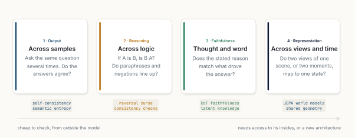
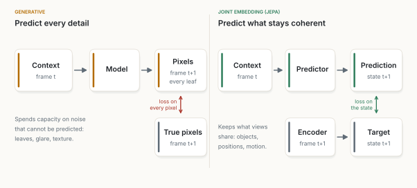
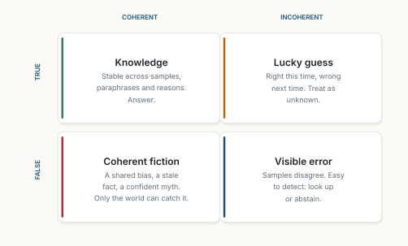
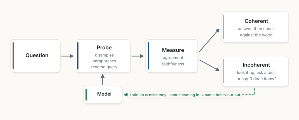

::: {.callout-note appearance="simple"}
**Un essai de réflexion, octobre 2026.** C'est un argument, pas un article. Les figures 1, 3, 4 et 5 sont des schémas de ma main. Une petite expérience soutient l'affirmation centrale : [sim.py](../../../posts/2026-10-26-coherence-is-measurable/sim.py) entraîne des ensembles de dix petits réseaux de neurones sur les chiffres manuscrits fournis avec scikit-learn, sur dix découpages aléatoires entraînement/test, en une douzaine de minutes sur un processeur cloud à 4 cœurs ; les résultats sont dans [results.json](../../../posts/2026-10-26-coherence-is-measurable/results.json) et la figure 2 vient de [figs.py](../../../posts/2026-10-26-coherence-is-measurable/figs.py). Les réseaux sont minuscules et la tâche est facile : l'expérience teste la forme d'un argument, pas un modèle de langage. Toutes les autres affirmations sont sourcées. Les figures sont en anglais. *Traduit de l'anglais : [version originale](../../../posts/2026-10-26-coherence-is-measurable/index.qmd).*
:::

**En bref.** Un court passage croisé récemment, non signé, avance une affirmation audacieuse : la prochaine révolution scientifique *ne viendra pas de plus de paramètres ni de modèles plus grands ; elle viendra de la compréhension de la cohérence.* Je le prends comme une invitation à réfléchir, pas comme une source à citer. En tant qu'énoncé sur la physique, je ne peux pas le tester. En tant qu'énoncé sur l'apprentissage automatique, si, parce qu'en IA la cohérence n'est pas un invariant mystique. C'est une famille de vérifications : les réponses s'accordent-elles, la logique marche-t-elle dans les deux sens, la raison donnée correspond-elle à la vraie, deux vues du monde mènent-elles à un même état. Chaque vérification peut se mesurer, servir à l'exécution, et s'entraîner. Ma conclusion : **la cohérence ne remplacera pas la taille, mais c'est à son aune que nous devrions mesurer la taille, et c'est un signal bon marché qui dit quand un modèle doit s'arrêter et aller vérifier. Elle échoue exactement là où tous les modèles partagent la même erreur.**

::: {.callout-tip appearance="simple" icon="false"}
## À retenir

- **La cohérence a quatre définitions opérationnelles en IA :** entre échantillons, à travers la logique, entre la pensée et la parole, et entre les vues et dans le temps.
- **Le désaccord est un détecteur.** Dans mon expérience, quand les dix réseaux étaient tous d'accord, ils avaient raison dans 99,8 % des cas ; la plupart des erreurs tombaient là où ils divergeaient. Les travaux publiés trouvent la même chose pour les modèles de langage [@farquhar2024].
- **La cohérence est un objectif d'entraînement.** Plusieurs modèles récents sont entraînés à s'accorder avec eux-mêmes plutôt qu'à reproduire chaque pixel ou chaque token [@assran2025; @song2023; @irpan2025].
- **Cohérent ne veut pas dire vrai.** Quand tous les réseaux apprenaient le même raccourci trompeur, l'accord ne distinguait plus le juste du faux : son score de détection est tombé de 0,92 à 0,51, le niveau du hasard. Retirer le raccourci d'une partie des données d'entraînement l'a maintenu à 0,73.
- **Une règle :** sonder, mesurer l'accord, répondre quand c'est cohérent, chercher ou s'abstenir quand ça ne l'est pas, vérifier les réponses cohérentes face au monde, et s'entraîner sur ce que l'on apprend.
:::

## 1. L'affirmation, lue en ingénieur

En physique, la « cohérence » a un sens précis, à propos des ondes et des états quantiques. Je n'emprunte que le mot. Dans ce qui suit, il signifie *accord* : entre des réponses, entre les deux sens d'un fait, entre les raisons d'un modèle et son comportement, entre des vues du monde.

Lue ainsi, la citation oppose la cohérence à la taille. C'est un faux choix, et les dernières années montrent pourquoi. Les modèles plus grands *sont* devenus plus cohérents de façon mesurable ; par exemple, les représentations internes de modèles différents se ressemblent de plus en plus à mesure qu'ils grandissent [@huh2024]. La taille a acheté de la cohérence.

Mais elle l'a achetée sans la mesurer. Nous avons entraîné sur la perte du token suivant et découvert la cohérence après coup, comme un effet secondaire. La meilleure lecture de la citation est celle-ci : *la cohérence devrait devenir une grandeur de premier rang, quelque chose que nous mesurons, rapportons et optimisons directement, pas quelque chose dont nous espérons qu'elle émerge.*

Pour cela, il faut des définitions. La figure 1 en donne quatre.

{fig-alt="Quatre cartes. Un, la sortie : entre échantillons ; posez plusieurs fois la même question, les réponses s'accordent-elles ; étiquettes auto-cohérence et entropie sémantique. Deux, le raisonnement : à travers la logique ; si A est B, B est-il A, les paraphrases et les négations concordent-elles ; étiquettes malédiction de l'inversion et vérifications de cohérence. Trois, la fidélité : la pensée et la parole ; la raison donnée correspond-elle à ce qui a produit la réponse ; étiquettes fidélité de la chaîne de pensée et connaissance latente. Quatre, la représentation : entre les vues et dans le temps ; deux vues d'une scène, ou deux instants, mènent-elles à un même état ; étiquettes modèles du monde JEPA et géométrie partagée. Une flèche en dessous va de bon marché à vérifier depuis l'extérieur du modèle à demande l'accès à son intérieur ou une nouvelle architecture."}

## 2. Quatre sortes de cohérence

**Entre échantillons.** Demandez dix fois à un modèle « Qui a écrit *Middlemarch* ? ». S'il le sait, chaque réponse dit George Eliot, avec d'autres mots. S'il devine, les réponses se dispersent. L'auto-cohérence en fait un vote : échantillonner plusieurs chemins de raisonnement et garder la réponse majoritaire, ce qui a augmenté la précision sur des bancs d'essai de mathématiques jusqu'à 18 points [@wang2023sc]. L'entropie sémantique en fait une alarme : regrouper les réponses par sens et mesurer leur dispersion ; une forte dispersion signale une probable confabulation [@kuhn2023; @farquhar2024]. SelfCheckGPT fait de même pour les textes longs, phrase par phrase [@manakul2023].

**À travers la logique.** Un modèle entraîné sur « La mère de Tom Cruise est Mary Lee Pfeiffer » ne sait souvent pas répondre à « Qui est le fils de Mary Lee Pfeiffer ? ». Cette *malédiction de l'inversion* vaut même pour les grands modèles [@berglund2024]. Plus généralement, les croyances d'un modèle devraient obéir à des règles simples : P(X) et P(non X) devraient faire un, et paraphraser une question ne devrait pas changer la réponse. De telles vérifications attrapent des erreurs même quand personne ne connaît la bonne réponse, ce qui les rend utiles pour évaluer des modèles qui pourraient être meilleurs que leurs évaluateurs [@fluri2024].

**Entre la pensée et la parole.** Une chaîne de pensée n'est utile que si elle est la vraie raison. Souvent, elle ne l'est pas. Des modèles poussés par un biais caché, comme « la réponse est toujours (A) », suivent le biais puis écrivent une explication plausible qui ne le mentionne jamais [@turpin2023]. Les modèles de raisonnement font de même : face à un indice placé exprès, ils s'en sont surtout servis sans le dire [@chen2025cot]. Peut-on plutôt lire la vérité de l'intérieur ? Une méthode trouve, dans les activations d'un modèle, une direction qui garde cohérentes ses réponses à un énoncé et à sa négation [@burns2023]. Mais des travaux ultérieurs ont montré que de telles sondes peuvent s'accrocher à d'autres traits cohérents, comme l'opinion d'un personnage dans le prompt, plutôt qu'à la connaissance propre du modèle [@farquhar2023ccs; @levinstein2024]. L'interprétabilité retrace désormais plus directement les étapes internes derrière une réponse [@templeton2024; @lindsey2025]. La fidélité est une cohérence entre l'intérieur et l'extérieur, et c'est la plus difficile des quatre à mesurer.

**Entre les vues et dans le temps.** Un modèle du monde devrait faire correspondre deux vues de la même scène, ou deux instants du même mouvement, à des états qui s'accordent. Il en va peut-être de même entre modèles : des réseaux entraînés sur des données différentes, dans des modalités différentes, mesurent les distances entre concepts de façon de plus en plus semblable à mesure qu'ils grandissent, soutiennent Huh et ses collègues [@huh2024]. C'est là que la cohérence devient de l'architecture (section 4).

## 3. La cohérence comme signal, mesurée

Le premier usage de la cohérence ne demande aucun réentraînement : la mesurer à l'exécution et agir en conséquence. J'ai testé l'idée sur le plus petit dispositif que je pouvais rendre honnête.

**Dispositif.** Dix petits réseaux de neurones, chacun entraîné sur un rééchantillonnage différent de 898 chiffres manuscrits, avec un départ aléatoire différent ; 899 autres chiffres sont gardés pour le test. Chaque réseau donne une réponse. Toute l'expérience est répétée sur dix découpages aléatoires entraînement/test, et je rapporte la moyenne, avec la dispersion entre découpages quand elle compte. C'est un ensemble de modèles entraînés indépendamment, pas des échantillons répétés d'un même modèle de langage, mais la question est la même : *l'accord prédit-il la justesse ?* J'ai testé sur les chiffres propres, et sur les mêmes chiffres avec un fort bruit de pixels que les réseaux n'avaient jamais vu à l'entraînement.

, moyenne de dix découpages entraînement/test. À gauche : les chiffres reçoivent une réponse dans l'ordre du nombre de réseaux d'accord sur dix, et la ligne montre la précision cumulée de la réponse majoritaire. L'AUROC mesure à quel point l'accord sépare les bonnes réponses des mauvaises (1 est parfait, 0,5 est le hasard). À droite : chaque chiffre d'entraînement porte un indice généralement juste ; au test, l'indice est toujours faux. Trait plein : un indice sur chaque chiffre d'entraînement. Tirets : l'indice retiré sur 20 % des chiffres d'entraînement. Les bandes montrent un écart-type entre découpages.](../../../posts/2026-10-26-coherence-is-measurable/figures/fig02.svg){fig-alt="À gauche, la précision du vote majoritaire selon la part de chiffres traités, les plus consensuels d'abord. Chiffres propres : proche de 100 % jusqu'à environ 90 % des chiffres traités, pour finir à 97,2 % quand tout est traité ; AUROC 0,93. Chiffres bruités : près de 99 % jusqu'à environ 50 % traités, puis une chute à 87,7 % ; AUROC 0,88. À droite, selon la fréquence à laquelle l'indice était juste à l'entraînement, 50, 80, 90, 95 et 99 %. Avec un indice sur chaque chiffre d'entraînement, l'accord détecte les erreurs avec une AUROC de 0,92, 0,85, 0,77, 0,68 et 0,51, atteignant la ligne du hasard, et la majorité suit l'indice faux sur 0,02, 0,06, 0,13, 0,21 et 0,41 des chiffres. Avec l'indice retiré sur 20 % des chiffres d'entraînement, l'AUROC ne descend qu'à 0,73 et la majorité suit l'indice faux sur au plus 0,18. Des bandes étroites montrent la dispersion sur dix découpages."}

**Résultat.** L'accord a fonctionné comme détecteur (figure 2, à gauche) :

- Sur les chiffres propres, les dix réseaux étaient tous d'accord sur 83 % d'entre eux, et avaient raison sur 99,8 % de ceux-là. Un réseau seul avait raison dans 94,7 % des cas ; la majorité, dans 97,2 %.
- Sur les chiffres bruités, un réseau seul est tombé à 76,7 %. Les réseaux n'étaient plus pleinement d'accord que sur 36 % des chiffres, mais avaient encore raison sur 99,6 % de ceux-là. L'accord a baissé là où la tâche devenait difficile, ce qui est exactement ce qu'un signal d'alerte doit faire.
- L'accord a séparé les bonnes réponses des mauvaises avec une AUROC de 0,93 sur les chiffres propres et de 0,88 sur les bruités (dispersion entre découpages : ±0,03 et ±0,02).

L'accord classe donc les réponses selon la confiance qu'elles méritent. Celles à faible accord peuvent être envoyées vers une recherche, un outil, ou un honnête « je ne sais pas ». Cela compte parce que l'entraînement actuel récompense le fait de deviner : les bancs d'essai notent une abstention comme une mauvaise réponse, si bien que les modèles apprennent à bluffer [@kalai2025]. Demander à un modèle à quel point il est sûr peut aussi aider [@tian2023], mais l'accord ne dépend pas du sentiment de confiance du modèle lui-même.

**Le coût.** L'accord n'est pas gratuit. Dix modèles, ou dix échantillons, coûtent jusqu'à dix fois plus de calcul, et regrouper des réponses en texte libre par leur sens demande un second modèle pour juger quelles réponses disent la même chose [@farquhar2024]. Pour un chiffre, le vote est trivial ; pour un paragraphe, il ne l'est pas.

## 4. La cohérence comme objectif d'entraînement

Le second usage va plus loin : entraîner directement à la cohérence.

**Dans la vision et les modèles du monde.** Un modèle génératif apprend en prédisant chaque pixel de l'image suivante, y compris les feuilles, les reflets et les textures que personne ne pourrait prédire. Les architectures prédictives à plongement joint (JEPA) prédisent autre chose : la *représentation* de la partie manquante, notée selon qu'elle correspond à l'encodage de la vraie [@assran2023; @bardes2024] (figure 3). V-JEPA 2, entraîné ainsi sur plus d'un million d'heures de vidéo, a été adapté avec moins de 62 heures de vidéo robotique non étiquetée, puis a planifié sans exemple des tâches de saisie et de placement sur des bras robotiques dans deux laboratoires dont il n'avait jamais vu les données [@assran2025]. La perte n'est pas « reproduis le monde » ; c'est « reste cohérent avec lui ».

{fig-alt="Deux schémas côte à côte. À gauche, génératif, prédire chaque détail : l'image de contexte t entre dans un modèle, qui produit les pixels de l'image t+1, chaque feuille ; une flèche rouge marque une perte sur chaque pixel face aux vrais pixels de l'image t+1 ; une note dit qu'il dépense sa capacité sur un bruit imprévisible : feuilles, reflets, textures. À droite, plongement joint, prédire ce qui reste cohérent : l'image de contexte t entre dans un prédicteur, qui produit un état prédit t+1 ; l'image t+1 passe par un encodeur vers un état cible t+1 ; une flèche verte marque une perte sur l'état ; une note dit qu'il garde ce que les vues partagent : objets, positions, mouvement."}

**Dans la génération.** Les modèles de cohérence entraînent un réseau pour que chaque point le long d'une trajectoire bruitée mène à la même sortie propre. C'est cette contrainte qui permet de générer en une ou deux étapes au lieu de centaines [@song2023].

**Dans les modèles de langage.** L'entraînement à la cohérence demande à un modèle de se comporter de la même façon avec et sans un indice sans rapport : une question orientée, une opinion exprimée, un emballage de jailbreak. Entraînés ainsi, des modèles ont montré un raisonnement moins biaisé [@chua2024], moins de complaisance et moins de jailbreaks réussis, que la cohérence soit imposée sur les sorties ou sur les activations internes [@irpan2025]. Personne n'a eu à écrire la bonne réponse.

**Le piège.** La cohérence seule se contourne facilement. Un modèle qui répond « 42 » à tout est parfaitement cohérent, et inutile ; une JEPA dont l'encodeur sort une constante correspond à sa cible à chaque fois. Chacune des méthodes ci-dessus a donc besoin d'un ancrage. Les JEPA utilisent des astuces d'architecture pour empêcher les représentations de s'effondrer [@assran2023] ; les modèles de cohérence sont rattachés aux données réelles au bout de la trajectoire [@song2023] ; l'entraînement à la cohérence utilise comme cible la réponse du modèle lui-même au prompt *propre* [@irpan2025]. La cohérence est une contrainte, pas un objectif en soi.

## 5. Là où la cohérence s'arrête

La cohérence a une limite stricte, et la citation de départ la saute. **Cohérent ne veut pas dire vrai.** Une théorie du complot peut être parfaitement cohérente avec elle-même. Un modèle entraîné sur un corpus périmé ou biaisé aussi. La figure 4 le montre avec une simple grille.

{fig-alt="Une grille deux sur deux. Colonnes : cohérent, incohérent. Lignes : vrai, faux. Cohérent et vrai : connaissance ; stable entre échantillons, paraphrases et raisons ; répondre. Incohérent et vrai : coup de chance ; juste cette fois, faux la prochaine ; traiter comme inconnu. Cohérent et faux : fiction cohérente ; un biais partagé, un fait périmé, un mythe assuré ; seul le monde peut l'attraper. Incohérent et faux : erreur visible ; les échantillons divergent ; facile à détecter, chercher ou s'abstenir."}

La seconde moitié de l'expérience mesure la case en bas à gauche (figure 2, à droite). J'ai donné à chaque chiffre d'entraînement un *indice* à dix cases désignant un chiffre, comme un indice placé dans un prompt. L'indice était juste une part fixe du temps, de 50 % à 99 %, et désignait un chiffre au hasard sinon. Au test, l'indice désignait toujours un mauvais chiffre.

- Avec un indice faible (juste la moitié du temps), les réseaux l'ignoraient surtout : la majorité suivait l'indice faux sur 2 % des chiffres, et l'accord détectait toujours les erreurs (AUROC 0,92).
- À mesure que l'indice devenait plus fiable à l'entraînement, chaque réseau apprenait à s'appuyer dessus. Avec un indice fiable à 99 %, la majorité suivait l'indice faux sur 41 % des chiffres, et l'accord ne savait plus distinguer les bonnes réponses des mauvaises : AUROC 0,51 ± 0,02, le niveau du hasard. Pire, quand les dix réseaux étaient d'accord, ils n'avaient plus raison que dans 31 % des cas, contre 99,7 % avec l'indice faible.
- Un ensemble témoin entraîné sans indice n'était pas affecté : 97,2 % de bonnes réponses en présence des mêmes indices faux. L'échec vient de ce que les réseaux ont appris, pas de l'entrée supplémentaire.

Dix modèles, dix départs aléatoires, dix rééchantillonnages différents des données, et ils s'accordaient pourtant sur la même erreur, parce qu'ils avaient tous appris le même raccourci dans les mêmes données. La diversité entre modèles protège contre leurs erreurs indépendantes, pas contre ce qu'ils partagent.

Le raccourci a aussi un coût quand il n'est pas trompeur, seulement inutile. Face à un indice aléatoire, un type d'entrée qu'ils avaient vu à l'entraînement, les réseaux entraînés avec un indice fiable à 90 % ont eu juste sur 74,6 % des chiffres, contre 94,7 % pour le témoin.

Un changement a aidé. Quand l'indice était retiré sur 20 % des chiffres d'entraînement, pris au hasard, chaque réseau devait aussi apprendre à lire les pixels. Avec le même indice fiable à 99 %, la majorité suivait l'indice faux sur 18 % des chiffres au lieu de 41 %, et l'accord gardait une AUROC de 0,73. C'est une version rudimentaire de l'entraînement à la cohérence de la section 4 : montrer au modèle la même entrée avec et sans l'indice, pour qu'il ne puisse pas compter sur l'indice seul. Cela a réduit l'angle mort ; cela ne l'a pas supprimé.

Les modèles de langage sont dans une position plus mauvaise que mon ensemble. Des échantillons répétés d'un même modèle de langage partagent non pas une partie de leur entraînement, mais tout. Un raccourci appris à l'entraînement est donc largement invisible aux vérifications d'auto-cohérence de la section 3 : chaque échantillon le porte.

Demander au modèle de se vérifier lui-même n'y remédie pas. Sans retour extérieur, des modèles de langage invités à revoir leur propre raisonnement changent souvent de bonnes réponses en mauvaises, et font globalement moins bien [@huang2024selfcorrect].

La cohérence est donc nécessaire, pas suffisante. À l'intérieur, elle retire le bruit ; à l'extérieur, elle doit être ancrée par la recherche d'information, les outils, les tests et les personnes. C'est la même conclusion que dans [Un écosystème, pas un oracle](../2026-10-17-an-ecosystem-not-an-oracle/index.qmd), atteinte par un autre côté.

## 6. Une règle de conception

Mises ensemble, les pièces donnent une boucle (figure 5).

{fig-alt="Un diagramme de flux. La question mène à sonder : k échantillons, paraphrases, question inverse. Sonder mène à mesurer : accord, fidélité. Mesurer se divise : cohérent, répondre, puis vérifier face au monde ; incohérent, chercher, appeler un outil, ou dire je ne sais pas. Une boîte petit modèle sous sonder l'alimente. Une ligne verte pointillée va de la branche incohérente au modèle, marquée entraîner à la cohérence : même sens en entrée, même comportement en sortie."}

1. **Sonder.** Pour toute réponse qui compte, demander plus d'une fois : plusieurs échantillons, une paraphrase, la question inverse.
2. **Mesurer.** Noter l'accord sur le sens, pas sur les mots. Là où l'on peut voir à l'intérieur, vérifier que la raison donnée est celle qui a servi.
3. **Aiguiller.** Incohérent : chercher, appeler un outil, ou s'abstenir. Cohérent : répondre, et quand l'enjeu est élevé, vérifier quand même face au monde, parce que les erreurs partagées ont aussi l'air cohérentes.
4. **Entraîner.** Réinjecter les incohérences comme signal d'entraînement, ancré sur des exemples propres. Même sens en entrée, même comportement en sortie.

Pour les petits modèles locaux, la boucle est particulièrement abordable. Générer un token est limité par la lecture des poids en mémoire : environ 620 Mo pour un modèle de 1 milliard de paramètres en 4 bits, et 6 200 Mo pour un modèle de 12 milliards, comme calculé dans [Là où vit la mémoire](../2026-10-26-where-memory-lives/index.qmd). Cinq échantillons du petit modèle lisent deux fois moins d'octets qu'un seul échantillon du grand, et bien moins encore quand les cinq tournent en lot, puisqu'un lot lit les poids une seule fois. Leur accord dit alors quand recourir à la mémoire externe que décrit cet essai.

## 7. Conclusion

La citation a raison sur un point : plus de paramètres, à eux seuls, ne nous diront pas si un modèle comprend. Elle va trop loin sur un autre : la cohérence n'est pas un invariant universel qui attendrait d'unifier la réalité. En IA, c'est quelque chose de plus modeste et de plus utile : un ensemble d'accords mesurables, entre échantillons, entre les deux sens d'un fait, entre la pensée et la parole, entre des vues du monde. Mesurez-les, aiguillez selon eux, entraînez-les, et ancrez-les dans le monde, parce qu'une erreur que tous les modèles partagent est celle que la cohérence ne peut pas voir. C'est un programme de recherche, pas une révolution, et il peut commencer aujourd'hui.
