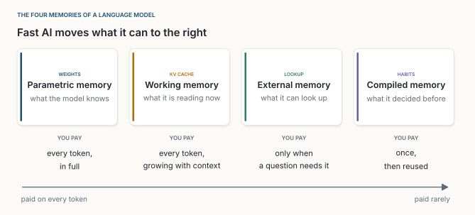
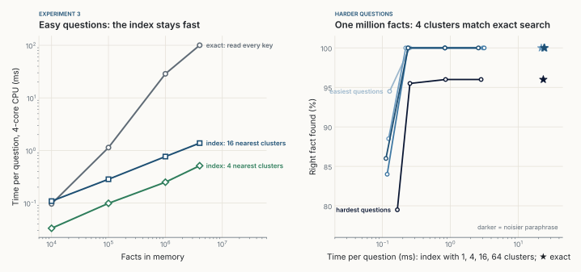
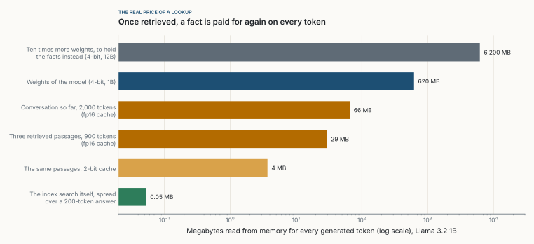
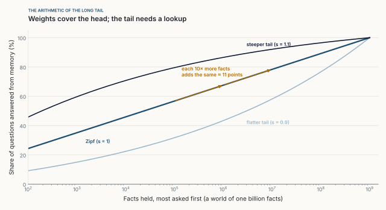
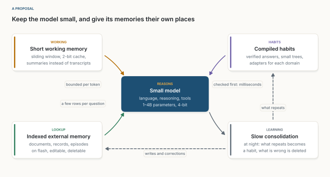

::: {.callout-note appearance="simple"}
**Une expérience, octobre 2026.** Chaque nombre des expériences 1 à 4 vient de [sim.py](../../../posts/2026-10-26-where-memory-lives/sim.py), en NumPy simple sur un processeur cloud à 4 cœurs, avec les résultats dans [results.json](../../../posts/2026-10-26-where-memory-lives/results.json) et les figures produites par [figs.py](../../../posts/2026-10-26-where-memory-lives/figs.py). Les chiffres d'autres auteurs sont cités là où ils apparaissent. Les réseaux sont volontairement minuscules : ils testent la forme d'un argument, pas un produit. Cet essai met à l'épreuve deux idées de [Fast AI](../2026-10-11-fast-ai/index.qmd) et d'[Un écosystème, pas un oracle](../2026-10-17-an-ecosystem-not-an-oracle/index.qmd) : la bande passante, et la mémoire hors des poids. Les figures sont en anglais. *Traduit de l'anglais : [version originale](../../../posts/2026-10-26-where-memory-lives/index.qmd).*
:::

**En bref.** Un modèle de langage garde ce qu'il sait à quatre endroits : ses poids, sa mémoire de travail (le cache KV), ce qu'il peut aller chercher, et les habitudes qu'il a compilées. Chacun se paie à un moment différent, et pour un petit modèle sur un ordinateur portable, c'est cela qui décide de la conception. Quatre expériences m'ont mené à une règle : **garder dans les poids ce qui sert à chaque token ; chercher tout le reste, et garder court ce que l'on va chercher.**

::: {.callout-tip appearance="simple" icon="false"}
## À retenir

- **Les poids sont la mémoire la plus dense, et la plus chère à lire.** Mes réseaux ont stocké jusqu'à 1,7 bit par paramètre, et un modèle les lit tous pour chaque token.
- **Les poids sont difficiles à modifier.** Un fine-tuning sur 150 faits modifiés ou nouveaux n'a jamais gardé à la fois les modifications et les autres faits. Tout répéter y est parvenu, après 630 000 exemples d'entraînement. Une table a demandé 150 écritures.
- **Chercher est bon marché ; relire ce que l'on a trouvé ne l'est pas.** Un index a cherché parmi quatre millions de faits en 0,5 ms. Mais trois passages récupérés coûtent ensuite 29 Mo à un modèle de 1 milliard de paramètres, à chaque token généré.
- **Les petits modèles heurtent d'abord le mur de la mémoire de travail.** Avec des poids en 4 bits, le cache de Llama 3.2 1B pèse plus que ses poids à partir d'environ 19 000 tokens.
- **La connaissance a une longue traîne.** Sous la loi de Zipf, chaque multiplication par dix des faits retenus répond à la même tranche supplémentaire de questions. Les poids couvrent la tête ; la traîne relève d'une recherche.
:::

## 1. La question

Les débats sur les petits modèles de langage demandent en général quelle part d'un grand modèle tient sur un ordinateur portable. Cela traite un modèle comme un seul bloc de connaissance à comprimer. Je pense que la meilleure question est : *qu'est-ce qui doit vivre où ?*

Générer un token sur un ordinateur portable est limité par la bande passante mémoire, pas par le calcul : la machine lit chaque poids, et tout le cache de la conversation, pour chaque token [@alizadeh2023]. L'endroit où vit la connaissance décide donc de ce qu'elle coûte.

{fig-alt="Quatre cartes côte à côte. Les poids, mémoire paramétrique : ce que le modèle sait, lu en entier pour chaque token. Le cache KV, mémoire de travail : ce qu'il est en train de lire, grandit avec le contexte et est lu pour chaque token. La recherche, mémoire externe : documents, fiches, cas passés, quelques lignes seulement à la demande. Les habitudes, mémoire compilée : réponses vérifiées et petits modèles, construits une fois et réutilisés en millisecondes. Une flèche en dessous va de payé à chaque token à payé rarement."}

## 2. Expérience 1 : combien de faits tiennent dans les poids

**Dispositif.** Un fait est une clé (un vecteur aléatoire de 32 nombres, qui tient lieu de question) et une valeur, l'une de $V = 256$ réponses : $\log_2 256 = 8$ bits. La mémoire est un réseau à deux couches,

$$
f_\theta(x) = W_2\,\mathrm{ReLU}(W_1 x + b_1) + b_2, \qquad |\theta| = 32h + h + 256h + 256,
$$

où :

- $x$ est la clé, les 32 nombres qui tiennent lieu de question ;
- $W_1$ (une table de $h \times 32$ nombres) et $b_1$ ($h$ nombres) forment la première couche, qui transforme la clé en $h$ valeurs cachées ;
- $\mathrm{ReLU}(z) = \max(0, z)$ garde les valeurs cachées positives et met les autres à zéro ;
- $W_2$ ($256 \times h$ nombres) et $b_2$ (256 nombres) forment la seconde couche, qui donne un score à chacune des 256 réponses possibles ; le score le plus élevé est la réponse du réseau ;
- $\theta$ désigne tous ces nombres ensemble, et $|\theta|$ les compte : $32h$ dans $W_1$, $h$ dans $b_1$, $256h$ dans $W_2$ et 256 dans $b_2$ ;
- $h$, la largeur cachée, fixe la taille du réseau.

J'ai utilisé $h \in \{8, 16, 32, 64\}$ : de 2 568 à 18 752 paramètres. Chaque réseau a appris $N$ faits, représentant de la moitié à quatre fois autant de bits qu'il a de paramètres, en 3 000 pas d'Adam sur le lot complet, avec trois graines chacun. À la suite d'Allen-Zhu et Li [@allenzhu2025], je compte les bits qu'il retient comme

$$
B(\theta) = \sum_{i=1}^{N} \max\!\Big(0,\; \log_2 V + \log_2 p_\theta(y_i \mid x_i)\Big),
$$

ce que sa prédiction sait de chaque réponse au-delà d'un tirage uniforme, où :

- $N$ est le nombre de faits, et $i$ les parcourt ;
- $x_i$ et $y_i$ sont la clé et la bonne réponse du fait $i$ ;
- $p_\theta(y_i \mid x_i)$ est la probabilité que le réseau donne à la bonne réponse ;
- $\log_2 V = 8$ est ce que vaut un fait : les bits nécessaires pour désigner une réponse parmi 256 ;
- $\log_2 p_\theta(y_i \mid x_i)$ est nul ou négatif : les bits qui manquent encore au réseau. Certain de la bonne réponse ($p = 1$), il retient les 8 bits ; hésitant entre deux réponses ($p = 1/2$), il en retient 7 ; devinant à l'aveugle ($p = 1/256$), il n'en retient aucun ;
- $\max(0, \cdot)$ compte une prédiction pire qu'un tirage à l'aveugle comme nulle plutôt que négative.

{fig-alt="À gauche, quatre lignes de bits retenus selon les bits offerts, pour des réseaux de 2 568, 4 880, 9 504 et 18 752 paramètres, chacune la moyenne de trois graines avec une bande étroite. Chacune suit la diagonale, où chaque bit offert est gardé, puis culmine et se stabilise un peu plus bas. À droite, bits retenus par paramètre selon les bits offerts par paramètre, avec de petites barres d'erreur : les quatre réseaux montent le long de la même ligne jusqu'à un pic de 1,40, 1,53, 1,68 et 1,67, puis se stabilisent près de 1,4. Trois losanges ambre, pour trois fois plus d'entraînement, sont un peu plus haut : 1,80, 1,55 et 1,49. Une ligne ambre pointillée à 2 marque la capacité d'un perceptron et des modèles de langage."}

**Résultat.** Sous la capacité, chaque réseau a gardé chaque bit. Près de la capacité, il a culminé à 1,40 bit par paramètre pour le plus petit réseau, 1,53 pour le suivant, et 1,68 et 1,67 pour les deux plus grands, les graines ne s'écartant jamais de plus de 0,04. Au-delà de la capacité, il a retenu moins, pas plus : environ 1,4 bit par paramètre, avec une précision tombée à un cinquième ou un tiers. Trois fois plus d'entraînement a relevé le pic à 1,80 mais a à peine changé le déclin (de 1,52 à 1,55, de 1,45 à 1,49) : le déclin vient donc surtout de l'interférence entre les faits, pas d'un manque d'entraînement.

Le chiffre est ancien : Cover a montré en 1965 qu'un perceptron stocke environ deux bits par poids [@cover1965], et Allen-Zhu et Li ont mesuré environ deux bits par paramètre dans des transformers [@allenzhu2025]. **Les poids sont une mémoire très dense** : un fait de 8 bits coûte environ cinq paramètres, moins de cinq octets en précision 8 bits. Quantifiés en 4 bits après l'entraînement, la précision à laquelle tournent la plupart des petits modèles, leurs modèles en ont perdu plus de la moitié.

## 3. Expérience 2 : changer d'avis

**Dispositif.** Un réseau de 18 752 paramètres a appris parfaitement 1 500 faits. Puis 75 faits ont changé et 75 nouveaux sont apparus. Je l'ai mis à jour de deux façons, chacune avec 4 taux d'apprentissage et 3 durées d'entraînement : un fine-tuning sur les **seules modifications**, les 150, ou **tout répéter**, les 1 575 faits. Une table externe a reçu les mêmes modifications : écraser 75 lignes, en ajouter 75.

{fig-alt="À gauche, un nuage de points. Abscisse : part des 150 modifications apprises. Ordonnée : part des 1 425 autres faits gardés. Les essais tout répéter, en carrés, sont alignés en haut à 100 % gardés, de 0 à 100 % de modifications apprises. Les essais modifications seules, en cercles, descendent le long d'une diagonale, de 100 % gardés sans modification apprise à environ 30 % gardés avec toutes les modifications apprises. Un losange vert en haut à droite marque la table externe. À droite, la moins bonne des deux parts selon les exemples d'entraînement traités, en échelle logarithmique : les essais modifications seules restent sous 50 % ; les essais tout répéter atteignent 100 % à partir d'environ 630 000 exemples."}

**Résultat.** Le fine-tuning sur les seules modifications n'a jamais réussi les deux. Les essais qui ont appris 97 % ou plus des modifications n'ont gardé que 28 % à 35 % des autres faits ; le meilleur compromis en a gardé 48 % et appris 47 %. Tout répéter a amené les deux à 100 %, après 630 000 exemples d'entraînement, un coût qui croît avec tout ce que le réseau sait. La table a demandé 150 écritures et 0,04 ms.

L'interférence catastrophique n'est pas nouvelle [@mccloskey1989], et des méthodes d'édition comme ROME et MEMIT font bien mieux qu'un simple fine-tuning [@meng2022; @meng2023], même si les modèles se dégradent encore à mesure que les modifications s'accumulent [@gupta2024]. Ce qui compte, c'est le contraste : dans une table, une modification est locale par construction ; dans des poids, chaque fait partage chaque paramètre. Les contacts changent, les prix changent, un client demande que l'on efface ses données. Une mémoire que l'on peut réécrire ligne par ligne est une mémoire que l'on peut garder vraie.

## 4. Expérience 3 : aller chercher

**Dispositif.** J'ai stocké de dix mille à quatre millions de faits sous forme de vecteurs unitaires de 256 nombres, regroupés autour de 2 000 thèmes, comme le sont les vrais plongements. Une question est une clé stockée plus du bruit, une paraphrase. La recherche exacte la compare à chaque clé, ce qui demande $O(Nd)$ opérations : $N$ clés de $d = 256$ nombres chacune ($O(\cdot)$ signifie « croît proportionnellement à »). Un index à fichiers inversés (IVF) regroupe une fois les clés en $c = 4\sqrt{N}$ grappes, puis compare une question aux $c$ centres de grappes et aux seules clés des $p$ grappes les plus proches. Cela demande $O\big((c + pN/c)\,d\big)$ opérations : $c$ centres, plus $p$ grappes d'environ $N/c$ clés chacune. Avec $c = 4\sqrt{N}$, les deux termes croissent comme $\sqrt{N}$ : une mémoire cent fois plus grande ne coûte que dix fois plus par question [@douze2024].

{fig-alt="À gauche, un graphique log-log du temps par question selon le nombre de faits en mémoire, de dix mille à quatre millions : la recherche exacte monte de 0,1 à 100 millisecondes ; un index qui sonde 16 grappes de 0,1 à 1,4 milliseconde ; qui sonde 4 grappes, de 0,03 à 0,5 milliseconde. À droite, part des questions qui trouvent le bon fait selon le temps par question, pour cinq niveaux de bruit : sonder 1 grappe en trouve 80 à 95 % en environ 0,12 milliseconde ; sonder 4 grappes atteint la même part que la recherche exacte, 100 % pour quatre niveaux et 95,5 % contre 96 pour le plus bruité, en environ 0,25 milliseconde, alors que la recherche exacte prend environ 24 millisecondes."}

**Résultat.** La recherche exacte a pris 29 ms sur un million de faits et 100 ms sur quatre millions. Sonder 4 grappes a pris 0,25 et 0,5 ms, en lisant 5 et 11 Mo. Sur des questions plus difficiles, une seule grappe en ratait 5 % à 20 %, alors que quatre grappes égalaient la recherche exacte (95,5 % contre 96 % au niveau le plus bruité). Mes clés regroupées flattent n'importe quel index : sur de vrais plongements, le même rappel demande plus de grappes, et plus de temps.

Une mémoire externe est moins compacte que des poids : 1 024 octets par fait ici, ou 8 à 64 octets avec des codes compressés [@douze2024], contre moins de cinq dans les poids. Mais les poids sont lus en entier pour chaque token. Une recherche lit quelques mégaoctets, seulement quand une question le demande.

### Ce que coûte vraiment un fait trouvé

Dans la génération augmentée par la recherche [@lewis2020], ce que l'index trouve est collé dans le prompt. Dès lors, cela se trouve dans la mémoire de travail et est relu pour chaque token généré.

{fig-alt="Des barres horizontales en échelle logarithmique, en mégaoctets lus par token généré pour Llama 3.2 1B. Un modèle dix fois plus grand, 12B en 4 bits : 6 200. Les poids du modèle, 1B en 4 bits : 620. La conversation jusqu'ici, 2 000 tokens, cache fp16 : 66. Trois passages récupérés, 900 tokens, cache fp16 : 29. Les mêmes passages avec un cache 2 bits : 4. La recherche dans l'index elle-même, répartie sur une réponse de 200 tokens : 0,05."}

Chaque token de contexte coûte 32 Ko à ce modèle. Trois passages de 300 tokens ajoutent 29 Mo à chaque token généré, plus de cinq cents fois la recherche elle-même. Cela ne représente encore que 5 % des 620 Mo de poids, et bien moins qu'un modèle dix fois plus grand, qui lirait 6 200 Mo par token pour répondre à environ 11 points de questions de plus (section 6). Une recherche n'est bon marché que si ce qu'elle rapporte est court : un fait, pas trois pages.

C'est pourquoi des architectures récentes placent la recherche *à l'intérieur* du modèle, là où un fait récupéré ne devient jamais du contexte. Les couches de mémoire de Meta lisent quelques lignes d'une table entraînable par token et battent des modèles denses qui utilisent plus de deux fois plus de calcul, surtout sur les questions factuelles [@berges2024]. Engram, de DeepSeek, ajoute une table de n-grammes hachés lue en temps constant [@engram2026]. Gemma 3n garde des plongements par couche sur le stockage local [@gemma3n].

## 5. Expérience 4 : la mémoire de travail

**Dispositif.** Le cache KV stocke une clé et une valeur par token, par couche et par tête clé-valeur :

$$
\text{octets KV par token} = 2 \cdot L \cdot n_{kv} \cdot d_h \cdot b.
$$

où :

- le facteur 2 compte une clé et une valeur ;
- $L$ est le nombre de couches (16 dans Llama 3.2 1B) ;
- $n_{kv}$ est le nombre de têtes clé-valeur par couche (8) ;
- $d_h$ est le nombre de valeurs dans chaque tête (64) ;
- $b$ est le nombre d'octets par valeur : 2 en 16 bits, 0,25 en 2 bits.

Pour Llama 3.2 1B en 16 bits : $2 \cdot 16 \cdot 8 \cdot 64 \cdot 2 = 32\,768$ octets, 32 Ko pour chaque token du contexte.

Chaque nouveau token lit tout le cache et tous les poids, si bien que le cache pèse autant que les poids à

$$
T^{*} = \frac{|\theta| \cdot b_w}{2 \cdot L \cdot n_{kv} \cdot d_h \cdot b_{kv}}.
$$

où :

- $T^{*}$ est la longueur de contexte, en tokens, à laquelle les deux pèsent autant ;
- $|\theta|$ est le nombre de paramètres (1,24 milliard pour Llama 3.2 1B) ;
- $b_w$ est le nombre d'octets par poids : 2 en 16 bits, 0,5 en 4 bits ;
- $b_{kv}$ est le nombre d'octets par valeur du cache ;
- le numérateur est la taille des poids en octets ; le dénominateur, la taille du cache pour un token.

Pour Llama 3.2 1B avec des poids en 4 bits et un cache en 16 bits : $1{,}24 \times 10^9 \times 0{,}5 \,/\, 32\,768 \approx 19\,000$ tokens.

J'ai chronométré une couche ayant la forme de celles de Llama 3.2 1B [@llama32] générant un token sur des caches de 1 000 à 131 000 tokens.

{fig-alt="À gauche, un graphique log-log du temps par token généré pour une couche selon la longueur de contexte, de 1k à 128k tokens : les poids restent plats à 3,6 millisecondes ; l'attention sur le cache KV monte de 0,3 à 49 millisecondes, croisant les poids vers 15k tokens ; une ligne pointillée à 59k marque l'endroit où le cache et les poids contiennent le même nombre d'octets. À droite, des barres horizontales donnant le contexte à partir duquel le cache pèse autant que les poids. Llama 3.2 1B : 76k avec des poids en 16 bits, 19k avec des poids en 4 bits, 151k avec des poids en 4 bits et un cache en 2 bits. Llama 3.2 3B : 56k, 14k, 112k. Llama 3.1 8B : 123k, 31k, 245k. Llama 3.1 70B : 431k, 108k, 862k."}

**Résultat.** Les poids ont coûté 3,6 ms par token quel que soit le contexte. L'attention a coûté 0,3 ms à 1 000 tokens, a égalé les poids vers 15 000 et a pris 49 ms à 131 000. En octets seuls, le croisement est à 59 000 ; mon attention en NumPy est plus lente qu'un produit matriciel, il est donc arrivé plus tôt.

La formule donne 76 000 tokens pour Llama 3.2 1B en 16 bits. Quantifiez les poids en 4 bits et cela tombe à **19 000** : un long document, ou une seule boucle d'agent avec quelques sorties d'outils. Pour Llama 3.1 70B, c'est 108 000. **Réduire les poids déplace le goulot d'étranglement vers la mémoire de travail.** Les remèdes gardent tous cette mémoire courte : l'attention à requêtes groupées [@ainslie2023], des fenêtres glissantes sur cinq couches sur six dans Gemma 3 [@gemma3], des caches en 2 bits [@liu2024kivi], qui repoussent le croisement du modèle 1B à 151 000, et les Cartridges, de petits caches entraînés hors ligne qui égalent l'apprentissage en contexte avec 38,6 fois moins de mémoire [@eyuboglu2026].

## 6. L'arithmétique de la longue traîne

Combien doit rester dans les poids ? Les questions ne sont pas uniformes : les modèles connaissent bien mieux les faits populaires que les rares [@kandpal2023], et la recherche aide surtout pour les rares [@mallen2023]. Si le $k$-ième fait le plus demandé parmi $F$ est demandé avec une probabilité proportionnelle à $k^{-s}$ (loi de Zipf), une mémoire qui contient les $K$ réponses les plus demandées couvre

$$
\text{couverture}(K) = \frac{H_{K,s}}{H_{F,s}}, \qquad H_{n,s} = \sum_{k=1}^{n} k^{-s}.
$$

où :

- $F$ est le nombre de faits dans le monde (un milliard dans la figure 7) ;
- $k$ est le rang d'un fait selon la fréquence à laquelle il est demandé : 1 pour le plus demandé ;
- $s$ fixe la raideur de la traîne : avec $s = 1$, la loi de Zipf classique, le deuxième fait est demandé deux fois moins souvent que le premier et le dixième dix fois moins ; un $s$ plus grand concentre davantage de questions sur les premiers faits ;
- $K$ est le nombre de faits que la mémoire contient, les $K$ plus demandés ;
- $H_{n,s}$ additionne la popularité des $n$ premiers faits ;
- le rapport est la part de toutes les questions qui tombent sur les $K$ faits retenus.

Pour $s = 1$, $H_n \approx \ln n + 0{,}577$, où $\ln$ est le logarithme naturel et 0,577 la constante d'Euler. Chaque pas d'un facteur dix ajoute donc la même part,

$$
\text{couverture}(10K) - \text{couverture}(K) \approx \frac{\ln 10}{\ln F + 0{,}577},
$$

où $\ln 10 \approx 2{,}30$ est la hausse de $\ln K$ quand $K$ est dix fois plus grand, et $\ln F + 0{,}577 \approx 21{,}3$ pour un milliard de faits. Le rapport, $2{,}30 / 21{,}3 \approx 0{,}11$, ne dépend pas de $K$ : passer de mille à dix mille faits ajoute environ 11 points, et passer de cent millions à un milliard aussi.

{fig-alt="Trois courbes montantes sur un axe horizontal logarithmique, de cent à un milliard de faits. La courbe de Zipf avec s égal à 1 monte presque en ligne droite, d'environ 25 % à cent faits jusqu'à 100 % à un milliard. Deux flèches ambre indiquent que chaque multiplication par dix ajoute la même tranche d'environ 11 points. Une traîne plus plate, avec s égal à 0,9, est en dessous ; une traîne plus raide, avec s égal à 1,1, au-dessus."}

Un modèle dix fois plus grand lit dix fois plus par token pour 11 points de plus. Un index dix fois plus grand lit environ trois fois plus, une fois par question. La tête relève des poids, où elle sert constamment ; la traîne relève d'une recherche. Les mémoires hiérarchiques d'Apple font ce partage dès le pré-entraînement : un modèle de 160 millions de paramètres allant chercher 18 millions de paramètres dans une banque de mémoire de 4,6 milliards a égalé un modèle classique plus de deux fois plus grand [@pouransari2026].

## 7. Ce que cela signifie pour les petits modèles et Fast AI

{fig-alt="Un schéma. Une carte sombre au centre : petit modèle, raisonne ; langage, raisonnement, outils ; 1 à 4 milliards de paramètres en 4 bits. En haut à gauche, la mémoire de travail : fenêtre glissante, cache 2 bits, résumés plutôt que transcriptions, marquée bornée par token. En bas à gauche, la recherche : mémoire externe indexée sur flash, modifiable et effaçable, marquée quelques lignes par question. En haut à droite, les habitudes : réponses vérifiées, petits arbres, adaptateurs, marquées consultées d'abord, millisecondes. En bas à droite, l'apprentissage : consolidation lente, la nuit. Des flèches pointillées vont de la consolidation aux habitudes et à la mémoire externe, marquées écritures et corrections."}

1. **Garder dans les poids ce qui sert à chaque token :** la langue, le raisonnement, l'usage des outils, la structure d'un domaine. Pas la liste de prix.
2. **Garder la mémoire de travail courte :** des résumés plutôt que des transcriptions, un cache compressé, une fenêtre.
3. **Aller chercher la longue traîne, et rapporter peu :** le fait, pas la page. Chaque ligne peut être inspectée, corrigée et effacée.
4. **Compiler ce qui se répète,** comme dans [Fast AI](../2026-10-11-fast-ai/index.qmd) : une réponse vérifiée, un petit arbre ou un adaptateur, consultés avant d'appeler le modèle.
5. **Consolider lentement :** ce qui est cherché constamment peut mériter une place dans une habitude ; ce qui est faux est effacé, en une ligne, pas en un entraînement.

Les systèmes de mémoire pour agents construisent le haut de cette pile : MemGPT, devenu Letta, pagine le contexte comme un système d'exploitation [@packer2023] ; Mem0 et A-MEM extraient et relient des souvenirs d'une session à l'autre [@chhikara2025; @xu2025amem] ; Titans apprend une mémoire au moment de l'inférence [@behrouz2024]. Un petit modèle a le moins de place dans ses poids et le moins de bande passante à revendre, c'est donc lui qui gagne le plus à mettre chaque mémoire au bon endroit.

## 8. Travaux récents, avec code

| Travail | Mémoire concernée | Idée | Code |
|---|---|---|---|
| Physics of Language Models 3.3 [@allenzhu2025] | Poids | Environ 2 bits de connaissance par paramètre | — |
| Memory Layers at Scale [@berges2024] | Poids, creux | Recherche clé-valeur entraînable dans le modèle | [facebookresearch/memory](https://github.com/facebookresearch/memory) |
| Engram [@engram2026] | Poids, creux | Mémoire de n-grammes hachés, recherche en temps constant | [deepseek-ai/Engram](https://github.com/deepseek-ai/Engram) |
| Mémoires hiérarchiques [@pouransari2026] | Poids + banque | Petit modèle, faits de la longue traîne dans une banque de mémoire consultée | — |
| Titans [@behrouz2024] | Apprise à l'inférence | Une mémoire neuronale mise à jour pendant l'inférence | [lucidrains/titans-pytorch](https://github.com/lucidrains/titans-pytorch) (non officiel) |
| KIVI [@liu2024kivi] | Mémoire de travail | Cache KV en 2 bits, sans fine-tuning | [jy-yuan/KIVI](https://github.com/jy-yuan/KIVI) |
| Cartridges [@eyuboglu2026] | Mémoire de travail | Un petit cache entraîné hors ligne pour chaque corpus | [HazyResearch/cartridges](https://github.com/HazyResearch/cartridges) |
| LLM in a Flash [@alizadeh2023] | Poids sur flash | Ne charger que les poids dont un token a besoin | — |
| Faiss [@douze2024] | Externe | Index vectoriels, IVF et au-delà | [facebookresearch/faiss](https://github.com/facebookresearch/faiss) |
| MemGPT / Letta [@packer2023] | Externe, agent | Le contexte comme mémoire virtuelle | [letta-ai/letta](https://github.com/letta-ai/letta) |
| Mem0 [@chhikara2025] | Externe, agent | Extraire et mettre à jour des souvenirs d'une session à l'autre | [mem0ai/mem0](https://github.com/mem0ai/mem0) |
| A-MEM [@xu2025amem] | Externe, agent | Des notes reliées qui se réorganisent d'elles-mêmes | [agiresearch/A-mem](https://github.com/agiresearch/A-mem) |
| llama.cpp | Toutes, en local | Poids et cache KV quantifiés sur un ordinateur portable | [ggml-org/llama.cpp](https://github.com/ggml-org/llama.cpp) |

: **Tableau 1.** Travaux récents sur les quatre mémoires. Liens vers le code vérifiés le 25 octobre 2026. Les bancs d'essai des systèmes de mémoire pour agents sont encore jeunes, et les scores annoncés par les éditeurs divergent souvent des scores indépendants ; je les comparerais sur vos propres données.

## 9. Ce que cette expérience ne montre pas

- **Mes faits sont aléatoires.** La vraie connaissance a une structure qu'un modèle peut comprimer, si bien que des poids peuvent faire mieux que mes réseaux.
- **Mes réseaux sont minuscules :** deux couches, au plus 19 000 paramètres.
- **Mes questions sont synthétiques.** Une vraie recherche doit d'abord plonger la question ; elle peut rater, ou trouver le fait et voir le modèle l'ignorer.
- **Le simple fine-tuning est le plus faible des éditeurs.** De meilleures méthodes réduisent l'écart, mais modifient toujours des poids que chaque fait partage.
- **NumPy n'est pas un moteur de service**, c'est pourquoi la figure 6 donne aussi le décompte en octets.
- **Zipf est un modèle.** Les questions d'un spécialiste peuvent avoir une traîne plus courte, ce qui plaide pour les spécialistes.

## 10. Conclusion

Nous disons qu'un modèle *sait* quelque chose, comme si la connaissance vivait à un seul endroit. Elle vit à quatre, à quatre prix : des poids denses lus à chaque token, une mémoire de travail qui grandit à chaque token, une recherche encombrante mais bon marché et corrigeable, et des habitudes qui ne coûtent presque rien une fois construites. Les grands modèles peuvent se permettre de les confondre. Les petits non, et c'est leur avantage. Gardez dans les poids ce qui sert à chaque token, gardez la mémoire de travail courte, allez chercher la longue traîne, compilez ce qui se répète.

::: {.read-next}
**À lire ensuite** · [Un écosystème, pas un oracle](../2026-10-17-an-ecosystem-not-an-oracle/index.qmd)
L'architecture dans laquelle s'inscrivent ces quatre mémoires.
:::

::: {.small}
*Les opinions exprimées dans cet essai sont les miennes et ne décrivent aucun produit ni aucun projet de mon employeur.*
:::

## Références

::: {#refs}
:::
