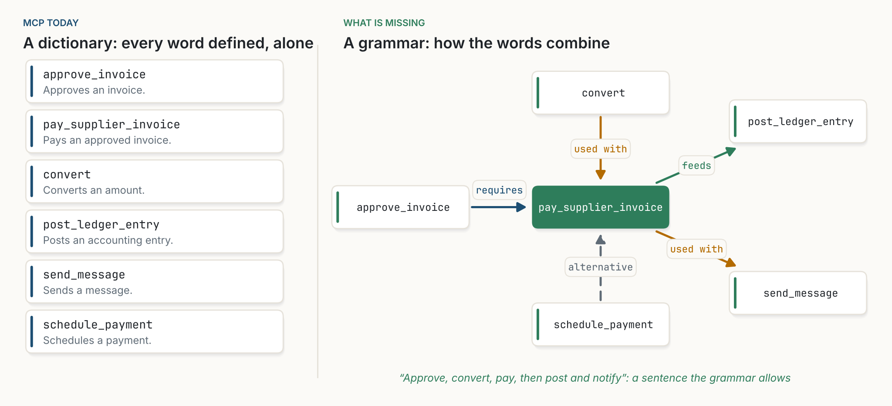
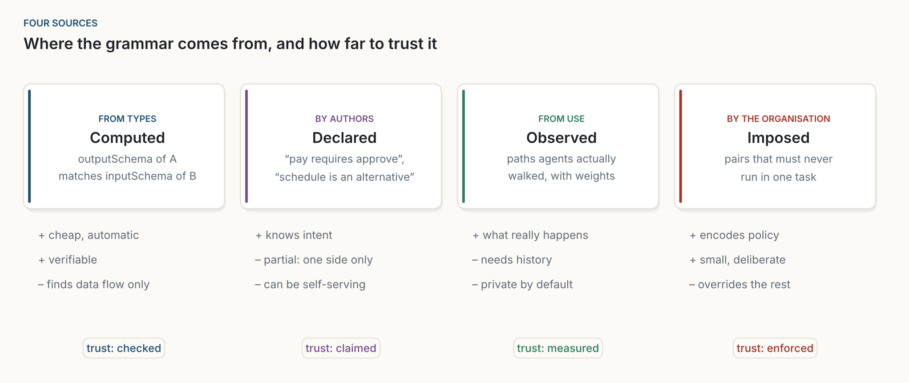
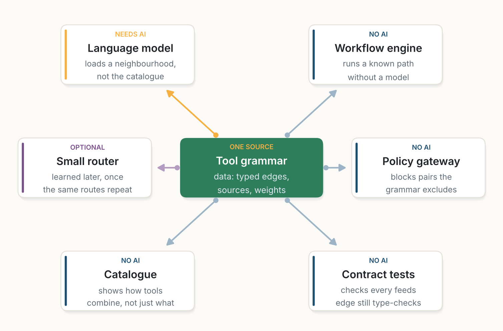

::: {.callout-note appearance="simple"}
**Essai, octobre 2026.** La suite de [L'interface est une donnée](../2026-10-20-the-interface-is-data/index.qmd). Les figures sont de moi, dessinées avec [figs.py](../../../posts/2026-10-30-a-grammar-for-tools/figs.py) ; toutes sont des schémas, sauf la figure 3, qui est un simple comptage. Les rôles, les relations et le JSON des figures 2, 6 et 7 sont une proposition de ma part, pas une partie de la spécification MCP. Les figures sont en anglais. *Traduit de l'anglais : [version originale](../../../posts/2026-10-30-a-grammar-for-tools/index.qmd).*
:::

**En bref.** Le Model Context Protocol (MCP) a donné un dictionnaire aux agents d'IA. Chaque outil se définit lui-même : un nom, une description, un schéma de ce qu'il prend et de ce qu'il renvoie. Ce que MCP n'a pas, c'est une grammaire, une façon de dire comment les outils se combinent : lequel doit venir d'abord, lequel alimente lequel, lesquels s'utilisent ensemble, lesquels se remplacent, et lesquels ne doivent jamais se rencontrer dans la même tâche. Aujourd'hui, chaque agent reconstruit cette grammaire dans sa fenêtre de contexte, à chaque exécution, et l'oublie à la fin. Avec quelques dizaines d'outils, cela fonctionne. Avec des milliers, non, et le remède habituel, chercher dans les descriptions d'outils, trouve des outils qui ressemblent à la demande, pas des outils qui se complètent. Je soutiens que la pièce manquante est un type d'objet, la relation entre outils, publiée sous forme de données. Une grammaire utile travaille à deux niveaux : des règles sur des *types* d'outils (« tout ce qui paie exige une approbation »), qui s'appliquent à des outils que personne n'a encore utilisés, et des habitudes d'outils *précis*, apprises à l'usage. Les relations peuvent venir de quatre sources (les schémas, les auteurs, l'usage et les règles de l'organisation), et chaque source a son propre propriétaire et son propre niveau de confiance. Rien de tout cela n'est nouveau dans son principe : OpenAPI a des liens entre opérations, sa spécification sœur Arazzo (2024) décrit des workflows entiers, et les services web sémantiques des années 2000 décrivaient des préconditions et des effets. Ces efforts se sont enlisés parce qu'écrire une grammaire précise coûtait trop cher et que rien ne savait lire une grammaire imprécise. Un modèle de langage le sait. Les principes de conception viennent des réseaux de neurones (localité, activation clairsemée, plasticité, modularité et filtrage), mais je ne pense plus qu'il faille entraîner un réseau pour les appliquer.

::: {.callout-tip appearance="simple" icon="false"}
## À retenir

- **MCP est un dictionnaire.** Chaque outil est défini seul. Les liens entre outils n'existent qu'à l'intérieur de l'exécution d'un agent.
- **L'objet manquant est la relation.** MCP a des outils, des ressources et des prompts de premier rang, et des groupes d'outils sont proposés. Il n'a pas de relation typée entre outils, si bien que personne ne peut en publier, en partager, en versionner ni en vérifier une.
- **La ressemblance n'est pas la complémentarité.** Chercher dans les descriptions trouve des outils qui ressemblent à la demande. Une tâche a besoin d'outils qui se complètent, et ceux-là se ressemblent rarement. La recherche sur la sélection d'outils dit la même chose depuis 2024.
- **Le goulot d'étranglement est déjà visible.** Des bancs d'essai de 2025, avec des centaines d'outils MCP, montrent que trouver le bon outil est la principale cause d'échec, et que planifier sur plusieurs étapes et plusieurs serveurs reste difficile.
- **Une grammaire a deux niveaux.** Les règles sur des rôles (« payer exige approuver ») valent pour des outils jamais vus. Les habitudes d'outils nommés (« cet outil de paiement est d'ordinaire suivi de ce convertisseur ») sont précises pour le travail connu et muettes pour le travail nouveau.
- **Quatre sources, quatre propriétaires.** Les arêtes sont calculées à partir des schémas par n'importe quel lecteur, déclarées par les serveurs, observées par les clients et imposées par la passerelle de l'organisation. Chaque arête devrait dire d'où elle vient.
- **On l'a déjà tenté, en partie.** Les liens OpenAPI, les workflows Arazzo et les services web sémantiques décrivaient comment les opérations s'enchaînent. Arazzo et agents.json écrivent des *phrases* (des workflows fixes), pas une grammaire. Il manquait aux efforts plus anciens un lecteur capable d'utiliser une grammaire bon marché et imparfaite. Un modèle de langage est ce lecteur.
- **Les arêtes sont locales ; les noms ne le sont pas.** Comme les liens du web, les relations n'ont pas besoin de carte centrale, mais elles ont besoin de noms stables, donc d'un registre.
- **Emprunter aux réseaux de neurones leurs principes, pas le réseau.** Localité, activation clairsemée, plasticité, modularité et filtrage décrivent comment la grammaire doit se comporter. Un routeur appris est une optimisation pour plus tard.
:::

## 1. Des points sur un plan

Imaginez chaque outil MCP comme un point. Sa position est son sens, ce que sa description dit qu'il fait. Deux outils de facturation sont proches ; un outil de facturation et un outil d'agenda sont éloignés. Un serveur publie une poignée de ces points. Un client se connecte à plusieurs serveurs et voit leur réunion : un nuage de points sans aucune ligne entre eux [@mcpspec2025].

Ce n'est pas un défaut. C'est ce qui a rendu MCP si facile à adopter. Un serveur n'a pas besoin de savoir qui d'autre existe. N'importe qui peut ajouter un point, et tout client peut le lire. C'est la force que j'ai décrite dans [L'interface est une donnée](../2026-10-20-the-interface-is-data/index.qmd) : l'interface est devenue une donnée, lue au moment où on l'utilise.

Mais une tâche n'est jamais un point. « Payer cette facture fournisseur en euros et le prévenir » est un chemin : approuver la facture, convertir le montant, payer, passer l'écriture comptable, envoyer un message. Ce chemin traverse trois ou quatre serveurs. Quelqu'un doit le tracer.

{fig-alt="Deux panneaux de points dispersés. À gauche, intitulé « Today », un catalogue plat : des cercles gris sans connexions et un chemin orange en pointillés à travers quatre points mis en évidence, numérotés de 1 à 4, avec la mention « the graph lives for one task, then it is forgotten » (le graphe vit le temps d'une tâche, puis il est oublié). À droite, intitulé « Proposed », un graphe local : le même genre de points regroupés en six groupes colorés nommés invoices, currency, mail, documents, identity et calendar, avec de fines arêtes à l'intérieur de chaque groupe et quelques arêtes orange épaisses entre les groupes."}

Aujourd'hui, c'est l'agent qui le trace. Le modèle lit les descriptions d'outils, raisonne sur la tâche et choisit chaque appel. Le chemin existe, mais en un seul endroit et pour un seul moment : la fenêtre de contexte d'une exécution. Quand l'exécution se termine, le chemin disparaît. Le prochain agent face à la même tâche le retrace à partir de rien.

## 2. Un dictionnaire sans grammaire

Le langage est une meilleure image que les points. MCP nous donne un **dictionnaire**. Chaque entrée définit un mot, clairement et sous une forme standard. Ce qu'un dictionnaire ne vous dit pas, c'est comment construire une phrase : quels mots vont ensemble, dans quel ordre, lesquels peuvent se remplacer, quelles combinaisons sont fautives. C'est le rôle d'une **grammaire**.

{fig-alt="Deux panneaux. À gauche, intitulé « MCP today, a dictionary: every word defined, alone » (MCP aujourd'hui, un dictionnaire : chaque mot défini, seul). Six fiches listent approve_invoice, pay_supplier_invoice, convert, post_ledger_entry, send_message et schedule_payment, chacune avec une description d'une ligne. À droite, intitulé « What is missing, a grammar: how the words combine » (ce qui manque, une grammaire : comment les mots se combinent). pay_supplier_invoice est au centre. approve_invoice pointe vers lui avec « requires ». convert pointe vers lui avec « used with ». Il pointe vers post_ledger_entry avec « feeds » et vers send_message avec « used with ». schedule_payment pointe vers lui avec une flèche en pointillés « alternative ». Une légende indique : approuver, convertir, payer, puis comptabiliser et prévenir, une phrase que la grammaire autorise."}

Ce qui manque à MCP n'est donc pas un algorithme. C'est un **type d'objet**. MCP a des outils, des ressources et des prompts de premier rang. Il n'a pas de *relation* de premier rang entre eux. Tant que les relations ne font pas partie du vocabulaire, personne ne peut en publier une, en partager une, en versionner une ni en vérifier une. Chaque agent garde sa propre grammaire privée, et personne d'autre ne peut la lire.

### La ressemblance n'est pas la complémentarité

La réponse actuelle aux grands catalogues est la recherche. Les outils restent hors du contexte et sont trouvés en comparant la demande à leurs descriptions [@anthropic2025advtools; @gan2025], parfois d'abord le serveur, puis l'outil [@fei2025mcpzero]. On trouve ainsi des outils qui *ressemblent* à la demande. Une tâche a besoin d'outils qui se *complètent*.

« Payer cette facture fournisseur en euros » ressemble aux outils de facturation. Cela ne ressemble ni au serveur de comptabilité ni au serveur de messagerie, et pourtant la tâche a besoin des deux. La relation entre payer une facture et passer une écriture comptable n'est dans aucune des deux descriptions. Elle est dans l'usage.

Les systèmes de recommandation l'ont appris il y a longtemps. Les boutiques distinguent les produits qui se *substituent* l'un à l'autre (deux appareils photo semblables) de ceux qui se *complètent* (un appareil photo et une carte mémoire), et les deux types de relation doivent s'apprendre différemment [@mcauley2015]. La plus ancienne réponse qui fonctionne, « les clients qui ont acheté ceci ont aussi acheté cela », ne regarde pas du tout les descriptions : elle compte ce qui est utilisé ensemble [@linden2003]. La recherche d'outils a redécouvert ce point. COLT a montré en 2024 que comparer une demande aux descriptions d'outils renvoie des outils redondants et manque les outils complémentaires dont une demande en plusieurs parties a besoin, et a proposé une recherche qui vise l'ensemble *complet* [@qu2024colt]. Tool2Vec représente chaque outil à partir des demandes qui l'ont réellement utilisé plutôt qu'à partir de sa description, et retrouve bien mieux les bons outils [@moon2024tool2vec]. Les deux apprennent de l'usage ; les deux gardent ce qu'ils apprennent à l'intérieur d'un seul système. En production, la recherche d'outils en reste encore surtout au premier type de relation. Une grammaire est la façon d'écrire le second, sous une forme que d'autres peuvent lire.

## 3. Pourquoi c'est important maintenant

Avec quelques dizaines d'outils, l'agent peut lire chaque définition et tracer le chemin lui-même. Rien n'a besoin d'être stocké, rien ne se périme. Le coût apparaît quand les catalogues grandissent, et deux choses grandissent avec eux.

{fig-alt="Deux graphiques en échelle log-log en fonction du nombre d'outils, de 10 à 10 000. À gauche : les tokens nécessaires pour lister toutes les définitions passent d'environ 3 500 à 3,5 millions, et dépassent une fenêtre de contexte de 200k tokens vers 570 outils et une fenêtre de 1M tokens vers 2 900 outils. À droite : les chaînes possibles de quatre étapes croissent comme N puissance quatre, de dix mille à dix puissance seize ; les arêtes d'un graphe clairsemé croissent comme 3N et les workflows réellement exécutés comme N sur 2, de nombreux ordres de grandeur plus bas."}

La première est le coût de la lecture. MCP-Zero compte environ 4 600 tokens pour les 26 outils du seul serveur GitHub [@fei2025mcpzero]. Un millier d'outils remplit une grande fenêtre de contexte avant même que la tâche commence.

La seconde est l'espace des compositions. Avec $N$ outils, il y a $N^k$ chaînes ordonnées de $k$ d'entre eux. Les chaînes que quelqu'un utilise réellement sont une fraction infime de cet espace. La structure utile est petite, à peu près linéaire en $N$, mais personne ne l'écrit. Si bien que chaque exécution la cherche à nouveau dans un espace qui croît à la puissance quatre.

Ce n'est plus une projection. LiveMCPBench a donné aux agents 70 serveurs MCP et 527 outils pour 95 tâches de la vie courante. Le meilleur modèle en a accompli 79 %, la plupart des modèles seulement 30 % à 50 %, et les auteurs identifient la recherche du bon outil comme le principal goulot d'étranglement [@mo2025livemcpbench]. MCP-Bench a connecté 20 modèles à 250 outils sur 28 serveurs réels, pour des tâches qui enchaînent des outils à l'intérieur d'un serveur et d'un serveur à l'autre, et a constaté une difficulté persistante à planifier sur le long terme, les modèles les plus faibles se dégradant le plus sur les tâches à plusieurs serveurs [@wang2025mcpbench]. Les deux pointent vers le même manque : savoir quels outils vont ensemble.

Le domaine l'a remarqué, et les réponses jusqu'ici en disent long :

- **Les groupes.** Une proposition pour MCP, SEP-1300, permet aux serveurs de ranger leurs outils en groupes et en étiquettes, pour qu'un client puisse charger un domaine fonctionnel à la fois [@sep1300]. Les groupes sont des ensembles : ils disent quels outils vont ensemble, pas comment ils se combinent. Ils sont le bon premier pas, et les relations sont le pas suivant naturel.
- **Les prompts.** Les serveurs MCP peuvent déjà publier des prompts, des workflows modèles écrits en prose [@mcpspec2025]. Un prompt est une phrase, pas une grammaire : il vit sur un seul serveur, il est choisi par l'utilisateur, et on ne peut ni le vérifier ni le combiner avec les prompts d'autres serveurs.
- **Les skills.** Les Agent Skills regroupent des instructions, des scripts et l'usage d'outils pour une tâche [@anthropic2025skills]. Chaque skill contient une petite grammaire, écrite à la main, pour un seul lot.
- **Les systèmes de recherche** parcourent des graphes de transitions entre outils appris sur des exécutions passées [@liu2024toolnet], suivent des arêtes de dépendance après une première recherche [@lumer2025graphrag], ou apprennent des représentations d'outils à partir de l'usage [@qu2024colt; @moon2024tool2vec], chacun à l'intérieur d'un seul système. Des bancs d'essai comme TaskBench décrivent déjà les tâches comme des *graphes d'outils*, avec les outils pour nœuds et les dépendances pour arêtes [@shen2024taskbench] : la communauté de recherche modélise la grammaire, mais seulement pour évaluer les agents, pas pour la publier.

Chacun détient un morceau de la grammaire. Aucun ne peut être lu par quelqu'un d'autre, parce que le protocole n'a nulle part où mettre une relation. Le protocole lui-même a évolué vite : les annotations d'outils sont arrivées en mars 2025 [@mcpspec20250326], les schémas de sortie en juin [@mcpspec2025], et la révision de novembre 2025 a ajouté des icônes, des conseils sur le nommage des outils et les tâches de longue durée [@mcpspec20251125]. Aucune n'ajoute de relations entre outils. La feuille de route 2026 porte sur le transport, la communication entre agents, la gouvernance et la préparation aux entreprises [@mcproadmap2026] ; autant que je puisse en juger, les relations typées n'y figurent pas.

## 4. On l'a déjà tenté

Décrire comment les opérations s'enchaînent est une vieille idée, et il vaut la peine de se demander pourquoi elle n'a pas pris.

**Les liens OpenAPI.** Depuis la version 3.0, une description OpenAPI peut dire qu'une valeur renvoyée par une opération est l'entrée d'une autre, avec la correspondance exacte des champs : l'`id` de la réponse de `createUser` devient le paramètre `userId` de `getUser` [@openapi30links]. C'est exactement la relation *feeds* (alimente) de cet essai, standardisée en 2017. Elle existe, elle fonctionne, et peu de gens l'utilisent. Les API REST ont reçu des liens entre opérations ; les outils MCP, jamais.

**Arazzo et agents.json.** En 2024, l'OpenAPI Initiative a publié Arazzo, une spécification pour décrire des workflows en plusieurs étapes à travers des API : quelles opérations appeler, dans quel ordre, et comment les sorties deviennent des entrées [@arazzo2024]. En 2025, agents.json s'est appuyé sur OpenAPI pour donner aux agents d'IA des « flows » et des « links » dans le même but [@agentsjson2025]. Ce sont les plus proches parents de cet essai, et ils montrent que le besoin est réel. Mais ils écrivent des *phrases*, des workflows complets choisis à l'avance. Ils ne donnent pas une grammaire à partir de laquelle un agent peut construire une phrase que personne n'a écrite, et ils ne disent rien de ce qui a été observé à l'usage ou interdit par les règles. Une grammaire et un ensemble de phrases se complètent : un workflow connu est une phrase que la grammaire autorise, et un bon format de workflow est une façon naturelle d'en publier une.

**Les services web sémantiques.** Au début des années 2000, OWL-S et WSMO décrivaient les services web par leurs entrées, leurs sorties, leurs préconditions et leurs effets, pour que des agents logiciels puissent les trouver et les composer automatiquement [@owls2004; @wsmo2005]. « Exige » est une précondition ; « alimente » est une sortie appariée à une entrée. La vision était proche de celle de cet essai. Elle s'est enlisée pour deux raisons : écrire des descriptions formelles dans des ontologies partagées coûtait bien plus que ce que quiconque voulait payer, et les moteurs de raisonnement qui les consommaient cassaient sur tout ce qui était imprécis.

Ce qui a changé, c'est le lecteur, le même argument que j'ai avancé dans [L'interface est une donnée](../2026-10-20-the-interface-is-data/index.qmd) pour les API qui se décrivent elles-mêmes. Un modèle de langage n'a pas besoin d'une ontologie parfaite. Il peut utiliser une relation partielle, approximative ou écrite en mots simples, et la peser face à tout ce qu'il sait par ailleurs. Et l'une des quatre sources ci-dessous, l'usage observé, n'a besoin d'aucun auteur. Une grammaire trop chère à écrire précisément pour un lecteur strict devient assez bon marché pour être écrite à grands traits pour un lecteur tolérant.

## 5. D'où vient la grammaire

Si les relations doivent devenir des données, les premières questions sont : d'où viennent-elles, et qui les garde ? Je vois quatre sources. Elles diffèrent par leur coût, par la confiance qu'elles méritent et par leur propriétaire.

{fig-alt="Quatre fiches. « Computed, from types » (calculées, à partir des types) : l'outputSchema de A correspond à l'inputSchema de B ; bon marché et automatique, vérifiable, ne trouve que le flux de données ; confiance : « checked » (vérifiée) ; dérivées par n'importe quel lecteur. « Declared, by authors » (déclarées, par les auteurs) : « pay requires approve », « schedule is an alternative » ; connaissent l'intention, partielles parce que les auteurs ne voient qu'un côté, peuvent être intéressées ; confiance : « claimed » (affirmée) ; publiées par le serveur. « Observed, from use » (observées, à l'usage) : les chemins que les agents ont réellement suivis, avec des poids ; montrent ce qui se passe vraiment, demandent un historique, privées par défaut ; confiance : « measured » (mesurée) ; gardées par le client. « Imposed, by the organisation » (imposées, par l'organisation) : les paires qui ne doivent jamais s'exécuter dans une même tâche ; encodent les règles, petites et délibérées, l'emportent sur le reste ; confiance : « enforced » (appliquée) ; détenues par la passerelle."}

### 5.1 Calculées à partir des types

Depuis sa révision de juin 2025, MCP permet à un outil de déclarer un `outputSchema`, la forme de ce qu'il renvoie, à côté de son `inputSchema` [@mcpspec2025]. Cela suffit pour dériver certaines arêtes sans que personne ne déclare rien. Si un outil renvoie un `payment_id` et qu'un autre en exige un, le premier *alimente* probablement le second.

{fig-alt="Deux fiches de schéma. À gauche, pay_supplier_invoice, outputSchema : payment_id string, amount number, currency string, paid_at date-time. À droite, post_ledger_entry, inputSchema obligatoire : payment_id string, account string, amount number. Une épaisse flèche verte relie les deux champs payment_id, avec la mention « feeds via payment_id ». Une fine flèche grise relie les deux champs amount, avec la mention « same name, too weak alone » (même nom, trop faible seul). Une note indique qu'un identifiant qu'un outil crée et qu'un autre exige est un indice fort ; un champ générique partagé ne l'est pas."}

Les arêtes calculées sont bon marché, et n'importe qui peut les dériver : le client, une passerelle, un catalogue. Elles sont aussi vérifiables, puisqu'un test peut confirmer que la sortie d'un outil correspond toujours à l'entrée de l'autre. Leurs limites sont réelles. Elles trouvent le flux de données, pas l'intention ; les noms de champs sont bruités ; et les schémas de sortie sont facultatifs dans MCP. Je n'ai pas mesuré combien de serveurs publics les déclarent aujourd'hui. S'ils sont peu nombreux, cette source est une promesse plutôt qu'une ressource, et le premier pas concret est simplement de publier des schémas de sortie.

### 5.2 Déclarées par les auteurs

Certaines relations, seul l'auteur les connaît. Que payer exige d'abord une approbation. Que `schedule_payment` est une alternative au paiement immédiat. Qu'un outil est d'ordinaire suivi d'une notification. Ce sont des énoncés courts, et MCP permet déjà à un outil de porter des métadonnées supplémentaires où ils pourraient vivre. Ils appartiennent au serveur et voyagent avec ses outils.

Les arêtes déclarées portent l'intention, qu'aucune autre source n'a. Elles sont aussi partielles, puisqu'un auteur ne voit que son côté d'un workflow, et elles peuvent être intéressées : chaque serveur a une raison de déclarer des arêtes vers lui-même.

### 5.3 Observées à l'usage

Chaque agent trace déjà la grammaire à chaque exécution. Si les clients gardaient les chemins qu'ils ont suivis, ils pourraient compter quels outils sont utilisés ensemble et transformer ces comptes en poids. C'est la source la plus fidèle : elle montre ce qui se passe réellement, y compris des partenaires que personne n'avait pensé à déclarer.

C'est aussi la plus sensible. Ce que font les agents d'une organisation est privé, si bien que les arêtes observées appartiennent au client et restent dans l'organisation par défaut, partagées au plus sous forme de poids agrégés. Les compter de la même manière partout demande un format de traces commun. Il pourrait faire partie de MCP, ou être une convention dans un standard de traçage existant comme OpenTelemetry ; ce qui compte, c'est qu'il soit partagé.

### 5.4 Imposées par l'organisation

Une grammaire ne dit pas seulement ce qui va ensemble. Elle peut aussi dire ce qui ne doit pas aller ensemble. La « trifecta létale » de Simon Willison nomme une combinaison dangereuse : un agent qui lit des données privées, est exposé à du contenu non fiable et peut communiquer vers l'extérieur [@willison2025]. Chaque outil peut être sûr seul ; le danger est dans la combinaison. Une organisation devrait pouvoir l'écrire comme une règle, *excludes* (exclut), et la faire appliquer.

Cette règle n'appartient à aucun serveur. Un fournisseur publie ses outils ; il ne décide pas de ce que votre entreprise interdit. Les arêtes de règles appartiennent au client ou à la passerelle placée entre les agents et les serveurs, et elles l'emportent sur toutes les autres sources.

## 6. Une grammaire à deux niveaux

Une grammaire, au sens linguistique, ne relie pas des mots précis. Elle travaille sur des *catégories* de mots : un verbe prend un complément, un adjectif s'accorde avec un nom. Les mots précis qui apparaissent habituellement ensemble, « café serré » plutôt que « café pressé », s'appellent des *collocations*, et on les apprend par l'usage. Une grammaire d'outils a besoin des deux niveaux.

| Dans la langue | Pour les outils | Exemple |
|---|---|---|
| les parties du discours | les rôles : le genre de chose que fait un outil | *approuve*, *paie*, *convertit*, *notifie*, *lit des données privées* |
| les règles de grammaire | les relations entre rôles | tout ce qui *paie* exige quelque chose qui *approuve* |
| les collocations | les relations entre outils nommés, avec des poids | cet outil de paiement s'utilise d'ordinaire avec ce convertisseur (0,71) |
| une phrase | le chemin d'une tâche | approuver, convertir, payer, comptabiliser, prévenir |

: **Tableau 1.** Les deux niveaux d'une grammaire d'outils, par analogie avec la langue.

{fig-alt="Deux panneaux. À gauche, « Level 1, grammar rules, rules over roles » (niveau 1, règles de grammaire, règles sur des rôles) : pays requires approves ; returns payment_id feeds needs payment_id ; pays used with notifies ; reads private data excludes sends externally. Une note : écrites une fois, sur des types d'outils, valent pour des outils que personne n'a encore utilisés. À droite, « Level 2, collocations, habits of named tools » (niveau 2, collocations, habitudes d'outils nommés) : pay_supplier_invoice vers fx-rates convert, 0.71 ; pay_supplier_invoice vers mail send_message, 0.64 ; create_contract vers sign request_signature, 0.88 ; book_meeting vers calendar find_slot, 0.93. Une note : apprises à l'usage, sur des outils précis, précises pour le travail connu, muettes pour le travail nouveau."}

Les deux niveaux échouent de façons opposées, et c'est pourquoi il faut les deux. Les collocations sont précises pour le travail qu'une organisation fait déjà, et elles ne disent rien d'un outil installé hier ni d'un workflow que personne n'a exécuté. Les règles sur des rôles s'appliquent tout de suite aux nouveaux outils, mais elles sont grossières : elles disent qu'un paiement exige *une* approbation, pas laquelle. Un nouvel outil qui déclare ses rôles trouve sa place dans la grammaire le jour où il apparaît ; l'usage affine ensuite les règles en collocations.

MCP a déjà l'ébauche d'un système de rôles. Les annotations d'outils disent si un outil est en lecture seule, destructeur, idempotent, ou s'il atteint le monde extérieur [@mcpspec2025]. Ce sont des parties du discours, sauf le nom. La règle de la trifecta létale, par exemple, peut déjà s'écrire en partie avec elles : un outil qui atteint le monde extérieur ne devrait pas s'exécuter dans la même tâche qu'un outil qui lit des données privées. Ce qui manque, c'est une courte liste partagée de rôles au-delà de ces annotations, et une façon d'écrire des règles sur eux.

### 6.1 Un vocabulaire de départ

Cinq relations sont un point de départ raisonnable. Elles ne couvriront pas tout (des conditions comme « si ceci échoue, utiliser l'alternative », ou un ordre au-delà de *requires*, viendraient ensuite), mais elles couvrent beaucoup.

| Relation | Sens | Source typique |
|---|---|---|
| **requires** (exige) | doit s'être exécuté avant | déclarée |
| **feeds** (alimente) | sa sortie est l'entrée de l'autre | calculée |
| **used with** (utilisé avec) | souvent dans la même tâche | observée |
| **alternative** | peut remplacer l'autre | déclarée |
| **excludes** (exclut) | ne doit pas s'exécuter dans la même tâche | règle |

: **Tableau 2.** Un vocabulaire de départ proposé pour les relations, utilisable entre rôles ou entre outils nommés.

Chaque relation peut pointer vers un rôle ou vers un outil nommé, et chaque arête dit d'où elle vient, pour qu'un lecteur puisse la pondérer.

{fig-alt="Un panneau de code sombre montrant une entrée JSON pour un outil nommé pay_supplier_invoice, avec une description, des schémas, les annotations destructiveHint true et openWorldHint true, et un objet _meta avec roles : pays, et une liste grammar : requires role approves ; usedWith role converts ; requires tool approve_invoice ; alternative tool schedule_payment. Quatre fiches expliquent : les parties du discours que MCP a déjà, les annotations comme début d'un système de rôles ; les rôles, une courte liste partagée ; les règles sur des rôles, qui s'appliquent à des outils jamais vus ; les arêtes vers des outils nommés, le savoir local de l'auteur, avec des noms uniques par serveur, qui ont donc besoin d'un registre. Une note en dessous indique que les poids observés sont gardés par le client et les règles par la passerelle."}

### 6.2 Ce dont le protocole a besoin, et ce dont il n'a pas besoin

Ce dont MCP lui-même aurait besoin est peu de chose :

1. **Une place pour les relations.** Aujourd'hui une convention dans `_meta`, que MCP permet déjà sur les outils [@mcpspec2025] ; plus tard un champ à part entière, si la convention se révèle utile. Les groupes d'outils, s'ils sont adoptés, sont un foyer naturel pour les règles qui valent à l'intérieur d'un groupe.
2. **Un vocabulaire partagé.** Une courte liste de rôles, et les cinq relations ci-dessus.
3. **Des noms stables.** Voir plus bas.
4. **Une façon commune de compter l'usage.** Dans MCP ou dans une convention de traçage existante.

La voie pour un tel changement existe : MCP évolue par des propositions d'amélioration publiques, et depuis décembre 2025 le protocole est confié à l'Agentic AI Foundation plutôt qu'à une seule entreprise [@anthropic2025aaif]. Une convention dans `_meta` peut d'abord être essayée par quelques serveurs et clients, puis proposée une fois qu'elle a montré son utilité.

Ce qu'il ne devrait *pas* inclure est tout aussi important : une manière particulière d'utiliser les relations. La façon dont un client classe les outils, parcourt le graphe ou charge un voisinage est l'affaire du client. MCP doit porter la grammaire, pas décider comment la lire.

### 6.3 Les arêtes sont locales ; les noms ne le sont pas

Tout cela pourrait-il vivre plutôt dans un registre central ? Pour la composition, je ne le pense pas. Les premiers annuaires du web rangeaient les pages dans des dossiers, et ont été dépassés par une recherche qui lisait les *liens* que les pages portaient elles-mêmes [@brin1998]. Les liens ont fonctionné parce que chaque page publiait les siens et que personne n'avait à tenir la carte [@fielding2000]. MCP est aujourd'hui un web de pages sans liens, et chaque outil devrait porter les siens.

Mais l'analogie avec le web coupe dans les deux sens. Les liens n'avaient pas besoin de carte centrale, mais ils avaient besoin d'un système central de *noms* : une URL n'est utile que parce que le DNS dit ce qu'est un domaine. C'est la même chose ici. Une arête vers « l'outil `convert` du serveur `fx-rates` » n'a de sens que si `fx-rates` désigne le même serveur pour tout le monde, et les noms d'outils MCP ne sont uniques qu'à l'intérieur d'un serveur ; la révision de novembre 2025 a ajouté des conseils sur la façon de nommer les outils, pas un moyen de les nommer d'un serveur à l'autre [@mcpspec20251125]. Les règles sur des rôles évitent le problème, ce qui est une raison de plus de les préférer. Les arêtes vers des outils nommés sur d'autres serveurs ont besoin d'un registre qui donne aux serveurs des identités stables, et le MCP Registry est le candidat évident [@mcpregistry2025]. La position honnête est donc : les relations sont locales et décentralisées ; les noms ne le sont pas. C'est une couche modeste, pour l'identité, pas une couche qui détient la grammaire.

## 7. Emprunter aux réseaux de neurones

Ma première idée pour cet essai était de traiter l'écosystème des outils comme un réseau de neurones : les outils comme neurones, les arêtes comme synapses, et un réseau de neurones sur graphe [@gilmer2017] qui décide quels outils s'activent pour chaque tâche. J'en ai construit un dans une petite simulation. Il fonctionnait, mais pas mieux qu'un simple parcours le long des arêtes, et il peinait sur des workflows qu'il n'avait jamais vus, exactement là où les règles sur des rôles aident. Ce qui a survécu, ce n'est pas le réseau. Ce sont les principes.

{fig-alt="À gauche, un petit réseau de neurones à trois couches avec des connexions grises ; quelques neurones sont remplis en orange et reliés par des connexions orange, avec la mention « weights learned, few units fire per input » (poids appris, peu d'unités s'activent par entrée). À droite, six groupes d'outils en pointillés nommés invoices, currency, mail, documents, identity et calendar, avec des arêtes grises. La tâche A, payer une facture en euros et confirmer par mail, allume un chemin orange à travers invoices, currency et mail. La tâche B, signer un contrat et réserver la réunion, allume un chemin bleu-vert à travers documents, identity et calendar."}

Les grands réseaux de neurones fonctionnent parce qu'ils reposent sur une poignée d'idées. Chacune devient une règle de conception pour une grammaire d'outils :

| Concept | Dans un réseau de neurones | Comme règle de conception pour les outils |
|---|---|---|
| **Localité** | une unité ne reçoit de messages que de ses voisines | un outil ne connaît que ses voisins ; personne ne tient la carte globale |
| **Activation clairsemée** | peu d'unités s'activent pour une entrée donnée [@olshausen2004; @shazeer2017] | une tâche charge un voisinage, jamais le catalogue |
| **Plasticité** | les connexions qui s'activent ensemble se renforcent [@hebb1949] | les arêtes observées se renforcent avec l'usage et s'estompent sans lui |
| **Modularité** | les modules sont assemblés différemment pour chaque question [@andreas2016] | les groupes d'outils qui travaillent ensemble deviennent des unités, d'un serveur à l'autre |
| **Filtrage** | l'entrée décide quels chemins s'ouvrent | la tâche décide quelles arêtes comptent : une arête *notifie* compte pour un paiement, pas pour un rapport |

: **Tableau 3.** Cinq principes empruntés aux réseaux de neurones, et ce que chacun signifie pour une grammaire d'outils.

L'activation clairsemée est celle qui rapporte le plus directement. Au lieu de chercher dans un catalogue de milliers d'outils, un agent trouve un bon outil de départ par le sens, puis charge son voisinage : une poignée d'outils dont la grammaire dit qu'ils vont avec lui. La recherche trouve la porte ; la grammaire montre les pièces qui sont derrière.

La modularité est là où trouve sa place ma première intuition d'*intrication*. Certains groupes d'outils ne peuvent pas se comprendre un par un : ce qui se passe dans la facturation en dit long sur ce qui va se passer dans la conversion de devises et la messagerie, quoi que dise la description de chaque outil. Les physiciens appellent *intriqués* les systèmes qu'on ne peut pas décrire partie par partie [@horodecki2009]. Rien de quantique ne se passe dans un catalogue d'outils, et les mathématiques utiles ici sont de la statistique ordinaire. Mais l'intuition tient. L'unité de conception n'est plus l'outil isolé. C'est le groupe d'outils qui travaillent ensemble, qu'on peut retrouver à partir des arêtes elles-mêmes [@newman2006]. Les groupes et les skills sont de telles unités, dessinées à la main. Une grammaire les laisse émerger de l'usage et franchir les frontières entre serveurs.

## 8. Qui lit la grammaire

L'argument le plus fort en faveur des relations comme données est celui que j'ai avancé pour les descriptions d'outils : une fois qu'une chose est une donnée, beaucoup de lecteurs peuvent s'en servir, et la plupart n'ont pas besoin d'IA.

{fig-alt="Une fiche verte au centre, « Tool grammar, data » (grammaire d'outils, des données) : arêtes typées, sources, poids. Six lecteurs autour. « Language model », a besoin d'IA : charge un voisinage, pas le catalogue. « Workflow engine », sans IA : exécute un chemin connu sans modèle. « Policy gateway », sans IA : bloque les paires que la grammaire exclut. « Contract tests », sans IA : vérifie que chaque arête feeds est toujours cohérente en types. « Catalogue », sans IA : montre comment les outils se combinent, pas seulement ce qu'ils font. « Small router », facultatif : appris plus tard, une fois que les mêmes routes se répètent."}

- **Le modèle de langage** est le lecteur principal. Il n'a pas besoin d'une fonction de classement plus intelligente ; il a besoin des quelques bons outils dans son contexte. Face à un outil et à son voisinage, un modèle raisonne bien mieux que face à une liste de milliers d'outils. C'est aussi le lecteur qui tolère une grammaire imparfaite, et c'est ce qui distingue cette tentative de la précédente.
- **Un moteur de workflow** peut exécuter un chemin que la grammaire connaît déjà, sans aucun modèle.
- **Une passerelle de règles** peut bloquer tout appel qui compléterait une paire *exclue* dans la même tâche.
- **Des tests de contrat** peuvent vérifier, à chaque version, que chaque arête *feeds* est toujours cohérente en types.
- **Un catalogue** peut montrer aux gens comment les outils se combinent, pas seulement ce que fait chacun.
- **Un petit routeur appris** peut venir plus tard, une fois que les mêmes décisions de routage se répètent assez souvent pour valoir la peine d'être compilées, comme je l'ai soutenu dans [Fast AI](../2026-10-11-fast-ai/index.qmd) et dans [Le collègue junior](../2026-10-18-the-junior-colleague/index.qmd). C'est une optimisation, pas le paradigme.

## 9. Objections

**« Gardez MCP petit. La composition appartient aux clients et aux skills. »** C'est l'objection la plus forte. Ma réponse est que les skills et les groupes prouvent le besoin : chaque skill contient une grammaire faite à la main, et chaque groupe est un ensemble d'outils dont quelqu'un a décidé qu'ils vont ensemble. Mais les skills sont écrites par un seul auteur et vivent chez un seul fournisseur, et les groupes ne disent rien de l'ordre ni du flux de données. Une courte liste de rôles et cinq relations coûteraient peu au protocole. Les laisser de côté garantit que chaque client invente sa propre version, et qu'aucun ne peut lire celle des autres.

**« C'est encore le web sémantique. »** Dans l'ambition, oui. Dans l'économie, non. Le web sémantique demandait des descriptions précises, écrites par des personnes pour des machines strictes. Une grammaire d'outils peut partir de ce qui est gratuit (les schémas et l'usage observé), ajouter un peu de ce que savent les auteurs, et être lue par un modèle qui s'accommode des lacunes.

**« Une recherche entraînée sur l'usage règle déjà le problème, sans changer le protocole. »** COLT et Tool2Vec montrent qu'apprendre de l'usage bat la comparaison des descriptions [@qu2024colt; @moon2024tool2vec], et je suis d'accord. Mais ce qu'ils apprennent reste à l'intérieur d'un seul moteur de recherche : on ne peut ni le partager entre clients, ni le vérifier face aux schémas, ni le soumettre aux règles de l'organisation, ni le faire lire par un moteur de workflow. Une grammaire ne remplace pas la recherche apprise. Elle lui donne un endroit où écrire ce qu'elle a trouvé, et quelque chose dont partir le premier jour.

**« Arazzo fait déjà cela. »** Arazzo décrit des workflows fixes sur des opérations OpenAPI. Les outils MCP ne sont pas des opérations OpenAPI, et un workflow fixe n'aide pas un agent à en construire un nouveau. Arazzo est un bon format pour les phrases ; une grammaire est ce qui rend de nouvelles phrases possibles.

**« Le modèle peut déduire la complémentarité tout seul. »** Souvent, oui. Un modèle sait que payer en euros peut demander une conversion de devises. Il ne sait pas que *votre* entreprise exige `approve_invoice` avant tout paiement, ni que votre outil de comptabilité doit suivre votre outil de paiement. Les conventions locales sont exactement ce qu'une grammaire consigne. Elle épargne aussi les tokens et le temps nécessaires pour les redécouvrir à chaque exécution.

**« Les arêtes déclarées seront manipulées. »** Certaines, oui. C'est pourquoi chaque arête nomme sa source. Un client peut faire confiance aux arêtes calculées et aux arêtes de règles, réduire le poids des arêtes déclarées par des serveurs qu'il ne connaît pas, et laisser les poids observés corriger les deux. Une arête déclarée que personne ne suit jamais s'estompe.

**« Les arêtes observées révèlent ce que nous faisons. »** Elles devraient rester chez le client par défaut. Le protocole n'a besoin que d'une façon commune de compter ; partager des poids agrégés est un choix, pas une obligation.

**« La structure va enfermer le modèle. »** La force du catalogue plat est qu'un modèle peut tracer un chemin que personne n'avait prévu. Une grammaire devrait décider ce qu'on montre d'abord, pas ce qui est permis, sauf pour les règles *excludes* qu'une organisation impose délibérément.

**« Les arêtes vont se périmer. »** Les outils changent. Des arêtes versionnées avec leurs outils, des arêtes calculées revérifiées à chaque version, et des poids observés qui décroissent sans usage limitent les dégâts. Le catalogue plat ne se périme jamais, mais il n'apprend jamais non plus.

## 10. Ce qui me donnerait tort

- **Si les fenêtres de contexte et la recherche d'outils progressent plus vite que les catalogues**, si bien qu'un agent peut toujours lire chaque description pertinente, alors la grammaire ajoute de la maintenance et peu d'autre chose.
- **Si les vraies descriptions d'outils portent le signal de complémentarité**, si bien que « payer une facture » se trouve en pratique près de « passer une écriture comptable » dans l'espace des représentations, alors la recherche par le sens ferait l'essentiel du travail. Cela peut se mesurer sur de vrais serveurs et de vraies traces.
- **Si les arêtes calculées se révèlent rares ou bruitées**, la source la moins chère disparaît. C'est facile à vérifier : compter combien de serveurs MCP publics déclarent des schémas de sortie, en dériver des arêtes *feeds*, et voir combien une personne en accepterait.
- **Si les liens OpenAPI restent inutilisés dans MCP pour les mêmes raisons**, le problème est une question d'incitations, pas l'absence d'un champ, et un champ seul n'y changera rien.
- **Si une recherche entraînée sur l'usage, comme Tool2Vec ou COLT, comble l'écart que mesurent des bancs d'essai comme LiveMCPBench**, sans aucune relation partagée, alors la valeur de la grammaire se réduit aux règles et à l'audit.
- **Si les groupes, les skills et les workflows explicites (à la manière d'Arazzo) couvrent le travail fréquent**, le gain d'une grammaire partagée se réduirait à la longue traîne. Je soupçonne que c'est dans la traîne que se trouve une grande partie de la valeur, mais c'est une hypothèse.

## 11. Conclusion

MCP a réussi le plus difficile. Il a fait de chaque outil une définition que tout appelant peut lire. Ce qu'il a laissé de côté, pour de bonnes raisons au départ, c'est la façon dont les définitions se combinent. Aujourd'hui, chaque agent reconstruit ce savoir dans sa fenêtre de contexte et le jette à la fin de l'exécution.

Ce qui manque n'est ni une nouvelle couche centrale, ni un réseau entraîné. C'est une petite grammaire à deux niveaux : des règles sur des types d'outils, qui valent pour des outils que personne n'a encore utilisés, et des habitudes d'outils précis, apprises à l'usage. Les relations peuvent être calculées à partir des schémas, déclarées par les serveurs, observées par les clients et imposées par l'organisation, et chacune devrait dire d'où elle vient. L'idée est ancienne ; OpenAPI, Arazzo et le web sémantique en ont tenté des parties. Ce qui est nouveau, c'est un lecteur capable d'utiliser une grammaire bon marché, partielle et imparfaite. Les idées qui permettent aux réseaux de neurones de passer à l'échelle nous disent comment cette grammaire doit se comporter, et nous pouvons les emprunter sans construire de réseau.

Un dictionnaire permet de chercher des mots. Une grammaire permet de dire quelque chose. MCP a le premier. Le second est ce dont les grands écosystèmes d'outils ont maintenant besoin.

## Références

::: {#refs}
:::
