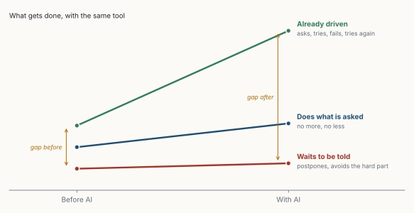
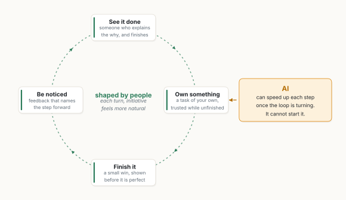

::: {.callout-note appearance="simple"}
**Essai, octobre 2026.** Un essai court et personnel. Les deux figures sont des schémas de moi, dessinés avec le code de [figs.py](../../../posts/2026-10-30-the-tool-and-the-hand/figs.py) ; elles montrent une forme, pas des données mesurées. Les figures sont en anglais. *Traduit de l'anglais : [version originale](../../../posts/2026-10-30-the-tool-and-the-hand/index.qmd).*
:::

**En bref.** L'IA élève le plafond de ce qu'une personne peut faire. Elle ne déplace pas le sol sur lequel chacun de nous se tient. La productivité n'est pas une propriété des outils, mais de la relation entre une personne et son travail : la curiosité, le sens des responsabilités, l'habitude de terminer. Celui qui remettait à plus tard remettra à plus tard avec l'IA, simplement plus vite. L'outil multiplie ce qui est déjà là ; l'écart entre ceux qui savent pourquoi ils travaillent et ceux qui attendent encore qu'on le leur dise va donc se creuser. Un état d'esprit peut changer, mais grâce aux personnes, pas grâce à un logiciel.

## 1. La plus ancienne des promesses

Chaque nouvel outil arrive avec une promesse. L'imprimerie allait nous rendre plus sages. Le téléphone allait nous rapprocher. Le tableur allait libérer le comptable, et Internet mettre tout le savoir à la portée de chacun. Chacun de ces outils a tenu quelque chose de réel. Aucun n'a apporté la personne.

L'intelligence artificielle arrive avec la plus grande promesse de toutes : n'importe qui, avec la bonne question, pourrait désormais écrire, coder, analyser et décider plus vite et mieux qu'avant. Il est vrai que le plafond s'est élevé. Ce qui n'a pas bougé, c'est le sol sur lequel chacun de nous se tient.

## 2. L'outil amplifie, il ne transforme pas

Un outil prolonge la main. Il ne lui donne pas d'intention. Mettez un moteur puissant dans une voiture dont le conducteur ne sait pas où aller, et vous obtenez davantage de chevaux qui tournent au ralenti au même carrefour.

La productivité n'est pas une propriété des outils. C'est une propriété de la relation entre une personne et son travail : la curiosité, le sens des responsabilités, l'habitude de terminer ce qu'on a commencé, le courage de montrer quelque chose d'imparfait pour l'améliorer vite. Ce ne sont pas des fonctionnalités que l'on installe.

Alors celui qui remettait à plus tard remettra à plus tard avec l'IA. Celle qui attendait des instructions parfaites attendra désormais le prompt parfait. Celui qui évitait l'effort de réflexion trouvera dans l'IA une excellente complice pour l'éviter, et le résultat aura l'air soigné, ce qui le rend plus dangereux, pas moins. L'hésitation, multipliée, n'est qu'une hésitation plus rapide.

> L'IA multiplie ce qui est déjà là. Elle ne fournit pas ce qui manque.

Pendant ce temps, la personne qui était déjà animée, qui posait des questions, essayait, échouait et recommençait, ira remarquablement plus loin (figure 1). Le vrai risque de ce nouvel outil n'est pas qu'il remplace les gens. C'est qu'il creuse, sans bruit, l'écart entre ceux qui savent pourquoi ils travaillent et ceux qui attendent encore qu'on le leur dise.

{fig-alt="Graphique en pente intitulé « What gets done, with the same tool », de « Before AI » à « With AI ». « Already driven » (la personne déjà animée, qui demande, essaie, échoue et recommence) monte fortement. « Does what is asked » (fait ce qu'on lui demande, ni plus ni moins) monte un peu. « Waits to be told » (attend qu'on lui dise, remet à plus tard) reste presque à plat. Des flèches montrent un petit écart avant (« gap before ») et un écart bien plus grand après (« gap after »)."}

## 3. Un état d'esprit se façonne, il ne s'installe pas

Ce n'est pas un jugement porté sur les plus lents. Peu de gens naissent indifférents ; beaucoup n'ont simplement jamais vu d'autre manière de faire. Personne ne leur a confié de responsabilité, personne ne leur a fait confiance avec une idée inachevée, personne n'a salué un petit pas en avant. Un état d'esprit n'est pas un trait figé. C'est le dépôt des exemples que nous avons vus, des retours que nous avons reçus, et de la liberté qu'on nous a laissée, ou non.

C'est pourquoi il peut changer, mais pas grâce à un logiciel. Il change grâce aux personnes (figure 2). Un responsable qui explique le pourquoi avant le comment. Un collègue qui partage un brouillon sans honte. Une équipe où poser une question est un signe d'engagement plutôt que de faiblesse. De petites victoires, répétées, jusqu'à ce que terminer devienne une habitude et que l'initiative paraisse naturelle. Ce travail est lent, humain et sans éclat. Aucune licence ne l'achète, et aucun plan de déploiement ne peut le planifier.

{fig-alt="Une boucle de quatre étapes, « shaped by people » : « See it done » (quelqu'un qui explique le pourquoi, et qui termine), « Own something » (une tâche à soi, confiée même inachevée), « Finish it » (une petite victoire, montrée avant d'être parfaite), « Be noticed » (un retour qui nomme le pas en avant). Au centre : à chaque tour, l'initiative paraît plus naturelle. Hors de la boucle, une case « AI » avec une flèche en pointillés : elle peut accélérer chaque étape une fois la boucle lancée, mais ne peut pas la lancer."}

## 4. La question à se poser d'abord

Avant de se demander « comment déployer l'IA ? », une organisation, ou une personne, pourrait se poser une question plus simple et plus inconfortable : *qu'allons-nous exactement amplifier ?* Si la réponse est la curiosité, le sens des responsabilités et le goût du travail bien fait, l'outil fera merveille. Si la réponse est l'attente, la peur de se tromper et l'absence de sens, l'outil ne changera rien, sinon la vitesse à laquelle nous faisons du surplace.

Ce n'est pas le marteau qui a bâti la cathédrale. Ce sont des femmes et des hommes qui savaient pourquoi ils taillaient la pierre. Les outils n'ont jamais été aussi puissants qu'aujourd'hui. Il n'a jamais été aussi important de prendre soin de la main qui les tient.
