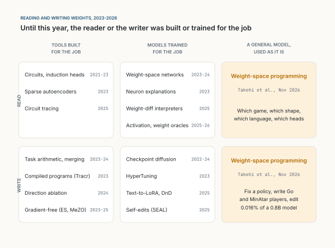

::: {.series-note}
**Une IA rapide et locale** · Partie 4 sur 4 · [Lire toute la série](../../fast-and-local-ai.qmd)
:::

::: {.callout-note appearance="simple"}
**Analyse, novembre 2026.** Une lecture de *Sparks of Weight-Space Programming* de Rikiya Takehi, Jayden Teoh, Alex Zhang et Omar Khattab, du MIT CSAIL [@takehi2026], publié sous forme de billet de blog le 2 novembre 2026, replacé dans les travaux de 2023 à 2026 qui lisent ou écrivent les poids des réseaux de neurones, et lu pour ce qu'il signifie pour [Fast AI](../2026-10-11-fast-ai/index.qmd) : de petits modèles rapides qui tournent sur les machines du client. Sauf mention contraire, les chiffres sur les expériences viennent du billet lui-même ; ce sont des résultats précoces des auteurs, non relus par des pairs, mais ils ont publié tous les journaux d'exécution. Le modèle qu'ils utilisent s'appelle GPT-6 Astra dans le billet ; je ne l'ai pas utilisé et ne peux rien vérifier à son sujet au-delà de ce qu'ils rapportent. La seconde moitié, sur un « incubateur » pour petits modèles et son fonctionnement sur site, est ma propre proposition. Les figures sont tracées avec [figs.py](../../../posts/2026-11-03-the-teacher-who-writes-the-weights/figs.py) ; la figure 2 reprend le tableau du billet, les figures 1 et 3 sont des schémas. Les figures sont en anglais. *Traduit automatiquement de l'anglais ; quelques erreurs sont possibles. [Version originale](../../../posts/2026-11-03-the-teacher-who-writes-the-weights/index.qmd).*
:::

**En bref.** Depuis toujours en apprentissage profond, les poids d'un réseau sont écrits par un optimiseur. Depuis 2023, de plus en plus de travaux entraînent des modèles spécialisés pour lire les poids ou pour les générer. Le nouveau billet affirme autre chose : un modèle de pointe généraliste, utilisé tel quel, peut lire les poids bruts d'un réseau et dire pour quoi il a été entraîné, et peut écrire des poids directement, autour d'un objectif formulé en langage courant. Il nomme le jeu sur lequel une politique a été entraînée, trouve les têtes d'induction d'un petit transformeur sans l'exécuter, répare en une réponse une politique de contrôle bloquée, écrit de zéro des joueurs qui battent PPO entraîné pendant 100 millions de pas, et modifie 0,016 % des poids d'un modèle de 0,8 milliard de paramètres pour l'empêcher de tourner en boucle, ce qui fait passer MATH-500 de 7,9 % à 48,1 %. Ma lecture : les résultats sont réels, mais plus étroits que le titre. Le modèle excelle à traduire en forme neuronale un *programme* qu'il comprend, et à retirer un *obstacle* qu'il sait trouver ; le contrôle des auteurs eux-mêmes montre qu'il n'a pas pu ajouter une capacité qui manquait au modèle. Cette forme convient très bien à Fast AI. Fast AI utilise déjà le grand modèle une fois, avant la boucle, comme un compilateur ; la programmation dans l'espace des poids lui permet de compiler dans le petit réseau lui-même, de réparer ce réseau sans grappe de GPU, et de livrer la correction comme un correctif de quelques centaines de kilo-octets. Sur site, la question difficile est ce qui sort du bâtiment : une spécification peut sortir, les données privées ne le devraient pas, et les poids entraînés portent une partie de ces données. J'esquisse un incubateur qui respecte cette ligne, et l'expérience qui montrerait s'il vaut la peine d'être construit.

::: {.callout-tip appearance="simple" icon="false"}
## À retenir

- De 2023 à 2026, les poids ont été lus par des outils d'interprétabilité et des lecteurs entraînés, et écrits par des optimiseurs, des fusions, des compilateurs et des générateurs entraînés. Le lecteur ou l'auteur était toujours construit ou entraîné pour cette tâche.
- La nouvelle affirmation : un modèle généraliste, utilisé tel quel, peut faire les deux, parfois sans exécuter le réseau du tout.
- Les meilleurs résultats sont là où existe un algorithme net (Breakout, la tactique au go, une voiture qui doit reculer) ou là où une seule direction cause une seule panne (les boucles). La modification de Qwen a supprimé les boucles ; elle n'a pas enseigné les mathématiques.
- Pour Fast AI, le grand modèle peut compiler non seulement la mémoire mais le petit spécialiste lui-même : lent et coûteux une fois, petit et rapide à chaque fois ensuite.
- Sur site, cela offre une réparation sans réentraînement et une correction livrée comme une petite différence de poids, qu'on peut relire.
- Le piège, ce sont les données : les poids entraînés portent une partie de leurs données d'entraînement, si bien que les faire lire par un modèle distant est un transfert de données. Écrire à partir d'une spécification ne l'est pas.
:::

## Les poids étaient l'affaire des optimiseurs

Un réseau de neurones est, au fond, une longue liste de nombres. Un programme en Python peut être lu par une personne ; une liste de 17 253 nombres à virgule flottante ne le peut pas, du moins par personne que je connaisse. La division du travail est donc stable depuis des décennies. Les humains écrivent l'architecture, les données et la fonction de perte. Un optimiseur, en général une variante de la descente de gradient, écrit les poids. Les humains étudient ensuite le résultat de l'extérieur, en l'exécutant.

Les auteurs le disent bien. Depuis quelques années, nous utilisons les grands modèles de langage pour optimiser du texte : des prompts et les programmes qui les entourent [@khattab2024; @agrawal2026], des couches d'exploitation entières [@lee2026], et le code qui entraîne les modèles [@karpathy2026]. La justification était que le texte n'a pas de gradient et qu'une personne peut améliorer du code à la main, donc un modèle de langage aussi. Les poids faisaient exception. « Humans can 'optimize' code by hand », écrivent-ils, « but they can't 'optimize' neural weights by hand, so those remained largely in the realm of symbolic algorithms » [@takehi2026].

Le billet affirme que cette exception prend fin. Si c'est vrai, cela change quelque chose qui m'importe davantage que les scores : la façon dont un grand modèle peut aider un petit.

## Ce qui précède : quatre façons de toucher un poids, de 2023 à 2026

Pour voir ce qui est nouveau, il aide de trier les travaux antérieurs selon deux questions : *lisent*-ils les poids ou les *écrivent*-ils, et le lecteur ou l'auteur est-il un outil construit pour la tâche, un modèle entraîné pour la tâche, ou un modèle généraliste utilisé tel quel ? La figure 1 place les principales lignes de travail.

{fig-alt="Une grille de deux lignes, « READ » (lire) et « WRITE » (écrire), et trois colonnes : « TOOLS BUILT FOR THE JOB » (outils construits pour la tâche), « MODELS TRAINED FOR THE JOB » (modèles entraînés pour la tâche) et « A GENERAL MODEL, USED AS IT IS » (un modèle généraliste utilisé tel quel). Lire, outils : circuits et têtes d'induction 2021-23, autoencodeurs parcimonieux 2023, traçage de circuits 2025. Lire, modèles entraînés : réseaux sur l'espace des poids 2023-24, explications de neurones 2023, interprètes de différences de poids 2025, oracles d'activations et de poids 2025-26. Écrire, outils : arithmétique de tâches et fusion 2023-24, programmes compilés avec Tracr 2023, ablation de direction 2024, stratégies d'évolution et MeZO 2023-25. Écrire, modèles entraînés : diffusion de points de contrôle 2022-24, HyperTuning 2023, Text-to-LoRA et Drag-and-Drop 2025, auto-modifications avec SEAL 2025. La colonne du modèle généraliste, en surbrillance, contient « Weight-space programming », Takehi et al., novembre 2026, pour la lecture comme pour l'écriture."}

**Lire, avec des outils construits pour la tâche.** L'interprétabilité mécaniste trace des circuits [@olah2020] et a trouvé les *têtes d'induction* qui permettent à un transformeur de recopier un texte antérieur, avec une méthode qui multiplie des matrices de poids sans exécuter le modèle [@elhage2021]. Les autoencodeurs parcimonieux décomposent les activations en caractéristiques nommables [@bricken2023; @cunningham2023], et le traçage de circuits dessine des graphes de calcul entiers [@ameisen2025].

**Lire, avec des modèles entraînés pour la tâche.** Les réseaux sur l'espace des poids sont entraînés à prendre en entrée les poids d'un autre réseau et à prédire ses propriétés, comme sa précision ou les données sur lesquelles il a été entraîné [@navon2023; @zhou2023; @lim2024]. Les modèles de langage s'y sont mis, pour expliquer des neurones isolés [@bills2023], pour lire des différences de réglage fin [@goel2025] et des activations [@karvonen2025; @fraser2026], et, cet automne, pour lire directement des poids [@kabra2026].

**Écrire, avec des outils.** L'arithmétique de tâches additionne et soustrait les différences de poids de modèles réglés [@ilharco2023] ; TIES, DARE et la recherche évolutionnaire ont rendu la fusion plus robuste [@yadav2023; @yu2024; @akiba2025]. Le refus, dans beaucoup de modèles conversationnels, est porté par une seule direction, et la retirer des poids retire le comportement [@arditi2024] ; des faits peuvent être localisés et modifiés [@meng2022]. Tracr a compilé de petits programmes directement dans les poids d'un transformeur [@lindner2023], et les optimiseurs sans gradient écrivent les poids par essais et erreurs [@salimans2017; @malladi2023; @qiu2026].

**Écrire, avec des modèles entraînés pour la tâche.** Des modèles génératifs produisent des points de contrôle [@peebles2022; @wang2024] ; des hyperréseaux transforment une description de tâche ou quelques prompts en adaptateurs [@phang2023; @charakorn2025; @liang2025; @neurogen2025]. SEAL laisse un modèle écrire ses propres données de réglage fin, mais ce sont encore des gradients qui appliquent la mise à jour [@zweiger2025].

Le motif commun à ces quatre cases est celui que relève le billet : « either the reader is trained for the task or training still does the writing » [@takehi2026]. La seule exception qu'ils citent, AdderBoard, fait régler à la main les poids d'un minuscule transformeur par des agents de programmation [@papailiopoulos2026]. La colonne de droite de la figure 1 est ce que le billet affirme remplir.

## Ce qu'affirme le billet

Les auteurs définissent l'idée en une phrase : « In Weight-Space Programming, a general-purpose LLM reads and writes a network's weights directly (i.e., not through an optimizer, and in particular not with gradient descent) around some natural language spec, sometimes even with no environment feedback at all » [@takehi2026].

Dit un peu plus formellement, l'affirmation a trois parties. Soit $W$ les poids d'un réseau d'architecture connue, et $M$ un modèle de langage généraliste.

1. **Lire.** Étant donné $W$, en texte ou en tenseurs, et une question $q$ sur le comportement du réseau, $M$ répond correctement à $q$ plus souvent que le hasard, sans exécuter le réseau.
2. **Réparer.** Étant donné $W$, un objectif $g$ et peu ou pas de retour, $M$ produit $W' = W + \Delta$ avec un petit $\Delta$, tel que $W'$ atteigne $g$ mieux que $W$.
3. **Écrire.** Étant donné seulement l'architecture et une description de la tâche, $M$ produit à partir de zéro un $W$ qui fonctionne bien, sans données, sans perte et sans gradient.

La ressource intéressante n'est pas le nombre de jetons mais les *passes avant* : combien de fois $M$ a le droit d'exécuter le réseau pour voir ce qu'il fait. Plusieurs expériences n'en autorisent aucune.

## Les huit expériences

Le tableau 1 réunit le dispositif et le principal résultat de chaque expérience, tels que rapportés.

| N° | Tâche (réseau ; ce qu'Astra peut utiliser) | Résultat rapporté |
|-|------------|--------|
| 1 | Quel jeu ? (politique PPO de 17 000 poids ; poids en texte, sans outils) | Bon jeu, quatre sur quatre |
| 2 | Quelle forme ? (modèle de diffusion de 24 000 poids ; aucune passe avant) | Bonne forme, trois sur trois |
| 3 | Quelle langue, quelles têtes ? (transformeur de 7,2 M de poids, couches externes retirées ; Python, sans l'exécuter) | Bonne langue, trois sur trois ; toutes les têtes de copie, aucune fausse |
| 4 | Réparer une voiture bloquée sur une rampe (politique PPO de 172 000 poids ; une réponse, sans outils) | 1 024 épisodes réussis sur 1 024 ; 3,5 % des poids modifiés |
| 5 | Écrire de zéro des joueurs MinAtar (sans données, outils ni parties) | Battent PPO à 100 M de pas dans les trois jeux (tableau 2) |
| 6 | Écrire de zéro un joueur de go (1,5 M de poids ; 0 à 50 passes avant) | Avec 50 passes, bat le réseau PPO de même taille |
| 7 | Quel modèle est complaisant ? (paires de Gemma 3 270M) | Poids seuls : échec. Avec les motifs d'attention : trois sur trois |
| 8 | Rendre Qwen3.5-0.8B meilleur en maths (10 à 50 passes avant) | MATH-500 de 7,9 % à 48,1 % ; 0,016 % des poids modifiés (figure 2) |

: **Tableau 1.** Les huit expériences de Takehi et ses collègues [@takehi2026], dans leur ordre. Les jeux de l'expérience 1 sont des versions sur grille des auteurs ; MinAtar [@young2019] et Kinetix [@matthews2025] sont des bancs d'essai standard.

Les joueurs de l'expérience 5 méritent leur propre tableau, car ils sont le test d'écriture le plus propre : pas de données, pas d'outils, pas de parties d'essai, une seule réponse.

| Jeu | PPO, 100 M de pas | PPO, 500 M de pas | Astra, un essai |
|---|---:|---:|---:|
| Breakout | 15,8 | 25,3 | 517,4 |
| Seaquest | 5,6 | 88,9 | 53,1 |
| Asterix | 25,8 | 55,2 | 53,2 |

: **Tableau 2.** Score moyen sur 1 000 épisodes dans trois jeux MinAtar, d'après le billet. PPO est le meilleur de 3 à 10 graines.

La façon de faire compte plus que les scores. Dans tous les cas où le billet montre le raisonnement, le modèle ne cherche pas dans l'espace des poids. Il *comprend* le réseau comme un programme. Dans Breakout, « Astra programs the first layer to compute where the ball would land, and the second layer is programmed to move the paddle to that position ». Au go, il écrit 336 lignes de Python qui marquent les pierres et les libertés dans les premières couches, les propagent le long des chaînes dans les couches du milieu, et notent captures et sauvetages dans la dernière. Pour la voiture, il ajoute « a small separate path through a few units per layer » qui fait reculer la voiture puis s'éteint. En lecture, il redécouvre de lui-même la méthode de multiplication des poids qu'Elhage et ses collègues avaient utilisée pour trouver les têtes d'induction [@elhage2021].

L'expérience 8 fait le titre et c'est la plus instructive. La figure 2 en reprend le tableau.

![**Figure 2.** Expérience 8 : Qwen3.5-0.8B après la modification des poids par Astra, pour trois budgets de passes avant. Le dernier panneau donne la part des réponses à MATH-500 qui atteignent la limite de 32 768 jetons ; elle ne baisse qu'avec le plus grand budget. Données de Takehi et ses collègues [@takehi2026], leur tableau ; graphique de moi.](../../../posts/2026-11-03-the-teacher-who-writes-the-weights/figures/fig02.svg){fig-alt="Quatre petits diagrammes en barres sur un axe de pourcentage de 0 à 100, chacun avec quatre barres : « Base » (le modèle de départ), puis le modèle modifié avec 10, 25 et 50 passes avant. MATH-500 : 7.9, 12.3, 14.1, 48.1. GSM8K : 13.8, 25.7, 25.1, 67.1. IFEval : 21.0, 49.0, 39.9, 62.3. Part des réponses à MATH-500 qui atteignent la limite de jetons : 93.0, 87.2, 86.4, 33.1."}

Le modèle de départ tourne en boucle : il se répète et termine rarement (85 de ses 96 premières réponses d'entraînement ont atteint la limite de jetons ; la fiche du modèle Qwen elle-même le signale). Astra a fait remonter les boucles à une direction écrite par les MLP des couches 15 et 19, et l'a soustraite de 64 colonnes de sortie dans chacune, soit 131 072 poids. C'est, comme le notent les auteurs, proche dans l'esprit de la suppression du refus par l'effacement d'une direction [@arditi2024], et de travaux récents sur les raisons des boucles des modèles de raisonnement [@pipis2025]. Comme les boucles ne sont pas propres aux mathématiques, le suivi d'instructions s'est amélioré aussi.

Vient ensuite le contrôle que je respecte le plus dans le billet. Les auteurs ont essayé la même chose sur Gemma 3 270M, qui tourne rarement en boucle. Rien n'a marché : MATH-500 est passé de 6,8 % à 7,7 % au mieux, un gain qu'Astra lui-même a jugé non établi. Leur conclusion est prudente : « Editing weights could remove an obstacle that hid an ability, but it could not add an ability the model lacked. »

## Ma lecture

**Ce que je garde.** Trois choses me semblent solides, même à ce stade précoce.

D'abord, *lire sans exécuter* fonctionne sur de petits réseaux, au moins pour des questions grossières. L'expérience 3 est la plus convaincante : sans les couches d'entrée et de sortie, rien dans les poids ne dit quelle dimension correspond à quelle lettre, et pourtant le modèle trouve les têtes de copie qu'une mesure confirme, sans faux positif. Ce n'est pas de la reconnaissance de motifs sur la première couche. C'est un raisonnement structurel sur des matrices.

Ensuite, *écrire fonctionne là où un programme existe*. Breakout a un algorithme net (aller là où la balle va tomber), et le réseau écrit marque 20 fois plus que PPO à 500 millions de pas. Seaquest n'a pas de programme court de ce genre (oxygène, plongeurs, ennemis, minutage) et le réseau écrit atteint 60 % de PPO. Cet écart est ce que le tableau 2 a de plus instructif. Il dit que la programmation dans l'espace des poids est, au fond, une *compilation par compréhension* : Tracr le faisait pour des programmes écrits en RASP [@lindner2023] ; ici le programme vit dans le raisonnement du modèle et la cible est un MLP ordinaire.

Enfin, *une petite modification explicitée peut réparer une grosse panne*. Un changement de 0,016 % expliqué en une phrase (« cette direction cause les boucles ; retirez-la ») est un objet très différent d'un réglage fin complet. On peut le relire.

**Ce que je laisse de côté.** Dire que le modèle a « rendu Qwen meilleur en maths » exagère le résultat, et le contrôle Gemma des auteurs le dit. La modification a permis au modèle de *terminer* des réponses qu'il savait déjà trouver. C'est précieux, mais c'est une réparation, pas un enseignement.

Je lirais aussi les comparaisons avec PPO avec prudence. PPO sur un MLP de 32 unités est probablement une référence faible ; 517 contre 25 en dit autant sur la difficulté d'entraîner un petit réseau par apprentissage par renforcement que sur le réseau écrit. La comparaison que le billet ne fait pas est celle d'un réseau écrit utilisé comme *point de départ* pour PPO.

Les passes avant sont aussi un retour d'information. Dans l'expérience 8, dix ou vingt-cinq passes ont à peine réduit les boucles (87 % et 86 % atteignent encore la limite), IFEval était *plus bas* à 25 qu'à 10, puis cinquante passes ont tout changé. Avec une seule modification par budget, une courbe d'échelle et une recherche chanceuse se ressemblent.

Et les échantillons sont petits : quatre jeux, trois formes, trois langues, trois paires complaisantes, un seul grand modèle. L'expérience 7 a échoué à partir des poids seuls. Le modèle est de ceux que la plupart des lecteurs, moi compris, ne peuvent pas essayer. Rien de tout cela ne rend les résultats faux ; cela en fait des étincelles, ce que dit le titre.

## Un esprit plus avancé qui en façonne un plus petit

Voici la partie qui m'intéresse le plus, et elle n'est pas dans le billet.

Jusqu'ici, il y avait deux façons pour un grand modèle d'améliorer un petit. La première est la *distillation* : le grand modèle produit des sorties, et le petit apprend à les imiter par descente de gradient [@hinton2015]. Beaucoup de petits modèles de ces deux dernières années ont été faits ainsi, parfois avec de l'élagage [@muralidharan2024]. La seconde est un *générateur entraîné* : un hyperréseau qui transforme une description en poids [@charakorn2025; @liang2025]. Dans les deux cas, les poids du petit modèle sont encore écrits par un optimiseur, à partir d'exemples.

La programmation dans l'espace des poids ajoute une troisième voie, et elle est étrange. Le grand modèle ne montre pas d'exemples au petit. Il lit ses poids, se fait une théorie de ce qu'il calcule, et le modifie. Le tableau 3 met les trois côte à côte.

| | Distillation | Générateur entraîné | Programmation des poids |
|---|---|---|---|
| Ce que donne le maître | Des exemples de son comportement | Une correspondance apprise de la tâche aux poids | Un diagnostic et une modification |
| Qui écrit les poids | L'optimiseur de l'élève | Le générateur | Le maître, directement |
| Besoin de données | Beaucoup | Beaucoup de points de contrôle entraînés | Peu ou pas |
| S'explique | Non | Non | En langage courant |
| Bon pour | Transmettre une capacité générale | Adapter vite au sein d'une famille | Points de départ, réparations, audits |
| Faible pour | Retirer un défaut précis | Les tâches éloignées de son entraînement | Ajouter une capacité qui manque à l'élève |

: **Tableau 3.** Trois façons dont un grand modèle peut façonner un petit. Les deux premières colonnes résument les travaux cités ; la troisième résume le billet, et les deux dernières lignes sont ma lecture.

L'analogie humaine est tentante, et elle est à moitié juste. Un bon enseignant ne donne pas seulement des exemples ; il repère l'idée fausse précise derrière une série d'erreurs et traite cette seule chose. L'expérience 8 est exactement cela : une idée fausse (une direction qui ne lâche jamais prise), une correction. Mais un enseignant humain passe *par* l'apprentissage propre de l'élève. Ici, le maître le contourne et modifie l'esprit lui-même. C'est plus puissant, et moins sûr : l'élève n'a pas son mot à dire, et rien dans sa propre expérience ne confirme le changement. C'est la différence entre un précepteur et un chirurgien. Nous acceptons la chirurgie, mais nous demandons aux chirurgiens de dire ce qu'ils vont couper et pourquoi, de vérifier ensuite, et de tenir un dossier.

Le résultat sur Gemma s'accorde aussi, de façon gênante, avec l'analogie. On peut dégager un obstacle dans un esprit ; on ne peut pas, en le modifiant, lui donner une compréhension qu'il n'a jamais formée. La capacité vient toujours de l'apprentissage. Ce qu'un esprit plus avancé peut faire, c'est donner à un plus petit un meilleur départ, retirer ce qui le bloque, et le vérifier avant qu'il parte dans le monde.

## Un incubateur pour petits réseaux

Cela suggère un dispositif concret, que j'appellerai un incubateur. C'est une boucle autour d'un entraînement ordinaire, dans laquelle un grand modèle joue le rôle de mentor d'un petit réseau (figure 3).

![**Figure 3.** Un incubateur pour petits réseaux. Le grand modèle écrit un point de départ, l'entraînement ordinaire le fait grandir, le grand modèle l'examine et le répare, et la boucle se répète tant que chaque modification se rentabilise ; la mise en service s'accompagne d'une note d'audit et de la différence de poids. Les étiquettes au-dessus des cartes disent où chaque étape peut tourner sur site : au plus, la spécification sort, et elle peut elle aussi être confidentielle. Schéma, de moi ; il montre une proposition, pas un résultat.](../../../posts/2026-11-03-the-teacher-who-writes-the-weights/figures/fig03.svg){fig-alt="Cinq cartes en ligne reliées par des flèches : « 1 Conceive » (concevoir), le mentor écrit un premier réseau à partir d'une spécification ; « 2 Grow » (grandir), entraînement ordinaire à partir de ce départ, sur des données réelles ; « 3 Examine » (examiner), le mentor lit les poids et des sondes à la recherche de boucles et de raccourcis ; « 4 Operate » (opérer), une petite modification explicitée, gardée seulement si des tests réservés l'approuvent ; « 5 Release » (mettre en service), une note d'audit et la différence de poids, relues comme du code. Une flèche pointillée revient de l'étape 4 à l'étape 2, avec « repeat while each edit pays for itself » (répéter tant que chaque modification se rentabilise). Des étiquettes au-dessus des cartes disent où chaque étape tourne : « spec only » pour concevoir, « on premise » (sur site) pour grandir, « local or remote » (local ou distant) pour examiner et opérer, « on premise » pour la mise en service. Une note en bas dit que le budget se compte en passes avant et en jetons du mentor, comparés à l'entraînement seul, et qu'au plus la spécification sort."}

1. **Concevoir.** À partir d'une spécification en langage courant, le mentor écrit un premier réseau de la taille visée, comme un programme sous forme neuronale, à la manière dont Astra a écrit les joueurs de Breakout et de go. Là où la tâche a un algorithme connu, ce départ peut déjà être bon ; sinon, il est au moins structuré.
2. **Grandir.** Entraînement ordinaire, sur des données réelles, à partir de ce départ. C'est de là que vient la capacité, et c'est là que s'applique la leçon de Gemma : le mentor ne peut pas sauter cette étape.
3. **Examiner.** Le mentor lit les poids entraînés, avec un petit budget de sondes, à la recherche de pannes connues : boucles, raccourcis, une direction qui suit l'opinion de l'utilisateur (la complaisance de l'expérience 7), unités mortes, une politique bloquée dans un minimum local (expérience 4).
4. **Opérer.** Une petite modification, énoncée en une phrase, gardée seulement si des tests réservés l'approuvent. Puis retour à l'entraînement, pour que le réseau absorbe le changement.
5. **Mettre en service.** Le réseau part avec une note d'audit : ce qui a été examiné, ce qui a été trouvé, ce qui a été changé, et la différence de poids elle-même.

L'économie est simple à énoncer. Soit $C_\text{train}(s)$ le coût d'entraînement d'un point de départ $s$ jusqu'à une qualité visée, $C_\text{write}$ le coût pour le mentor d'écrire le départ, et $C_\text{fix}$ le coût de chaque cycle examiner-opérer. L'incubateur vaut la peine quand

$$
\begin{aligned}
&C_\text{write} + C_\text{train}(s_\text{written}) + k \, C_\text{fix}\\
&\quad < \; C_\text{train}(s_\text{random}),
\end{aligned}
$$

ou, plus souvent en pratique, quand il atteint une qualité que l'entraînement seul n'atteint pas du tout, comme pour la voiture bloquée. Le billet donne des indices des deux côtés : un départ écrit peut être très bon (tableau 2), et une seule réparation peut valoir plus que n'importe quelle quantité d'entraînement supplémentaire (la voiture n'a jamais réussi en 256 épisodes après un milliard de pas). Il ne mesure pas le membre de gauche. C'est la première expérience à faire.

## Ce que cela signifie pour Fast AI sur site

Sur ce site, j'ai défendu ce que j'appelle Fast AI : les experts apprennent lentement, une fois, puis agissent vite par habitude ; le grand modèle doit donc servir *avant* la boucle, comme un compilateur, et des modèles rapides et explicables doivent faire tourner le processus (voir [Fast AI](../2026-10-11-fast-ai/index.qmd)). J'ai aussi soutenu que l'IA locale sera un écosystème de petits spécialistes, d'une mémoire partagée et d'une couche d'exploitation légère, et non un grand modèle rapetissé (voir [Un écosystème, pas un oracle](../2026-10-17-an-ecosystem-not-an-oracle/index.qmd)). Beaucoup des lieux où cela compte le plus fonctionnent sur site : une usine, un hôpital, une banque, une administration, où le matériel est modeste, la latence serrée, et où les données ne doivent pas sortir du bâtiment. La programmation dans l'espace des poids touche ce tableau en cinq points.

### 1. Compiler dans les poids, pas seulement dans la mémoire

Dans Fast AI, le grand modèle compile une tâche en une mémoire structurée (un graphe de connaissances que les experts peuvent inspecter) et de petits modèles s'appuient dessus. La programmation dans l'espace des poids ajoute une seconde cible de compilation : le petit réseau lui-même. L'expérience 5 est exactement cela, avec les règles et le code source d'un jeu transformés en un réseau 600→32→32→6 en une seule réponse. Le réseau obtenu est minuscule, tourne en quelques microsecondes sur un CPU ou un NPU, et n'a besoin d'aucun grand modèle à l'exécution. C'est le profil de coût de Fast AI : lent et coûteux une fois, bon marché à chaque fois ensuite.

Je garderais une règle de l'essai Fast AI : *laisser l'apprentissage profond percevoir et les arbres décider*. Si une règle métier est connue et stable, un arbre de décision est moins cher, plus rapide et plus facile à auditer que n'importe quel réseau, écrit ou entraîné. Un réseau écrit se justifie là où la décision repose sur la perception (la règle a besoin de caractéristiques qu'un arbre ne voit pas), ou là où il doit tourner fusionné avec un modèle de perception sur le même accélérateur. Écrire un réseau pour imiter une règle qu'on a déjà dans un tableau est un pas en arrière.

### 2. Le mentor passe ; il ne reste pas

Le coût du grand modèle se paie à la construction et à la réparation, jamais à chaque décision. Dans l'expérience 8, toute la réparation a pris cinquante passes avant du modèle de 0,8 milliard et une session du grand modèle ; le billet ne donne pas le coût du grand modèle lui-même. À comparer avec l'agent qui « relit le manuel chaque matin », qui paie le grand modèle à chaque exécution. Pour un client sur site, c'est la différence entre une dépendance permanente envers un modèle distant et la visite occasionnelle d'un spécialiste. Le tableau 4 résume où chaque partie tournerait.

| Étape | Où elle peut tourner | Ce qu'elle doit voir |
|---|---|---|
| Écrire un premier réseau (grand modèle) | N'importe où, y compris à distance | La spécification et l'architecture |
| L'entraîner (optimiseur ordinaire) | Sur site | Les données privées |
| L'examiner (grand modèle, quelques passes avant) | Sur site, ou à distance si les poids peuvent sortir | Les poids entraînés et quelques sondes |
| Le réparer (grand modèle, un noyau Python) | Comme ci-dessus | Les poids ; aucun gradient |
| L'exécuter (le petit réseau seul) | Sur site, CPU ou NPU | Les entrées en direct |

: **Tableau 4.** Où chaque partie d'un petit modèle incubé tournerait dans un déploiement sur site. Ma propre proposition, d'après les dispositifs des expériences 5, 6 et 8 [@takehi2026].

### 3. Réparer sans grappe de GPU

Les équipes sur site ont rarement l'infrastructure, ou la chaîne de données, pour refaire un réglage fin chaque fois qu'un modèle se comporte mal. La réparation de Qwen a utilisé un noyau Python « over the weights (no GPU) » et aucun entraînement. Les passes avant ne sont pas gratuites pour autant : cinquante, à une moyenne de 64 réponses qui allaient pour la plupart jusqu'à 32 768 jetons, font de l'ordre de cent millions de jetons générés (mon estimation grossière à partir des réglages du billet). Pour un modèle de 0,8 milliard de paramètres, cela représente des heures sur un GPU, pas un travail pour un CPU, mais c'est une machine, pas une grappe. La modification a changé 131 072 poids : environ un demi-mégaoctet en flottants 32 bits, un quart en 16 bits (mon calcul). C'est un correctif, au sens logiciel. On peut le signer, le livrer, l'appliquer et le retirer comme n'importe quel correctif, et le client peut garder le modèle de base qu'il a déjà validé.

La limite est celle que trace le contrôle Gemma. Un correctif peut retirer une panne qui cache une capacité (boucles, politique bloquée, direction qui suit l'opinion de l'utilisateur). Il n'ajoutera pas une capacité qui manque au modèle ; cela demande encore de l'entraînement, et des données.

### 4. Ce qui sort du bâtiment

C'est le point auquel je réfléchirais le plus avant de vendre quoi que ce soit. Les données privées ne doivent pas sortir du bâtiment. Une spécification le peut en général, mais pas toujours : dans l'expérience 5, le mentor a aussi lu le code source du jeu, et sur site l'équivalent (règles métier, logique des processus) peut être confidentiel aussi. Les poids entraînés sont entre les deux : ils sont façonnés par leurs données d'entraînement, et des attaques publiées ont extrait mot pour mot des exemples d'entraînement de modèles de langage [@carlini2021]. Envoyer un modèle entraîné sur des dossiers de patients à un mentor distant pour « examen » est donc un transfert de données, quel que soit le nom que lui donne le contrat.

Les dispositifs du billet suggèrent un partage net. *Écrire* à partir d'une spécification (expériences 5 et 6) ne demande aucune donnée, et peut donc être fait par tout mentor à qui le client accepte de montrer la spécification. *Entraîner* se fait sur site, sur les données privées. *Examiner* et *réparer* demandent les poids entraînés : soit les poids peuvent sortir, soit le mentor doit tourner à l'intérieur. Aujourd'hui, seul un modèle de pointe a montré cette capacité à ce niveau, et seulement entre les mains d'un laboratoire. Savoir si un modèle ouvert, qu'un client peut faire tourner chez lui, sait faire l'examen est, pour moi, la question ouverte la plus importante pour le travail sur site. Tant qu'elle n'a pas de réponse, la recette sûre sur site est : écrire à distance, entraîner et exécuter localement, et examiner localement avec les outils que nous avons déjà.

### 5. Auditer avant le déploiement, et relire l'intention

Les clients soumis à une réglementation demandent ce que fait un modèle avant de le laisser tourner. Lire les poids pourrait ajouter un nouveau type de preuve : non seulement « il a réussi ces tests », mais « voici ce qu'il calcule, voici ce que nous avons cherché sans le trouver ». L'expérience 7 est pourtant un avertissement : à partir des poids seuls, Astra a vu beaucoup de différences entre un modèle honnête et un modèle complaisant, sans pouvoir dire laquelle comptait. La lecture doit s'ajouter à l'évaluation, pas la remplacer.

Et chaque modification a besoin d'une intention énoncée. Une différence de 131 072 poids n'est pas quelque chose qu'une personne lira ; « retirer la direction qui cause les boucles dans les couches 15 et 19 », si. C'est le déplacement que j'ai défendu pour le code dans [Relire l'intention, pas le diff](../2026-10-22-review-the-intent-not-the-diff/index.qmd) : les humains possèdent l'intention, les machines l'implémentation, et les tests vérifient l'une contre l'autre. Sur site, la note d'intention, la différence et les résultats des tests devraient être livrés ensemble, et le client devrait pouvoir refuser le correctif.

Un modèle de décision du type que j'ai analysé dans [Le collègue junior](../2026-10-18-the-junior-colleague/index.qmd) est le premier candidat naturel pour ces cinq points : petit, étroit, souvent proche d'un programme, entraîné sur les états de l'agent lui-même, et tournant à côté de l'agent sur la machine du client.

## Là où cela casse

- **L'échelle.** Les réseaux qui tiennent dans le contexte ont au plus 171 664 poids. La modification du modèle de 0,8 milliard a utilisé un noyau Python et cinquante passes avant, et a changé une seule direction. Rien ne montre encore qu'un modèle puisse *comprendre* un grand réseau dans son ensemble, plutôt qu'y trouver une prise.
- **Les tâches sans programme.** L'écriture fonctionne le mieux là où existe un algorithme court. Beaucoup de tâches confiées aux petits modèles (perception, langage, jugement) n'en ont pas, et le mentor ne peut alors que réparer et auditer.
- **Des départs écrits qui résistent à l'entraînement.** Rien dans le billet ne teste un réseau écrit comme point de départ d'un entraînement par gradient. Des poids fixés par raisonnement peuvent saturer des unités tanh, là où les gradients s'annulent, si bien que l'étape *grandir* peut caler, ou simplement effacer la structure écrite.
- **Des poids adverses.** Un lecteur qu'on peut tromper avec des poids conçus pour paraître inoffensifs est une surface d'attaque. Aucune des expériences ne le teste.

## Ce que je ne prétends pas

Pas que la descente de gradient soit en voie de disparition : les meilleurs résultats du billet viennent encore de réseaux entraînés d'abord, ou de tâches assez simples pour être programmées. Pas que l'incubateur fonctionne ; c'est un dispositif, avec son test ci-dessous. Pas que des réseaux écrits doivent remplacer les arbres de décision là où les règles sont connues. Rien sur GPT-6 Astra au-delà de ce que rapporte le billet. Et pas qu'un modèle qui lit des poids les comprenne comme nous l'espérons ; il a peut-être trouvé une heuristique pour petits MLP qui échoue en silence à grande échelle.

## Ce qui me donnerait tort

- **Un modèle qui ajoute une capacité en modifiant les poids.** Si une modification des poids, sans entraînement, donne à un modèle une compétence qui lui manquait de façon mesurable (et non une compétence cachée par une panne comme les boucles), ma distinction entre réparer et enseigner tombe. Une reproduction du contrôle Gemma avec un résultat positif serait l'endroit où regarder.
- **Des départs écrits qui n'aident pas l'entraînement.** Si PPO ou un entraînement supervisé, à partir d'un départ écrit par le mentor, atteint la même qualité, au même coût total, qu'un entraînement depuis un départ aléatoire, l'étape « concevoir » de l'incubateur est inutile.
- **Des réparations qui ne survivent pas à l'entraînement.** Si une modification énoncée, suivie d'un entraînement supplémentaire, est systématiquement défaite, les modifications sont cosmétiques et la boucle de l'incubateur ne converge pas.
- **Pas de mentor local.** Si, d'ici fin 2027, aucun modèle ouvert tournant sur un seul serveur ne peut refaire l'expérience 3 ou la réparation de Qwen, la programmation dans l'espace des poids reste un service distant, et sa valeur sur site se limite à l'écriture à partir de spécifications.
- **Des optimiseurs sans gradient qui font aussi bien.** Si les stratégies d'évolution ou le réglage fin par passes avant seules [@qiu2026; @malladi2023], avec les mêmes cinquante passes avant, trouvent une modification aussi bonne que celle d'Astra sur Qwen, alors ce n'est pas le raisonnement qui a fait la différence, et un optimiseur local bon marché suffirait.

L'expérience que je ferais en premier est petite : trois jeux MinAtar, un MLP de 32 unités, et quatre bras à calcul égal : PPO depuis zéro, PPO depuis un départ écrit, le réseau écrit seul, et PPO avec un cycle examiner-opérer à mi-parcours. Je la ferais deux fois, pour séparer deux questions. D'abord avec le meilleur mentor disponible, pour tester l'incubateur lui-même ; puis avec un modèle ouvert sur un seul serveur sur site, pour tester si un mentor local suffit. Si les deuxième et quatrième bras gagnent la première fois, l'incubateur vaut la peine d'être construit ; la seconde fois dit s'il peut l'être à l'intérieur du bâtiment. Sinon, j'aurai appris quelque chose aussi.

::: {.read-next}
**À lire ensuite** · [Fast AI](../2026-10-11-fast-ai/index.qmd)
Apprendre lentement, une fois. Agir vite, à chaque fois. Utiliser le grand modèle pour construire la mémoire, pas pour la remplacer.
:::

::: {.small}
*Les opinions exprimées dans cette analyse sont les miennes et ne décrivent aucun produit ni aucun projet de mon employeur.*
:::

## Références

::: {#refs}
:::
