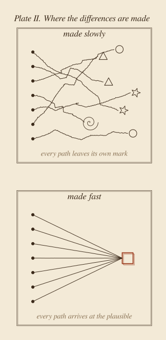

::: {.callout-note appearance="simple"}
**Essai, novembre 2026.** Un essai philosophique sur le temps : pourquoi nous le compressons, ce que l'IA ajoute à cette habitude, et ce que nous perdons en le faisant. Il emprunte une image à la physique, la lumière, comme métaphore et non comme argument. Les deux planches sont des schémas, de moi, réalisés avec [figs.py](../../../posts/2026-11-05-never-seen-passing/figs.py), et dessinés à dessein dans un style qui n'est pas celui de ce site : un essai sur le fait que tout finit par se ressembler ne devrait pas ressembler à tout le reste. Les figures sont en anglais. *Traduit automatiquement de l'anglais ; quelques erreurs sont possibles. [Version originale](../../../posts/2026-11-05-never-seen-passing/index.qmd).*
:::

**En bref.** Nous pensons le temps comme ce avec quoi nous produisons ; alors nous cherchons à l'économiser, et l'IA nous aide à en économiser davantage. Mais le temps est aussi là où nous existons : là où nous pensons, où nous sommes présents aux autres, où nous pouvons être vus. La lumière offre une étrange image de ce qui arrive quand on retire le temps. La chose la plus rapide qui soit ne vit aucun temps, et personne ne la voit jamais passer : elle rend tout le reste visible et n'est vue qu'au moment où elle s'éteint. Quand nous compressons nos journées, nous glissons vers cette condition. Notre travail devient plus visible et nous le devenons moins, et le travail lui-même finit par ressembler à celui de tout le monde. Comprendre, inventer et intégrer sont faits de temps, et c'est là que le travail devient le nôtre. L'IA est une sorte de lumière : rapide, partout, et, pour autant qu'on le sache, ne vivant rien en chemin. C'est très bien pour une machine, tant que nous n'essayons pas de devenir lumière nous-mêmes.

## 1. Le temps est là où nous existons

Nous parlons du temps comme d'une ressource. Nous l'économisons, le dépensons, le gaspillons, l'investissons. Une bonne journée est une journée où l'on a beaucoup produit ; une journée perdue, une journée où l'on a peu produit. Dans ce langage, le temps n'a de valeur que par ce qui en sort, et le but évident est d'en avoir besoin de moins pour le même résultat. L'IA s'inscrit parfaitement dans ce langage. C'est la meilleure machine à gagner du temps que nous ayons construite.

Mais pensez aux moments où quelqu'un *a eu du temps* pour vous. Un enseignant resté après le cours. Un collègue qui n'a pas regardé son téléphone pendant que vous lui expliquiez un problème. Un ami qui a laissé durer un silence. Ce qu'ils vous ont donné n'était pas un résultat. C'était une présence. Pendant cette heure, vous existiez pour eux, pleinement, et eux pour vous.

Avoir du temps n'est pas seulement une manière de produire. C'est une manière d'exister. C'est l'espace où nous pensons au lieu de réagir, où une pensée peut être suivie jusqu'au bout, où nous pouvons douter, changer d'avis, et devenir quelqu'un d'un peu différent de celui que nous étions le matin. Augustin, après de longues pages à chercher ce qu'est le temps, conclut qu'il est une sorte d'étirement de l'esprit lui-même, une *distentio animi* [@augustine1909, XI.26] : l'esprit qui retient ce qui a été, s'attache à ce qui est, attend ce qui sera. Le temps, dans cette perspective, n'est pas quelque chose que nous avons. C'est quelque chose sur quoi nous sommes étirés.

Et quand il rétrécit, nous rétrécissons avec lui. Le sociologue Hartmut Rosa a décrit comment les technologies qui font gagner du temps nous laissent plus à court de temps que jamais, parce que les minutes gagnées sont aussitôt dépensées à faire davantage [@rosa2013]. Une réunion devient un message, un document devient son résumé, une personne devient ses livrables. Peu à peu, nous n'apparaissons plus les uns aux autres que comme des résultats : le rapport est arrivé, le ticket est fermé, le tableau de bord est à jour. Celui ou celle qui les a produits est de moins en moins visible.

C'est l'argument que je veux poser d'abord. Raccourcir notre temps ne nous coûte pas seulement de la qualité. Cela nous coûte de la présence. Cela nous rend plus difficiles à voir, par les autres et par nous-mêmes.

## 2. On ne voit jamais passer la lumière

La physique offre une image de cela que je ne parviens pas à oublier.

Imaginez un photon qui quitte une étoile dans une galaxie lointaine. Pour nous, son voyage dure des milliards d'années. Des galaxies se forment et se percutent pendant qu'il voyage. Pour le photon, aucun temps ne passe. La relativité d'Einstein dit qu'une horloge en mouvement retarde, et que plus elle va vite, plus elle retarde [@einstein1920]. À six dixièmes de la vitesse de la lumière, une horloge bat huit fois pendant qu'une horloge au repos en bat dix. À la vitesse de la lumière, elle ne bat plus du tout. Le long du trajet de la lumière, le temps vécu entre le départ et l'arrivée, ce que les physiciens appellent le *temps propre*, est exactement nul.

Un photon n'a pas de point de vue, et la physique n'admet aucun référentiel qui se déplace avec la lumière : c'est donc une image, pas une expérience. Mais l'image a une seconde moitié. Nous ne voyons jamais passer la lumière. Nous voyons *grâce à* la lumière : tout ce qui est visible l'est parce que des photons en sont partis et nous ont atteints. Un photon n'est vu qu'au moment où il est absorbé, c'est-à-dire au moment où il cesse d'exister. La lumière rend tout visible, sauf elle-même.

Voilà l'image de là où mène la compression. La chose la plus rapide de l'univers ne vit rien en chemin et n'est jamais vue pendant qu'elle voyage. Elle livre, parfaitement, et disparaît dans ce qu'elle livre.

{fig-alt="Un diagramme dans le style d'une gravure sur papier sépia. Deux points, A en bas marqué « a question » et B en haut marqué « an answer », sont reliés par quatre trajets à l'intérieur d'un losange hachuré, notés de a à d. Le trajet a, vertical, au repos, porte dix graduations. Le trajet b, coudé, à 0.6 c, en porte huit. Le trajet c, à 0.9 c, environ quatre. Le trajet d, celui de la lumière, tracé en rouge rouille, n'en porte aucune. Une légende en dessous indique : a, au repos, temps vécu 10 ; b, à 0.6 c, 8 ; c, à 0.9 c, 4.4 ; d, lumière, 0."}

## 3. Le temps appartient aux choses lentes

Retournez l'image, et elle dit quelque chose de nous.

Nous sommes lents. La Terre nous emporte autour du Soleil à environ trente kilomètres par seconde, soit à peu près un dix-millième de la vitesse de la lumière. Brian Greene décrit toute chose comme se déplaçant dans l'espace-temps à la même vitesse : la lumière met tout dans l'espace, et ce qui est presque au repos met presque tout dans le temps [@greene1999, chap. 2]. Nous sommes presque entièrement faits de temps. Il nous est si présent, si lourd, parce que nous allons si lentement. Et comme le montre la figure 1, entre deux instants, le trajet lent n'est pas celui qui gaspille. C'est celui qui contient le plus de temps.

Henri Bergson appelait le temps vécu la *durée*, et il en a donné l'exemple le plus simple que je connaisse : « Si je veux me préparer un verre d'eau sucrée, j'ai beau faire, je dois attendre que le sucre fonde » [@bergson1911, chap. 1]. L'attente n'est pas perdue. La fonte *est* le temps qu'elle prend.

Quand nous compressons nos journées, nous essayons, à petite échelle, de devenir lumière : avoir la réponse sans le temps qui sépare la question de la réponse. Et la lumière est précisément la chose pour laquelle rien n'arrive en chemin.

## 4. Vite, et pareil

L'IA arrive avec un message clair : vous pouvez faire plus en moins de temps. Je suis d'accord, et je l'ai défendu dans [Fast AI](../2026-10-11-fast-ai/index.qmd). Une grande partie de notre travail est répétitive, et le faire plus vite est tout simplement bon. Toutes nos heures ne méritent pas d'être vécues lentement, et je suis content d'en céder certaines.

Mais le message porte une seconde moitié implicite : *puisque c'est fait vite, c'est fait.* La vitesse nous dit combien de temps une chose a pris. Elle ne nous dit rien de ce qu'elle valait, ni de sa qualité.

Et il y a un second effet, que je commence à voir dans mon propre travail. Quand un processus prend des semaines, nous vivons dedans, et faisons de petits choix tout au long du chemin : quoi montrer d'abord, quoi laisser de côté, quel mot convient. Le résultat porte les marques du chemin et, à travers elles, de la personne qui l'a parcouru. Quand il prend quelques minutes, nous voyons à peine le processus. Nous jugeons le résultat à son air juste, et « avoir l'air juste » a un centre de gravité : le plausible, c'est-à-dire ce qui est proche de ce qui a déjà été fait. Je le vois quand des gens utilisent Claude, ou n'importe quel assistant, pour construire des tableaux de bord et des rapports. Chacun est meilleur que ce que la plupart d'entre nous auraient fait à la main dans le même temps. Ensemble, ils se ressemblent : les mêmes cartes, la même rangée de chiffres clés, la même palette douce. Le même aspect, partout.

La recherche va dans le même sens. Dans une expérience de Doshi et Hauser, des histoires écrites à partir d'idées proposées par un modèle de langage ont été jugées plus créatives en moyenne, mais elles se ressemblaient aussi davantage entre elles [@doshi2024]. Chaque personne y a gagné. L'ensemble a perdu en variété. Une expérience n'est pas une loi, et chaque époque a eu ses modèles. Mais le mécanisme est facile à voir : entre deux points, la lumière prend toujours le même chemin. Seul le voyageur lent peut errer, et arriver là où personne n'est encore allé.

{fig-alt="Deux panneaux dans le style d'une gravure sur papier sépia. Dans le panneau du haut, « made slowly », sept lignes tremblées partent de sept points à gauche, se croisent et aboutissent à des formes différentes : cercles, triangles, étoiles, une spirale. Dans le panneau du bas, « made fast », sept lignes droites issues de sept points convergent toutes vers un même petit carré rouge rouille."}

C'est ici que les deux moitiés de l'argument se rejoignent. L'uniformité est ce à quoi ressemble l'invisibilité vue de l'extérieur. Quand le chemin disparaît, les marques de celui qui l'a parcouru disparaissent avec lui. Le résultat est bon, il est à tout le monde, et donc il n'est à personne.

## 5. Là où le travail devient le nôtre

Trois sortes de temps se comportent comme le sucre de Bergson, et chacune est un lieu où le travail devient le nôtre.

**Le temps de comprendre.** Je peux lire une explication en deux minutes et la comprendre une semaine plus tard. Un résumé raccourcit la lecture, pas la compréhension, parce que la compréhension se fait en moi. Personne ne peut comprendre quelque chose à ma place, et ce que j'ai compris, je peux l'expliquer avec mes propres mots.

**Le temps d'inventer.** Poincaré a raconté des semaines d'échecs sur un problème mathématique, puis la solution trouvée au moment même où il montait dans un omnibus, en pensant à autre chose [@poincare1914, livre I, chap. 3]. Le psychologue Graham Wallas en a ensuite nommé les étapes : préparation, incubation, illumination, vérification [@wallas1926]. L'IA aide pour la première et la dernière. L'incubation, au milieu, ressemble exactement à ne rien faire, et c'est pourquoi c'est la première chose que nous supprimons. C'est aussi là qu'une idée prend la forme de l'esprit qui la porte.

**Le temps d'intégrer.** On peut déployer un outil en un jour. On ne peut pas déployer une nouvelle pratique en un jour, parce qu'une pratique est ce que les gens font une fois qu'ils ont cessé de penser à l'outil, et elle ne devient celle d'une équipe qu'en étant vécue.

Ces temps ne sont pas lents parce que nous serions inefficaces. Ils sont faits de temps, comme une mélodie : jouez-la dix fois plus vite, vous n'obtenez pas la même mélodie plus tôt, vous obtenez du bruit. Et c'est là que nous devenons visibles dans ce que nous faisons. Une idée reçue ne porte aucune trace de nous. Une idée comprise, inventée ou intégrée porte notre marque.

## 6. L'objection : ne sommes-nous pas plus visibles que jamais ?

L'objection la plus forte à cet essai est simple. Ceux qui produisent plus et plus vite sont sûrement *plus* visibles, pas moins. Leurs rapports sont partout, leurs noms dans tous les fils, leurs tableaux de bord sur tous les écrans. Dans un monde qui voit à travers les résultats, la vitesse semble le meilleur moyen d'être vu.

Je crois que cette objection confond deux sortes de visibilité, et la lumière montre la différence. Quand vous regardez une pièce éclairée, vous voyez la table, les livres, les visages. Vous ne voyez pas la lumière. La vitesse rend le *travail* visible. Elle ne rend pas la *personne* visible ; elle peut la faire disparaître dans le travail, comme la lumière disparaît dans ce qu'elle éclaire. Un collègue qui livre dix rapports par semaine est très visible en tant que source de rapports. Que quelqu'un sache comment il pense, ce dont il doute, ce qu'il aurait fait autrement, c'est une autre affaire. Cette seconde visibilité demande du temps : du temps pour dire quelque chose qui n'est pas encore un livrable, et du temps pour que quelqu'un d'autre écoute.

Il y a aussi une objection plus douce. Chaque génération a dit que les nouveaux outils rendraient les gens superficiels, et chaque fois, les gens ont trouvé de nouvelles façons de penser en profondeur avec eux. Peut-être l'IA, en prenant les parties fastidieuses, nous donne-t-elle *plus* de temps pour exister. Je crois que c'est à moitié vrai. Mais le temps libéré ne reste pas libre de lui-même. En 1930, Keynes imaginait que la productivité offrirait à ses petits-enfants une semaine de quinze heures [@keynes1930]. La productivité est venue ; nous l'avons dépensée en production supplémentaire. Le temps de penser n'a pas de défenseur. Il n'apparaît sur aucun tableau de bord, et il ressemble à de l'oisiveté. Si personne ne le protège délibérément, c'est la première chose à laquelle les heures gagnées seront consacrées.

## 7. Laissons les machines être la lumière

Il existe une façon de lire la métaphore qui n'est pas un avertissement.

L'IA est une sorte de lumière. Elle est rapide, elle est partout et, pour autant qu'on le sache, elle ne vit rien en chemin. Elle rend les choses visibles : des motifs dans les données, des options dans une conception, la forme d'un problème. Elle n'a pas besoin d'être vue elle-même, et elle n'est pas diminuée de n'avoir aucun temps. C'est très bien. C'est à cela que sert la lumière.

L'erreur serait de rivaliser avec elle à sa propre vitesse : essayer de devenir lumière nous-mêmes, livrer partout et ne rien vivre. Nous perdrions cette course, et nous disparaîtrions dans l'effort. La meilleure répartition des rôles est celle que l'univers pratique déjà : la lumière voyage, et les choses lentes restent là où elles peuvent être vues.

Alors, quand l'IA me fait gagner une journée, j'essaie de me demander où est passée cette journée, et pas seulement ce que je pourrais livrer de plus. J'essaie de garder les parties du processus qui font que le travail est le mien : la question, la structure, ce qu'on laisse de côté. Et j'essaie de garder un peu de temps vide. Le mot grec pour le loisir, *scholè*, est la racine de notre mot *école* ; Josef Pieper voyait dans le loisir le fondement de la culture, un temps où nous pouvons recevoir ce que nous ne pouvons pas produire [@pieper1952].

La lumière, après tout, ne montre que ce qui est là. Dirigez-la vers une pièce vide, elle montre une pièce vide ; demandez-lui un tableau de bord sans rien apporter de vous, elle montre le plausible, le même tableau de bord que tout le monde a reçu. C'est l'uniformité de tout à l'heure, vue de l'autre côté. La lumière n'est pas le problème. Ce qui compte, c'est ce que nous plaçons devant elle : une question avec laquelle nous avons vécu, un doute, une façon de voir qui a mis du temps à se former. C'est la part que seules les choses lentes peuvent apporter.

Un photon traverse l'univers entier et ne vit rien. Il éclaire tout, et personne ne le voit jamais passer.

Nous sommes lents. C'est pour cela que nous avons du temps, et que nous pouvons être vus.

Laissons les machines être la lumière. Nous sommes ce qu'elle éclaire.

::: {.read-next}
**À lire ensuite** · [Pas parce que c'est utile](../2026-11-01-not-because-it-is-useful/index.qmd)
L'IA sait suivre la méthode scientifique mieux que nous. Ce qui a fait avancer la science n'a jamais été seulement la méthode, ni seulement la réponse.
:::

::: {.small}
*Les opinions exprimées dans cet essai sont les miennes et ne décrivent aucun produit ni aucun projet de mon employeur.*
:::

## Références

::: {#refs}
:::
