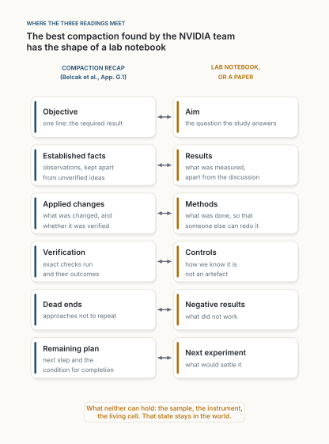

::: {.callout-note appearance="simple"}
**Analyse, novembre 2026.** Trois publications que j'ai gardées cette semaine, lues ensemble. La première, d'un dirigeant technique, résume un nouvel article de NVIDIA, *You don't need long context* [@belcak2026]. La deuxième, de Johannes Hermle, annonce le rapport d'Anthropic *AI for Scientific Discovery: How Researchers Use Claude* [@hermle2026]. La troisième, de Ramakrushna Mohapatra, explique la différence entre l'attention multi-têtes, multi-requêtes et à requêtes groupées. J'ai lu l'article et le rapport en entier ; les chiffres qui les concernent viennent de ces documents, pas des publications. Le calcul sur l'attention est le mien et se trouve dans [figs.py](../../../posts/2026-11-07-a-finite-state-of-mind/figs.py), qui trace aussi toutes les figures : la figure 1 est calculée, les figures 2 et 3 reprennent les chiffres des sources, et la figure 4 est un schéma de moi. La section philosophique de la fin est ma lecture, pas le résultat de qui que ce soit. Les figures sont en anglais. *Traduit automatiquement de l'anglais ; quelques erreurs sont possibles. [Version originale](../../../posts/2026-11-07-a-finite-state-of-mind/index.qmd).*
:::

**En bref.** Les trois publications semblent sans rapport : l'une parle de coûts de service, l'autre de la façon dont les scientifiques utilisent un assistant conversationnel, la troisième de l'organisation des têtes d'attention. Elles parlent de la même chose : ce qu'un système doit garder en tête pendant qu'il travaille, et ce que cela coûte. L'attention à requêtes groupées réduit la mémoire que prend chaque jeton retenu, d'un facteur 4 dans Llama 3 8B. L'article de NVIDIA réduit le nombre de jetons qu'un agent garde : les modèles de pointe ne perdent que peu ou rien sur des tâches de code, de recherche d'information et de longs documents quand leur historique est remplacé par un court état écrit, même quand ils repartent d'un contexte neuf après chaque action. Servir une fenêtre de 256K au lieu de 16K leur coûte de 3,6 à 7 fois plus par jeton généré. Le rapport d'Anthropic montre où l'IA sert en recherche : dans les tâches cognitives, codifiées et vérifiables, beaucoup moins dans celles dont l'état vit dans un laboratoire. Mis ensemble, les leviers se multiplient (un facteur 128 sur la mémoire KV dans mon exemple), et ils mènent à une idée. La meilleure compaction trouvée par l'équipe de NVIDIA a la forme d'un cahier de laboratoire : but, faits, méthodes, vérifications, impasses, étape suivante. La science tient un état sémantique depuis quatre siècles. Ce qui lui résiste, c'est ce qui ne tient jamais sur la page : l'échantillon, l'instrument, le savoir-faire tacite. C'est là que se trouve le goulot physique du rapport d'Anthropic et, je le soutiendrai, la part humaine du travail.

::: {.callout-tip appearance="simple" icon="false"}
## À retenir

- **Une ressource, trois leviers.** Les octets par jeton retenu (l'architecture), le nombre de jetons retenus (le harnais de l'agent), et ce qui, dans un travail, peut être mis en jetons (le domaine). Les deux premiers se multiplient ; le troisième décide où tombent les économies.
- **Le long contexte est surtout une habitude, pas un besoin.** Sur 13 benchmarks, une compaction fréquente et une lecture sélective ont gardé les modèles de pointe à quelques points de l'historique complet, et souvent bien au-dessus sur les tâches à longue entrée. Un modèle ouvert s'est effondré : l'affirmation vaut pour des modèles forts, aujourd'hui.
- **Le bon bloc-notes est un cahier de laboratoire.** La compaction qui marche le mieux sépare les faits des hypothèses, consigne les vérifications et les impasses, et nomme l'étape suivante. C'est la méthode scientifique écrite comme une structure de données.
- **L'adoption en science suit la même ligne.** L'usage par chercheur est le plus élevé là où les tâches sont formelles et vérifiables, le plus bas là où elles sont physiques, réglementées ou relationnelles. Les étapes physiques font environ 40 % du temps de recherche dans les sciences de paillasse, contre 4 % dans le domaine médian.
- **Ce qui suit :** des prix qui dépendent du contexte, des modèles entraînés à écrire des passations, des agents assez petits pour être à soi, et un goulot qui se déplace vers la paillasse et vers le choix de la question.
:::

## Trois publications, une ressource

Chaque publication avance une affirmation claire.

Celle du dirigeant, sur l'article de NVIDIA : les derniers jetons coûtent jusqu'à 7 fois plus cher à générer que les premiers ; une compaction agressive ne coûte que peu ou pas de précision ; les agents ne s'effondrent pas, même avec une seule action par fenêtre de contexte ; la bonne abstraction est un *modèle à espace d'états sémantique*. Elle se termine par une image que j'ai aimée : « Votre agent n'a pas besoin d'une mémoire photographique. Il a besoin d'un bon bloc-notes. C'est Guy Pearce dans Memento, et il livre quand même la pull request. » Et par une opinion : possédez votre IA, car un modèle dans le cloud de quelqu'un d'autre est aligné sur son propriétaire.

Celle de Johannes Hermle, sur le rapport d'Anthropic : Claude est davantage utilisé par chercheur en informatique, en mathématiques et en statistique, moins en santé et dans les sciences de laboratoire ; l'analyse de données et l'écriture dominent ; l'usage suit la capacité de l'IA et l'aptitude d'une tâche à l'apprentissage par renforcement ; les capacités actuelles, largement adoptées, pourraient jusqu'à doubler la production de recherche dans certains domaines, et un monde où l'IA ferait tout le travail non physique pourrait l'augmenter d'un ordre de grandeur, le travail physique restant le goulot.

Celle de Ramakrushna Mohapatra : le décodage est limité par la mémoire, pas par le calcul, parce que chaque jeton généré lit tout le cache clé-valeur (KV). L'attention multi-têtes (MHA) stocke une clé et une valeur par tête de requête ; l'attention multi-requêtes (MQA) en partage une pour toutes ; l'attention à requêtes groupées (GQA) en partage une par groupe. Pour un modèle de la forme de Llama 3 8B en FP16, cela donne 512 Kio par jeton en MHA et 16 Kio en MQA. La plupart des modèles ouverts récents utilisent GQA comme compromis.

Ce qui les relie est une grandeur qu'aucune ne nomme directement. Appelons-la l'**état de travail** : ce qu'un système doit garder sous la main pour faire son pas suivant. Pour un transformeur, l'état de travail est le cache KV, et sa taille vaut

$$
\text{octets KV} = B \times N, \qquad B = 2\,L\,H_{kv}\,d\,b,
$$

où $B$, les octets par jeton, est fixé par l'architecture ($L$ couches, $H_{kv}$ têtes clé-valeur de dimension $d$, $b$ octets par nombre), et $N$, les jetons gardés en contexte, par le harnais qui fait tourner le modèle [@pope2023]. La publication sur l'attention porte sur le premier facteur. L'article de NVIDIA porte sur le second. Et le rapport d'Anthropic porte sur quelque chose qui vient avant les deux : quelles parties d'un travail peuvent d'abord être transformées en jetons.

## Le premier levier : les octets par jeton

La publication sur l'attention est juste, et ses chiffres se vérifient. Avec 32 couches, une dimension de tête de 128 et deux octets par valeur, un jeton coûte $2 \times 32 \times 32 \times 128 \times 2 = 524\,288$ octets avec 32 têtes K/V, 128 Kio avec les 8 têtes qu'utilise réellement Llama 3 [@dubey2024], et 16 Kio avec une seule. MQA date de 2019 [@shazeer2019] ; GQA a été introduite en 2023 pour garder l'essentiel de la qualité de MHA avec l'essentiel de la vitesse de MQA, et peut même s'obtenir en « ré-entraînant » brièvement un modèle MHA existant [@ainslie2023]. Mistral 7B et Llama 3 l'ont adoptée [@jiang2023; @dubey2024].

Depuis, le premier levier a été tiré fort, dans quatre directions.

- **Compresser ce qui est stocké.** L'attention latente multi-têtes (MLA) de DeepSeek met en cache un vecteur latent de faible rang par couche au lieu de clés et de valeurs par tête [@deepseek2024]. Dans la configuration de DeepSeek-V3, cela fait 576 nombres par couche sur 61 couches, environ 69 Kio par jeton en 16 bits, pour un modèle de 671 milliards de paramètres (mon calcul à partir de la configuration publiée [@deepseek2024v3]). La quantification du cache KV sur 2 bits fait la même chose au niveau des nombres [@liu2024kivi].
- **Stocker moins de jetons par couche.** Les couches à fenêtre glissante ne gardent que les quelques centaines ou milliers de derniers jetons. Plusieurs des modèles ouverts que l'équipe de NVIDIA a fait tourner en local alternent des fenêtres de 512 ou 1 024 jetons avec quelques couches globales [@belcak2026].
- **Écarter les jetons qui ne comptent pas.** L'éviction des « gros frappeurs » garde les jetons qui attirent l'attention [@zhang2023h2o] ; les puits d'attention gardent les tout premiers et une fenêtre récente [@xiao2024].
- **Remplacer le cache par un état fixe.** Les modèles à espace d'états comme Mamba portent un état de taille constante au lieu d'un cache qui grandit [@gu2023; @dao2024]. Les hybrides les mêlent à l'attention : des couches Gated DeltaNet alternent à 3 pour 1 avec l'attention complète dans les modèles Qwen de l'article de NVIDIA [@yang2025; @belcak2026], et Nemotron-H, de NVIDIA, remplace la plupart des couches d'attention par des couches Mamba [@nemotronh2025].

Les logiciels de service ont rendu le cache gérable comme une mémoire, avec la pagination [@kwon2023]. Mais le second facteur, $N$, a continué de grandir. Le tableau 1 de l'article le montre avec un sourire : les fenêtres de contexte dépassent maintenant *Guerre et Paix* (environ 753K jetons) pour plusieurs modèles, et atteignent un million de jetons ou plus [@belcak2026].

## Le second levier : les jetons gardés

L'article de NVIDIA pose une question, « Les longs contextes sont-ils nécessaires ? », et la découpe en trois : peut-on mener à bien sans long contexte les tâches à long horizon, les tâches à longue entrée, et les tâches à long horizon avec au plus une action par contexte ? Sa réponse aux trois est oui [@belcak2026].

**Le coût.** Sur des GPU H100 en service saturé, le débit maximal de décodage baisse quand la fenêtre configurée grandit. Servir à 256K au lieu de 16K coûte 3,6 fois plus par jeton généré pour GLM 5.2, 5,6 fois pour Kimi K2.6 et 7 fois pour Qwen 3 Coder Next. Sur un DGX Spark, une machine de bureau, les derniers jetons de plusieurs modèles prennent environ deux fois plus de temps que les premiers. Le « jusqu'à 7 fois » de la publication est donc juste, avec une nuance : le facteur 7 porte sur la fenêtre qu'un serveur réserve, mesurée sous charge, pas sur la position d'un jeton.

**La méthode.** Trois régimes : l'accumulation de l'historique complet (la boucle d'agent habituelle), la compaction en fin de conversation (quand le contexte franchit un seuil, le modèle écrit un récapitulatif et une conversation neuve repart de la tâche et du récapitulatif), et la compaction après chaque action (une conversation neuve pour chaque action, qui ne porte qu'un état écrit). Les agents sont volontairement minimaux : une commande Bash par tour. Pour les longues entrées, les documents sont posés sur le disque et l'agent les lit avec `grep`, `sed` et un `doc-read` borné au lieu de les recevoir dans l'invite.

**Les résultats.** Sur six benchmarks à long horizon, la précision varie entre −3,7 et +5,6 points pour Claude Opus 4.5 et entre −3,3 et +4,4 pour GPT 5.6 Sol, et pas plus de 5 réglages sur 22 par modèle ne perdent plus de 2 points. Sur sept benchmarks à longue entrée, la lecture sélective fait généralement *mieux* que coller toute l'entrée : sur RULER, le rappel passe de 62,5 % à 95,7 % pour Opus et de 65,5 % à 96,4 % pour GPT ; sur BABILong, il gagne environ 24 points ; sur AA-LCR, Opus passe de 65 % à 84 %. La figure 2 montre le résultat à une action par contexte, le plus frappant.

![**Figure 2.** La compaction après chaque action comparée à l'historique complet et à la meilleure compaction en fin de conversation, sur SWE-bench Verified et Terminal-Bench 2.1. En haut : la précision. En bas : le plus grand contexte unique par tâche ; l'historique complet atteint 130K à 200K jetons, la compaction après chaque action une médiane de 7K à 9K. Données du tableau 2 de l'article [@belcak2026] ; graphique de moi.](../../../posts/2026-11-07-a-finite-state-of-mind/figures/fig02.svg){fig-alt="Deux graphiques, l'un au-dessus de l'autre. En haut, des barres groupées de précision en pourcentage pour quatre cas, chacun avec « Full history », « Best compaction » et « One action per context » : Opus 4.5 sur SWE-bench Verified 70, 75, 70 ; Opus 4.5 sur Terminal-Bench 2.1 47, 53, 52 ; GPT 5.6 sur SWE-bench Verified 84, 89, 82 ; GPT 5.6 sur Terminal-Bench 2.1 88, 89, 84. En bas, sur une échelle logarithmique de 5K à 200K jetons, la médiane et le maximum du plus grand contexte par tâche : historique complet, médianes de 17K à 32K et maxima de 130K à 200K ; meilleure compaction, médianes de 19K à 24K et maxima de 22K à 40K ; une action par contexte, médianes de 7K à 9K et maxima de 15K à 37K."}

Vient ensuite la proposition : un **modèle à espace d'états sémantique** (SSSM), « un modèle post-entraîné à (1) comprendre une description en langage naturel de l'état d'une conversation, (2) raisonner sur l'action suivante appropriée ou sur la tâche en cours, (3) agir, (4) enregistrer le résultat, et (5) mettre à jour la description de l'état de la conversation », de sorte qu'une autre instance puisse continuer. Les auteurs l'opposent à un modèle à espace d'états comme Mamba : « Contrairement à un SSM, qui maintient un état neuronal opaque entre les générations de jetons, un SSSM maintient un état explicable en langage naturel (d'où "sémantique") entre les tours » [@belcak2026].

**Comment je le lis.** Je trouve l'article convaincant sur son point principal et je garderais trois réserves en tête.

D'abord, les économies sont l'estimation d'un prix qui n'existe pas. Les prix des API sont aujourd'hui fixes par jeton, quel que soit le contexte. Le « coût de détail optimisé estimé » de l'article interpole ce qu'un fournisseur *pourrait* facturer si les prix suivaient ses mesures de débit (un facteur d'environ 0,2 à 16K). Aux prix nominaux, la compaction coûte parfois *plus* : sur SWE-bench Verified, la facture de GPT 5.6 Sol passe de 168 $ à entre 186 $ et 203 $, parce que la compaction ajoute des jetons de sortie et de nouvelles entrées. L'économie est réelle pour qui fait tourner les GPU ; elle n'atteint l'utilisateur que si la tarification change.

Ensuite, le résultat vaut pour des modèles forts. En annexe, cinq modèles ouverts exécutés en local sont moins robustes, et Qwen 3 Coder Next s'effondre sur SWE-bench Verified de 53,0 % à 3,6 % au réglage le plus serré, « surtout parce que ses trajectoires verbeuses laissent trop peu de place à un progrès utile entre les compactions ». Écrire une bonne passation est une compétence ; la proposition même de l'article est de l'entraîner.

Enfin, les benchmarks sont des tâches dont la fin est vérifiable : une suite de tests, une réponse de référence, un état final de base de données. C'est exactement là qu'un état écrit fonctionne le mieux, parce qu'on peut le confronter au monde. Les auteurs sont prudents sur ce point. Ils construisent eux-mêmes un contre-exemple (un agent qui doit plus tard retrouver le *i*-ème d'une longue série de pile ou face finira par échouer sous tout budget de compaction fixe), et ils écrivent que leurs résultats n'excluent pas l'existence de tâches pour lesquelles un long contexte est utile. La parade qu'ils proposent, garder le journal complet sur disque et le lire de façon sélective, ramène le problème à une tâche à longue entrée.

Rien de tout cela n'est isolé. On savait que les longs contextes sont utilisés de façon inégale, l'information au milieu étant souvent manquée [@liu2024lost], que les longueurs effectives sont bien en dessous des longueurs annoncées [@hsieh2024], et que la précision se dégrade à mesure que l'entrée grandit, même sur des tâches simples [@hong2025]. Les constructeurs d'agents traitaient déjà le contexte comme un budget à composer plutôt qu'un seau à remplir [@anthropic2025context], et donnaient aux agents une mémoire externe paginée [@packer2023]. Ce qui est nouveau, c'est une mesure soignée, sur des modèles de pointe, qui pousse la compaction à l'extrême et constate qu'elle tient.

## Les deux leviers se multiplient

Les deux leviers agissent sur des facteurs différents du même produit, donc leurs effets se multiplient. La figure 1 met les chiffres de la publication sur l'attention en regard des longueurs de contexte de l'article de NVIDIA.

{fig-alt="Une grille de cinq lignes et trois colonnes. Lignes : 256K, 128K, 32K, 16K et 8K jetons gardés. Colonnes : MHA avec 32 têtes K/V et 512 KiB par jeton, GQA avec 8 têtes et 128 KiB, MQA avec 1 tête et 16 KiB. À 256K : 128 GiB (« does not fit »), 32 GiB (2 à la fois), 4 GiB (16). À 128K : 64 GiB (1), 16 GiB (4), 2 GiB (32). À 32K : 16 GiB (4), 4 GiB (16), 512 MiB (128). À 16K : 8 GiB (8), 2 GiB (32), 256 MiB (256). À 8K : 4 GiB (16), 1 GiB (64), 128 MiB (512)."}

Du coin supérieur gauche (MHA à 256K : 128 Gio, qui ne tient pas du tout) à GQA à 8K (1 Gio, 64 séquences à la fois), le cache diminue d'un facteur 128 : 4 grâce à l'architecture, 32 grâce au harnais. Le levier du harnais est le plus grand des deux, et il ne demande aucun ré-entraînement. Comme chaque jeton généré lit tout le cache, le même facteur s'applique, au premier ordre, au trafic mémoire par jeton. C'est l'arithmétique derrière les 3,6 à 7 fois mesurés dans l'article : les serveurs réels utilisent déjà GQA ou MLA et paient le reste en taille de lot.

Deux conséquences suivent. D'abord, les leviers se disputent les mêmes économies. Un modèle avec MLA ou un état hybride gagne moins à la compaction qu'un modèle MHA, parce que ses jetons sont déjà bon marché ; c'est peut-être pourquoi les rapports de coût de l'article diffèrent d'un modèle à l'autre. Ensuite, le levier du harnais est à la portée de quiconque écrit un agent, aujourd'hui, sur n'importe quel modèle. Le levier de l'architecture appartient à qui entraîne le modèle.

## Le troisième levier : ce qui peut s'écrire

Venons-en au rapport d'Anthropic, qui semble d'abord appartenir à une autre conversation.

**Ce qu'il mesure.** 207 049 sessions de recherche sur des offres grand public entre le 2 août et le 30 septembre 2026, dont 128 914 dans les applications Claude et Cowork et 78 135 dans Claude Code, chacune classée par un modèle de langage dans l'un des 34 domaines, 318 sous-domaines et 7 262 tâches de la taxonomie SciNet ; seules les étiquettes sont conservées [@hermle2026]. C'est la même approche respectueuse de la vie privée que les études d'usage précédentes d'Anthropic [@tamkin2024; @handa2025]. Une enquête auprès de 528 scientifiques, surtout en sciences de la vie et de la santé, ajoute leur propre point de vue.

**Où va l'usage.** Par chercheur, l'usage est le plus élevé dans les sciences formelles (informatique, mathématiques, statistique) et les sciences sociales, le plus bas en chimie, en médecine et dans d'autres domaines de laboratoire ou cliniques. L'informatique représente 4,3 % des chercheurs du monde et 32,7 % des sessions Claude Code. Par tâche, l'analyse de données fait 33,7 % des sessions Claude et 48,1 % des sessions Claude Code, l'écriture 32,0 % et 17,6 %, l'idéation seulement 4,2 % et 2,1 %, alors que les scientifiques interrogés la jugent la partie la plus importante de leur travail.

**Pourquoi là.** Les auteurs notent chaque étape de tâche selon ce que l'IA pourrait en théorie y faire, et constatent que l'usage croît avec cette note : dans le cinquième supérieur de capacité, les tâches reçoivent environ deux à quatre fois l'usage que prédirait leur part du temps de recherche ; dans le cinquième inférieur, presque rien. La capacité elle-même est fortement corrélée (+0,78) à un « indice d'apprentissage par renforcement », qui mesure à quel point une tâche se prête à un entraînement avec une récompense vérifiable ; elle est corrélée positivement à la part cognitive d'une tâche (+0,69) et négativement à sa part physique (−0,57), réglementaire (−0,38) et relationnelle (−0,31).

**Ce que cela pourrait signifier.** Une fonction de production d'idées simple, où les étapes de recherche sont complémentaires, de sorte que la plus lente limite les autres, transforme cela en scénarios (figure 3). Avec les capacités actuelles largement adoptées, la production à budget fixe augmente de 1,35 fois dans les arts et de 1,96 à 2,02 fois en informatique et en statistique : c'est le « jusqu'à doubler ». Si l'IA faisait toutes les étapes non physiques, les domaines peu physiques atteindraient environ 15 à 16 fois, mais la biologie, la chimie, les matériaux et les sciences biomédicales seulement 3 à 4 fois, parce que les étapes physiques y prennent environ 40 % du temps de recherche, contre 4 % dans le domaine médian. Les auteurs parlent de « scénarios illustratifs, pas de prévisions ».

![**Figure 3.** Production de recherche à budget fixe, rapportée à l'absence d'IA, dans deux scénarios du rapport d'Anthropic. En haut : les capacités actuelles, largement adoptées. En bas : toutes les étapes de recherche non physiques faites par l'IA ; la barre foncée est le bas de la fourchette annoncée. Données du rapport [@hermle2026] ; graphique de moi.](../../../posts/2026-11-07-a-finite-state-of-mind/figures/fig03.svg){fig-alt="Deux graphiques à barres horizontales, l'un au-dessus de l'autre. En haut, intitulé « Today's abilities, widely adopted » : arts 1,35 fois, anthropologie 1,36, chimie 1,41, informatique 1,96, statistique 2,02. En bas, intitulé « All non-physical steps automated » : statistique, informatique, économie, mathématiques, psychologie et la plupart des sciences sociales, 15 à 16 fois ; biologie, chimie, matériaux, sciences agricoles et biomédicales, 3 à 4 fois."}

La logique du rapport est une vieille idée économique appliquée avec soin : quand des étapes sont complémentaires, celle qu'on ne peut pas accélérer fixe le rythme [@aghion2019]. Et elle repose sur une inquiétude plus ancienne. La productivité de la recherche baisse depuis des décennies : les idées sont de plus en plus difficiles à trouver [@bloom2020], en partie parce que chaque nouveau chercheur doit assimiler davantage avant de contribuer, le « fardeau du savoir » qui pousse la science vers des experts plus spécialisés et des équipes plus grandes [@jones2009]. Vu depuis les deux premières publications, le fardeau du savoir est le problème de long contexte de la science.

## Là où les trois se rejoignent

Voici le lien que je n'attendais pas quand j'ai gardé ces publications.

L'équipe de NVIDIA décrit, en annexe, ce qui fait une bonne compaction. Pas un résumé fidèle : les meilleures compactions ne sont pas celles qui capturent fidèlement l'essentiel de la trace de l'agent, mais celles qui sélectionnent le mieux les faits utiles au travail qui reste à faire ; ce ne sont pas des récits de l'historique d'exécution, mais des notes de passation choisies avec soin. Leur invite de récapitulatif demande six choses : l'objectif ; les faits établis, en séparant les « observations » des « idées non vérifiées » ; les modifications appliquées et si elles ont été vérifiées ; les vérifications exactes effectuées et leurs résultats ; les impasses à ne pas répéter ; et le plan restant avec « la condition d'achèvement » [@belcak2026].

Cette liste est un cahier de laboratoire (figure 4). But, résultats, méthodes, contrôles, résultats négatifs, expérience suivante. L'article scientifique a la même structure, publiée.

{fig-alt="Deux colonnes de six cartes reliées par des doubles flèches. À gauche, le récapitulatif de compaction : « Objective », le résultat demandé en une ligne ; « Established facts », les observations séparées des idées non vérifiées ; « Applied changes », ce qui a été modifié et si c'est vérifié ; « Verification », les vérifications exactes et leurs résultats ; « Dead ends », les approches à ne pas répéter ; « Remaining plan », l'étape suivante et la condition d'achèvement. À droite, le cahier de laboratoire ou l'article : « Aim », « Results », « Methods », « Controls », « Negative results », « Next experiment ». Une note en bas : ce qu'aucun des deux ne peut contenir, l'échantillon, l'instrument, la cellule vivante ; cet état reste dans le monde."}

Je ne crois pas que ce soit une coïncidence. La science affronte le problème du long contexte depuis quatre cents ans, et elle l'a résolu de la manière que propose l'article. Aucun scientifique ne garde toute la littérature en tête. Chacun lit un état compacté (une revue, un manuel, l'introduction d'un article), fait quelques actions au cours d'une carrière, et réécrit un état mis à jour pour que quelqu'un d'autre continue. La littérature est un espace d'états sémantique, entretenu par de nombreuses instances séparées. « Se tenir sur les épaules des géants » décrit une compaction après chaque action à l'échelle des générations. Et la division du travail que le fardeau du savoir a imposée à la science, des équipes plus grandes d'experts plus spécialisés partageant une même littérature, ressemble un peu à l'attention à requêtes groupées : beaucoup de questionneurs, une mémoire partagée par groupe. Je ne pousserais pas l'analogie loin, mais elle a la bonne forme.

Lues ainsi, les trois publications disent une seule chose sous trois angles :

1. **Ce qui se compacte bien, c'est ce qui se vérifie.** Le rapport constate que l'IA sert là où les tâches se prêtent à l'apprentissage par renforcement, c'est-à-dire là où un résultat peut être vérifié. L'article constate qu'un état écrit fonctionne là où la tâche a une fin vérifiable, et sa compaction sépare les faits des hypothèses et consigne les vérifications. Les deux désignent la même propriété : un état qui peut être vérifié peut être écrit sans danger, puis transporté à peu de frais.

2. **Ce qui ne se compacte pas, c'est le monde.** Le contre-exemple du pile ou face est exactement ce que produit une expérience : des observations sans structure à résumer tant qu'on ne les a pas. L'état d'une culture cellulaire, d'un échantillon à mi-synthèse ou d'un patient n'est dans aucune fenêtre de contexte. Il vit dans le monde et doit être mesuré à nouveau. Les 40 % de part physique des sciences de paillasse dans le rapport sont la partie de la recherche dont l'état de travail ne peut pas être mis en jetons. Michael Polanyi disait que nous savons plus que nous ne pouvons dire [@polanyi1966] ; au laboratoire, une grande partie de ce que nous savons est dans les mains.

3. **La lecture sélective, c'est déjà comme cela qu'on analyse bien.** L'analyse de données est la plus grande tâche de recherche du rapport, la moitié des sessions scientifiques de Claude Code. Le résultat de l'article sur les longues entrées, que `grep` et des lectures bornées battent le collage de toute l'entrée, est la version agent d'une habitude de bon analyste : interroger les données, ne pas tout regarder. C'est aussi la plus vieille leçon de l'économie de l'information : une abondance d'information crée une pauvreté d'attention [@simon1971].

## Implications pour les prochaines années

Ce sont mes extrapolations, avec leurs raisons.

**Des prix qui dépendent du contexte.** Si l'écart entre 16K et 256K est de 3,6 à 7 fois en coût de service, des prix fixes par jeton sont une subvention des usages à contexte court vers les usages à long contexte. Je m'attends à ce que les fournisseurs facturent par palier de contexte, ou vendent la compaction comme un service, comme la mise en cache des invites l'a été avant. À ce moment-là, écrire des agents qui gardent leur contexte court cesse d'être une optimisation et devient la norme.

**Entraîner aux passations, pas aux fenêtres.** La phrase la plus lourde de conséquences de l'article est peut-être son hypothèse que les SSSM sont « considérablement plus efficaces en données à entraîner », parce que le modèle n'a plus à apprendre où regarder dans un long historique. Si cela se vérifie, le post-entraînement récompensera l'écriture d'un bon état, et l'entraînement au long contexte comptera moins. La compétence qui manquait au modèle ouvert effondré, laisser de la place au progrès entre les passations, devient une capacité entraînée. La mesure de METR sur la longueur des tâches que les agents peuvent mener à bien [@kwa2025] dépendra alors moins de ce qu'un modèle peut contenir que de la qualité avec laquelle il se passe le relais à lui-même.

**Des agents que l'on peut posséder.** Avec 8K jetons de contexte actif, le cache d'un modèle GQA de la forme de Llama 3 8B fait 1 Gio ; même un modèle GQA bien plus grand tient son état de travail sans peine sur un accélérateur de bureau. L'article lui-même le souligne : il renvoie à un projet nommé « Project Moonshot: Local Frontier Intelligence », et il mesure des modèles locaux sur une machine de bureau parce que le code source ou d'autres données de la tâche doivent rester sur l'appareil pour des raisons de confidentialité ou de coût. C'est là que la dernière phrase du dirigeant mérite une réponse prudente. « L'IA dans le cloud est alignée sur l'entreprise qui la possède » est une opinion, pas quelque chose que l'article montre. Ce que l'article montre est plus subtil et, je crois, plus utile : si l'état de travail est un court texte, l'état est portable. On peut le lire, le garder, l'auditer et le confier à un autre modèle, local ou distant. Vous ne possédez peut-être pas le modèle ; vous pouvez posséder le bloc-notes. Pour le travail sur site, qui est le sujet de [Fast AI](../2026-10-11-fast-ai/index.qmd), le changement est grand : les contextes courts rendent viables de petits modèles locaux, et un état explicite est la mémoire partagée qui permet à de petits spécialistes de se relayer.

**La science accélère inégalement, puis le goulot se déplace.** Les scénarios du rapport disent que les sciences formelles partent les premières et que les sciences de paillasse sont freinées par les étapes physiques. Deux choses pourraient déplacer cette ligne. L'automatisation des laboratoires transforme les étapes physiques en appels d'outils : en 2023, un agent fondé sur un modèle de langage planifiait et exécutait déjà des réactions chimiques sur des équipements robotisés [@boiko2023], et des systèmes de « co-scientifique » proposent et classent maintenant des hypothèses [@gottweis2025; @lu2024]. Et la part qui restera sera celle qui a toujours été la plus difficile : l'idéation, que les scientifiques placent en tête par importance et qui fait à peine 4 % des sessions aujourd'hui. Si le travail textuel devient bon marché, l'intrant rare devient la question.

**Un état que l'on peut auditer, et attaquer.** Un état sémantique est un cadeau pour la supervision : une personne peut lire pourquoi l'agent a fait ce qu'il a fait ensuite, ce qu'un état neuronal ne permettait jamais. C'est aussi un point de défaillance unique. Ce qui entre dans les notes est cru par toutes les instances suivantes. Un « fait établi » erroné, ou une instruction glissée dans la sortie d'un outil et recopiée dans l'état, persiste dans tous les contextes futurs, sans les éléments autour qui auraient pu le démasquer. L'invite de l'article demande déjà de séparer les observations des idées non vérifiées ; j'ajouterais la provenance : d'où vient chaque fait, pour qu'on puisse le vérifier à nouveau. C'est la même leçon que dans [Le contexte est le fil](../2026-11-01-the-context-is-the-wire/index.qmd) : le contexte est le canal par lequel le risque circule, et un contexte compacté le concentre.

## Une perspective philosophique

L'article se termine par une phrase que je n'attendais pas dans un article de systèmes : sa conclusion est « loin d'être surprenante », car la motivation même de la définition de la calculabilité repose sur l'hypothèse que tout ce qui est calculable peut l'être en ne comprenant qu'une quantité bornée d'entrée à la fois et en ne maintenant qu'un état d'esprit fini [@belcak2026]. C'est l'analyse que fait Turing en 1936 d'une personne qui calcule avec un crayon et du papier [@turing1937]. Turing modélise le calculateur humain comme quelqu'un qui ne voit que quelques symboles à la fois, se trouve dans l'un d'un nombre fini d'« états d'esprit », et qui, s'il est interrompu, peut écrire sur la bande une note qui dit comment continuer. La note est l'état. La bande est le monde. L'agent à une action par contexte est le calculateur de Turing, redécouvert au prix de plusieurs milliards de paramètres.

La tradition philosophique soupçonne depuis longtemps que tout retenir n'est pas un don. Le Funes de Borges, qui après une chute se souvient de chaque feuille de chaque arbre qu'il a vu, ne peut pas penser : « Penser, c'est oublier des différences, c'est généraliser, abstraire. Dans le monde surchargé de Funes il n'y avait que des détails » [@borges1942]. Nietzsche soutenait qu'un être vivant n'agit qu'à l'intérieur d'un horizon, et que la capacité d'oublier est une condition de l'action, pas un défaut de la mémoire [@nietzsche1874]. L'accumulation de l'historique complet, c'est Funes. La compaction est l'oubli qui rend possible l'action suivante. Le constat de l'article que la lecture sélective *bat* l'entrée complète sur plusieurs tâches à longs documents n'est, sous cet angle, pas surprenant non plus : le modèle qui a tout sous les yeux est celui qui se perd.

Vient ensuite la question de Memento, que la publication du dirigeant soulève en plaisantant. Leonard Shelby ne peut plus former de nouveaux souvenirs et vit de notes, de photographies et de tatouages [@nolan2000]. Locke liait l'identité personnelle à la mémoire : une personne s'étend aussi loin que sa conscience peut remonter [@locke1694]. Parfit a desserré ce lien : ce qui compte n'est pas une mémoire ininterrompue mais des chaînes de connexions psychologiques qui se chevauchent, et l'identité importe peut-être moins que nous le pensons [@parfit1984]. Un agent à une action par contexte est une suite d'instances dont aucune ne se souvient des autres, reliées seulement par un état écrit. Pour Locke, il n'y a pas d'agent unique du tout ; pour Parfit, il y en a autant que les notes en portent. Et Clark et Chalmers diraient que les notes font partie de l'esprit : Otto, atteint d'Alzheimer, qui consulte un carnet pour trouver un musée, croit l'adresse autant que quiconque s'en souvient, parce que le carnet joue le même rôle [@clark1998]. L'état sémantique est le carnet d'Otto de l'agent.

Memento est aussi un avertissement, et c'est la partie que je ne voudrais pas omettre. Les notes de Leonard sont en partie écrites par des gens qui le manipulent, et en partie par un Leonard qui ment à son futur lui-même. Un esprit fait de notes est exactement aussi fiable que ses notes. Platon l'avait vu dans le *Phèdre* : l'écriture, dit Thamus à son inventeur, est un remède pour le ressouvenir, pas pour la mémoire, et elle donne l'apparence de la sagesse sans sa substance [@plato_phaedrus]. Le récapitulatif qui dit « vérifié » peut ne pas l'être. C'est pourquoi la meilleure compaction garde les vérifications et leurs résultats, et pourquoi j'ajouterais la provenance : un carnet qui dit *comment* nous savons est un autre objet qu'un carnet qui dit *ce que* nous savons.

Enfin, ce que les trois publications disent de nous. Une compaction est bonne quand elle garde les faits utiles au travail qui reste à faire. Ce qui est utile dépend du but. Le modèle peut écrire la note une fois qu'il a l'objectif ; il ne peut pas dire, à partir de la seule trace, quel objectif mérite d'être poursuivi. Les cahiers de la science fonctionnent pour la même raison : ils sont écrits en vue d'une question que quelqu'un a choisie. Le rapport d'Anthropic constate que les scientifiques utilisent l'IA le moins pour l'idéation et y tiennent le plus. Dans les termes de cette analyse, ce qui reste à nous, c'est la ligne en haut du cahier : le but, la condition d'achèvement, et la décision de ce qui vaut d'être retenu. J'ai défendu une idée proche dans [Pas parce que c'est utile](../2026-11-01-not-because-it-is-useful/index.qmd) : la méthode peut être suivie par n'importe qui ; choisir ce qui nous importe n'est pas une étape de la méthode.

## Là où cela casse

- **Trois sortes de preuves.** L'arithmétique de l'attention est exacte. Les résultats de NVIDIA sont des mesures sur des benchmarks publics, avec des coûts qui estiment un prix hypothétique. Les chiffres d'Anthropic viennent de sessions classées par un modèle sur des offres grand public, publiés par une entreprise qui vend le modèle, et ses chiffres d'accélération sont des scénarios. Je les ai combinés parce qu'ils s'emboîtent, pas parce qu'ils ont été conçus pour l'être.
- **Les analogies sont des analogies.** Les groupes de GQA ne sont pas des équipes de recherche, et un article scientifique n'est pas une invite de compaction. Je m'en sers pour voir une structure commune, pas comme preuve que cette structure est causale.
- **Le lien entre vérifiabilité et compactabilité est mon hypothèse.** Le rapport montre que l'usage suit un indice d'apprentissage par renforcement ; l'article montre que la compaction marche sur des tâches à fin vérifiable. Aucun des deux ne teste si les tâches difficiles à vérifier sont aussi difficiles à compacter.
- **Les benchmarks sont courts à l'échelle humaine.** Une tâche de SWE-bench, c'est des heures de travail humain, pas des mois. Les projets de recherche portent un état sur des mois et entre des personnes ; qu'un état écrit tienne à cette échelle n'est pas testé ici.
- **Les modèles plus faibles ne tiennent pas.** L'effondrement d'un modèle ouvert rappelle que « vous n'avez pas besoin d'un long contexte » est une affirmation sur des modèles de pointe avec un bon harnais.

## Ce que je ne prétends pas

Pas que les modèles à long contexte sont inutiles ; l'article lui-même n'exclut pas des tâches qui en ont besoin. Pas que le facteur 7 vaut pour tout modèle ou tout déploiement : c'est le rapport pour un modèle dans une configuration de service, et la fourchette va de 3,6 à 7. Pas que l'IA va doubler la production scientifique : le rapport dit « jusqu'à », dans certains domaines, sous une adoption large, et qualifie ses scénarios d'illustratifs. Pas que les modèles dans le cloud sont mal alignés avec leurs utilisateurs : c'est l'opinion du dirigeant, et aucune des trois sources ne la teste. Et pas que j'ai mené aucune de ces expériences ; les seuls chiffres que j'ai calculés sont les tailles de cache de la figure 1.

## Ce qui me donnerait tort

- **Le long contexte gagne à coût égal.** Si, d'ici fin 2027, des agents qui gardent tout l'historique battent des agents bien compactés de plus de quelques points sur des benchmarks à long horizon *au même coût total de service*, le second levier est plus faible que ne le pensent l'article et moi.
- **La compaction échoue sur le travail difficile à vérifier.** Si un agent à état écrit fait aussi bien que l'historique complet sur des tâches sans fin vérifiable (analyse de données ouverte, synthèse de littérature jugée par des experts), alors mon idée que la vérifiabilité rend un état compactable est fausse, et la compaction est plus générale que je ne le dis. S'il fait bien moins bien là et très bien sur le code, j'ai raison.
- **Les prix restent fixes.** Si les grands fournisseurs gardent des prix fixes par jeton jusqu'en 2027 malgré l'écart de coût de service, l'argument économique n'atteint pas les utilisateurs, et l'incitation à compacter reste chez les fournisseurs.
- **Les sciences de paillasse rattrapent sans laboratoires.** Si l'usage de l'IA par chercheur en chimie et en sciences biomédicales rejoint celui des sciences formelles *avant* que l'automatisation des laboratoires ne se répande, alors le goulot physique a moins compté pour l'adoption que ne le supposent le rapport et moi.
- **Des notes indignes de confiance.** Si les agents à état sémantique se révèlent, en déploiement, nettement plus faciles à dévoyer par leurs notes que les agents à historique complet par leur contexte, l'argument de l'auditabilité s'inverse : un état court serait une faiblesse, pas un cadeau.

::: {.read-next}
**À lire ensuite** · [Là où vit la mémoire](../2026-10-26-where-memory-lives/index.qmd)
Quatre expériences sur ce qu'un petit modèle doit retenir et ce qu'il doit aller chercher, y compris quand le cache KV pèse plus que le modèle.
:::

::: {.small}
*Les opinions exprimées dans cette analyse sont les miennes et ne décrivent aucun produit ni aucun projet de mon employeur.*
:::

## Références

::: {#refs}
:::
