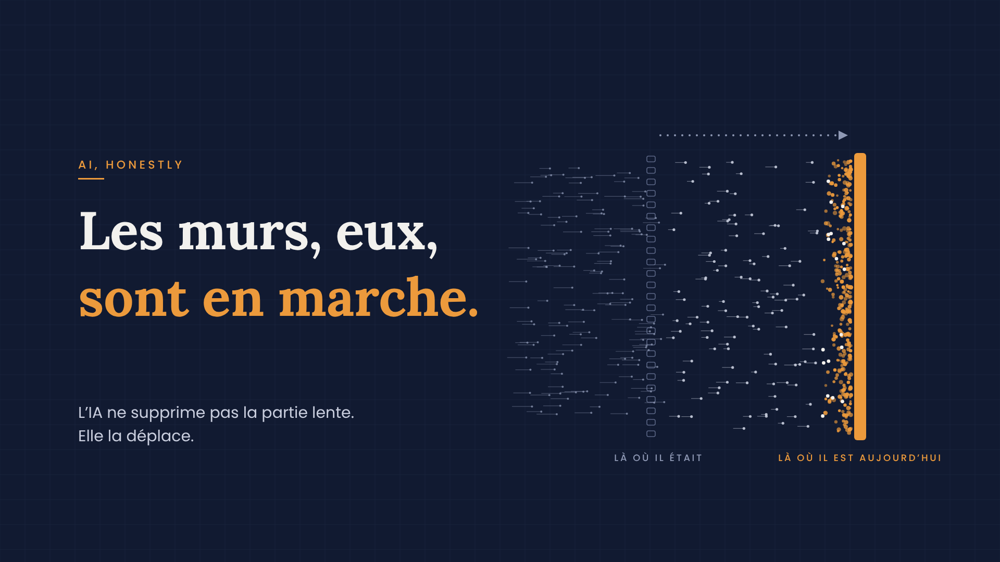
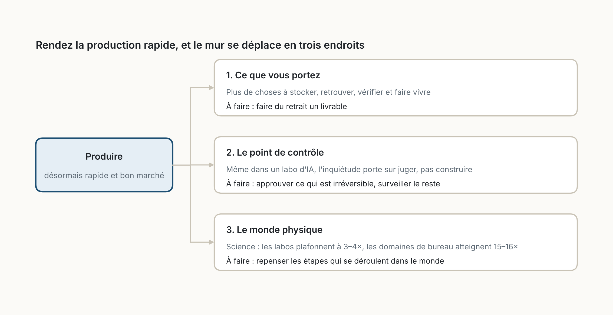

::: {.callout-note appearance="simple"}
**Édition de la newsletter *AI, Honestly*, novembre 2026.** La version française de l'édition parue en anglais sur LinkedIn. Les figures sont de moi, faites avec [figs.py](figs.py), et l'image d'ouverture avec [cover.js](cover.js). *Traduit de l'anglais avec l'aide de l'IA ; quelques erreurs sont possibles.*
:::

{fig-alt="Image d'ouverture sur fond bleu nuit. À gauche : « AI, HONESTLY », puis le titre « Les murs, eux, sont en marche. », et en dessous « L'IA ne supprime pas la partie lente. Elle la déplace. ». À droite, des points qui filent de gauche à droite traversent une ancienne colonne de cases vides, marquée « Là où il était », et s'entassent en orange contre un mur orange plus loin, marqué « Là où il est aujourd'hui » ; une flèche pointillée va de l'ancien mur au nouveau."}

En 1964, Bob Dylan prévenait que les temps changeaient. Avec l'IA, ils changent, mais pas comme la plupart des gens le pensent. La partie lente du travail ne disparaît pas. Elle se déplace.

Je le vois tous les jours dans mon propre travail. Nous pouvons désormais livrer à une vitesse impensable il y a un an, et cette vitesse oblige à repenser tout ce qui l'entoure. La surprise, c'est où cela mène. Pas à tout accélérer, mais à accepter qu'il y a certaines choses que nous devrions simplement lâcher.

L'exemple le plus clair, pour nous, c'est la planification. Un plan complet établi à l'avance ne peut plus suivre le rythme du travail, alors nous l'avons en grande partie abandonné. À sa place : une série de micro-planifications, courtes et fréquentes, qui suivent ce que nous livrons.

Alors soyons clairs : je crois en l'IA. Mais elle ne rapporte que si nous changeons ce que nous faisons autour d'elle. Continuer dans le même paradigme, simplement plus vite, n'est pas une stratégie.

L'essentiel de ce qui s'écrit sur l'IA débat de la vitesse : de combien elle nous rend plus rapides, ou pourquoi elle ne l'a pas encore fait. Mon expérience me dit que l'on passe ainsi à côté de la question la plus utile. Une fois que quelque chose devient rapide, où va la lenteur ?

Pour le vérifier, j'ai regardé le cas extrême. Anthropic, l'entreprise derrière Claude, fait désormais construire une grande partie de ses propres outils par l'IA, et elle a publié ce mois-ci trois documents à ce sujet. Lus ensemble, ils montrent à pleine échelle ce que je vois à la mienne. J'ai ensuite confronté chaque constat à des recherches indépendantes.

Dylan ne prophétisait pas en général ; il s'adressait à des gens précis. Je ferai de même : trois murs, trois publics.

## 1. À ceux qui fabriquent : ce que vous portez

Quand produire devient presque gratuit, vous n'avez pas moins de travail. Vous avez plus de choses. Chez Anthropic, le volume de modifications écrites par l'IA a été multiplié par douze en quatre mois, et les outils servant à suivre le travail ont tout simplement cédé.

Pas besoin de cette échelle pour le ressentir. La présentation que personne n'a demandée. Le rapport qui prend cinq minutes à écrire et une heure à lire. La boîte de réception qui a doublé. Chacun doit être stocké, retrouvé, vérifié et maintenu en vie. L'IA a rendu la production bon marché. Rien n'a rendu la conservation bon marché.

Ce n'est pas un problème d'entreprise tech. Dans une enquête de Stanford de 2025, 40 % des employés de bureau américains avaient récemment reçu un travail produit par l'IA qui semblait terminé mais ne l'était pas, avec près de deux heures par cas pour démêler la situation.

.](figures/fig01.png){fig-alt="Un arbre de décision. En haut, une question : « Retire-t-il ou évite-t-il plus de masse qu'il n'en ajoute ? ». Oui mène à un encadré vert, « À garder : il dit non » : un objectif clair pour la période, une définition partagée de « terminé », des demandes qui expirent si personne ne les renouvelle, un budget de masse qui oblige à retirer. Non mène à un encadré rouge, « À couper ou alléger : il compte » : estimer chaque élément, rapports et tableaux de bord que personne ne lit, mesures d'activité (heures, points, volume), nouveaux comités, cérémonies et rôles."}

La réponse n'est pas davantage de structure pour gérer la pile, mais une habitude du retrait : laisser les demandes expirer à moins que quelqu'un ne les renouvelle, et montrer ce que vous avez retiré à la même réunion que celle où vous montrez ce qui est nouveau.

Le mur s'est déplacé. Il se dresse là où les choses s'accumulent.

## 2. À ceux qui valident : le point de contrôle

Le dossier d'introduction en bourse d'Anthropic cite, parmi les risques, que l'IA pourrait accélérer les progrès au-delà de sa capacité à les évaluer. Même là, l'inquiétude ne porte pas sur la vitesse à laquelle on peut construire, mais sur la vitesse à laquelle on peut juger.

Chaque organisation a ce mur : des approbations et des revues conçues pour une époque où le travail arrivait lentement. Au Danemark, des économistes qui ont suivi 25 000 travailleurs ont constaté que l'IA ne leur faisait gagner qu'environ 3 % de leur temps, en grande partie absorbés par la vérification de ce que l'IA produisait.

Vérifier plus fort n'est pas la réponse, car les gens repèrent mal les endroits où l'IA échoue. Dans une expérience menée par Harvard et le BCG, les consultants qui utilisaient l'IA sur une tâche juste hors de sa portée trouvaient la bonne réponse dans 60 à 70 % des cas, contre 84 % pour ceux qui travaillaient seuls.

Alors déplacez le point de contrôle. Approuvez ce que vous ne pouvez pas défaire. Surveillez tout le reste. Un paiement, un contrat, un message à un client méritent une décision humaine. Des règles claires et un regard régulier en arrière peuvent attraper le reste.

Le mur s'est déplacé. Il se dresse là où les choses sont jugées.

## 3. À ceux qui dirigent les opérations : le monde physique

Chaque entreprise a sa paillasse : le travail qui se fait dans le monde, au rythme du monde. Un patient qui a besoin de temps pour se rétablir. Un camion sur la route. Un client qui décide quand il est prêt. Une relation qui met des mois à inspirer confiance.

Le rapport scientifique d'Anthropic chiffre ce phénomène. Automatisez chaque étape de recherche qui se déroule sur un écran, et des domaines comme la statistique pourraient produire environ 15 fois plus. La chimie et la biologie plafonnent à 3 ou 4 fois, parce qu'une grande partie de leur travail se fait à la paillasse, et qu'une culture cellulaire pousse à la vitesse d'une culture cellulaire.

 (2026).](figures/fig02.png){fig-alt="Un diagramme à barres horizontales : production de recherche à budget constant, par rapport à aujourd'hui sans IA, selon un modèle d'Anthropic de 2026. Statistique : 2,0× avec l'IA d'aujourd'hui largement adoptée, 15–16× si toutes les étapes non physiques sont automatisées. Chimie : 1,4× aujourd'hui, 3–4× si tout le non physique est automatisé. Note en bas : les sciences de laboratoire et de terrain consacrent 38 à 41 % du temps de recherche à des étapes physiques ; le domaine médian, environ 4 %."}

L'histoire va dans le même sens : les usines ont mis environ quarante ans à tirer profit de l'électricité, jusqu'à ce qu'elles repensent l'atelier autour d'elle. Comme je l'ai écrit dans une édition précédente, le temps est la seule chose que l'IA ne compresse pas. Votre plafond est fixé par le travail qui se fait dans le monde : c'est donc lui qu'il faut repenser.

L'industrie de l'IA elle-même vient de heurter ce mur. Cette semaine, des électeurs de plusieurs États américains ont soutenu des limites aux nouveaux centres de données, et environ 2 500 milliards de dollars de capitalisation boursière tech se sont évaporés en une seule journée, sur la crainte d'un ralentissement des constructions. Le code peut désormais s'écrire en quelques heures ; un centre de données a toujours besoin de terrain, d'électricité, de permis et de voisins.

Le mur s'est déplacé. Il se dresse là où le monde impose le rythme.

## Là où ce raisonnement peut se tromper

Anthropic est un cas extrême, et l'entreprise vend de l'IA : un dossier d'introduction en bourse est à la fois un avertissement et un argument de vente. C'est pourquoi chaque mur est aussi confronté à des travaux indépendants. Les chiffres sur la science viennent d'un modèle dont les hypothèses sont explicites.

Et un mur qui se déplace n'est pas une excuse pour attendre, car certains goulets d'étranglement disparaissent vraiment, pour un temps. Ce qui compte, c'est que chaque accélération atterrit quelque part, et que quelqu'un devrait décider où.

{fig-alt="Un schéma. À gauche, un encadré bleu : « Produire, désormais rapide et bon marché ». Trois flèches mènent à trois encadrés. 1. Ce que vous portez : plus de choses à stocker, retrouver, vérifier et faire vivre ; à faire : faire du retrait un livrable. 2. Le point de contrôle : même dans un labo d'IA, l'inquiétude porte sur juger, pas construire ; à faire : approuver ce qui est irréversible, surveiller le reste. 3. Le monde physique : en science, les labos plafonnent à 3–4×, les domaines de bureau atteignent 15–16× ; à faire : repenser les étapes qui se déroulent dans le monde."}

## Le dernier couplet

Les temps changent, comme ils l'ont toujours fait. Ce qui est nouveau, c'est que l'on peut voir où se dressera le prochain mur. Allez le trouver avant qu'il ne vous trouve. Et quand vous l'aurez trouvé, souvenez-vous que tous les murs n'ont pas besoin d'être déplacés. Certaines choses, comme le grand plan, gagnent à être lâchées. Et un mur ne devrait jamais bouger : celui où nous choisissons ce qui vaut la peine d'être fait.

Où le mur s'est-il déplacé dans votre travail ? Répondez-moi et racontez-le-moi.

## Pour aller plus loin

| Mur | Essais |
|---|---|
| Ce que vous portez | [Le travail a une masse](../2026-10-24-work-has-mass/index.qmd) · [Là où vit la mémoire](../2026-10-26-where-memory-lives/index.qmd) |
| Le point de contrôle | [Arrêtez de relire les pull requests](../2026-10-23-stop-reviewing-pull-requests/index.qmd) · [Le contexte est le fil](../2026-11-01-the-context-is-the-wire/index.qmd) · [La cohérence se mesure](../2026-10-26-coherence-is-measurable/index.qmd) |
| Le monde physique | [Jamais vu passer](../2026-11-05-never-seen-passing/index.qmd) · [Les mathématiques à venir](../2026-11-02-the-mathematics-still-to-come/index.qmd) |

## Sources

**Chez Anthropic :**

- [« Redesigning source control at Anthropic »](https://www.anthropic.com/engineering/redesigning-source-control) (octobre 2026)
- [« AI for scientific discovery: How researchers use Claude »](https://www.anthropic.com/research/how-researchers-use-claude) (2026)
- [Form S-1](https://www.sec.gov/Archives/edgar/data/0002130357/000162828026067168/anthropicpbc-sx1.htm) (26 octobre 2026), avec son facteur de risque sur l'évaluation [cité par Deepak Gupta](https://guptadeepak.com/anthropic-s1-ipo-filing/)

**Indépendantes :**

- Humlum et Vestergaard, [« Large Language Models, Small Labor Market Effects »](https://econpapers.repec.org/RePEc:nbr:nberwo:33777), NBER Working Paper 33777, avec [le résumé de Computing](https://www.computing.co.uk/news/2025/ai/ai-chatbots-yet-to-prove-their-worth)
- Stanford Social Media Lab et BetterUp Labs sur le *workslop*, [rapporté par Allwork.Space](https://allwork.space/2025/09/ai-workslop-is-upsetting-coworkers-and-costing-companies-millions)
- Dell'Acqua et al., [« Navigating the Jagged Technological Frontier »](https://doi.org/10.1287/orsc.2025.21838), *Organization Science*
- Paul A. David, [« The Dynamo and the Computer »](https://www.gwern.net/doc/economics/automation/1990-david.pdf) (1990), avec [un résumé sur History News Network](https://www.historynewsnetwork.org/article/39689)
- CNN, [« Massive tech sell-off wipes $2.5 trillion from the stock market »](https://www.cnn.com/2026/11/05/investing/tech-heavy-nasdaq-plunges) (5 novembre 2026)
- Fortune, [« Anti-data center governors elected in Texas, Ohio and Georgia »](https://fortune.com/2026/11/04/democrats-midterm-election-2026-anti-data-center-governors-texas-georgia-ohio-ai-infrastructure-big-tech-spending-moratorium-regulations/) (4 novembre 2026)
