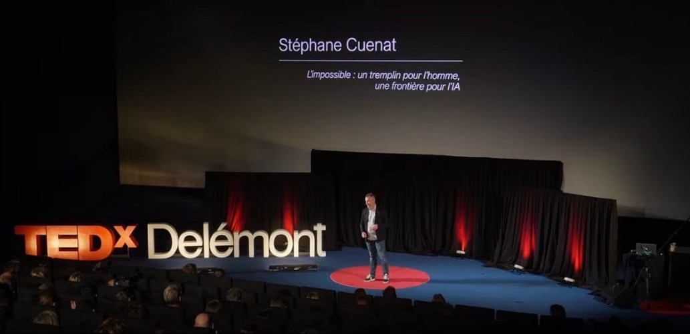

```{=html}
<a class="video-card" href="https://www.youtube.com/watch?v=uxu9kGQ51A4" target="_blank" rel="noopener" aria-label="Regarder la conférence TEDx sur YouTube">
  <span class="video-card-media"><span class="video-card-play" aria-hidden="true"></span></span>
  <span class="video-card-body"><span class="video-card-title">L’impossible : un tremplin pour l’homme, une frontière pour l’IA</span><span class="video-card-meta">TEDxDelémont · Regarder sur YouTube ↗</span></span>
</a>
```

## La réponse qu’on ne peut pas vérifier {#essai}

*L’essai que j’ai écrit au moment de la conférence. Traduit automatiquement de l’anglais ; quelques erreurs sont possibles. [Version originale](../talks.qmd#essay).*

**L’IA est extraordinaire, jusqu’à ce qu’elle atteigne la limite de ce que nous savons. Et là, la chose la plus dangereuse qu’elle puisse vous donner, c’est une réponse convaincante qu’on ne peut plus vérifier contre rien.**

Il y a quelques mois, je travaillais sur un problème d’apprentissage automatique : établir les bornes supérieure et inférieure d’un classifieur, c’est-à-dire les limites mathématiques de ce qu’il peut atteindre au mieux. C’est un travail lent et minutieux, de ceux où une seule hypothèse fausse invalide en silence tout ce qu’on a construit dessus.

Je me suis fait aider par un modèle d’IA. Et il m’a aidé, beaucoup. Il a aussi failli me coûter des semaines. Je veux être honnête là-dessus, parce que je soupçonne que beaucoup de gens vivent la même chose sans le dire.

À un moment, il m’a fourni une série de conjectures propres, bien motivées et élégamment argumentées. Elles ressemblaient exactement au genre de résultat que produirait la littérature. J’ai commencé à construire dessus. Ce n’est que plus tard, en vérifiant à la main, que j’ai compris qu’elles étaient subtilement fausses : la forme d’une preuve, sans la substance.

Cette expérience a cristallisé quelque chose que je considère désormais comme le vrai risque de ces outils. Ce n’est pas l’hallucination qu’on repère. Une affirmation manifestement fausse est inoffensive : on l’écarte et on passe à autre chose. Le mode de défaillance dangereux, c’est la conjecture plausible qu’on ne repère pas, la réponse assez crédible pour qu’on y croie et assez fausse pour nous mener droit dans le mur. Et à la frontière, là où vit vraiment la recherche, il n’y a souvent plus rien contre quoi la vérifier. C’est cela, bien plus que le manque de fiabilité, le problème dont je veux parler.

### Là où les ennuis commencent

Pour comprendre pourquoi cela arrive, il faut être précis sur ce que ces systèmes font extraordinairement bien, et sur l’endroit où ils cèdent sans bruit.

Les grands modèles sont brillants pour recombiner ce qui existe déjà. Dans l’espace de tout ce qu’ils ont vu, chaque article, chaque preuve, chaque motif, ils interpolent magnifiquement. Demandez-leur quelque chose qui se trouve dans cet espace, et ils le produiront plus vite et avec plus d’aisance que n’importe quel humain.

Les ennuis commencent aux bords. Face à l’extrapolation, au véritablement nouveau, ils ne s’arrêtent pas. Ils comblent le vide avec quelque chose qui ressemble à la réponse qu’aurait produite la littérature existante. Pour la plupart des tâches quotidiennes, c’est très bien, parce que la réponse se trouve vraiment dans l’espace connu. Mais la recherche, par définition, vit à la frontière : son métier est d’atteindre ce qui n’existe pas encore. Et qu’un modèle puisse ou non aller parfois aussi loin, il n’a aucun moyen de distinguer une vraie percée d’une supposition faite avec assurance. Pour le système, les deux se ressentent de la même façon.

Le modèle ne sait pas qu’il est passé de l’interpolation à l’invention. Il n’a aucun signal interne qui dise *ici, je devine*. Il produit l’artefact plausible avec la même assurance qu’un artefact correct.

### L’oracle manquant

Il y a une raison plus profonde pour laquelle il est si difficile de s’en protéger, et elle n’a rien à voir avec le manque de fiabilité du modèle. Elle tient à la vérification.

Quand on travaille sur un problème connu, on dispose d’un oracle. On peut confronter la réponse à un résultat établi, à un manuel, à un jeu de données, à un collègue qui l’a déjà fait. La réponse plausible mais fausse se fait attraper parce qu’il existe une vérité de terrain pour l’attraper.

À la frontière, cet oracle disparaît. Il n’y a pas de résultat établi, puisque tout l’intérêt est que le résultat soit nouveau. Alors, quand un système vous tend une conjecture propre sur une question que personne n’a tranchée, contre quelle vérité extérieure la vérifiez-vous ? Sa cohérence interne ne suffit pas : une idée fausse peut être parfaitement cohérente avec elle-même. C’est précisément ce qui rendait mes fausses conjectures si séduisantes : elles tenaient ensemble. Elles n’étaient simplement pas vraies.

C’est la question à laquelle je reviens chaque fois que quelqu’un annonce qu’une IA a « découvert » quelque chose de nouveau. Le test intéressant d’une découverte n’est pas de savoir si le modèle l’a produite, ni même si elle est élégante. C’est de savoir si elle fait une prédiction qu’on peut confronter au monde et qui peut se révéler fausse. Un modèle assez concis pour générer une expérience réfutable dispose d’un oracle extérieur : la réalité elle-même. C’est la ligne qui sépare une vraie découverte d’un ajustement très habile. Sans elle, on a de la cohérence interne déguisée en intuition profonde.

### La boussole à la frontière

Il serait facile de lire tout cela comme un argument selon lequel l’IA ne peut pas faire de vraie science. Ce n’en est pas un : j’utilise ces outils tous les jours, et ils me rendent plus rapide et plus affûté. Et je pense que parier contre leur portée est une erreur. Ces systèmes peuvent parfois atteindre des points véritablement nouveaux, et la ligne entre recombinaison sophistiquée et véritable extrapolation est plus floue que les sceptiques ne veulent bien l’admettre. Cette ligne va continuer de bouger, et je ne parierai pas contre elle.

Le fossé le plus difficile et le plus durable est ailleurs. Le problème de la frontière a en réalité deux moitiés, et elles vont ensemble. L’oracle manquant explique pourquoi on ne peut pas vérifier la réponse une fois qu’on l’a. Mais une question vient avant celle-là : comment savoir où chercher, tout simplement ? À la frontière, il n’y a pas de gradient à suivre, aucun signal qui dise que cette direction vaut la peine d’être explorée, ou que cette construction élégante est réellement vraie. Ce qui comble ce vide, chez un humain, c’est l’intuition.

J’entends par là quelque chose de précis, pas de mystique. Les mathématiciens sentent couramment qu’un résultat est vrai bien avant de pouvoir le prouver, et c’est cette conviction qui leur dit où passer les six prochains mois. Les physiciens sentent qu’une équation est « trop laide pour être juste ». Cette intuition n’a rien de magique ; c’est un autre type d’entraînement, bien plus riche, construit à partir de l’expérience incarnée, du transfert entre des domaines sans rapport, d’années passées à se tromper de façon instructive. Et surtout, elle s’accompagne d’un doute calibré : une personne à la limite de ses connaissances sait généralement quand elle devine. On peut aussi amener les modèles à exprimer de l’incertitude, mais d’après mon expérience, c’est précisément sur la construction nouvelle et plausible que ce signal fait défaut. Les conjectures qui ont failli me tromper ne sont pas arrivées marquées comme des suppositions. Elles sont arrivées avec l’allure de résultats.

Alors l’asymétrie que je trouve vraiment porteuse d’espoir, ce n’est pas que les machines ne peuvent pas atteindre le nouveau. C’est qu’atteindre le nouveau, là où rien ne peut être vérifié, dépend encore d’un sens de l’orientation que le modèle n’a pas : le jugement pour choisir quelle inconnue vaut la peine d’être poursuivie, et l’instinct pour sentir quand une belle réponse sonne creux. L’impossible a été un territoire humain non pas parce que nous y arrivons par le calcul, mais parce que nous portons une boussole pour nous y guider.

Ce n’est pas une limite qui attend d’être corrigée dans la prochaine génération de modèles. C’est la description de deux types de travail différents. L’un est la recombinaison, et peut-être même une vraie portée, à une vitesse surhumaine. L’autre consiste à savoir où la diriger, et à savoir quand on est vraiment arrivé.

La posture à laquelle je suis arrivé est donc simple, peut-être même un peu démodée. Pour moi, l’IA est un outil, et seulement un outil. Pas un substitut au jugement, à l’expertise, ni au lent travail de compréhension réelle d’un problème. Alors je remets en question chaque résultat, parce que les plus convaincants sont les plus dangereux, et j’essaie de ne jamais prendre ce qu’elle produit pour la vérité. Utilisée dans cet esprit, elle apporte beaucoup. Utilisée à l’aveugle, c’est un rendez-vous avec l’échec. Le reste, décider ce qui vaut la peine d’être visé et reconnaître quand on est vraiment arrivé, c’est la part qu’aucun modèle ne peut faire à ma place. Cette part-là, je la garde pour moi.

Gardez l’outil. Et gardez la tête sur les épaules.

J’ai défendu une version de cette idée sur la scène de TEDx : « L’impossible : un tremplin pour l’homme, une frontière pour l’IA ». Si l’argument vous intéresse, la conférence va un peu plus loin : [regardez-la sur YouTube](https://www.youtube.com/watch?v=uxu9kGQ51A4).

---

Les questions et les contre-arguments sur la conférence sont les bienvenus : [retrouvez-moi sur LinkedIn](https://www.linkedin.com/in/st%C3%A9phane-cuenat-87116b5/).
