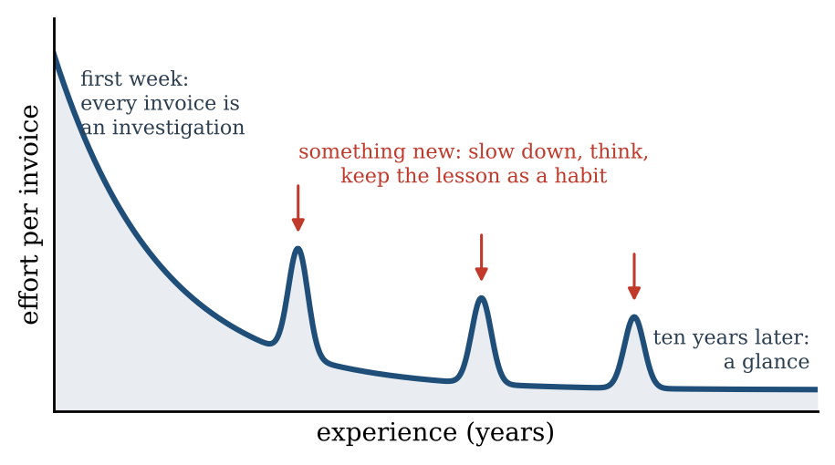
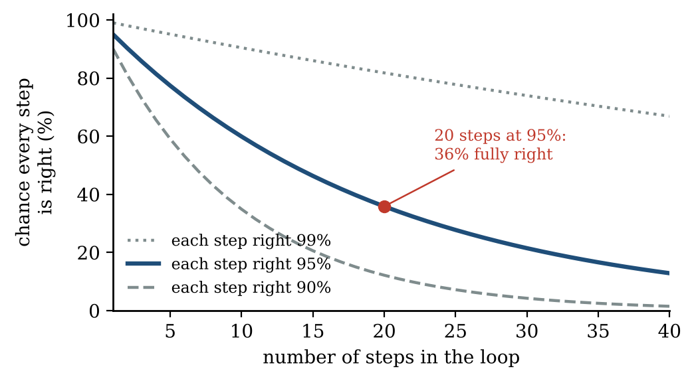
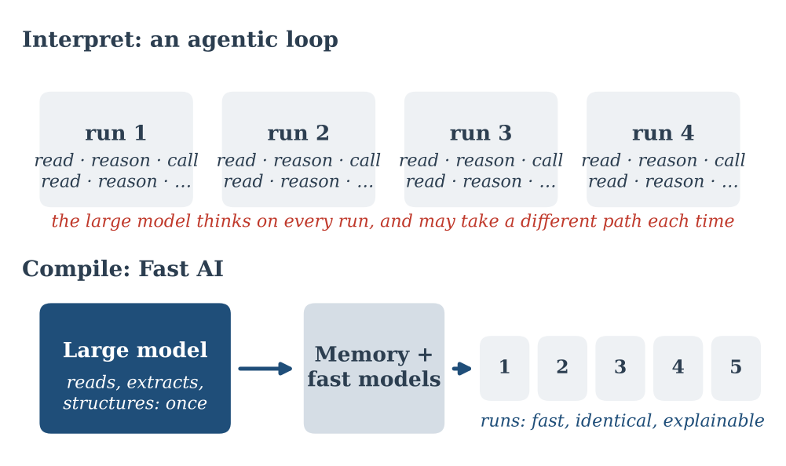
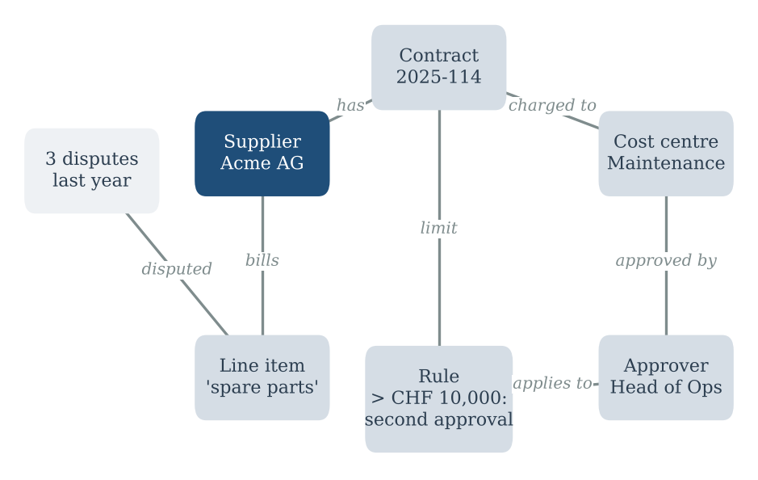
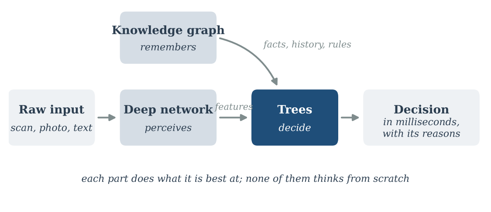
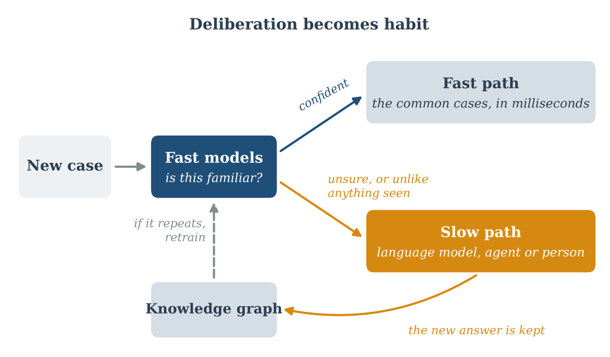

::: {.callout-note appearance="simple"}
**Essay, October 2026.** The code for the figures is here: [figs.py](figs.py).
:::

**In short.** Experts learn slowly, once, and then act fast on habit. Most AI automation today does the opposite: an agent reasons from scratch on every run, which compounds errors, costs time and forgets what it learned. Fast AI uses the large model before the loop, as a compiler: it builds a structured memory once, and fast, explainable models run the process. The agentic loop is kept for the exceptions, and what it learns there becomes the next habit.

::: {.callout-tip appearance="simple" icon="false"}
## Key takeaways

- An agentic loop interprets the task on every run. Fast AI compiles it.
- Use the large model to build the memory, a knowledge graph experts can inspect and correct, not to replace it.
- Let deep learning perceive and trees decide.
- Keep the loop for the exceptions, and feed what it learns back into the memory.
- It is worth it only for work that repeats; for one-off problems, the agent is the right tool.
:::

## 1. Learning is slow, habits are fast

Think of a new accountant in their first week. Every invoice is a small investigation. They read it line by line, check the contract, look up the supplier, ask a colleague which budget it belongs to. Ten years later, the same person glances at an invoice and knows. They have not become a faster thinker. They have turned years of slow learning into fast habits.

This is how expertise works, in people and in most living things. Learning is slow and deliberate, and it happens rarely. Acting is fast and nearly automatic, and it happens constantly. The slow part builds a structure; the fast part uses it. When something truly new appears, the expert slows down again, thinks, and if the lesson is worth keeping, it becomes a new habit.

{fig-alt="Curve of effort per invoice against years of experience: high in the first week, falling to near zero, with three sharp spikes where something new appears, ending at a glance ten years later."}

I call this idea **Fast AI**. Not fast because the hardware is quick, but fast because the thinking has already been done.

## 2. The agent that reads the manual every morning

Now look at how we build automation with AI today.

The typical agent receives a task, reads the context, reasons about what to do, calls a tool, reads the result, reasons again, calls another tool, and continues until it believes the task is done. It is impressive to watch. It is also an employee who arrives every morning with no memory and reads the whole manual again before touching anything.

For automation processes, this has four costs.

- **Errors compound.** If each step is right 95% of the time, a 20-step loop gets everything right only about 36% of the time (0.95 to the power 20). Agents add checks and retries to compensate, which adds more steps, more time and more cost.
- **It is slow.** Each step is a call to a large model that takes seconds. A process that runs ten thousand times a day pays that price ten thousand times, for reasoning that was nearly identical yesterday.
- **It is not repeatable.** Give the same input twice and the agent may take a different path. In regulated work, the question is not only "is the answer right?" but "would it give the same answer tomorrow, and can you show me why?". A loop of free-text reasoning is hard to audit and harder to certify.
- **It does not accumulate.** What the agent figured out on Monday is gone on Tuesday, unless someone builds a memory around it. The intelligence is spent, not invested.

{fig-alt="Curves of the chance that every step is right against the number of steps, for 99%, 95% and 90% per step. The 95% curve is marked at 20 steps: 36% fully right."}

None of this means agents are bad. It means they are the wrong default for work that repeats.

## 3. Compile, don't interpret

Programmers know this distinction well. An interpreter reads and executes a program line by line, every time it runs. A compiler reads the program once, works hard to understand and optimise it, and produces something that runs fast and identically, again and again.

An agentic loop interprets the task on every run. Fast AI compiles it.

In this view, the language model's best role in automation is not to sit inside the loop. It is to work before the loop, as the compiler. It does the slow, intelligent work once: reading, extracting, structuring, connecting. Then it steps aside, and something fast and simple runs the process.

{fig-alt="Two diagrams. Interpret: four runs, each repeating read, reason, call. Compile: a large model builds memory plus fast models once, followed by five small, fast, identical runs."}

## 4. The slow part: a structured memory

What does the language model compile the domain into? My answer is a knowledge graph: a structured memory of the things in a domain and how they relate.

Language models are very good at the slow work this requires. Give them contracts, policies, past cases, emails and the notes experts leave behind, and they can extract the entities and relations hidden in all that text. For supplier invoices, that means suppliers, contracts, cost centres, approvers, products and the links between them: this supplier's invoices go to this budget, amounts above this limit need a second approval, this kind of line item was disputed three times last year.

{fig-alt="Knowledge graph of boxes and labelled links: supplier Acme AG, contract 2025-114, cost centre Maintenance, a spare-parts line item, 3 disputes last year, a rule above CHF 10,000 and approver Head of Ops."}

Three things make the graph more valuable than a pile of documents or a long prompt.

- **It is explicit.** Every fact is a node and a link that a person can inspect, correct or delete. Experts can validate it, and they should, because extraction makes mistakes.
- **It is stable.** It does not change between runs unless someone changes it. The same question gets the same facts.
- **It accumulates.** Every new case, correction and exception can be added. The intelligence is invested, not spent.

This is the slow learning of the expert, written down.

## 5. The fast part: trees and networks together

With the memory in place, the decision itself rarely needs a large language model. It needs the right fast model, and here Fast AI has a second meaning: it is a hybrid, not deep learning everywhere.

Deep learning is unmatched at perception: turning raw, messy inputs such as images, scanned documents, sound or free text into meaningful features. Decision trees, and especially gradient-boosted trees, are often better at deciding: taking a table of meaningful features and producing a choice. On structured, tabular data, which describes most business decisions, well-tuned tree ensembles still match or beat deep networks in careful public benchmarks, while being faster, needing less data and being far easier to explain.

So the natural split is:

- **Deep networks perceive.** They read the scanned invoice, the photo or the text of a request, and turn it into features.
- **The knowledge graph remembers.** It supplies what is known about those features: past cases, rules, constraints.
- **Trees decide.** They combine both into a decision in milliseconds, and they can show which features drove it.

{fig-alt="Flow from raw input to deep network (perceives) to trees (decide) to decision with reasons, with a knowledge graph feeding facts, history and rules into the trees."}

Each part does what it is best at. None of them needs to think from scratch on every case.

## 6. The loop moves to where it belongs

Fast AI does not remove deliberation. It moves it.

The fast path handles the common cases. But every fast model should know when it is unsure: a low confidence score, a case unlike anything in its memory, a combination the graph has never seen. Those cases, and only those, go to the slow path: a language model reasoning through the problem, an agent exploring options, or a person.

And when the slow path solves a new case, the answer does not vanish. It goes back into the knowledge graph, and if it repeats, the fast models are retrained on it. Deliberation becomes habit. This is the expert again, slowing down only for the truly new, and learning from it.

{fig-alt="Flow from new case to fast models. If confident, the fast path handles it in milliseconds. If unsure, the slow path (language model, agent or person) answers, the knowledge graph keeps it, and repeats retrain the fast models."}

So the agentic loop does not disappear. It stops running on every case and starts running on the exceptions, where its intelligence pays off.

## 7. An example: routing supplier invoices

Take a common task in any finance department: deciding what to do with each incoming invoice. Approve it, send it to the right person, or flag it.

**The agentic way.** An agent receives the invoice, calls a tool to read it, reasons about the supplier, searches the contracts, reasons about the amount, looks up the approval rules, proposes a route, checks it and adjusts. It may take half a minute, cost a noticeable amount, and route slightly differently next time. Explaining why it chose this approver means reading pages of its reasoning.

**The Fast AI way.** Months earlier, a language model read the contracts, policies and past decisions, and built a graph of suppliers, budgets, limits and approvers. The finance team reviewed it. Now, for each new invoice, a network reads the document, the graph supplies the relevant contract and history, and a tree ensemble picks a route in milliseconds. It explains its choice: supplier, amount against contract, cost centre, past disputes. When an invoice is unlike anything seen before, it says so and hands it to a person or an agent. Their answer enriches the graph.

{fig-alt="Two pipelines. The agentic way runs seven reasoning steps on every invoice, about half a minute each. The Fast AI way builds a reviewed graph once, then a network and trees route each invoice in milliseconds with reasons."}

Both use AI. Only one of them gets faster and better every month.

## 8. What Fast AI costs

This approach has real costs, and they are worth stating.

- **The graph is work.** Extraction errors must be caught, and someone has to own the memory. A wrong fact in the graph is repeated quickly and confidently, which is worse than a slow mistake.
- **It needs repetition.** For tasks that are truly one-off or open-ended, compiling makes no sense. There is nothing to reuse, and the agent is the right tool.
- **The world drifts.** New suppliers, new rules, new products: a fast system can go on confidently applying old habits. It needs a monitor that notices when its decisions stop fitting, as [my last essay](../2026-10-11-what-a-quiet-screen-cannot-see/index.qmd) argued for dashboards.
- **It takes design.** An agent can be set up in an afternoon. A hybrid of graph, networks and trees takes engineering. That upfront cost is precisely the slow learning, and it pays off only if the process repeats enough.

## 9. Conclusion

We are tempted to put the most powerful model in the middle of every process, thinking on every run. For open problems, that is right. For automation, it is often like asking a senior expert to reread the whole manual before every routine job.

The alternative is older than AI. Learn slowly, once, and write down what you learned. Act fast, with simple tools you can explain. Slow down only when something is truly new, and turn what you learn there into the next habit.

Use the large model to build the memory, not to replace it. Let deep learning perceive and trees decide. Keep the loop for the exceptions. That is Fast AI: not less intelligence, but intelligence spent once and invested, instead of spent again on every run.

::: {.read-next}
**Read next** · [An Ecosystem, Not an Oracle](../2026-10-17-an-ecosystem-not-an-oracle/index.qmd)  
The same idea for local AI: many small specialists, a shared memory and a way to keep learning.
:::

::: {.small}
*The views in this essay are my own and do not describe any product or plan of my employer.*
:::
