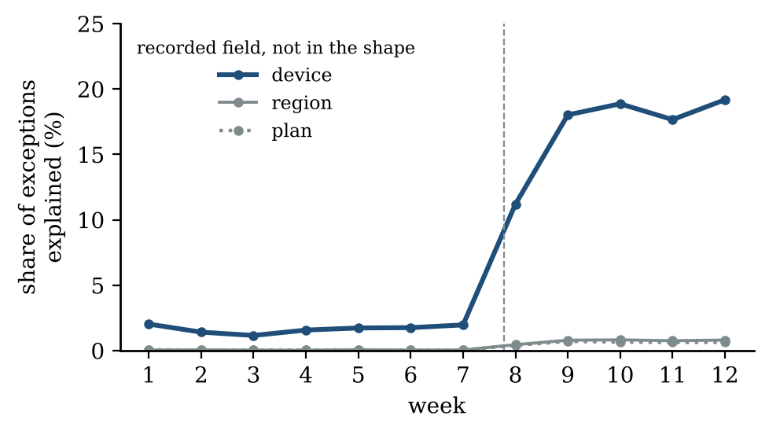
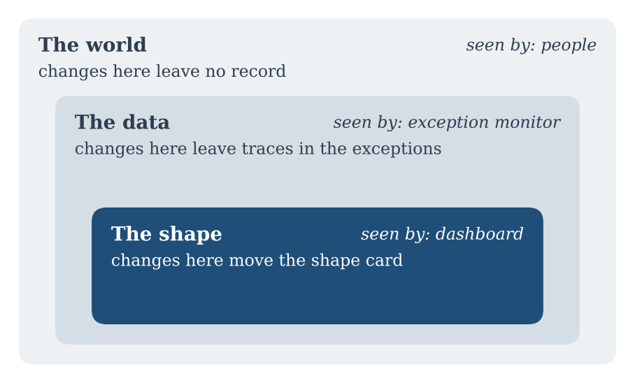

::: {.callout-note appearance="simple"}
**Essay, October 2026.** A follow-up to [Show What Changed, Not the Data](../2026-09-29-show-what-changed/index.qmd). The simulation code is here: [sim.py](sim.py), [figs.py](figs.py).
:::

**In short.** My last essay argued that a dashboard should show only how our understanding of a system has changed, so that most weeks it is empty. A reader pointed out the weak spot: if something goes wrong in a place our understanding does not cover, the screen stays quiet while the system fails. He is right, and this essay takes the objection seriously. An empty dashboard can mean two different things, *nothing changed* or *something changed where we are not looking*, and the dashboard alone cannot tell them apart. But the data can. Every summary leaves something unexplained, and when the world changes in a direction the summary does not cover, that leftover part grows. Watching it costs very little, and it turns a silent blind spot into a warning.

::: {.callout-tip appearance="simple" icon="false"}
## Key takeaways

- A model can only report changes it has words for. Everything else is invisible to it, however large.
- So silence has two meanings, and a heartbeat that says "checked" does not separate them.
- What the model cannot explain, its exceptions, is where unseen change shows up first. Watch how big the exceptions are, and what explains them.
- Some changes leave no trace in any data. For those, only people help: reviews, visits, conversations.
- A quiet screen must earn its silence. It should say what it checked, what it could not explain, and when it last proved that it can still see.
:::

# Part I · Two kinds of silence

## 1. The objection

After I published the first essay, a reader named Ronald wrote a comment that I have been thinking about since. He liked the idea and compared it to how the brain works: it does not process everything it receives, it predicts what should happen and reacts only to the difference. An empty dashboard, he said, is like a well-adapted organism with nothing to react to.

Then he added the caveat. The dashboard has a built-in blind spot. If something goes wrong outside what the shape describes, the screen stays silent while the system fails without a sound.

I had mentioned this limit at the end of the paper, in one paragraph. That was not enough. The whole proposal rests on one promise: *if the screen is empty, you can look away.* If an empty screen can also mean "something is breaking where I cannot see", then the promise is broken, and the old crowded dashboard starts to look safer. So the question deserves a full answer: when can we trust silence?

## 2. Two silences

Imagine two weeks in which the dashboard shows nothing.

In the first week, nothing changed. The system behaved as our shape (our compact description of how it works) said it would. Silence is good news.

In the second week, something did change, but in a direction the shape does not describe. Perhaps one type of device became slow, and the shape does not track devices. The shape is recomputed, it looks the same as last week, the difference is zero, and the screen is empty. Silence is now bad news, and it looks exactly like the good news.

In the first essay I added a *heartbeat*: a weekly line saying "shape checked on this week's data, no material change." It solves a real problem. Without it, a broken pipeline and a healthy system both produce an empty screen. But the heartbeat only proves that the system is *checking*. It does not prove that the system can *see* the change that matters. In the second week, the heartbeat is sent, it is true, and it is useless.

## 3. The geometry of a blind spot

It helps to picture this. The shape is a small set of numbers: for example the speed of each agent in each language, after removing the effect of request length and the daily ups and downs of the shared servers. Think of each number as one direction in which the system can move. Together, these directions form the space that the shape describes.

Any real change in the system is an arrow. Part of that arrow points along the directions the shape describes; that part moves the shape and reaches the dashboard. The rest points elsewhere; it moves nothing the shape measures, so the difference of shapes does not see it at all (Figure 1).

{fig-alt="Vector diagram. A large real change points mostly upward, outside what the shape describes; only its short horizontal shadow is seen, too small to report."}

Mathematicians call the visible part a *projection*. The dashboard of the first essay sees only the projection of each change onto the shape. This is not a flaw of one dashboard; it is true of every model, every summary and every set of indicators. You can only report a change in the words you have. A thermometer cannot tell you that the room is on fire if the fire has not yet warmed the air near it.

The danger is not only that some changes are invisible. It is that the shape will often *explain them away*. If a change looks, from inside the shape, like something the shape already expects, such as noise or a known swing, the shape will absorb it into that category without complaint.

# Part II · A problem the shape cannot see

## 4. The setup

To see how this happens, I reused the simulated AI copilot from the first essay: five agents (search, code, summarise, translate, email), four languages (English, German, French, Italian), request lengths, slow growth, quiet weekends, and response times that rise and fall each day for everyone because the servers are shared. Over 12 weeks the simulation produces about 2.2 million requests.

One thing is new. Each request now also records three fields the shape card does not use: the **device** (web browser, desktop app or iOS app), the **region** and the customer's **plan**. This is realistic. Telemetry usually records far more fields than any summary uses.

The shape card is the same as before: the speed of each agent in each language, after removing the effect of request length and the shared daily swings. It learns the length rule correctly (exponent 0.50, the value used to create the data) and it is quiet for seven weeks, as it should be.

Then, on the Wednesday of week 8, requests from the **iOS app** become **15% slower**, for every agent and every language. Perhaps an app update changed how requests are packed. iOS is 15% of all traffic.

## 5. Why the shape stays quiet

The shape card never moves. Over the twelve weeks, the largest change in any of its numbers is 2.6% from one week to the next, and 2.5% compared with the reference weeks. The materiality line is 5%. The dashboard is empty for all twelve weeks, and twelve heartbeats report "no material change" (Figure 2).

The reason is instructive. The slowdown hits every agent and every language equally, because iOS users are spread evenly across them. So the relative speeds that the shape card tracks do not change at all. What does change is the overall level: on average, all requests are about 2% slower. But the shape was built to treat changes in the overall level as server swings, because the servers really do swing, by about 5% from day to day. A step of 2% inside daily swings of 5% looks like one more swing. Look at the top panel of Figure 2: the 7-day average wandered just as much in weeks 3 and 4, when nothing was wrong.

{fig-alt="Top: noisy daily level over 80 days with a 7-day average; the iOS problem starts at day 51 with no visible jump. Bottom: weekly bars of the largest shape-card change, all below the 5% material line."}

This is the worst kind of blind spot. The shape does not ignore the problem. It *explains* it, with full confidence and the wrong explanation. A 15% slowdown for one in seven users becomes "the servers had a slightly slow fortnight".

The fourth caution of the first essay, comparing against a fixed reference and not only against last week, does not help here either. That caution catches slow changes along the directions the shape describes. This change is not slow; it is sideways.

# Part III · Watching what the shape cannot explain

## 6. The leftover part

The way out comes from an idea that was already at the centre of the first essay. The shortest description of a set of data has two parts:

$$
\text{data} = \text{rule} + \text{exceptions}
$$

The shape is the rule. The *exceptions* are everything the rule does not explain: for each small group of requests, the gap between the speed the shape predicts and the speed that was actually measured.

When the shape is right, the exceptions are pure noise. They have a typical size, which we can measure in quiet weeks, and they have no structure: you cannot predict them from anything.

When the world changes in a direction the shape does not describe, the change has to go somewhere. It cannot go into the shape, so it goes into the exceptions. In the language of Figure 1, the unseen part of the arrow is not lost; it lands in the leftover part. The exceptions get bigger, and they start to have a pattern.

So the shape needs a second, very simple monitor next to the dashboard. It asks two questions each week.

- **Are the exceptions bigger than usual?** If the rule still holds, the leftover part should be as large as it was in quiet weeks, no larger.
- **Can anything explain them?** For each recorded field that the shape does not use, check how much of the exceptions it explains. If the shape still holds, the answer should be: almost nothing.

The first question tells us that the shape is wearing out. The second tells us where.

## 7. What the exceptions show

Figure 3 shows the first question in the simulation. The size of the exceptions is measured relative to the first six weeks, so 1 means "usual". For seven weeks it stays within about 1% of 1. In week 8, it jumps to 1.18, then settles between 1.30 and 1.37. With a materiality line at +10%, the monitor raises a notice at the end of week 8, five days after the problem began. The shape card, for the same weeks, still says nothing has changed.

{fig-alt="Line chart over 12 weeks of the size of exceptions. It stays at 1 until week 7, then rises above the +10% line to about 1.37. A dashed line after week 8, once device type is learned, stays near 1."}

There is something important here. This first check does not need the device field at all. It only needs to know that the rule now explains the data less well than it used to. Even if the device were never recorded, we would know that the shape no longer fits, without knowing why. That alone is worth a lot: it changes the heartbeat from "no change" to "no change in the shape, but the shape fits worse than usual". That is a very different message, and a much more honest one.

Figure 4 shows the second question. Before the problem, the device field explains only 1 to 2% of the exceptions. That small part is real: iOS requests were always about 3% slower, a constant difference the shape never learned. After week 8, the device field explains 18 to 19% of the exceptions. Region and plan stay below 1% throughout.

{fig-alt="Line chart over 12 weeks of the share of exceptions explained by each field. Device jumps from about 2% to nearly 20% after week 7; region and plan stay near zero."}

So the notice can say something precise: *the shape fits worse than usual, and most of what it cannot explain is linked to device type; iOS requests are about 15% slower than the shape expects.* That is almost the full diagnosis, found by a monitor that has no idea what an iOS app is.

## 8. The shape learns

What happens next is the loop from the first essay: summarise, look at what the rule misses, summarise again. The notice tells us the shape is missing a dimension. So we add it: the shape card gains two numbers, the speed of the desktop app and of the iOS app relative to the web.

With those two numbers, the shape learns that iOS was about 3% slower than the web before week 8 and about 18% slower after, which matches the 15% slowdown we hid. The exceptions return to their usual size (the dashed line in Figure 3). The screen becomes quiet again, and this time the silence is justified.

This is how a shape should grow: not by adding every field "just in case", which brings back the crowded dashboard and the curve with too many terms, but by adding a dimension when the exceptions prove that it is needed. The leftover part is not waste. It is where the next rule comes from. Kepler gave up circular orbits because of an eight-arcminute gap in the orbit of Mars that circles could not explain.

# Part IV · What this has to do with the brain

## 9. Predictive coding has the same problem

Ronald's comparison with the brain is a good one, and it goes further than he said. A well-known theory in neuroscience, *predictive coding*, proposes that the brain constantly predicts what its senses will report, and passes on mainly the difference between prediction and reality. This is exactly a dashboard of differences. And the brain has exactly the same blind spot.

The most famous demonstration is an experiment by Simons and Chabris. Viewers are asked to count the passes in a video of people throwing a basketball. Halfway through, a person in a gorilla suit walks through the scene. Roughly half of the viewers do not notice the gorilla at all. They were not looking in the wrong place; the gorilla walked through the middle of the screen. Their model of the task simply had no slot for gorillas.

So how does the brain survive in a world full of gorillas? One influential answer, from Yu and Dayan, is that the brain tracks two kinds of uncertainty. *Expected uncertainty* is the normal noise of a familiar situation: we know the world is a bit unpredictable and we do not react to every small surprise. *Unexpected uncertainty* is when surprises become more frequent or larger than our model says they should be. That is the signal that the model itself is wrong, and it is thought to trigger a reset: attention widens, learning speeds up, old rules are questioned.

This is the exception monitor. The brain does not only watch *what* differs from its prediction. It watches *how much* it is being surprised overall, compared with how much it expects to be. When surprise rises above its usual level, the brain stops trusting its model and starts looking around. A dashboard should do the same.

# Part V · The third silence

## 10. Changes that leave no trace

The exception monitor has a limit too, and it is better to say it plainly. It sees changes that leave a trace in the data, even in fields the shape does not use. It cannot see changes that leave no trace in any data at all.

Suppose the copilot's answers in Italian slowly get worse, less accurate and less useful, while staying exactly as fast. Speed telemetry will never show it. No shape, no exception and no field will move, because nothing we record is affected. The only places this shows up are people: a user who stops using the copilot, a colleague in Milan who mentions it over coffee, an engineer who reads twenty Italian answers one afternoon.

So there are three kinds of change, and each needs a different watcher (Figure 5).

{fig-alt="Three nested boxes. The world, seen by people, changes leave no record. Inside it, the data, seen by the exception monitor. Inside that, the shape, seen by the dashboard."}

- **Changes inside the shape** reach the dashboard. This is what the first essay was about.
- **Changes in the data but outside the shape** reach the exception monitor. This is what this essay adds.
- **Changes outside the data** reach no machine. They need people who regularly look at the real thing: read the answers, visit the shop floor, talk to the users.

The third circle is not a footnote. In 1983, Lisanne Bainbridge described the "ironies of automation": the more reliable an automatic system becomes, the less often people practise the skills they need on the day it fails. A quiet dashboard makes this worse, because it removes the daily contact with the system that used to keep people's intuition alive. If we take away the crowded screen, we must give back that contact in a deliberate form: a regular, unhurried look at raw cases, chosen at random, by people whose job is to notice what nobody asked them to look for.

## 11. Proving that the system can still see

There is one more trap. Even a good exception monitor can break silently. A pipeline can stop filling a field; a threshold can be set too high after a busy month; a model can be retrained in a way that hides the exceptions inside the rule. Each of these produces a quiet screen.

Engineers already know how to deal with this in other fields. Fire alarms are tested. Pilots train in simulators on failures they hope never to see. In large software systems, *chaos engineering* deliberately breaks things in production, in small and controlled ways, to check that the monitoring notices.

The same idea works here. From time to time, inject a small, known, artificial change into a copy of the data: make one slice of synthetic requests slower, along a dimension the shape does not track. Then check that the exception monitor notices, and how fast. If it does not, the silence of the following weeks means nothing. If it does, we have evidence, not just hope, that the system can still see.

# Part VI · A quiet screen that earns its silence

## 12. A better heartbeat

Put together, the weekly heartbeat becomes a short, honest report of what was checked and how well:

> **Week 12.** Shape checked on this week's data: no material change.
> Exceptions: usual size; no recorded field explains them.
> Last drill: injected slowdown on a hidden slice, caught after 4 days.
> Last human review of raw cases: 3 weeks ago.

Each line answers a different doubt. The first says that our understanding still holds. The second says that it still *fits*: nothing is hiding in the leftover part. The third says that the watcher can still see. The fourth says when a person last looked at the world directly, outside every model.

This is still a very small amount to read: four lines a week instead of forty tiles a day. But now the silence carries information. It says not only "nothing changed", but "nothing changed that we could have seen, here is how much we could see, and here is when we last checked the rest".

## 13. Conclusion

The objection to the first essay was right: a system that only watches its own picture of the world cannot see what lies outside that picture, and it will often explain away what it cannot see. More tiles are not the answer; a crowded screen has blind spots too, it just hides them under noise.

The answer is to watch the part of the data the picture cannot explain. When the world moves sideways, away from what our model describes, the exceptions grow and take on a pattern long before anyone thinks of adding a new chart. Watching them is cheap, it needs no knowledge of what might go wrong, and it tells us both that our understanding has stopped fitting and roughly where.

And for what leaves no trace in any data, there is no shortcut: people have to keep looking at the real thing. An empty dashboard is the right goal. But silence is a claim, and like any claim, it has to be earned.

::: {.read-next}
**Read next** · [Show What Changed, Not the Data](../2026-09-29-show-what-changed/index.qmd)  
The working paper this essay answers: a dashboard as the difference between shapes.
:::

## Further reading

::: {.small}
- Bainbridge, L. (1983). Ironies of automation. *Automatica*, 19(6), 775–779.
- Basiri, A., et al. (2016). Chaos engineering. *IEEE Software*, 33(3), 35–41.
- Box, G. E. P. (1980). Sampling and Bayes' inference in scientific modelling and robustness. *Journal of the Royal Statistical Society, Series A*, 143(4), 383–430.
- Friston, K. (2010). The free-energy principle: a unified brain theory? *Nature Reviews Neuroscience*, 11(2), 127–138.
- Gama, J., Žliobaitė, I., Bifet, A., Pechenizkiy, M., & Bouchachia, A. (2014). A survey on concept drift adaptation. *ACM Computing Surveys*, 46(4), 1–37.
- Rao, R. P. N., & Ballard, D. H. (1999). Predictive coding in the visual cortex. *Nature Neuroscience*, 2(1), 79–87.
- Rissanen, J. (1978). Modeling by shortest data description. *Automatica*, 14(5), 465–471.
- Simons, D. J., & Chabris, C. F. (1999). Gorillas in our midst: sustained inattentional blindness for dynamic events. *Perception*, 28(9), 1059–1074.
- Yu, A. J., & Dayan, P. (2005). Uncertainty, neuromodulation, and attention. *Neuron*, 46(4), 681–692.
:::
