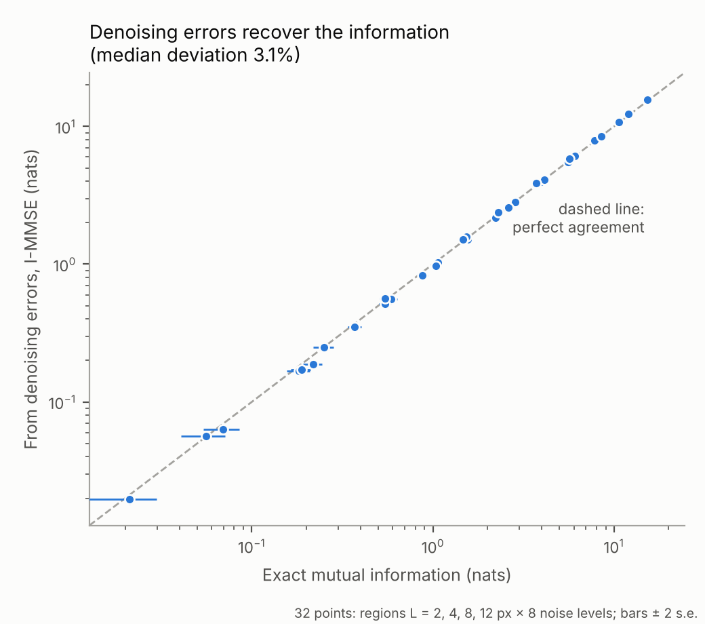

::: {.callout-note appearance="simple"}
**Essay, October 2026.** A follow-up to [A Universe Without a Bottom](../2026-10-15-a-universe-without-a-bottom/index.qmd). Everything is open: [download the code and results](noise-to-boundaries.zip){download="noise-to-boundaries.zip"} (zip, 2 MB), [browse them on GitHub](https://github.com/scuenat/scuenat.github.io/tree/main/posts/2026-10-16-decided-in-the-bulk/code/noise-to-boundaries), or read the [working paper](code/noise-to-boundaries/paper/From_Noise_to_Boundaries_Cuenat_2026.pdf) (PDF, 4 pages).
:::

**In short.** A physics paper about how structure appears out of complete disorder made me ask a question I could actually test: while an AI image generator turns noise into a picture, where does the picture's information live, in the inside of a region or on its border? I ran the experiment in one evening, on two CPU cores, with an AI as lab partner. Finished images follow an *area law*: information lives on borders. But on the way, the big decisions are made across the whole image first, and only later settle onto the edges. I also found a way to measure this inside any image generator using nothing but its ability to remove noise, and checked it against exact answers. None of this is my field. The part I want to stress is how it was possible at all.

::: {.callout-tip appearance="simple" icon="false"}
## Key takeaways

- Finished handwritten digits follow an area law (β = 1.07): what a patch shares with the rest of the image grows with its border.
- In the noisy early phase, real structure adds up to 2.4 times more shared information than a control, and it grows more like the patch's size. Structure is decided in the bulk and written on the boundary.
- The change is smooth. A "sudden transition" seen in one early run was noise, and disappeared when repeated.
- The same information can be read from denoising errors alone (median difference 3% from the exact values), so the method can be applied to real, trained image generators.
- An AI lab partner did not give me the answers. It let me ask the question properly: build, run, check, criticise, and throw away what does not hold.
:::

# Part I · From the cosmos to code

## 1. It must be simpler than this

Recently I wrote about reading a physics paper I could not follow: *Holograms and Standard Models*, by Miyashita, Sekino and Susskind. My first reaction was simple. Something is wrong here. It must be easier. I believe the universe is fundamentally simple.

That essay ended in philosophy. Grains inside grains, nothing creating everything, and the idea that the meaning is in the middle.

This one ends in an experiment.

I am a software architect, not a physicist. But I kept coming back to one idea from that paper, and one evening I asked a different question: could I actually test something? Not about the universe. About the AI systems I work with every day.

## 2. The surface knows everything

The idea that stuck is the *holographic principle*. In the 1970s, Bekenstein and Hawking found that the information a black hole can hold depends on the area of its surface, not on its volume. Double its size and its information grows four times, not eight.

Physicists found the same pattern elsewhere. In many systems, the information shared between a region and everything around it grows with the region's boundary. They call it an *area law*. When it grows with the region's size instead, it is a *volume law*.

Susskind and his colleagues go further. They build a small world of particles and forces from a system at infinite temperature, the state of maximum disorder, the closest thing to "nothing" physics allows. Structure from nothing, organised on a surface.

I could not check their mathematics. But their question felt general: *when structure appears out of complete disorder, where does its information live?*

## 3. A machine that builds structure from disorder

Then I realised I already knew a machine that builds structure from disorder.

Image generators like Stable Diffusion are *diffusion models*. They start from pure random noise, the same maximum-disorder state, and remove the noise step by step until an image appears. A face, a cat, a handwritten digit.

The universe gives us one run, seen from inside, mostly through a horizon. A diffusion model gives us as many runs as we want, and we can stop it at any moment and look.

So the question became concrete. While an image forms out of noise, does the information shared between a patch of the image and the rest of it grow with the patch's border, or with its size? Area or volume? And does that change along the way?

# Part II · The experiment

## 4. What I measured

The measurement is simple to state. Take a square patch of an image. Ask how much knowing the rest of the image tells you about that patch. Physicists call this *mutual information*. Then make the patch bigger and watch how that number grows.

If it grows like the border of the patch, it is an area law. If it grows like the number of pixels inside, it is a volume law. I summarise the growth with one number, β, from

$$
I(L) \propto L^{\beta},
$$

where $L$ is the side of the patch in pixels: β close to 1 means area law, close to 2 means volume law.

I did not use a giant neural network. I used something I could compute exactly: a statistical model of handwritten digits (the classic MNIST dataset) built from 40 simple pieces, four per digit. It learns real structure; on images it has never seen, it is far better than a simple model. And for this kind of model, every stage between noise and finished image can be calculated precisely, with no training noise and no guessing.

The most important part is the comparison. For every measurement I also built a *control*: a much simpler model that has exactly the same correlations between pixels but none of the real structure. No strokes, no digits, just smooth statistical blur. Whatever the real model does that the control does not, comes from actual structure. Without that control, I would have fooled myself at least twice.

## 5. What I found

**Finished digits follow an area law.** At the end of generation, β is 1.07. The information a patch shares with the rest of the image grows with its border.

**But on the way, something else happens.** In the noisy early phase, the real model carries up to 2.4 times more shared information than the control, and that extra information grows more like the *size* of the patch than its border. As the image sharpens, the extra information moves toward the borders, and the two curves meet (Figure 1).

{fig-alt="Left: nine generated handwritten digits. Right: scaling exponent beta against signal fraction. The learned model (blue) stays well above the Gaussian control (orange) in the noisy phase; both fall toward 1.07 for finished digits."}

Here is how I read it. Early on, the model is deciding the big things: which digit, roughly where, which way it leans. That is a fact about the whole image, and every pixel carries a little evidence about it, so it scales with size. Later, the model draws the details: strokes, edges, where black meets white. Those are local, and they live on borders.

Or, in one line: **structure is decided in the bulk and written on the boundary.**

## 6. What did not work

I expected a sudden switch, like water turning to ice, at one precise moment. A first coarse run seemed to show one. When I repeated it with eleven noise levels and three independent runs, the jump disappeared. The change is smooth (Figure 2). The "sudden switch" was noise in a single run.

{fig-alt="Two panels with error bars. a: total scaling exponent falls smoothly from about 1.4 to 1.1, above the control. b: the excess over control falls from near the volume law, about 1.7, toward the area law."}

I keep it in the story because it is exactly the kind of mistake that is easy to publish and hard to take back.

## 7. What it does not show

I asked for a tough review of my own results, the kind a referee would write. Here is what holds up less well than I would like.

- **The area law alone is not surprising.** Any image whose pixels mostly correlate with their neighbours gives an area law. Physicists have known this for years. The new part is not the final area law but the extra structure and how it moves from bulk to boundary.
- **It describes the data, not the network.** Because I computed everything exactly, the results describe what noisy digits look like at each stage, which is the same for any perfect generator. To say how real neural networks behave, I need to test a trained one.
- **The images are tiny.** At 28×28 pixels I can only compare patches from 2 to 12 pixels wide. That is less than one order of magnitude, and the blank border of each digit distorts larger patches.
- **The physics is an analogy.** A black hole's surface and the border of an image patch are not the same thing. The parallel is suggestive, and testable, but it is not a proof of anything about the universe.

None of this makes the work worthless. It tells me exactly what to do next.

# Part III · Pushing past the limit

## 8. Seeing inside any generator

The second limitation bothered me most. My exact method only works on simple models. Real generators, the ones people actually use, are giant neural networks where nothing can be computed exactly.

Then I came across a result from information theory, from 2005, by Guo, Shamai and Verdú. It links information to *how hard it is to remove noise*. Applied to my question, it says something I find beautiful:

> The information a patch shares with the rest of the image equals how much seeing the rest helps you clean up that patch, added up over all noise levels.

In symbols, with $A$ the patch, $B$ the rest of the image and $\text{mmse}$ the error of the best possible denoiser at a given signal-to-noise ratio $\gamma$:

$$
I(A;B) = \frac{1}{2}\int_0^{\text{snr}} \Big[\, \text{mmse}_A(\gamma) + \text{mmse}_B(\gamma) - \text{mmse}_{A \cup B}(\gamma) \,\Big]\, d\gamma
$$

That matters because cleaning up noise is exactly what a diffusion model is trained to do. So in principle you could measure the information map of *any* generator just by asking it to denoise a patch twice: once seeing only the patch, once seeing the whole image.

I tested this on my digit model, where I already knew the exact answer. The two routes agree, with a median difference of 3% across 32 comparisons (patch sizes from 2 to 12 pixels, noise levels from heavy to light). The largest difference was 14%, on one very small, very noisy patch (Figure 3).

{fig-alt="Log-log scatter of 32 points, information from denoising errors against exact mutual information, all lying close to the dashed line of perfect agreement."}

This is the part I find most valuable. The exact calculations become a *ground truth* to check a method that can scale to real models. The next step is to run it on a trained neural network. That needs a model that can denoise with part of the image hidden, which many image generators already can.

## 9. You don't need a big machine

Everything in this essay ran on two CPU cores. No GPU, no cloud cluster, no downloaded giant model. The longest run took about seven minutes.

At one point I was told the next step needed a GPU. I pushed back: why should a question need a big machine? It turned out the honest answer was that only one specific claim needs it, the one about trained neural networks. Everything else, the exact calculations, the controls, the repeated runs, fits on a laptop. Some of the best physics ever done was tabletop physics. A well-controlled small experiment beats a sloppy big one.

# Part IV · What the AI made possible

## 10. A lab partner, not an oracle

I should be transparent about how this was done. I did it in one evening with Claude, Anthropic's AI, as a lab partner. I brought the questions and the stubbornness; it wrote and ran the code, searched the literature, and, importantly, reviewed the results harshly when I asked it to. It also caught its own mistakes: a model that looked better than it was, a chart label that overstated a result, a "sudden transition" that was not there.

Look back at the path of this essay and count the steps that would have stopped me alone:

- **From a feeling to a measurable question.** "It must be simpler" is not a hypothesis. Turning it into "does mutual information scale with the border or the size, and does that change along the generation path?" took a conversation, not a degree.
- **From a question to code that runs.** Exact mutual information for a 784-pixel mixture model, Monte Carlo estimates with error bars, a fair control. Each is a week of reading for an outsider. Here, each was a script I could read, run and question within minutes.
- **From a result to a result I trust.** The control model, the three independent runs, the fine grid of noise levels: these exist because I kept asking "how would I fool myself here?", and the answers came back as experiments, not opinions.
- **From a dead end to a way forward.** The method that works on real generators comes from a 2005 information-theory paper I had never heard of. Finding it, understanding what it says about my question, and testing it against the exact values all happened in the same evening.
- **From a claim to a smaller, honest claim.** The harsh review took the area law off its pedestal and left the more interesting part standing. The GPU question turned "this needs a big machine" into "only this one claim does".

None of these steps is new science on its own. What is new, for me, is that they can follow each other at the speed of curiosity. The distance between "I wonder whether…" and "here is the plot, here is the control, here is why it might be wrong" used to be months, and for someone outside the field it was usually infinite. That evening it was hours.

## 11. Innovation is in the asking

This is the part of AI I find most interesting. Not that it answers, but that it lets someone like me *ask properly*: run the experiment, check it, and throw away what does not hold.

It is tempting to say that AI will produce new ideas by itself. I do not think that is what happened here. The question came from me, reading a paper I could not follow and refusing to let it go. The direction changed three times because of judgement calls: insist on a control, distrust a jump that looked too good, refuse to accept that a question needs a big machine. What the AI removed was the cost of each step in between. When trying an idea costs minutes instead of weeks, you try more of them, you kill the bad ones sooner, and the good ones get pushed further than you would ever have pushed them alone.

That also changes what rigour means for an outsider. The danger of a fast partner is that you go fast in the wrong direction, and a confident AI can make a wrong result look finished. The defence is the same as in any lab: controls, repeated runs, a referee who is paid to be unkind, and everything published so that others can check. The AI can play the referee too, if you ask it to. You have to ask.

# Part V · Back to the beginning

## 12. A very good middle

I started with a feeling: the universe must be simpler than that paper. I still believe it. But I see now that simple does not mean easy, and it does not mean finished.

In my last essay I wrote that "from nothing to nothing" forgets the middle, and that the middle is everything. This experiment is a small version of that idea. A machine starts from noise, from nothing. It ends with a digit, a finished thing. And in between, there is a moment where the big decisions are made everywhere at once, before they settle quietly onto the edges.

I don't know if the universe works like that. I do know that a question asked on a quiet evening can become something you can measure. That is not the end of anything. It is a very good middle.

## 13. Try it yourself

Everything is open. You can rerun every number and every figure in this essay on an ordinary laptop in about half an hour.

- **Code and results:** [download as a zip](noise-to-boundaries.zip){download="noise-to-boundaries.zip"}, or [browse on GitHub](https://github.com/scuenat/scuenat.github.io/tree/main/posts/2026-10-16-decided-in-the-bulk/code/noise-to-boundaries). It contains all scripts, the result files, the figures, and a `run_all.sh` that reproduces everything. The only thing to download is the MNIST dataset (about 11 MB); the [README](https://github.com/scuenat/scuenat.github.io/blob/main/posts/2026-10-16-decided-in-the-bulk/code/noise-to-boundaries/README.md) gives the link. MIT licence.
- **Working paper:** [*From Noise to Boundaries: Area-Law Information Scaling Along the Diffusion Path*](code/noise-to-boundaries/paper/From_Noise_to_Boundaries_Cuenat_2026.pdf), a four-page technical version with the equations and references.
- **Requirements:** Python with NumPy, SciPy, scikit-learn and Matplotlib. No GPU.

| Step | Script | What it does | Time (2 CPU cores) |
|---|---|---|---|
| 1 | [`area_law_pilot.py`](code/noise-to-boundaries/src/area_law_pilot.py) | Check of the method on fields with known behaviour | ~15 s |
| 2 | [`mixture_pilot.py`](code/noise-to-boundaries/src/mixture_pilot.py) | Synthetic 16-class data against its control | ~20 s |
| 3 | [`digits_fit.py`](code/noise-to-boundaries/src/digits_fit.py), [`digits_mi.py`](code/noise-to-boundaries/src/digits_mi.py) | Small 8×8 digits | ~30 s |
| 4 | [`mnist_model.py`](code/noise-to-boundaries/src/mnist_model.py) | Fit the 40-piece MNIST model; check it on unseen images | ~40 s |
| 5 | [`mnist_mi.py`](code/noise-to-boundaries/src/mnist_mi.py) | MNIST along the full generation path (Figure 1) | ~5 min |
| 6 | [`mnist_fine.py`](code/noise-to-boundaries/src/mnist_fine.py) | Fine noise grid, three independent runs (Figure 2) | ~5 min |
| 7 | [`immse_validation.py`](code/noise-to-boundaries/src/immse_validation.py), [`immse_compare.py`](code/noise-to-boundaries/src/immse_compare.py) | Information from denoising errors against exact values (Figure 3) | ~7 min |

If you work on diffusion models, information theory or the physics of learning, I would love your critique, especially on the denoising-error method and how to test it on a trained network. And if you are, like me, someone outside the field with a question that will not leave you alone: try it. You may not need a bigger machine. You may just need a smaller experiment, and a good partner to run it with.

## Further reading

::: {.small}
- Bekenstein, J. D. (1973). Black holes and entropy. *Physical Review D*, 7(8), 2333–2346.
- Biroli, G., Bonnaire, T., de Bortoli, V., & Mézard, M. (2024). [Dynamical regimes of diffusion models](https://arxiv.org/abs/2402.18491). *Nature Communications*, 15.
- Guo, D., Shamai, S., & Verdú, S. (2005). Mutual information and minimum mean-square error in Gaussian channels. *IEEE Transactions on Information Theory*, 51(4), 1261–1282.
- LeCun, Y., Bottou, L., Bengio, Y., & Haffner, P. (1998). Gradient-based learning applied to document recognition. *Proceedings of the IEEE*, 86(11), 2278–2324.
- Miyashita, S., Sekino, Y., & Susskind, L. (2026). [Holograms and Standard Models](https://arxiv.org/abs/2607.05678). arXiv:2607.05678.
- Sclocchi, A., Favero, A., & Wyart, M. (2025). [A phase transition in diffusion models reveals the hierarchical nature of data](https://arxiv.org/abs/2402.16991). *PNAS*.
:::
