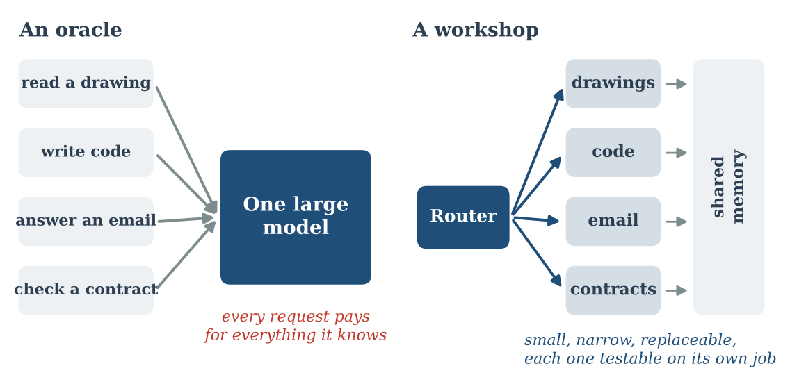
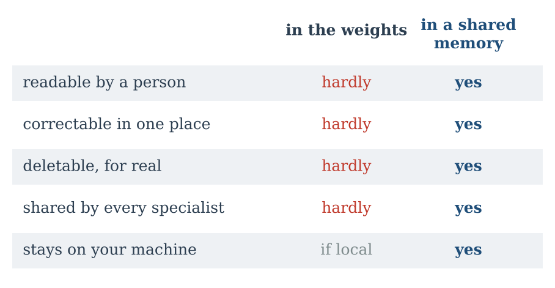

::: {.callout-note appearance="simple"}
**Essay, October 2026.** A companion to [Fast AI](../2026-10-11-fast-ai/index.qmd), which argued that the large model should build the memory rather than replace it. The figures are schematics, not measurements; the code is here: [figs.py](figs.py).
:::

**In short.** I believe the future of AI is, to a large extent, local. But when people talk about local AI, they usually picture one big model made small enough to fit on a laptop. I see it differently. I think local AI will look like a workshop: several small models, each very good at one thing, connected to a memory they share, and able to keep learning from the work they do. Size is not the right unit. What matters is how the parts are organised, what they remember, and how they improve.

::: {.callout-tip appearance="simple" icon="false"}
## Key takeaways

- Local AI should not be one big model made small. It should be designed for the machine in front of you from the start.
- A small model that does one job well runs on hardware you already own, and can be tested precisely on that job.
- Specialists need a shared memory, outside the weights, that people can read, correct and delete.
- Memory is not learning. A local system should also turn what it has seen into skill, slowly and safely, the way we turn experience into habit.
- Frontier models do not disappear. They become teachers and occasional consultants, not the place where every thought happens.
:::

## 1. The wrong picture

Models are getting smaller for the same capability, and quickly. Better training, better architectures, quantisation and better chips all push in the same direction. What needed a data centre a few years ago now runs on a good laptop. I am convinced this will continue, and that a large part of AI will move closer to where the work happens: onto our laptops, phones, machines and private servers.

But I think the picture most of us have in mind is the wrong one. We imagine one giant brain, waiting to be compressed into a smaller box. The question becomes "how much of the big model can I run locally?", and the answer is always "a bit less than you would like, but wait a year."

I would rather ask a different question: *what would intelligence look like if it were designed for the machine in front of me from the start?*

## 2. How the Jura built watches

Where I live, in the Swiss Jura, watches were not made by one master in one room. For two centuries the region worked by *établissage*. One family made springs, another cut wheels, another finished cases, another set the jewels. Each workshop was small and very good at one thing. An *établisseur* knew who did what, sent out the work and assembled the result.

Nobody in that system needed to know everything. It worked because of three things: specialists who were excellent at their part, someone who knew how to route the work, and a shared body of knowledge, written and unwritten, about standards, tolerances and what had gone wrong before.

That is how I picture local AI. Not an oracle in a box. A workshop.

## 3. Many small specialists

Today, a general model is asked to do everything: read a drawing, write code, answer an email, check a contract. It is impressive that one model can do all of this. It is also wasteful. Every request pays for all the knowledge it does not use.

A specialist pays only for what it needs. A model that only reads technical drawings, or only writes queries against one database, or only sorts support tickets for one product, can be small. It needs far less training data. It can be evaluated precisely, because its job is narrow. And it can run on a laptop, a phone, or the industrial PC next to a machine tool, today, not in some future generation of hardware.

I have seen this in my own research. The transformer networks I used to measure position in digital holograms were small enough to run on a CPU, and they were built for one narrow task and nothing else. Narrow is not a weakness. It is a design choice.

An ecosystem of specialists also has practical advantages that one large model cannot offer:

- **Replace one part at a time.** When a better speech model appears, you swap the speech model. The rest stays as it was, already tested.
- **Fail visibly.** When something goes wrong, you can see which specialist produced the wrong output, instead of searching inside one opaque model.
- **Spend where it matters.** Most requests are routine. A small router can send them to small models, and keep the expensive reasoning for the rare case that needs it.

The router matters as much as the specialists. Like the *établisseur*, it does not need to be the smartest part of the system. It needs to know who is good at what, and when to say "this one is new, ask someone bigger."

## 4. A memory they share

Specialists alone are not enough. A workshop without a logbook repeats its mistakes.

In [Fast AI](../2026-10-11-fast-ai/index.qmd) I argued that the large model should be used to build a structured memory, such as a knowledge graph that experts can inspect and correct, instead of reasoning from scratch on every run. In a local ecosystem, that memory becomes the common ground. The drawing reader writes what it found. The planner reads it. The assistant that talks to you knows what the others already decided, and why.

Two kinds of memory matter here:

- **Knowledge**: facts, rules, relations. "This customer always uses this material." "This tolerance is critical on this part."
- **Episodes**: what happened. "Last Tuesday this toolpath was rejected because of a collision near the clamp."

Keeping this memory outside the weights is not a technical detail. It is what makes the system trustworthy. You can read it. You can correct a wrong fact in one place and every specialist benefits. You can delete something, and it is really gone, which is very hard to promise for anything a model has absorbed into its parameters. And because it lives on your machine, it never has to leave it.

For me, this is the strongest argument for local AI. Privacy is not only protection. It is the condition for memory. People and companies will only let a system remember everything useful if they control where that memory lives.

## 5. A way to keep learning

This is the part I find most interesting, and the hardest.

A memory lets a system *look things up*. It does not let it *get better*. An expert does not consult a notebook for every decision; over time, what was in the notebook becomes instinct. Today's models mostly do not work like this. They are trained once, frozen, and shipped. Whatever they pick up afterwards stays in the conversation and is forgotten when it ends.

A local ecosystem can do better, because it sees the same kind of work every day, and because its specialists are small enough to retrain. I imagine a loop with two speeds:

1. **Fast, during the day.** The specialists work. Successes, corrections and failures are written to the memory as episodes. Nothing in the models changes yet.
2. **Slow, at night.** When the machine is idle, the system consolidates. It selects the episodes worth learning from, updates the affected specialist with a small, cheap adjustment, and tests it against everything it was already good at. If the new version is better and has not forgotten anything, it is kept. If not, it is thrown away.

This is not a new idea. It is roughly what sleep seems to do for us: replay the day, keep what matters, strengthen it, and let the rest go. What is new is that small local models make it practical. Retraining a giant model every night is absurd. Adjusting a small specialist with a few hundred examples is not.

The difficulties are real, and I do not want to hide them. Models that keep learning tend to forget what they knew before; researchers call it *catastrophic forgetting*. A system that learns from its own outputs can drift, slowly, in the wrong direction. And a model that changes every night is harder to certify than one that never changes. These are exactly the reasons the slow loop has to be careful: small updates, strict tests, a memory that keeps the evidence, and the ability to roll back. Narrow specialists help here too. It is much easier to check that a ticket sorter still works than to check that a general model still knows everything.

## 6. Where the big models fit

None of this makes the frontier models useless. It changes their role.

They become *teachers*: they generate training data and pass their skills on to the specialists, once, before the specialists go to work. They become *architects of memory*: they read the documents and build the first version of the knowledge graph. And they become *consultants*: when the router meets something truly new, it can ask, with the user's permission, and the answer becomes an episode the local system can learn from.

The big model is called rarely, for the hard and the new. The local workshop handles the rest, every day, and gets a little better each night.

## 7. Not one brain, a well-run workshop

I do not think we should wait for the big brain to come to us. The future I believe in is already within reach, and it is organised differently. Small specialists that are excellent at one thing. A router that knows who does what. A memory you own, can read and can correct. And a careful, slow loop that turns yesterday's work into tomorrow's skill.

The question will not only be "how much intelligence can I run locally?" It will be "how well is my local intelligence organised, what does it remember, and how does it learn?"

The Jura did not build some of the world's best watches with one genius. It built them with many small workshops, a clear way of sending work between them, and knowledge that grew over generations. I believe local AI will work the same way.
