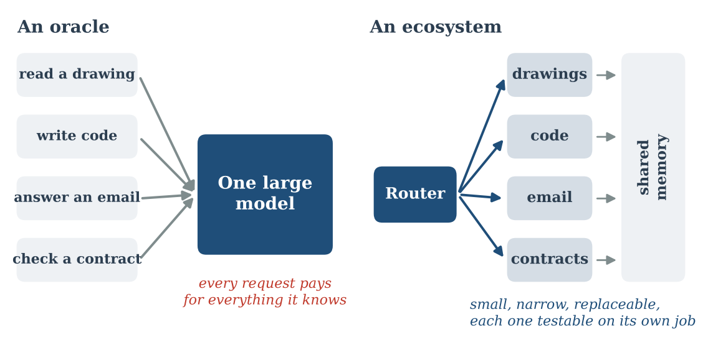
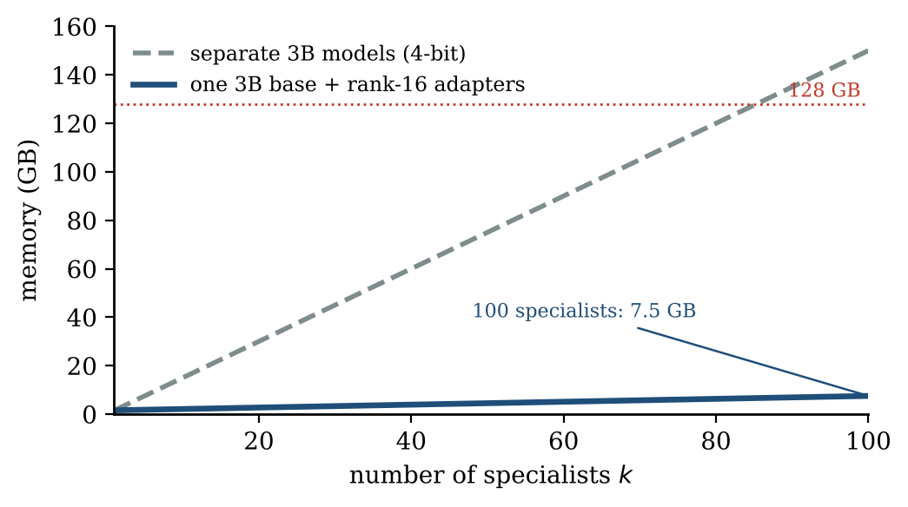
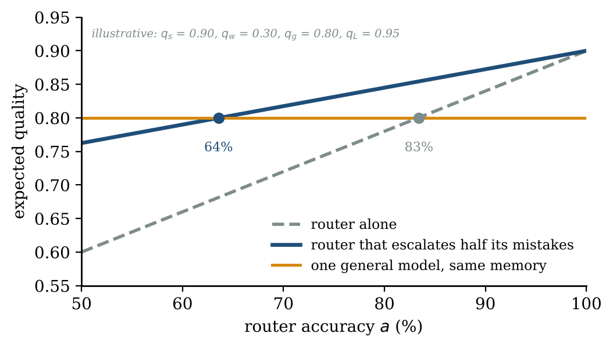
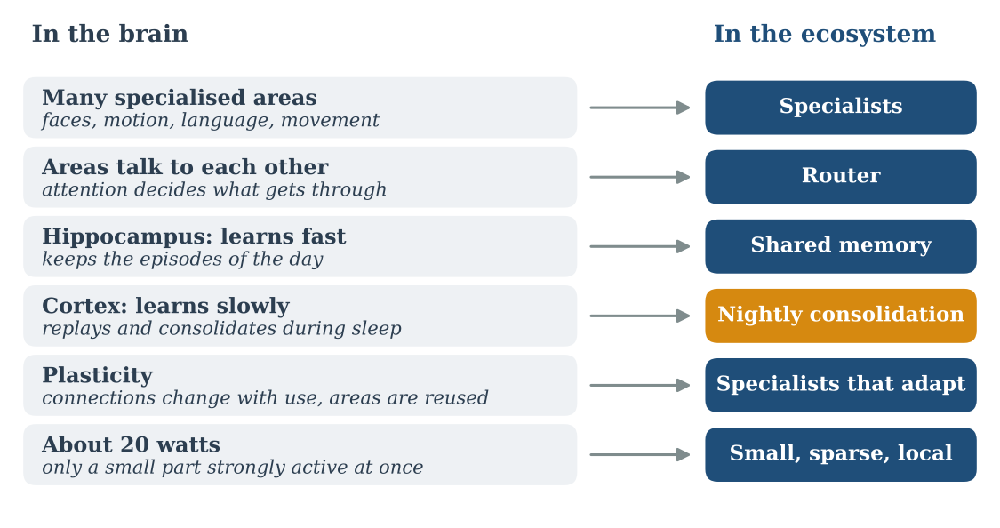

::: {.callout-note appearance="simple"}
**Essay, October 2026.** A companion to [Fast AI](../2026-10-11-fast-ai/index.qmd). All figures are my own, drawn with the code in [figs.py](figs.py). Where a figure or a sentence uses numbers from someone else's work, the source is cited next to it and listed in the references. Where numbers are my own illustrative assumptions, the caption says so.
:::

**In short.** I believe the future of AI is, to a large extent, local. But when people talk about local AI, they usually picture one big model made small enough to fit on a laptop. I see it differently: many specialised models, a memory they share, a thin harness around them, and a careful loop that lets them keep learning from the work they do. I have four reasons. The architectures of today's largest models already moved in this direction. Simple arithmetic about memory and bandwidth favours it on a local machine. A thin harness can help small models where it no longer helps large ones. And our own brain most likely works this way: a huge set of specialised parts, a fast memory, a slow learner, and plasticity everywhere.

::: {.callout-tip appearance="simple" icon="false"}
## Key takeaways

- The largest models already split themselves into experts. DeepSeek-V3 uses about 5.5% of its parameters for each word [@deepseek2024]. An ecosystem takes the same idea further, with parts you can load, swap, test and update one by one.
- On a laptop, generating text is limited by memory bandwidth, not computation. Speed is at most bandwidth divided by the bytes read per word, so small active models win.
- In a simple capacity model, a general model needs roughly $1/f$ times more domain capacity than a specialist, where $f$ is the share of its training devoted to that domain.
- Recent work suggests elaborate harnesses add little around strong frontier models [@brilliantov2026]. For small local models, I argue the opposite: verifiers, tools and structure are where they gain the most.
- Our brain seems to combine specialised areas, a domain-general coordinating network, a fast memory, a slow learner that consolidates during sleep, and plasticity [@fedorenko2024; @duncan2020; @mcclelland1995; @dehaene2007].
- Memory belongs outside the weights, where people can read, correct and delete it. Learning belongs in a slow, tested loop.
:::

## 1. The wrong picture

Models are getting smaller for the same capability. Xiao and colleagues measured this as *capability density*, and found that for open models it doubled roughly every three to three and a half months between 2023 and 2025 [@xiao2024]. Better training, better architectures, quantisation and better chips all push in the same direction. I am convinced a large part of AI will move closer to where the work happens: onto our laptops, phones, machines and private servers.

But the picture most of us have in mind is one giant brain, waiting to be compressed into a smaller box. The question becomes "how much of the big model can I run locally?", and the answer is always "a bit less than you would like, but wait a year."

I would rather ask a different question: *what would intelligence look like if it were designed for the machine in front of me from the start?*

{fig-alt="Two diagrams. An oracle: four tasks all go to one large model. An ecosystem: a router sends each task to a small specialist (invoices, code, email, contracts), all connected to a shared memory."}

## 2. What I mean by an ecosystem

By an ecosystem, I mean five parts working together on one machine:

1. **Specialists.** Small models, or adapters on a shared base model, each good at one job: reading invoices, writing queries, transcribing speech, a company's own domain.
2. **A router.** A small model that decides which specialist handles a task, and when to escalate.
3. **A shared memory.** Knowledge and episodes stored outside the weights, readable and correctable by people.
4. **A thin harness.** The tools, checks and permissions around the models: run the tests, validate the output, keep the data local.
5. **A consolidation loop.** A slow process, for example at night, that turns verified experience into small, tested updates of the specialists.

A frontier model can stay outside, as a teacher and an occasional consultant.

{fig-alt="Diagram of a local machine: you send a task to a router, which picks a vision, language, planner or domain specialist; all share a memory; nightly consolidation updates them. Outside, a frontier model distils knowledge and is consulted rarely."}

# Part I · Why I think so

## 3. Today's largest models already point this way

**From dense to mixtures of experts.** A classic language model is *dense*: to produce each word, it uses every one of its parameters. Many of today's largest models are *mixtures of experts* instead. The idea goes back to Shazeer and colleagues [@shazeer2017] and was scaled up in the Switch Transformer [@fedus2022]. Inside, the model is split into many sub-networks, and for each word a small gate chooses a few of them.

Two published examples make the point:

- **Mixtral 8x7B** has 46.7 billion parameters, but each word uses about 12.9 billion: two of its eight experts per layer [@jiang2024].
- **DeepSeek-V3** has 671 billion parameters, but each word uses about 37 billion [@deepseek2024]. Its design is telling: in each expert layer, one *shared* expert is used for every word, and 8 of 256 *routed* experts are chosen for that word. A common core, plus specialists picked on demand.

{fig-alt="Three grids. Dense model: all cells filled. Mixture of experts: all loaded but only a few cells active. Ecosystem: separate specialist boxes, only one active."}

![**Figure 4.** Share of parameters used for each word. Mixtral and DeepSeek-V3 values are computed from the published parameter counts [@jiang2024; @deepseek2024]. The cortex value is a rough estimate of the share of neurons that can be strongly active at the same time, from energy constraints [@lennie2003]; it is debated and shown hatched. Chart my own.](figures/fig04.png){fig-alt="Bar chart of share active per word: dense model 100%, Mixtral 8x7B 27.6%, DeepSeek-V3 5.5%, cortex estimate about 1% (hatched)."}

The people who build the largest models have concluded that not everything should work on everything. But a mixture of experts is still one model. All its experts must be loaded in memory, even if only a few work at a time. They are trained together, so you cannot replace one without touching the others. And they are not specialists a person would recognise: an expert is a part of the network that training happened to route certain words to.

**The other pieces already exist too.** What I call an ecosystem is mostly an assembly of things that already work:

- **Shared base plus adapters, in production.** Apple's on-device model has about 3 billion parameters and uses small, task-specific *LoRA adapters* that are swapped in for each task; a rank-16 adapter takes tens of megabytes [@gunter2024; @hu2021].
- **Many adapters on one machine.** S-LoRA showed how to serve thousands of adapters on top of one base model [@sheng2023].
- **Experts trained separately.** Branch-Train-MiX trains domain experts in parallel from a common starting model, then combines them [@sukhbaatar2024].
- **Routing between models.** RouteLLM learns when a query can go to a cheaper model, and reports cost reductions of more than two times on some benchmarks without a loss in quality [@ong2024]. FrugalGPT reports matching the best single model with large cost savings by cascading models [@chen2023].
- **Memory outside the weights.** RETRO, with retrieval from a large text database, performs comparably to GPT-3 on the Pile benchmark with about 25 times fewer parameters [@borgeaud2022; @lewis2020].

None of these is the whole ecosystem. Together, they show that each part is not speculation. Researchers at NVIDIA recently made a similar case for agents: most of what agents do is a small number of repetitive, specialised tasks, which small models can handle more economically, with larger models called only when needed [@belcak2025].

## 4. The arithmetic of a laptop: bandwidth

This is the argument I find most convincing, because it is simple arithmetic.

When a model generates text for one person, each new word requires reading all the active weights from memory once, and doing roughly two operations per weight. With weights stored at $b$ bits, a model with $N_{\text{active}}$ active parameters reads $N_{\text{active}} \cdot b/8$ bytes per word. The speed is therefore bounded by the memory bandwidth $B$:

$$
\text{words per second} \;\le\; \frac{B}{N_{\text{active}} \cdot b/8}.
$$

Is bandwidth really the limit, and not computation? The roofline model answers this by comparing operations per byte [@williams2009]. Decoding for one user at 4 bits does about two operations per half byte, so about 4 operations per byte read. A laptop GPU that can do tens of trillions of operations per second, with a bandwidth of about 500 GB/s, needs tens of operations per byte to be kept busy. Decoding offers far fewer, so it waits for memory.

Take a laptop with 128 GB of memory and up to 546 GB/s of bandwidth, the published figures for Apple's M4 Max [@apple2024m4]. I use 500 GB/s and 4-bit weights:

| Model | Active parameters | Read per word | Upper bound |
|---|---|---|---|
| 3B specialist | 3B | 1.5 GB | ≈ 330 words/s |
| 8B specialist | 8B | 4 GB | ≈ 125 words/s |
| 70B dense model | 70B | 35 GB | ≈ 14 words/s |
| DeepSeek-V3 (MoE) | 37B of 671B | 18.5 GB | ≈ 27 words/s, but 335 GB does not fit in 128 GB |

![**Figure 5.** Upper bound on generation speed when every word requires reading all active weights once, at 500 GB/s and 4-bit weights. Open circle: does not fit in 128 GB. Real speeds are lower; computation, the conversation's cache and software all cost something. My own calculation from the formula above; DeepSeek-V3 parameter counts from [@deepseek2024].](figures/fig05.png){fig-alt="Log-log line of tokens per second against billions of parameters read per token: 3B and 8B specialists over 100 tokens per second, 70B dense about 14, and an MoE with 37B active marked as not fitting in 128 GB."}

Two consequences follow. The same 128 GB that cannot hold one frontier model can hold about thirty 8-billion-parameter specialists, each of them fast. And this wall is not going away soon: over two decades, peak compute of server hardware grew about 3.0 times every two years, but memory bandwidth only about 1.6 times [@gholami2024]. Techniques such as speculative decoding [@leviathan2023] help, but they help small models just as much as large ones.

## 5. The arithmetic of capacity: why specialists can be small

The second argument is about where a model spends its capacity.

Michaud and colleagues proposed a useful way to think about scaling: knowledge comes in discrete units, which they call *quanta*, used with very different frequencies, and a model learns them roughly in order of how often they are needed [@michaud2023]. Here is a simple consequence, in my own words and with my own simplifications.

Suppose a task needs two kinds of quanta: a shared core (language, basic reasoning), which takes $N_{\text{shared}}$ parameters, and domain knowledge, which takes $N_{\text{domain}}$. A specialist needs both:

$$
N_{\text{specialist}} \approx N_{\text{shared}} + N_{\text{domain}}.
$$

A general model is trained on everything, and the domain is only a share $f$ of what it sees. In the simplest symmetric case, where many domains each have a share $f$ and similar structure, the general model reaches the same depth in this domain only when it has learned as deep into every other domain too:

$$
N_{\text{general}} \approx N_{\text{shared}} + \frac{N_{\text{domain}}}{f}.
$$

With illustrative values of 2 billion for the core and 1 billion for the domain, a domain that is 1% of the general model's training needs about 102 billion parameters for the same depth, against 3 billion for the specialist.

![**Figure 6.** A simple capacity model. Parameters needed for the same depth in one domain, for a general model and for a specialist, as a function of the domain's share $f$ of the general model's training. Illustrative values, my own: $N_{\text{shared}}$ = 2B, $N_{\text{domain}}$ = 1B, no transfer between domains beyond the shared core. Model inspired by the quanta view of scaling [@michaud2023].](figures/fig06.png){fig-alt="Log-log chart of parameters needed against the domain's share of training. The general model's curve falls from 1000B at 0.1% to 3B at 100%; the specialist stays flat at 3B. At 1%: about 102B against 3B."}

The model is crude, and its main assumption, that domains do not help each other beyond the shared core, is not fully true. Knowledge does transfer between domains, and a general model like GPT-4, carefully prompted, has outperformed specialist medical models on medical benchmarks [@nori2023]. That is exactly why the formula keeps $N_{\text{shared}}$: a good specialist is not trained from scratch, it starts from a strong shared core.

The published evidence is consistent with the direction of the argument. A 770-million-parameter model trained with explanations from a much larger model outperformed few-shot prompted 540-billion-parameter PaLM on a benchmark, using only 80% of the training data [@hsieh2023]. A 1.3-billion-parameter model trained on carefully chosen data reached 50.6% on the HumanEval coding benchmark [@gunasekar2023]. Narrow, well-taught models can be very small.

## 6. The arithmetic of many specialists: adapters

If every specialist were a separate model, memory would fill up quickly. Adapters solve much of this.

A LoRA adapter replaces the update of a weight matrix of size $d_{\text{in}} \times d_{\text{out}}$ by two thin matrices of rank $r$ [@hu2021]. Its size relative to the matrix is

$$
\frac{r\,(d_{\text{in}} + d_{\text{out}})}{d_{\text{in}}\,d_{\text{out}}} \;\approx\; \frac{2r}{d} \quad \text{for a square matrix}.
$$

With $r = 16$ and $d = 3072$, that is about 1%. Applied to a 3-billion-parameter base model, an adapter has roughly 30 million parameters, about 60 MB at 16 bits, consistent with the "tens of megabytes" Apple reports for its rank-16 adapters [@gunter2024].

{fig-alt="Memory against number of specialists. Separate 3B models rise linearly past the 128 GB line at about 85; one base plus adapters stays nearly flat, 7.5 GB for 100 specialists."}

One hundred specialists as adapters take about 7.5 GB; as separate models, 150 GB. There is a trade-off, and it is worth knowing: adapters learn less than full fine-tuning, but they also forget less of what the base model knew [@biderman2024]. For a system that must keep learning without breaking, forgetting less is a feature.

## 7. The arithmetic of routing

An ecosystem is only as good as its router. A simple model makes this precise.

Let $a$ be the router's accuracy, $q_s$ the quality when a task reaches the right specialist, and $q_w$ the quality when it reaches the wrong one. The expected quality is

$$
q = a\,q_s + (1-a)\,q_w.
$$

The ecosystem beats one general model of quality $q_g$ that runs at a similar speed only if

$$
a \;>\; a^{*} = \frac{q_g - q_w}{q_s - q_w}.
$$

With illustrative values $q_s = 0.90$, $q_w = 0.30$ and $q_g = 0.80$, the router must be right more than 83% of the time. If the router also knows when it is unsure, and sends half of its mistakes to a larger model with quality $q_L = 0.95$, the threshold drops to about 64%.

{fig-alt="Expected quality against router accuracy. The general model is flat at 0.80. A router that escalates half its mistakes passes it at 64% accuracy; a router alone only at 83%."}

The lesson is not the exact numbers, which are mine. It is the shape: a router that knows its own uncertainty is worth more than a slightly better specialist. This is also what makes published routing work encouraging [@ong2024; @chen2023].

## 8. The harness: thin around strong models, essential around small ones

A recent study from EPFL and Apple asks how much of a *harness* (the orchestrators, sub-agents and retrieval layers built around a model) a strong agent needs for machine-learning engineering tasks. Under an equal time budget and the same frontier model, the elaborate open-source harnesses they tested gave no advantage over a single session of a minimal coding agent with direct access to read, write and run commands [@brilliantov2026]. Their conclusion is that the model is the main driver of performance, and that elaborate harnesses around strong models give poor returns on current benchmarks.

At first sight, this goes against an ecosystem. If structure around a model does not help, why build an ecosystem at all? I read it differently, for three reasons.

**First, it is a result about strong models.** The study holds the frontier model fixed. It says that a strong model has absorbed much of what the scaffolding was doing. That fits Sutton's "bitter lesson": general methods that use more computation tend to beat hand-built structure in the long run [@sutton2019]. It says much less about a 3-billion-parameter model on a laptop.

**Second, small models gain the most from the right kind of harness.** Several results point that way:

- The design of the interface matters: SWE-agent showed that giving a model well-designed commands to view, edit and test code improved results on software tasks, without changing the model [@yang2024].
- A verifier turns attempts into results: with repeated attempts checked by the project's own tests, an open model went from solving 15.9% of SWE-bench Lite issues in one attempt to 56% in 250 attempts, above the best single attempt reported at the time, 43% [@brown2024].
- Extra computation at the time of answering, used well, allowed a smaller model to outperform a 14 times larger one, on problems where the smaller model already had a reasonable success rate [@snell2024].
- Apple's framework for its on-device model offers guided generation and constrained tool calling, which keep a small model's output within a valid structure [@apple2025].

![**Figure 9.** Repeated attempts with a verifier. The two points are results reported by Brown et al. for SWE-bench Lite [@brown2024]. The dashed line is my own calculation of what would happen if attempts were independent, $1-(1-p)^k$ with $p = 0.159$; the gap shows that attempts are strongly correlated. Chart my own.](figures/fig09.png){fig-alt="Issues solved against attempts, log scale. Reported results: 15.9% with one attempt, 56% with 250. The dashed independent-attempt curve rises to 100% quickly. A dotted line marks the best single attempt at 43%."}

The arithmetic is worth a sentence. If a single attempt succeeds with probability $p$ and attempts were independent, $k$ attempts would succeed with probability $1-(1-p)^k$. In practice attempts are correlated, so the real gain is smaller, as the figure shows. But on a local machine, where a small specialist is fast and a test can check each answer, a few extra attempts cost very little.

**Third, some of the harness can never be absorbed into a model.** A persistent memory that lasts beyond one conversation. Permissions over what may leave the machine. Tests that decide whether an output or an update is accepted. The local data itself. However strong models become, these stay outside.

![**Figure 10.** My own view of the harness, as a schematic. Scaffolding for reasoning (orchestrators, sub-agents, retries) adds much to small models and little to strong ones. Structure no model can absorb (memory, permissions, tests, local data) keeps its value. The right end is consistent with the finding of [@brilliantov2026]; the rest of the curve is my hypothesis, not data.](figures/fig10.png){fig-alt="Schematic of what the harness adds against model strength. Reasoning scaffolding falls from high for small specialists to near zero for frontier models; structure no model can absorb stays flat."}

So my conclusion is a design rule: **keep the harness thin, and keep only what earns its place.** Scaffolding that compensates for weak reasoning should be removable, and removed as specialists get better. Structure that gives memory, verification and control should stay.

## 9. Our own brain

The last reason is closer to home. When I look at how our brain seems to be organised, it does not look like one dense model. It looks much more like an ecosystem. I want to be careful here, because biology does not prove anything about software, and the brain is not a set of neat boxes.

**Many specialised parts.** Neuroscience has found areas that respond to specific things. A classic example is an area of the visual cortex that responds much more strongly to faces than to other objects [@kanwisher1997]. Damage to such areas can remove one ability and leave others almost intact. At the same time, representations are also distributed and overlapping across areas [@haxby2001]. Specialised, but heavily connected.

**Language and thinking are handled by different networks.** One of the most striking recent results for my argument comes from the study of language. Brain imaging reliably finds a network that is engaged when we read or listen to sentences, and it is largely not engaged when we solve problems or reason; people who lose language through brain damage can still reason [@fedorenko2024]. Mahowald and colleagues drew the consequence for AI: large language models are very good at the *form* of language, but their ability to reason and use it in the world is uneven, and models that work like humans may need separate mechanisms for the two [@mahowald2024].

**And a general-purpose network, too.** The brain is not only specialists. A *multiple-demand* network, spread over frontal and parietal areas, is engaged by many different demanding tasks and seems to help assemble the right parts for the problem at hand [@duncan2020]. In the ecosystem, that is the role of the shared core and the router: one general part that coordinates many specialised ones.

**Specialisation may simply be efficient.** A recent experiment makes this more than an analogy. Dobs and colleagues trained artificial neural networks to recognise both faces and objects. Without being told to, the networks split themselves into separate systems for faces and for objects, much as the brain does [@dobs2022]. Their interpretation is that specialisation is what good optimisation tends to produce when tasks are different enough.

**Probably a very large number of units.** Mountcastle proposed that the cortex is built from a repeated basic unit, the cortical column [@mountcastle1997]. Hawkins goes further and suggests that each column builds its own model of the world, and that they reach decisions together [@hawkins2021]; his team has since started an open project that builds AI from many such repeated *learning modules* [@clay2024]. This is a theory, and it is debated. But the picture of a large number of similar units, each specialised by what it receives, is widely shared.

**A fast memory and a slow learner.** The theory of *complementary learning systems* proposes that the hippocampus learns new episodes quickly, while the neocortex learns slowly, by replaying those episodes over time [@mcclelland1995; @kumaran2016]. Replay during sleep was first observed in the hippocampus of rats [@wilson1994], and it has since been measured in humans as well, during rest [@liu2019; @schuck2019]. Sleep seems to play an active role in moving memories from the fast system to the slow one [@klinzing2019]. One reason for two systems is precisely to avoid what AI researchers call catastrophic forgetting [@mccloskey1989].

**Plasticity.** Connections change with use. And when we learn to read, a region of the visual cortex becomes specialised for written words, a process Dehaene and Cohen call *neuronal recycling* [@dehaene2007]. New specialists are not only present from birth; they are formed during life.

**Sparse and frugal.** The human brain has about 86 billion neurons [@herculano2009] and runs on roughly 20 watts [@balasubramanian2021]. Energy budgets suggest that only a small share of cortical neurons can be strongly active at the same time, perhaps around one percent, although the exact figure is debated [@lennie2003; @attwell2001].

{fig-alt="Table mapping brain features to ecosystem parts: specialised areas to specialists, domain-general network to shared core and router, hippocampus to shared memory, cortex to nightly consolidation, plasticity to adapting specialists, 20 watts to small, sparse, local."}

Researchers who work on lifelong learning in machines draw the same lesson from biology: memory systems that learn at different speeds, replay, and modular, adaptable parts are among the mechanisms they consider most promising [@kudithipudi2022]. If our best example of general intelligence is most likely a huge set of specialised, plastic sub-models, with a general coordinator, a fast memory and a slow learner, then I find it hard to believe that the best local AI will be one frozen, dense block.

# Part II · The ecosystem in practice

## 10. A memory outside the weights

Specialists need a memory they share. In [Fast AI](../2026-10-11-fast-ai/index.qmd) I argued that a large model should be used to build a structured memory, such as a knowledge graph experts can inspect and correct. In a local ecosystem, that memory becomes the common ground, and plays the role of the fast memory in section 9. Two kinds matter:

- **Knowledge**: facts, rules, relations. "This customer always pays within 30 days."
- **Episodes**: what happened. "Last Tuesday this invoice was rejected because the supplier's VAT number did not match."

Keeping this memory outside the weights is what makes the system trustworthy. You can read it. You can correct a fact in one place, and every specialist benefits. You can delete something and know it is gone, which is very hard to guarantee once data has been used to train a model; removing its influence afterwards is an open research problem [@bourtoule2021]. Retrieval also lets small models know far more than their weights hold [@borgeaud2022; @lewis2020].

![**Figure 12.** Where knowledge lives matters. My own summary of the properties described in this section; on deletion, see [@bourtoule2021].](figures/fig12.png){fig-alt="Table comparing knowledge in the weights with a shared memory. Readable, correctable, deletable, shared by every specialist: hardly in the weights, yes in memory. Stays on your machine: if local, against yes."}

This is, for me, the strongest reason for running it locally. Privacy is not only protection. It is the condition for memory. People and companies will only let a system remember everything useful if they control where that memory lives.

## 11. A way to keep learning

A memory lets a system *look things up*. It does not let it *get better*. Today's models are trained once, frozen, and shipped. A local ecosystem can do better, because it sees the same kind of work every day, and because its specialists are small enough to update. I imagine a loop with two speeds, inspired by section 9:

1. **Fast, during the day.** The specialists work. Successes, corrections and failures are written to the memory as episodes. Nothing in the models changes.
2. **Slow, at night.** The system selects verified episodes, mixes them with examples of what the specialist already does well, updates the adapter, and tests the result against everything it was already good at. If it is better and has not forgotten anything, it is kept. If not, it is rolled back.

Each step has support in existing work. Mixing old examples with new ones, *replay*, is one of the most reliable ways to limit forgetting [@rolnick2019]; brain-inspired versions of replay go further and replay internal representations instead of stored examples [@vandeven2020]. Other methods protect the weights that matter most for old tasks [@kirkpatrick2017]. Adapters forget less than full fine-tuning [@biderman2024]. And using a machine's idle time is starting to be studied as a resource in itself: *sleep-time compute* lets a model think about its context before questions arrive, reducing the work needed when they do [@lin2025]. A broad review of continual learning describes the trade-offs between these approaches [@wang2024].

The test step deserves a little arithmetic, because it is where narrow specialists have a real advantage. If a specialist is right with probability $p$ on a test set of $n$ examples, the standard error of the measured accuracy is

$$
\sigma = \sqrt{\frac{p(1-p)}{n}}.
$$

With $p = 0.9$ and $n = 2000$, $\sigma \approx 0.7$ percentage points, so a drop of 2 points stands out at about three standard errors. Building 2000 good test cases for one narrow job is realistic. Building them for every ability of a general model is not.

{fig-alt="Step chart of quality over 30 days. A frozen model stays flat; the specialist improves a little each night, with one failed update on night 17 caught by the test and rolled back."}

The risks are real. A model trained repeatedly on its own outputs can degrade, a problem known as *model collapse* [@shumailov2024]. The risk is much lower when real data are kept and accumulated alongside generated data, instead of being replaced by it [@gerstgrasser2024]. This is one more reason for a memory that keeps the real episodes, and for a loop that learns only from episodes verified by a test, a person or the real world, never from its own unchecked answers. And a model that changes every night is harder to certify. Small updates, strict tests, a memory that keeps the evidence, and the ability to roll back are not optional.

## 12. Where the big models fit

None of this makes frontier models useless. It changes their role.

They become *teachers*: their knowledge can be passed to small models by distillation [@hinton2015], including their step-by-step explanations [@hsieh2023]. The DeepSeek-R1 team, for example, released a family of small models, from 1.5 to 70 billion parameters, trained on the reasoning of its large model [@deepseekr1]. They become *architects of memory*: they read the documents and build the first version of the knowledge graph. And they become *consultants*: when the router meets something new, or a problem that needs broad reasoning across many domains, it can ask, with the user's permission, and the verified answer becomes an episode the local system can learn from.

## 13. What would prove me wrong

An essay that argues for a future should say what would change the author's mind. Mine would change if:

- general small models kept beating ecosystems of specialists using the same memory, even with good routing;
- routers could not reach the accuracy that the arithmetic in section 7 requires on real, messy work;
- nightly updates could not pass strict regression tests without forgetting, even with replay and adapters;
- memory bandwidth on consumer devices grew fast enough that a single large model ran comfortably everywhere.

I do not think these will happen, but they are measurable, and I intend to keep watching.

## 14. Conclusion

I do not think we should wait for the big brain to come to us. The future I believe in is already within reach, and it is organised differently: specialists that are excellent at one thing, a router that knows who does what and when it does not know, a memory you own, a harness that is thin but keeps the essentials, and a careful loop that turns yesterday's verified work into tomorrow's skill.

The question will not only be "how much intelligence can I run locally?" It will be "how well is my local intelligence organised, what does it remember, and how does it learn?" Our own brain, most likely, already answers it that way.

::: {.read-next}
**Read next** · [Fast AI](../2026-10-11-fast-ai/index.qmd)  
Why the large model should build the memory once, instead of reasoning through every run.
:::

## References

::: {#refs}
:::
