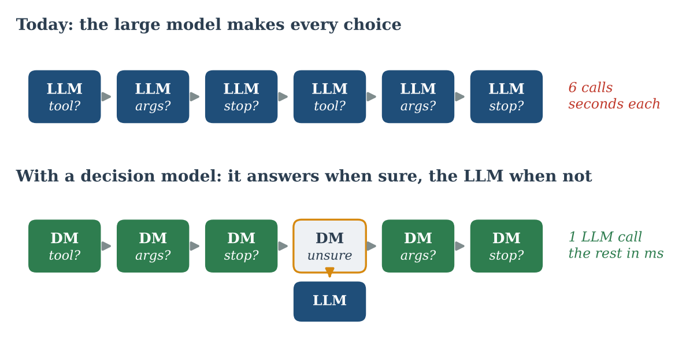
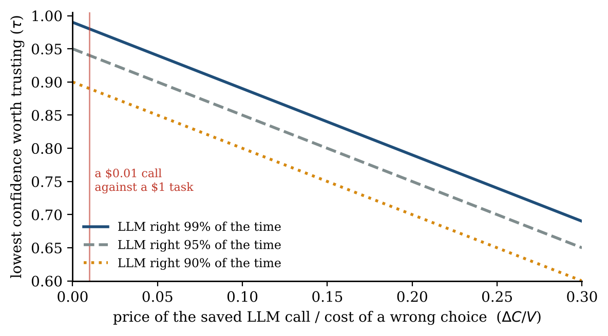
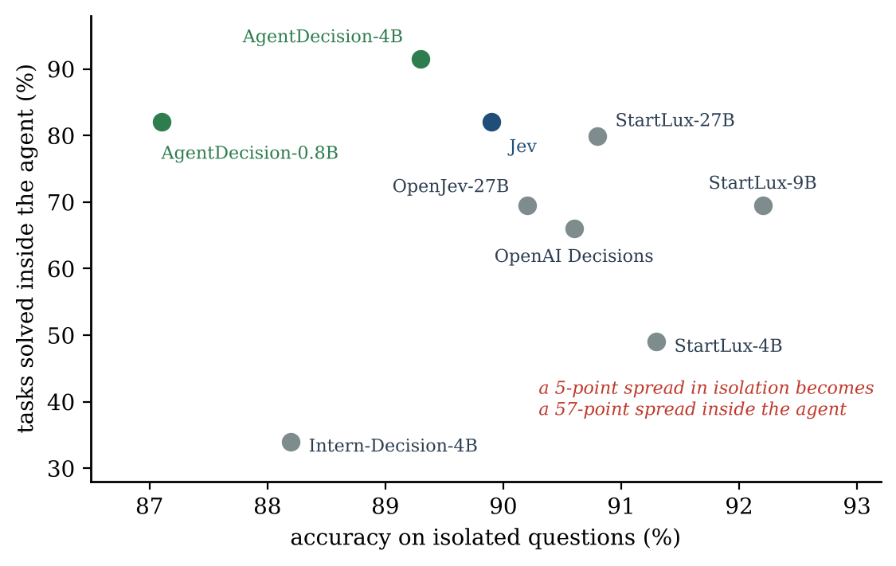
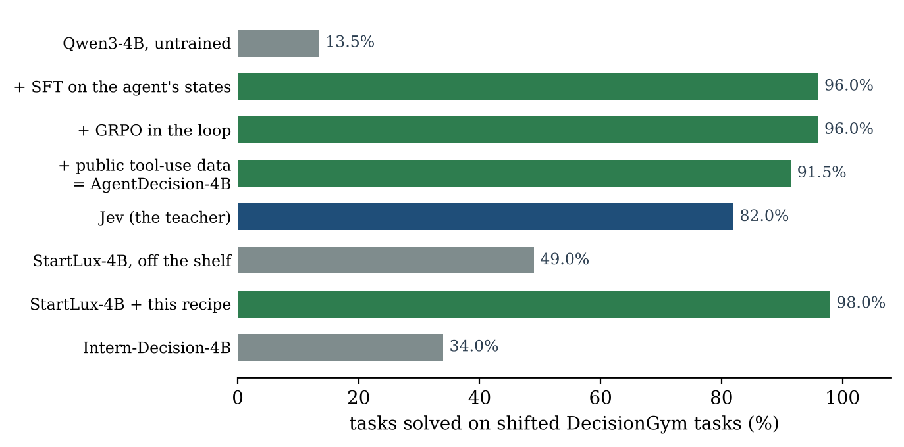
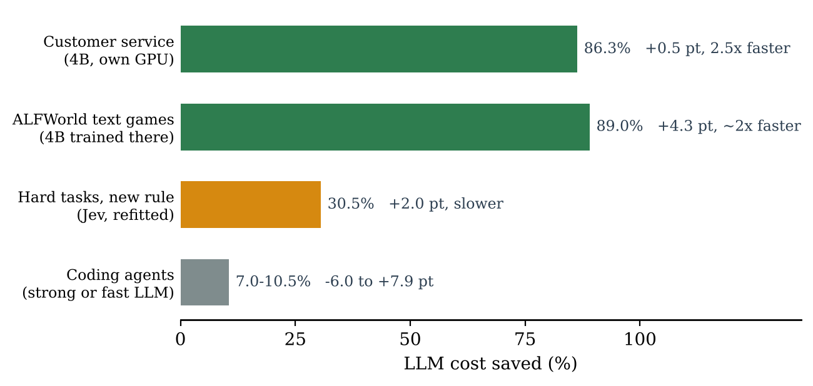

::: {.series-note}
**Agentic Coding** · Part 1 of 5 · [Read the whole series](../../agentic-coding.qmd)
:::

::: {.callout-note appearance="simple"}
**Analysis, October 2026.** An analysis of [Zhu et al., *JevAgentHarness: Benchmarking, Deploying and Training Decision Models That Share Control with LLMs*](https://arxiv.org/abs/2610.21412) (UIUC, Princeton, Google; arXiv 2610.21412, 15 October 2026), read in the light of my earlier essay [Fast AI](../2026-10-11-fast-ai/index.qmd). Unless stated otherwise, numbers come from that paper. Figures are my own, drawn with the code in [figs.py](figs.py).
:::

**Abstract.** Most of an AI agent's calls to a large language model end in a multiple-choice pick: which tool, which argument, stop or continue. Zhu and colleagues ask whether these picks can be handed to a small *decision model* that answers in milliseconds, without losing task success. Their answer is yes, under three conditions: the decision model is tested inside the agent rather than on isolated questions, it is used only when its confidence clears a threshold fitted on the agent's own runs, and it is trained on the states the agent actually reaches, including after its own mistakes. Under these conditions, an open 4B model made customer-service agents 86.3% cheaper and 2.5 times faster with no detectable loss of success. The gains were small in coding agents, and the method failed badly on a rule the model had never seen, until thresholds were refitted. I argue that this is the missing piece of Fast AI: a fast path at the level of single choices, which knows when it is unsure and learns its habits from the slow path.

::: {.callout-tip appearance="simple" icon="false"}
## Main findings

- **Most agent steps are multiple choice.** They need a model that picks and says how sure it is, not one that writes.
- **A fitted threshold protects success.** It cut cost by 14.2% without losing a single task; a fixed threshold lost 21.5 points.
- **Isolated scores mislead.** The best model on isolated questions solved only 69.5% of agent tasks; a less accurate one solved 91.5%.
- **Training on the agent's own states works.** A 4B model went from 13.5% to 96.0% of shifted tasks solved, for 2.2 GPU-hours.
- **The gains depend on repetition.** 86–89% cheaper in customer service and text games, 7–10.5% in coding agents.
- **Fast models fail confidently on new rules.** 3.0% of tasks solved against 88.0% for the large model alone, until refitting.
:::

## 1. The question

In [Fast AI](../2026-10-11-fast-ai/index.qmd) I argued that automation should learn slowly, once, and act fast every time, keeping the large model for the exceptions. The essay left one practical question open: inside a running agent, how do you know which steps are routine, and what answers them if not the large model?

The JevAgentHarness paper addresses exactly this. Its starting observation is simple. Watch an agent work and count what it decides. A customer asks to cancel an order; the agent must choose to look up the order, cancel it, or ask the customer first; then which order; then which reason from a fixed list; then whether the task is done. Each of these is a call to a large language model that reads the whole context and writes its answer token by token, in seconds. Yet almost every one ends in picking one item from a list the harness already knows.

The authors identify eight such *decision points* in one step of an agent loop: three that choose what the agent does (the tool, its arguments, or the next action) and five that control the loop (write memory, read memory, reflect after a failure, stop, or route the step to a cheaper model). Their research question is how a harness can delegate these choices "to a fast, cheap decision model when the model is reliable, so that agentic tasks become faster and cheaper with little loss of success."

{fig-alt="Two rows of six steps. Top: six LLM boxes for tool, args and stop, seconds each. Bottom: five green decision-model boxes and one unsure box that calls the LLM: one LLM call, the rest in milliseconds."}

## 2. Background: decision models

*Decision models* are a new class of model built for this kind of choice. Given a context and a question with fixed options, they return a probability for each option instead of generating text. The best known is Jev, released by TypeSafe in September 2026 and presented as a "System One" model, after Daniel Kahneman's fast, intuitive mode of thinking ([TypeSafe announcement](https://typesafe.ai/blog/introducing-system-one-models-and-jev)). Its weights and size are not public. In one episode recorded by Zhu and colleagues, a call to Jev took 28% of an LLM call's time and 2.6% of its price; the [project repository](https://github.com/JevAgentHarness/JevAgentHarness) estimates about 0.15 s and $0.0001 for a typical coding-agent state.

Open counterparts appeared within weeks, among them Intern-Decision, StartLux-Decision and OpenJev. So did the first independent evaluations, which are worth reading before trusting any of these models. As a cheap judge, Jev detected alignment failures such as sycophancy and prompt injection about as well as a reference LLM scorer, at a fraction of the cost ([Guo et al., 2026](https://arxiv.org/abs/2609.29429)). As a rubric judge, it was found "cheaper, faster, and wrong in the same places" as LLMs ([Rao and Callison-Burch, 2026](https://arxiv.org/abs/2609.29769)). Adversarial tests show that small edits to a question can flip its typed answers ([JevAdvBench](https://arxiv.org/abs/2609.31142)), and one study reports that swapping the order of "yes" and "no" changes many of its answers ([arXiv 2610.00346](https://arxiv.org/abs/2610.00346)).

The idea itself is older than these models. A classifier that may abstain when unsure is known as *selective classification* ([Geifman and El-Yaniv, 2017](https://arxiv.org/abs/1705.08500)); one that hands cases to an expert is *learning to defer* ([Mozannar and Sontag, 2020](https://arxiv.org/abs/2006.01862)). Routers and cascades such as [FrugalGPT](https://arxiv.org/abs/2305.05176) and [RouteLLM](https://arxiv.org/abs/2406.18665) apply it to whole requests, and agents that think "fast and slow", such as [SwiftSage](https://arxiv.org/abs/2305.17390) or the [Talker-Reasoner](https://arxiv.org/abs/2410.08328) architecture, apply it to whole steps. What is new in JevAgentHarness is the grain: one typed choice at a time, inside the agent, with a threshold per kind of choice.

## 3. The approach

The paper has three parts, one for each condition the authors believe a decision model needs to be useful.

**A benchmark at three levels.** AgentDecisionBench tests decision models on isolated questions (level 1), at each step of recorded agent runs, where answers are scored but not executed (level 2), and in control of a running agent, where every choice changes what comes next (level 3). Because public benchmarks only check the end of a run, the authors built DecisionGym, a simulated customer-service desk in the style of [τ-bench](https://arxiv.org/abs/2406.12045), which knows the acceptable next steps at every reachable state, including after detours. Each task offers 68 tools in shuffled order, among them 31 near-duplicates of the core tools.

**A harness that asks, then decides whether to trust.** JevAgentHarness plugs into existing harnesses such as mini-SWE-agent or the pi terminal agent through their hooks. At each routine choice, it asks the decision model a typed multiple-choice question: tools, fixed-list or yes/no argument values, or spans to copy from the context. In the main mode, the *cascade*, the answer is used only when the decision model's confidence $c$ clears a threshold. Otherwise the large model decides as usual. The paper derives the threshold from a simple cost argument: delegating is worth it when

$$
c \;\ge\; q_L - \frac{\Delta C}{V},
$$

where $q_L$ is how often the large model gets this choice right, $\Delta C$ the price of the saved call and $V$ the cost of a wrong choice. The small model may be slightly less accurate than the large one, as long as the saving covers the extra risk. In practice, the agent first runs on separate tasks while the decision model answers silently (*shadow mode*), and the threshold is fitted on these runs for each decision point. With Jev and Gemini 3.5 Flash, the fitted thresholds were 1.00 for tools and 0.99 for arguments: only near-certain answers are used.

{fig-alt="Three falling lines of the lowest confidence worth trusting against the ratio of saved call price to the cost of a wrong choice, for an LLM right 99%, 95% and 90% of the time. A marker at 0.01 shows thresholds close to the LLM's accuracy."}

**A model trained on the agent's own states.** AgentDecision-4B is Qwen3-4B with a LoRA adapter. The harness ran 587 training tasks and recorded every decision state, 15,694 in all. To include states after errors, a scripted policy repeated mistakes seen during development, an idea from imitation learning ([Ross et al., 2011](https://arxiv.org/abs/1011.0686)), so that 30.9% of the states follow a mistake. Jev's probabilities served as soft labels, mixed with the correct answer, under a loss that also keeps the probabilities calibrated. A second stage of reinforcement learning inside the agent loop rewarded success with fewer LLM calls.

The protocol is careful: the models, tasks and tests were registered before the main runs, each delegation was tested alone for non-inferiority (less than 3 points of success lost, at the 5% level, with a correction for multiple tests), and only then were the passing delegations combined and tested on new tasks.

## 4. Findings

### 4.1 Isolated scores misrank decision models

On isolated questions, the models were within about 5 points of each other. Inside a running agent, their task success spread over 57 points. StartLux-9B, the most accurate on isolated tool choice at 92.2%, solved 69.5% of tasks. AgentDecision-4B, at 89.3%, solved 91.5%. The difference lies in the hard states, such as the moments when the right move is to ask the customer before an irreversible action: there, AgentDecision-4B answered 67.4% correctly and Jev 58.3%. Accuracy on recorded agent steps ranked the models nearly as task success did (Kendall correlation 0.84).

{fig-alt="Scatter of tasks solved inside the agent against isolated accuracy. Isolated accuracies all lie between 87% and 92%, while task success ranges from 34% for Intern-Decision-4B to 91.5% for AgentDecision-4B. StartLux-9B, the most accurate in isolation, solves 69.5%."}

### 4.2 A fitted threshold protects success

With a fitted threshold, Jev made 27.2% of the tool choices and 20.8% of the argument choices, cutting cost by 14.2% without changing the outcome of any of 500 tasks. Without a threshold, letting Jev make every tool choice lost 19.0 points of success; a fixed threshold of 0.5 lost 21.5. The threshold, not the model, is what makes delegation safe.

### 4.3 Training on the agent's own states works

Supervised training on the agent's own states raised the 4B model from 13.5% to 96.0% of shifted tasks solved, for 2.2 GPU-hours. The same recipe raised StartLux-4B from 49.0% to 98.0%. The reinforcement-learning stage added no measurable gain, which the authors report plainly. The student beat its teacher: Jev solved 82.0% of the same tasks. On one L4 graphics card, AgentDecision-4B answered in a median of 31 ms, against 809 ms for a call to Gemini 3.5 Flash.

{fig-alt="Horizontal bars. Untrained Qwen3-4B 13.5%; after training on the agent's states 96.0%; after RL 96.0%; with public data, AgentDecision-4B 91.5%; Jev 82.0%; StartLux-4B 49.0%, and 98.0% with the recipe; Intern-Decision-4B 34.0%."}

### 4.4 The gains depend on how much the choices repeat

{fig-alt="Horizontal bars of LLM cost saved: customer service 86.3%, +0.5 points, 2.5 times faster; ALFWorld 89.0%, +4.3 points, about twice as fast; hard tasks with a new rule 30.5%, +2.0 points, slower; coding agents 7.0 to 10.5%, -6.0 to +7.9 points."}

- **Customer service.** On 500 new tasks, AgentDecision-4B on its own graphics card made 99.9% of the tool choices and 75.0% of the argument choices, saving 4.5 LLM calls per task: 86.3% cheaper, 2.5 times faster, success within half a point of the large model alone.
- **Text games.** On ALFWorld, a 4B model trained on the game's states made the agent 89.0% cheaper and about twice as fast, with higher success, and kept these gains in unseen rooms.
- **Coding agents.** Actions are free text, so the decision model could only choose which LLM writes each step. Savings were 7.0–10.5%, and success varied by harness.

### 4.5 Fast models fail confidently on new rules

On harder tasks with a cancellation rule no model was trained on, AgentDecision-4B made most cancel-or-ship choices but got only 81.6% of them right, and the agent solved 3.0% of the tasks, against 88.0% for the large model alone. Refitting the threshold restored success; retraining on the rule raised the model's accuracy from 76.5% to 95.3%. In the same vein, all 34 of Jev's failed tasks began with an irreversible wrong tool choice, usually cancelling where the agent should have asked.

## 5. Analysis: what this means for Fast AI

Fast AI proposed a split: deep networks perceive, a knowledge graph remembers, trees decide, and the agentic loop is kept for the exceptions. The paper does not test this architecture, but its results bear on it in five ways.

**Decision models fill the gap between trees and the large model.** Gradient-boosted trees remain my choice when a decision rests on structured features. But many choices in a process come as text: a customer message, a chat history, a ticket. These used to fall to the large model by default. A small decision model now handles them in milliseconds, with a probability attached.

**"Knowing when unsure" becomes an engineering step.** Fast AI required every fast model to know when to hand over, without saying how. The paper's answer is concrete: run in shadow mode, measure, fit one threshold per kind of choice, refit when something changes. Finding 4.2 shows this step matters more than the choice of model.

**The habit loop is the training loop.** Finding 4.3 is the habit-forming step of Fast AI, made measurable. The slow, expensive teachers, Jev and the large model, label the agent's own experience once. The fast student learns the habits of this agent in this domain, including how to recover from its own errors. Logged deferrals become the next round of training data.

{fig-alt="Flow from a listed choice to a small decision model, then to a fast path if confident enough or a slow path (LLM, agent, person) if not, both leading to an action. Dashed loop: slow path to logs of states, deferrals and mistakes, to retrain and refit, to shadow mode, back to the decision model."}

**The knowledge graph still matters, perhaps more.** A decision model is only as good as its options, and Finding 4.5 shows what happens when the rules change under it. In a well-built system, the graph supplies the options (which tools apply to this supplier, which approvers are valid for this amount) and holds the rules in a form a person can read and correct. When a rule changes, the change is made once in the graph, and the thresholds are refitted. Habits in weights are fast; habits in a graph are auditable. A serious system needs both.

**It fits the local ecosystem.** A 4B model on one graphics card is the kind of small specialist I described in [An Ecosystem, Not an Oracle](../2026-10-17-an-ecosystem-not-an-oracle/index.qmd). NVIDIA researchers make the same argument for agents in general: most of what agents do is narrow and repetitive, and small models can do it more economically ([Belcak et al., 2025](https://arxiv.org/abs/2506.02153)). Decision models push this furthest, because picking an option is far narrower than writing.

## 6. Limits and open questions

The paper is careful about its limits, and they shape how far its results can be carried.

- **External validity.** All tasks are in English, most runs use Gemini models, and the most striking numbers come from the authors' own environment, DecisionGym. Independent replication on real workloads is the next step.
- **Fitted to one agent.** Thresholds and trained models are fitted to one agent's runs. A new agent, new tools or a new task family call for refitting and, for the best accuracy, retraining.
- **Silent drift.** Finding 4.5 shows that confidence does not drop on its own when rules change. The authors suggest tracking the share of answers above the threshold; I would add the shape-based monitoring of [What a Quiet Screen Cannot See](../2026-10-11-what-a-quiet-screen-cannot-see/index.qmd).
- **Irreversible actions.** A confident wrong choice at an irreversible step ends the task. The authors warn that a decision-model guard should never be the only control on such an action, and that adapters should not be used as security boundaries.
- **Statistics.** The main tests show that success drops by less than 3 points; showing equal success would need an equivalence test. The authors did not compare against learned routers such as RouteLLM on the same tasks.
- **Licence.** The trained weights are released under a non-commercial licence, partly because they are trained on outputs of a proprietary model.

Two questions seem open to me. First, how much of the gain survives when the options themselves must be discovered, rather than listed by the harness? Second, can the threshold and the knowledge graph be kept in step automatically, so that a rule change in the graph triggers refitting before it triggers failures?

## 7. Conclusion

The large model was never meant to answer "which of these three tools?" ten thousand times a day. It was meant to handle what is new, and to teach.

JevAgentHarness shows a careful way to arrange this: ask a small decision model first, trust it only above a threshold fitted on your own runs, test it on your own work rather than on a leaderboard, and train it on the states your agent really reaches, mistakes included. When the choices repeat, the result is an agent several times faster and far cheaper, with no detectable loss of success. When the world changes, the same discipline of shadow mode, refitting and retraining is what keeps it safe.

That is a junior colleague in the best sense: fast on the routine, honest about what they do not know, and getting better every month from what the seniors decide. It is also Fast AI, one choice at a time.

::: {.read-next}
**Read next** · [Fast AI](../2026-10-11-fast-ai/index.qmd)
Why the large model should build the memory once, instead of reasoning through every run.
:::

::: {.small}
*The views in this analysis are my own and do not describe any product or plan of my employer.*
:::
