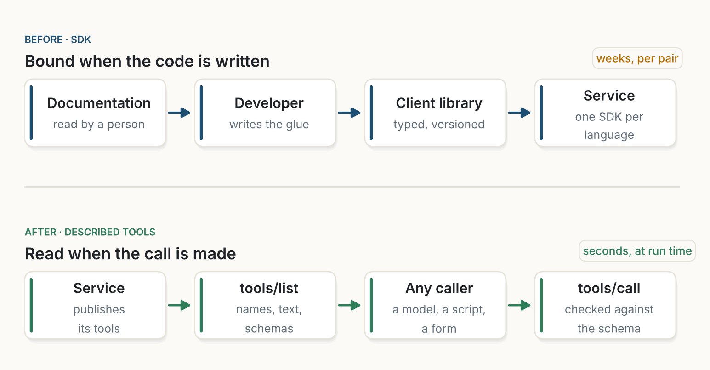
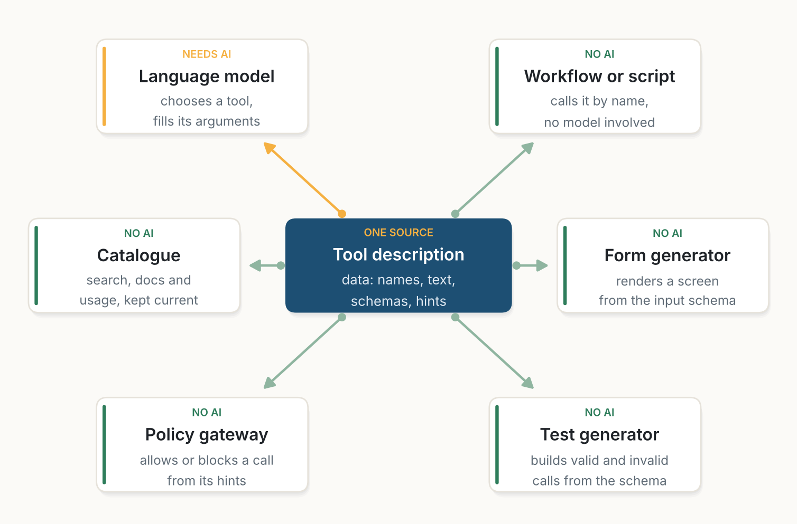
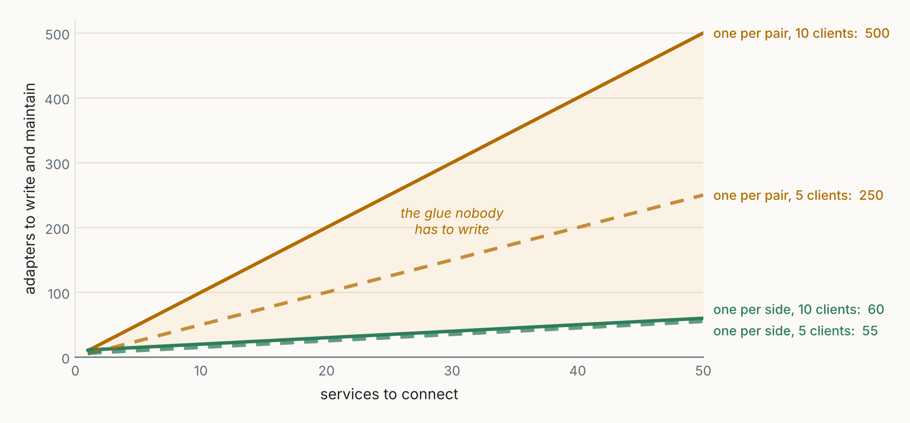
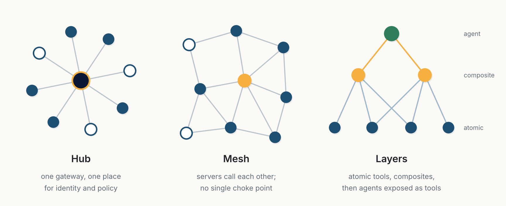
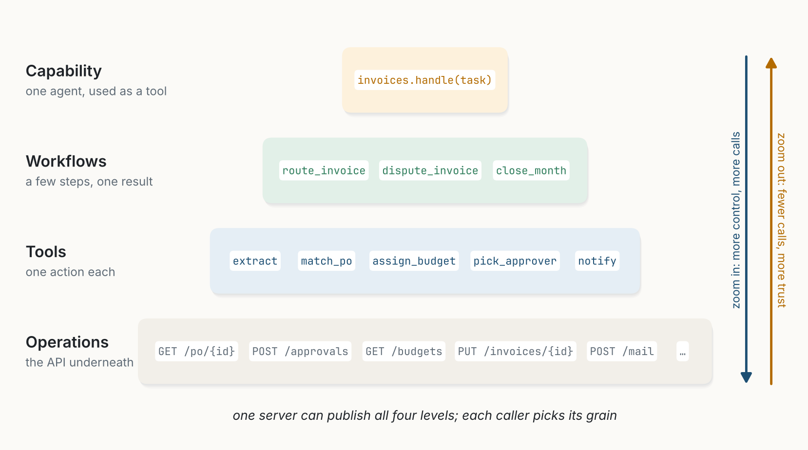
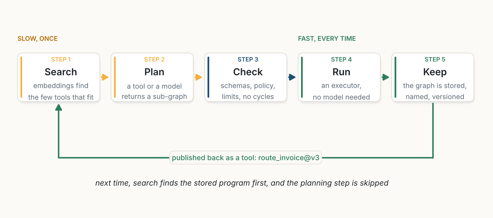
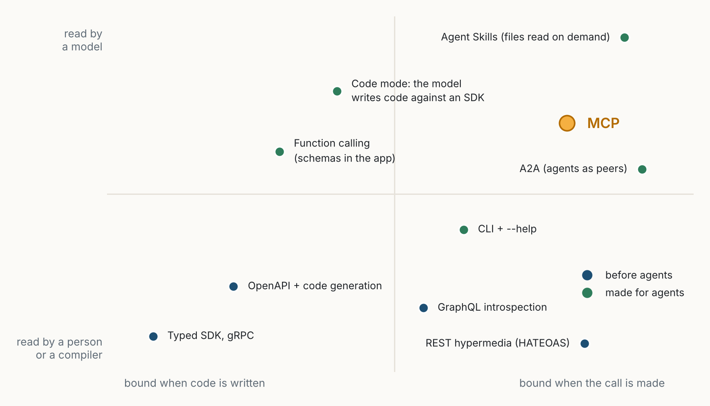
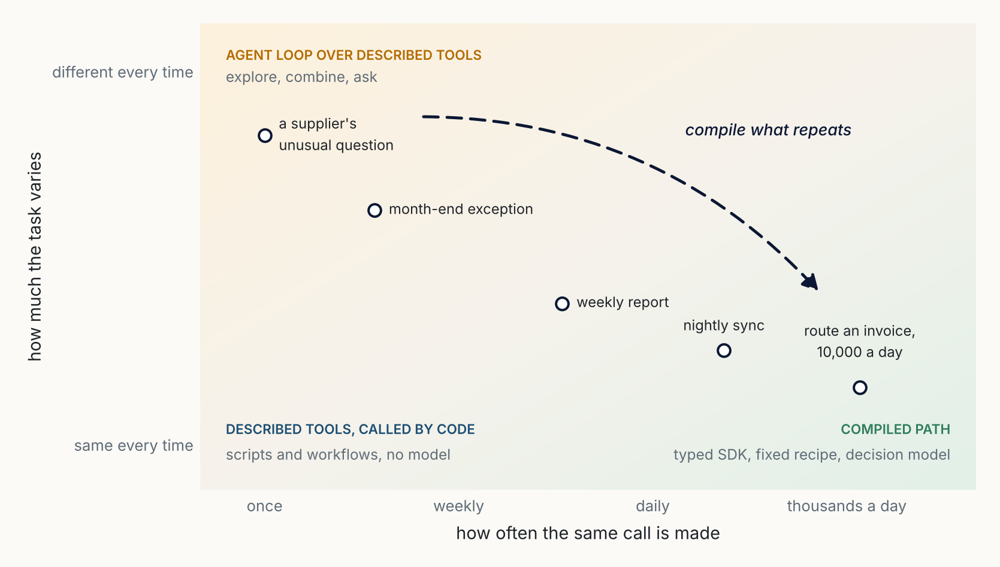

::: {.series-note}
**Agentic Coding** · Part 2 of 5 · [Read the whole series](../../agentic-coding.qmd)
:::

::: {.callout-note appearance="simple"}
**Essay, October 2026.** A companion to [Fast AI](../2026-10-11-fast-ai/index.qmd), [An Ecosystem, Not an Oracle](../2026-10-17-an-ecosystem-not-an-oracle/index.qmd) and [The Junior Colleague](../2026-10-18-the-junior-colleague/index.qmd). All figures are my own, drawn with the code in [figs.py](figs.py). Where a figure uses someone else's numbers, the caption names the source. Where the numbers are my own illustrative assumptions, the caption says so.
:::

**In short.** The Model Context Protocol (MCP) is usually presented as a way to give AI models access to tools. I think it does something larger. It changes what we mean by an API. A classic API is a contract that a developer reads once and then turns into code. An MCP server describes itself as data that any caller reads when it makes the call: what each tool does, what it accepts and returns, and whether it is safe to retry. The agentic loop is what made this practical, because for the first time a general client can read the description and act on it. But the idea does not need AI. A workflow engine, a form generator, a test suite or a policy gateway can read the same description. Once interfaces are data, tools can be connected as a graph of any shape, the same capability can be offered at several levels of detail, and much of the glue code between systems disappears. Pushed one step further, a tool can be found by the meaning of its description and can return not data but a program: a sub-graph of other tools, checked and run by an executor, then kept as a new tool. Programs then live inside the process, as data. MCP also has serious weaknesses: it fills the model's context, it opens new security holes, and plain prose is a weak contract. Some of the alternatives are better for parts of the job. My conclusion is that the lasting change is not the protocol. It is the habit of publishing an interface as data and choosing, case by case, when to bind to it.

::: {.callout-tip appearance="simple" icon="false"}
## Key takeaways

- **An API used to be read by people and turned into code.** An MCP tool is a piece of data, read by its caller at the moment of the call. The key change is not the wire format. It is *when* the interface is bound.
- **The idea is old; the reader is new.** Self-describing services (WSDL, REST hypermedia) were proposed twenty-five years ago and mostly failed, because no general client could read the descriptions. A language model in a loop can.
- **The idea does not need AI.** Of the six readers of a tool description I describe below, only one is a model.
- **Described tools form a web.** A server can also be a client, so tools compose into hubs, meshes or layers. With $N$ clients and $M$ services, the adapters to write fall from $N \times M$ to $N + M$.
- **Granularity becomes a choice for the caller.** One server can offer a whole capability, a few workflows, single tools and raw operations, and each caller picks its level.
- **A tool can return a program.** Embed tool descriptions to find them by meaning, let a tool return a sub-graph of calls, check it and run it without a model, then store it as a new tool. The line between API, workflow and program becomes a matter of level.
- **The case against MCP is real.** Tool descriptions crowd the model's context, poisoned descriptions and prompt injection are real attacks, prose is a weak contract, and code, CLIs or typed SDKs are often simpler.
- **The SDK does not die; it moves.** Explore with an agent over described tools, then compile what repeats into typed code, the step I called Fast AI.
:::

## 1. The ritual of the SDK

Anyone who has connected two business systems knows the ritual. You find the documentation of the other system's API. You read it, usually twice. You install its SDK for your language, or write a client if none exists. You map its objects to yours, handle its errors, its paging, its authentication, its rate limits. You write tests. Months later, the other side publishes version 3, and you start again.

The cost of this ritual is not in any single step. It is in the number of times we repeat it. Every pair of systems that must talk needs its own piece of glue, written by a person who has read the documentation of both. In a company with ten applications and fifty services, that is a lot of glue, and most of it does nothing more interesting than translate one shape of data into another.

For thirty years the answer has been better documentation and better code generation: WSDL in the early 2000s, then Swagger and OpenAPI, then typed client generators. They helped. But the contract was still read by a person and bound into code before the program ran. The program itself never knew what the service could do. It only knew what its developer had written down.

## 2. What MCP changes: the description is read at run time

MCP was published by Anthropic in November 2024 as an open standard for connecting AI applications to data and tools [@anthropic2024mcp]. Technically it is modest. Messages are JSON-RPC 2.0. A server exposes *tools* (actions), *resources* (data to read) and *prompts* (reusable instructions). A client asks the server what it offers with `tools/list` and calls a tool with `tools/call` [@mcpspec2025]. The protocol says openly that it takes inspiration from the Language Server Protocol, which solved a similar problem between code editors and programming languages [@lsp2016].

What matters is in the answer to `tools/list`. Each tool comes back as a small piece of data: a name, a human-readable title, a description in plain words, a JSON Schema for its input, and since the June 2025 revision, an optional schema for its output and *annotations*: hints such as whether the tool only reads, whether it can destroy something, whether it is safe to call twice [@mcpspec2025]. The server can also tell the client that its list of tools has changed.

{fig-alt="Two rows of four cards. Top row, labelled Before, SDK, bound when the code is written: documentation read by a person, a developer who writes the glue, a typed client library, the service; weeks per pair. Bottom row, labelled After, described tools, read when the call is made: the service publishes its tools, tools/list returns names, text and schemas, any caller (a model, a script, a form), tools/call checked against the schema; seconds, at run time."}

None of these fields is new on its own. JSON Schema has existed for more than fifteen years, and OpenAPI already carries descriptions. The change is *when the interface is bound, and by whom*. With an SDK, the binding happens when the code is written, in the head of a developer. With MCP, it happens when the call is made, inside the caller. The program no longer contains the knowledge of what the service can do. It asks.

{fig-alt="A dark code panel shows the JSON description of a tool named route_invoice, with a title, a description, an input schema with invoice_id and amount_chf, an output schema with budget and approver, and annotations readOnlyHint false and idempotentHint true. Leader lines link five parts to cards: name, read by everyone; description, read by a model or a person; input schema, read by a validator or a form; output schema, read by a planner or a type checker; hints, read by a policy gateway."}

This is why I say MCP is a way to redefine the API, at least in part. An API was a document plus a library. Here it becomes a *data object* that travels with the service, can be queried, filtered, logged, versioned and compared, like any other data.

## 3. An old dream, finally with a reader

The dream of services that describe themselves is old, and it is worth remembering why it failed.

In 2000, Roy Fielding's dissertation defined REST and one of its constraints, *hypermedia as the engine of application state* (HATEOAS): a client should discover what it can do next from the links in each response, not from documentation read in advance [@fielding2000]. Almost nobody built clients that way. Around the same time, WSDL described web services in machine-readable XML [@w3c2001wsdl], and UDDI registries were supposed to let programs find services on their own. The large public UDDI registries closed in 2006.

These ideas did not fail because they were wrong. They failed because the client was missing. A description is only useful if something can read it and decide what to do. A conventional program cannot read "assigns an invoice to a budget and to the person who approves it" and work out when to call it. So in practice a developer always read the description, and the binding stayed in the code.

The agentic loop supplied that client. A language model can read a description in plain words, match it to a goal, fill in the arguments from the schema, look at the result and decide what to do next [@yao2023react; @schick2023]. Function calling, introduced by OpenAI in June 2023 [@openai2023fc], gave models a structured way to do this, but each application still carried its own list of functions. Research on agents that choose among thousands of real APIs [@patil2023; @qin2024] showed both the promise and the difficulty. MCP's contribution was to move the description out of the application and into the service, behind one protocol. Adoption was quick. By December 2025, when Anthropic gave MCP to the new Agentic AI Foundation under the Linux Foundation, it counted more than 10,000 active public MCP servers [@anthropic2025aaif].

## 4. The idea does not need AI

This is the part I find most interesting, and most often missed. Once a service publishes its interface as data, the language model becomes just one of its readers.

{fig-alt="A central dark card, Tool description, data: names, text, schemas, hints. Six cards around it with arrows: Language model, needs AI, chooses a tool and fills its arguments; Workflow or script, no AI, calls it by name; Form generator, no AI, renders a screen from the input schema; Test generator, no AI, builds valid and invalid calls from the schema; Policy gateway, no AI, allows or blocks a call from its hints; Catalogue, no AI, search, docs and usage."}

- A **workflow engine** or a plain script can call a tool by name, with arguments checked against the schema, and never involve a model.
- A **form generator** can build a screen from the input schema, so a person can call the same tool by hand.
- A **test generator** can produce valid and invalid calls from the schemas and check that the outputs match the output schema.
- A **policy gateway** can read the annotations and decide, for example, that destructive tools require a human approval.
- A **catalogue** can index every tool in the company, with its owner, its version and how often it is used.

Seen this way, MCP is less an AI protocol than a *data-driven* way of building integrations. The interface is a record in a catalogue. The behaviour of the system, which tools exist, who may call them, which ones chain together, can be changed by changing data rather than code. The agentic loop is optional. The description is not.

This matters for the argument I made in [Fast AI](../2026-10-11-fast-ai/index.qmd). There I argued that the large model should do the slow, exploratory work once, and that what repeats should be compiled into something fast and fixed. A data-driven interface makes that compilation easy: the recipe an agent discovered can be stored as data (call `extract_invoice`, then `match_po`, then `pick_approver`) and replayed by a workflow engine with no model at all.

## 5. A web of tools

The second consequence is structural. In MCP, the roles of client and server are not fixed: a server can itself be a client of other servers. An "invoice desk" server can expose a single tool, `route_invoice`, and implement it by calling an ERP server, a document server and a decision model. A gateway can collect many servers behind one catalogue and add identity, policy and logging in one place.

{fig-alt="Line chart of adapters to write and maintain against services to connect, from 0 to 50. With one adapter per pair, 10 clients need 500 adapters at 50 services, 5 clients need 250. With one per side, 10 clients need 60, 5 clients need 55. The gap between the lines is shaded and labelled: the glue nobody has to write."}

The first gain is simple arithmetic, the same one that motivated the Language Server Protocol. If $N$ clients must each talk to $M$ services, writing one adapter per pair costs $N \times M$ adapters. If every client speaks one protocol and every service publishes one description, it costs $N + M$. With ten clients and fifty services, that is 60 adapters instead of 500. Each adapter is real work: reading, coding, testing, and above all maintaining it when either side changes. I suspect this, more than anything AI-related, is where most of the time is saved.

{fig-alt="Network diagram. Three clients on the left: Assistant, a model in a loop; Workflow engine, no model; Nightly script, no model. They call a dark Gateway card (one catalogue, identity, policy, logs). The gateway calls an Invoice desk server and client (route_invoice), a Mail server and a Knowledge graph server. The Invoice desk calls ERP (match_po), Documents (extract_invoice) and Decision model (pick_approver). Dashed green brackets link Documents to ERP labelled Invoice, and Knowledge graph to Decision model labelled Rules."}

The second gain is less obvious. When every tool declares the shape of what it accepts and returns, the connections between tools become something you can *compute*. If `extract_invoice` returns an object that fits the input of `match_po`, the two can be chained, and a planner, human or machine, can see this without reading any code. The graph of possible compositions is a by-product of the descriptions. This is what I mean by a web of tools: not a fixed integration diagram drawn by an architect, but a graph that can be queried, searched for paths, and checked for missing links.

{fig-alt="Three small network diagrams. Hub: one central gateway node with clients and servers around it. Mesh: servers connected to each other in an irregular network, one composite node in amber. Layers: a green agent node at the top, two amber composite nodes in the middle, four atomic server nodes at the bottom."}

And the graph can take whatever shape the organisation needs. A *hub* puts identity and policy in one place, which most companies will want for anything that touches money or personal data. A *mesh* lets teams connect their servers directly, with no central bottleneck. *Layers* stack atomic tools under composite tools, and composite tools under agents that are themselves exposed as tools. Because every node speaks the same protocol, moving from one shape to another is a matter of configuration. This is the cross-communication benefit: teams that never coordinated their APIs can still find and call each other's tools, through one catalogue, in one format.

## 6. Granularity on demand

Every API designer faces the question of grain. Too fine, and callers make dozens of chatty calls to do one thing. Too coarse, and callers cannot do anything the designer did not foresee. In the SDK world, the designer picks one grain and everybody lives with it.

Described tools loosen this choice in two ways.

{fig-alt="Four stacked bands that widen downward like a pyramid. Capability, one agent used as a tool: invoices.handle(task). Workflows, a few steps, one result: route_invoice, dispute_invoice, close_month. Tools, one action each: extract, match_po, assign_budget, pick_approver, notify. Operations, the API underneath: GET /po/{id}, POST /approvals, GET /budgets, PUT /invoices/{id}, POST /mail. Arrows on the right: zoom in, more control, more calls; zoom out, fewer calls, more trust."}

**First, the same server can publish several levels at once.** At the top, a whole capability exposed as one tool: "handle this invoice task", implemented by an agent. Below it, a few workflows that each deliver one result. Below those, single actions. At the bottom, the raw operations of the underlying API. A strong model working on an unusual case may want the fine tools. A workflow engine wants the workflow. Another team's agent may only want the capability. Because each level is just more data in the same catalogue, offering all four costs little. Anthropic's advice on writing tools for agents points the same way: fewer, more meaningful tools that match how a task is really done, rather than a thin wrapper around every endpoint [@anthropic2025tools].

**Second, the caller can choose how much of the description to read.** This is *progressive disclosure*: first the names, then the descriptions of the tools that look relevant, then their full schemas, then, if needed, their documentation or code. Agent Skills apply this idea to instructions: a model sees only a skill's name and summary until it decides the skill is relevant, and only then reads the rest [@anthropic2025skills]. Tool search does the same for large tool catalogues: tools are loaded only when a search finds them [@anthropic2025advtools; @gan2025].

![**Figure 8.** What a caller reads before it acts. Left: a catalogue of 200 tools, assuming about 10 tokens per name, 50 per name and description, and 450 per full schema; my own illustrative values. Right: one workflow reported by Anthropic, where presenting tools as files read on demand reduced the tokens used from 150,000 to 2,000 [@anthropic2025codeexec].](figures/fig08.png){fig-alt="Left, bar chart for a catalogue of 200 tools (illustrative): names only 2,000 tokens; names and descriptions 10,000; every schema 90,000; names then 3 schemas on demand 3,350. Right, horizontal bars reported by Anthropic: every tool definition loaded up front 150,000 tokens; tools read as files when needed 2,000; minus 98.7%."}

The numbers show why this matters. Loading every schema of a large catalogue before the first call can cost tens of thousands of tokens, which are paid on every run and push useful context out of the window. In one workflow described by Anthropic, presenting the tools as files that the agent reads only when needed reduced the tokens used from 150,000 to 2,000, a reduction of 98.7% [@anthropic2025codeexec]. That is one example, not a benchmark, but the direction is clear: granularity is no longer only a property of the API. It is a choice made by the caller, at run time, based on what it needs.

## 7. Tools that return programs

So far, every tool in this essay has returned data. I want to push the idea one step further, because I think this is where the paradigm becomes really new: a tool can return a *program*, and that program can stay inside the process as data.

### 7.1 A catalogue you search by meaning

If a tool's description is data, it can be *embedded*: turned into a vector by the same kind of model used for semantic search [@reimers2019]. The catalogue then becomes a space in which tools that do similar things sit close together. A question, from a person, an agent or another tool, lands somewhere in that space, and its nearest neighbours are the few tools worth reading.

{fig-alt="A map of 23 tools as dots grouped in five labelled clusters: invoices and payments, documents, people and rules, data, messages. An amber star marks the question 'who must approve this supplier invoice?', with a dashed circle around it and lines to its five nearest tools: pick_approver, assign_budget, route_invoice, get_supplier and rules_for. A panel on the right lists them: returned 5 of 23 tools; only their schemas are read."}

None of this is speculative. ToolLLM and Gorilla used a retriever to pick a handful of APIs out of thousands [@qin2024; @patil2023], and the tool search in current agent platforms works the same way [@anthropic2025advtools; @gan2025]. ToolkenGPT goes further and gives each tool its own token embedding inside the model, so that calling a tool is no different from predicting a word [@hao2023].

Embeddings give the web of §5 a second kind of edge. Schema edges say which tools *can* be chained, because one's output fits another's input. Embedding distance says which tools are *about* the same thing. Together they are enough to propose a plan without anyone drawing it.

### 7.2 A tool whose result is a sub-graph

Now the step that interests me most. Nothing in the idea of a tool requires its result to be plain data. A tool can return a small graph of *other* tool calls, with the arguments of each node wired to the outputs of the others.

{fig-alt="Left, a dark code panel titled plan_invoice_routing() result, with JSON: returns graph, name route_invoice@v3, five nodes (doc calls extract_invoice on $input.file; po calls match_po on $doc; rules calls rules_for on $doc.supplier; who calls pick_approver on $po and $rules; send calls notify to $who.approver), output $who, limits max_calls 8 and max_depth 2. Right, what the executor runs, no model in the loop: doc leads to po and rules in parallel, both lead to who, then send. Note: checked first, every tool exists, every reference fits its schema, no cycles, policy allows it, within limits."}

In Figure 10, `plan_invoice_routing` does not do the work. It returns the recipe: extract the invoice; then, in parallel, match the purchase order and fetch the supplier's rules; then pick the approver; then notify them. An executor, which is ordinary code, checks the graph before running anything: every tool exists, every reference fits the schema it feeds, there is no cycle, the policy gateway accepts every node, and the whole stays within its limits. Then it runs the graph, with no model in the loop.

Research on agents points the same way. ReWOO separates planning from execution: the model writes the whole plan once, instead of reasoning again after every observation [@xu2023rewoo]. LLMCompiler has the model emit a graph of function calls with their dependencies and runs the independent calls in parallel, which made runs faster and cheaper than step-by-step reasoning [@kim2024llmcompiler]. Code mode and programmatic tool calling let the model write the plan as code [@cloudflare2025codemode; @anthropic2025advtools].

What changes in my proposal is *who* returns the plan. It need not be the model in the loop. It can be a tool like any other: written by a team, generated by a model and reviewed once, or retrieved from storage. The plan stops being a private thought of the agent and becomes part of the interface.

### 7.3 Programs inside programs

Since a node of a returned graph is just a tool call, it can itself be a tool that returns a graph.

{fig-alt="Three rows of cards. Level 1, the process: receive, route_invoice, archive. A shaded funnel from route_invoice opens to Level 2, a graph returned by route_invoice: extract, match_po, approve, notify. A second funnel from approve opens to Level 3, a graph returned by approve: rules_for, pick_approver, escalate?. Two tags at the top right: max depth 3, max 20 calls."}

This gives the multiple levels of detail of §6 almost for free. Nobody has to design the levels in advance: each one expands only when it is reached, and only as far as needed. A caller that trusts `route_invoice` treats it as one step. A caller that must audit it can ask for the graph and inspect every level. The executor needs two limits to make sure the expansion ends: a maximum depth and a budget of calls.

### 7.4 Keeping the programs

The last step closes the loop with [Fast AI](../2026-10-11-fast-ai/index.qmd). A returned graph is data. It can be logged, compared with yesterday's, reviewed by a person, signed, versioned and stored. Once stored with a description, it is itself a tool: it gets embedded in the same catalogue, and the next search for "who must approve this supplier invoice?" finds the stored program before anything has to plan.

{fig-alt="Five step cards in a row: Search, embeddings find the few tools that fit; Plan, a tool or a model returns a sub-graph; Check, schemas, policy, limits, no cycles; Run, an executor, no model needed; Keep, the graph is stored, named, versioned. The first two are marked slow, once; the last two fast, every time. A green line returns from Keep to Search, labelled published back as a tool: route_invoice@v3. Caption line: next time, search finds the stored program first, and the planning step is skipped."}

Voyager, an agent that played Minecraft, worked this way: it stored every skill it learned as a program, indexed it by an embedding of its description, retrieved it when a similar task came up, and built new skills from old ones [@wang2023voyager]. Models that write their own tools and reuse them follow the same pattern [@cai2024latm].

In a company, the same mechanism means that the programs which run the business live *inside the process*, as data you can inspect, rather than hidden in the code of each application or worked out again by an agent every morning. This is what I mean by embedding programs in the process. The process is a graph of tools. Some tools return graphs. Those graphs can be kept and become tools. The difference between an API, a workflow and a program becomes a matter of level, not of kind. Programmers will recognise an old idea from Lisp, where code and data share one form. Here, the shared form is the tool description.

### 7.5 What it costs

A tool that returns a program is a tool that returns code, and everything §8.1 says about poisoned descriptions applies with more force. The executor must treat every returned graph as untrusted. It should run only tools from an allowed list, check every reference against its schema, apply the policy to every node and not only to the first, enforce the limits, and never let a graph call a tool its caller could not call directly. Debugging is harder too: a failure can sit three levels down, in a graph nobody wrote by hand, so every expansion must be logged with where it came from. Finally, there is no standard. MCP has no "graph" result type, so today this is a convention on top of the protocol, or a job for a workflow engine. A shared format for returned plans would, I think, be one of the most useful next steps for the ecosystem.

## 8. The case against MCP

So far I have made the case for. It would be dishonest to stop there. MCP has drawn serious criticism, much of it fair, and for several jobs there are better options.

### 8.1 Five objections

**It is a wrapper over APIs that already exist.** Many MCP servers are thin layers over a REST API that already had an OpenAPI description. Adding a protocol, a server process and a new failure point to say the same thing again is not obviously progress. Critics argue that a model that can read OpenAPI, or a `--help` page, does not need MCP at all [@ronacher2025].

**It crowds the model's context.** Every tool description an agent loads costs tokens on every call, and accuracy in choosing the right tool falls as the list grows [@gan2025]. In the paper I analysed in [The Junior Colleague](../2026-10-18-the-junior-colleague/index.qmd), each task offered 68 tools, 31 of them near-duplicates of the core ones, precisely because large, messy catalogues are what agents face in practice [@zhu2026]. Progressive disclosure helps, but it is extra machinery that the protocol did not originally provide.

**It opens new security holes.** A tool description is text that the model reads and trusts. A malicious or compromised server can hide instructions in it, a *tool-poisoning* attack [@invariant2025]. Any tool that returns content from the outside world can carry an *indirect prompt injection* [@greshake2023]. Simon Willison named the dangerous combination the *lethal trifecta*: an agent with access to private data, exposure to untrusted content, and a way to send data out [@willison2025]. Connecting many MCP servers to one agent makes that combination easy to assemble by accident. Surveys of the MCP ecosystem list these and other threats, such as name collisions between servers and installers that cannot be verified [@hou2025]. The specification itself warns that annotations are hints and should not be trusted from an unknown server [@mcpspec2025].

**Prose is a weak contract.** A schema says that `amount_chf` is a number. It does not say whether it includes VAT, whether calling the tool twice creates two approvals, or what happens if the budget is closed. A typed SDK does not say this either, but it is usually paired with a developer who read the documentation and wrote tests. When the reader is a model, the description *is* the documentation, and its gaps become errors at run time instead of questions at design time. Versioning is also weaker: a server can change its tools between two calls.

**It is slower and less predictable than a function call.** An agent that reads descriptions, reasons and then calls is orders of magnitude slower and more expensive than compiled code calling a library, and it may take a different path on the same input. For processes that run ten thousand times a day, this is the wrong trade, as I argued in [Fast AI](../2026-10-11-fast-ai/index.qmd).

### 8.2 The alternatives

{fig-alt="Scatter map. Horizontal axis from bound when code is written to bound when the call is made; vertical axis from read by a person or a compiler to read by a model. Before agents, in blue: typed SDK and gRPC bottom left; OpenAPI with code generation; GraphQL introspection; REST hypermedia (HATEOAS) bottom right. Made for agents, in green: function calling, upper left of centre; code mode, top centre; CLI with help, lower right of centre; A2A, right; Agent Skills, top right. MCP highlighted in amber, upper right."}

- **OpenAPI plus function calling.** If a service already has a good OpenAPI description, it can be turned into function definitions for a model with no new protocol [@openapi2021; @openai2023fc]. This keeps one source of truth and the existing tooling for authentication, gateways and testing.
- **Code as the interface.** Instead of asking the model to call tools one at a time, let it write a short program against a typed API and run it in a sandbox. Research found that agents acting through code solved more tasks than agents emitting JSON calls [@wang2024codeact]. Cloudflare's *Code Mode* turns MCP tools into a TypeScript API for exactly this reason [@cloudflare2025codemode], and Anthropic's code-execution approach does the same with files [@anthropic2025codeexec]. In this view, the SDK comes back, but its reader is now a model.
- **Command-line tools and skills.** A well-made CLI already describes itself through `--help`, composes through pipes, and is something models have seen countless times in training. Paired with short instruction files that are read on demand [@anthropic2025skills], it covers much of what developers use MCP for, with no server to run [@ronacher2025].
- **Agent-to-agent protocols.** When the thing on the other side is itself an agent with its own judgement, a protocol for tasks between peers, such as Google's A2A, fits better than a list of tools [@google2025a2a; @ehtesham2025].
- **Typed SDKs and RPC.** For hot paths, nothing beats a compiled call with types checked before the program runs.
- **GraphQL.** Its introspection already lets a client ask what a service offers and choose exactly the fields it needs [@graphql2021]. It solved part of the granularity problem years ago, for data.

### 8.3 My reading

Most of these alternatives share MCP's core idea: the interface is described in a form the caller reads, and the binding happens later than it used to. Code mode reads MCP descriptions and generates an SDK from them. Skills are descriptions in files. A2A publishes "agent cards". Even the critics who say "just use the CLI" are relying on `--help`, a self-description read at run time.

So I do not think the lasting change is MCP the wire format. It may be replaced, merged with other protocols, or survive mainly as an internal standard behind gateways. The lasting change is the *practice*: publish every interface as data, rich enough for a model and precise enough for a machine, and let each caller decide when to bind to it. MCP is, for now, the most widely adopted way to do that, and its governance under a neutral foundation makes it a reasonable bet. But the objections in §8.1 are about real costs, and the right answer to several of them is to use something else for that part of the job.

## 9. Where the SDK survives

Back to the original question: does this redefine the API and the SDK "to an extent" or "completely"? My answer is: completely at the edges, not in the core.

{fig-alt="A two-dimensional map shaded from amber at the top left to green at the bottom right. Horizontal axis: how often the same call is made, from once to thousands a day. Vertical axis: how much the task varies, from same every time to different every time. Example points: a supplier's unusual question, top left; month-end exception; weekly report; nightly sync; route an invoice, 10,000 a day, bottom right. Region labels: agent loop over described tools at top left; described tools, called by code at bottom left; compiled path (typed SDK, fixed recipe, decision model) at bottom right. A dashed arrow, compile what repeats, runs from top left to bottom right."}

At the edges, where integration happens, where a call is made rarely or differs every time, where a team needs to find and use another team's capability, the described interface wins. It is cheaper to build, easier to discover and works for model and script alike. Here I expect hand-written SDKs to become rare.

In the core, where the same call runs thousands of times a day, the binding should happen early again: a typed client, a fixed recipe, a small decision model like the one in [The Junior Colleague](../2026-10-18-the-junior-colleague/index.qmd). The difference from before is where that code comes from. It does not need to start from a developer reading documentation. It can be generated from the same descriptions, or compiled from a path that an agent found and that people reviewed. The SDK becomes an *output* of the described interface, not its source.

## 10. What would prove me wrong

I would change my mind if:

- tool descriptions stayed so unreliable that every serious integration still needed a person to read the documentation and write tests by hand, so the run-time binding saved nothing;
- the security problems of §8.1 proved impossible to contain at reasonable cost, so that companies kept MCP to demos and read-only tools;
- returned programs proved harder to secure, debug and govern than the hand-written code they replace;
- the token cost of descriptions kept growing faster than the techniques that load them on demand;
- integration time and maintenance, measured in real companies over a few years, did not fall for teams that publish their interfaces as data compared with teams that do not.

The last one is the real test, and it can be measured.

## 11. Conclusion

For decades, an API was a promise written for people. A developer read it, understood it, and turned it into code that was frozen until the next release. MCP and the agentic loop make a different arrangement possible: the promise is written as data, travels with the service, and is read by whoever calls it, at the moment of the call.

That one shift has several consequences. The caller no longer needs AI to benefit. Tools can be connected into a web of whatever shape suits the organisation, with far less glue. The same capability can be offered at several levels of detail, and each caller chooses how much to read. Tools can be found by meaning, and can return programs that are checked, run and kept as new tools, so the logic of a process lives inside it as data. And the expensive, exploratory work of figuring out how to combine tools can be done once by an agent, then compiled into something fast.

MCP may not be the protocol we use in ten years. Its weaknesses are real, and some of its alternatives are better at parts of the job. But I think the habit it is spreading will remain: an interface is not only something we read. It is data.

::: {.read-next}
**Read next** · [Fast AI](../2026-10-11-fast-ai/index.qmd)
Why the large model should build the memory once, instead of reasoning through every run.
:::

::: {.small}
*The views in this essay are my own and do not describe any product or plan of my employer.*
:::

## References

::: {#refs}
:::
