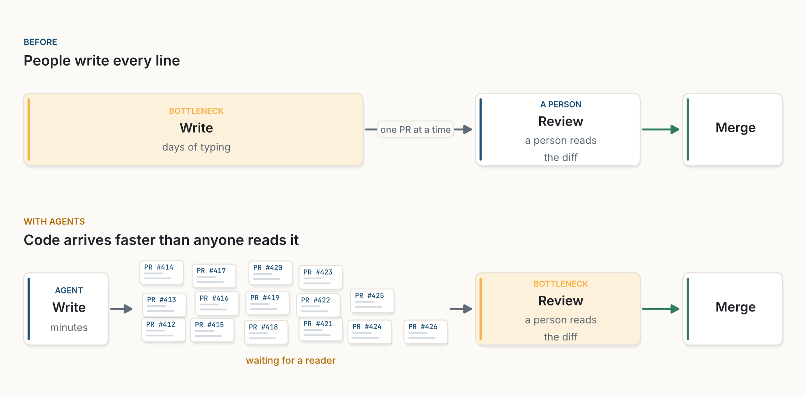
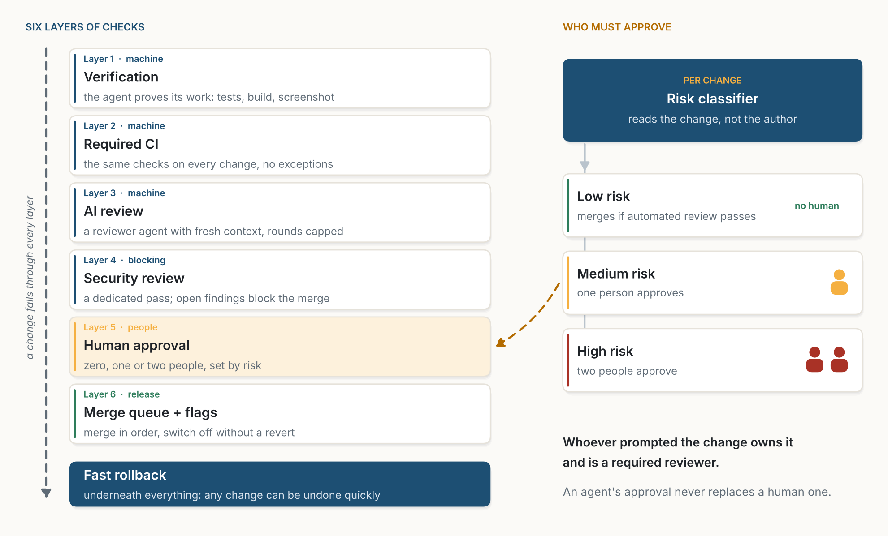

::: {.callout-note appearance="simple"}
**Analysis, October 2026.** An analysis of the Claude Code team's post [*Solving code review at Anthropic*](https://claude.dev/blog/solving-code-review-at-anthropic/), read in the light of my earlier paper [Intent Is the Source](../2026-10-21-intent-is-the-source/index.qmd). Unless stated otherwise, numbers come from that post. Figures are my own, drawn with the code in [figs.py](figs.py).
:::

## The bottleneck moved

Once a team adopts agentic coding, code stops being the bottleneck. Review takes its place. PRs pile up, everyone is nervous to approve them, and the speed you gained writing code is lost waiting for someone to read it.

{fig-alt="Two pipelines. Before: a wide amber Write card marked bottleneck, days of typing, then one PR at a time to Review by a person, then Merge. With agents: a narrow Write card, minutes, then a pile of small PR cards waiting for a reader, then an amber Review card marked bottleneck, then Merge."}

The Claude Code team at Anthropic, where Claude writes roughly 90% of the code, recently shared how they handled this. Between June and September, their merged PRs more than doubled while the share of reverted PRs fell by over 40%. They did not remove review. They moved most of the reading to machines and pointed human attention at the risk.

## Six layers and a classifier

Their approach stacks six layers of checks with fast rollback underneath: verification, required CI, AI review, security review, human approval, and a merge queue with feature flags.

{fig-alt="Left: six stacked layers, Verification, Required CI, AI review, Security review (blocking), Human approval (people, highlighted), Merge queue and flags (release), over a dark Fast rollback foundation. Right: a Risk classifier that reads the change, not the author, feeds three tiers: low risk merges if automated review passes with no human, medium risk needs one person, high risk needs two. A dashed arrow from the tiers points to Human approval. A note says whoever prompted the change owns it and is a required reviewer, and an agent's approval never replaces a human one."}

A few principles hold it together:

1. **Review happens before the PR exists.** It runs continuously, more like a spellchecker than a gate at the end. By the time a human looks, Claude has usually reviewed and fixed the change at least once.
2. **The agent must prove its work.** Tests, a build, or a screenshot compared against the design. It shows output instead of claiming it is done, and a subagent reviews the diff with fresh context.
3. **Risk is assessed per change.** A classifier reads the change, not the author, and sets the tier. Low-risk changes merge without a human if automated review passes. Medium risk needs one person, high risk needs two.
4. **Accountability stays human.** Whoever prompted a change owns it and counts as a required reviewer. An agent's approval never replaces a human one.
5. **The reviewer keeps learning.** Past incidents become daily evals, noise is measured by how people react to comments, and review rounds are capped so author and reviewer agents converge instead of looping.

It is a thoughtful system, and I largely agree with it.

## What the numbers show

The results are strong, but they come from one team measuring itself. Merged PRs can double because changes got smaller, so the count says more about pace than about how much was built. A revert is also only one measure of quality: a bug fixed forward, or switched off behind a flag, never shows up as a revert. What the numbers do show is the claim that matters most. The pace of merges rose sharply and quality, by this measure, got better instead of worse.

## What review quietly did

PR review was never only about catching bugs. It also built a shared understanding of the codebase. Reading each other's diffs is how teams learned the architecture, absorbed the conventions, and noticed when someone was drifting from them.

That side effect is now mostly gone. Anthropic writes that nobody on the team keeps a complete mental model of Claude Code, and that they do not think anyone needs to.

I half agree. Not everyone needs every detail. But everyone should understand the main architectural patterns, the interfaces and the conventions. Open Slack channels and asking Claude to explain bits of code on demand are useful, but they are not the final answer.

## Let go of one more thing

Here is where I would push further. We need to let go of the belief that shared understanding has to come from reading code.

PR review was an accidental knowledge channel. You learned the system as a by-product of checking someone else's work. That worked when humans wrote every line at human speed. At agentic speed it cannot scale, and trying to preserve it is nostalgia.

We have done this before. We stopped reading assembly decades ago, and we did not stop understanding our systems. We moved understanding up a level of abstraction. Code is heading the same way.

The comparison has a limit, and it matters. We could stop reading assembly because compilers are deterministic: once we trusted one, it stayed trusted. Agents are not. In [Intent Is the Source](../2026-10-21-intent-is-the-source/index.qmd) I called them stochastic compilers, correct only up to their checks. So moving understanding up a level is safe only if the level above can be checked. Intent written only as prose would not be enough.

## The intent layer

Make shared understanding deliberate instead. Humans own the intent: architecture decisions, interface contracts, invariants and conventions. Agents own the implementation. Review checks one against the other.

{fig-alt="Two bands. Top, intent, owned by people: four cards, Decisions (why it is built this way, lives in short decision records), Contracts (what each part promises, typed interfaces and tests), Invariants (what must always hold, properties and assertions), Conventions (how we do things here, agent instructions and linters). Bottom, implementation, owned by agents: six code files drawn as grey lines. A navy arrow down says agents follow it; an amber arrow up says review checks the diff against it. Between them: a change to the intent always goes to a person. A dashed red arrow on the right runs from top to bottom: incident, someone goes deep."}

The intent layer becomes the artifact the team reads, discusses and evolves together. It is short enough that everyone can hold it in their head, and explicit enough that agents can follow it and reviewers can enforce it. Conventions live in agent instructions and linters. Contracts live in typed interfaces and tests. Decisions live in short records that explain the why.

This also tells us when a person must read. A change that only implements existing intent can be checked by machines: the tests pass, the contracts hold, the linters stay quiet. A change that alters the intent always goes to a person, whatever its size. That covers a new contract, a weakened invariant or a reversed decision. It also covers the most common quiet failure of coding agents: an agent that edits a test until it passes has changed the intent, not implemented it.

The same rule keeps the intent layer from drifting, the way design documents usually do. The code is checked against it on every change, and it cannot change unless someone decides it should. Not every part can be checked by a machine. Contracts, invariants and conventions can. Decisions are prose, so the AI reviewer and people check that a change still respects them. The rule fits the Anthropic setup well: their risk classifier could treat any change to the intent layer as high risk by definition.

## Where it breaks

Abstractions leak. When an incident hits, someone still has to go deep into the code. That skill fades when nobody uses it, so teams will need to keep it on purpose: incident drills, rotating who traces a bug by hand, reading the code behind a decision record from time to time.

The goal is not that nobody reads code. The goal is that nobody needs to read all of it to know how the system works.

Own the why. Delegate the how. Review the intent, not the diff.

::: {.read-next}
**Read next** · [Intent Is the Source](../2026-10-21-intent-is-the-source/index.qmd)
Why agentic coding is the next IDE and the next programming language.
:::

::: {.small}
*The views in this analysis are my own and do not describe any product or plan of my employer.*
:::
