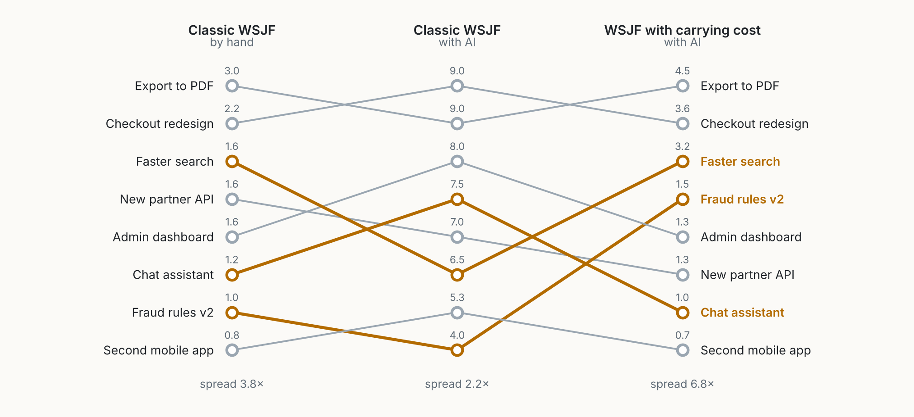

::: {.callout-note appearance="simple"}
**A draft, and an outsider's view.** I know Scrum from years of practice; SAFe I know only from its public framework, and practitioners will know where real trains differ. The physics is a metaphor, used on purpose, and the numbers come from a toy model described in full. Figures are my own, made with [figs.py](figs.py). This essay follows the [Agentic Coding](../../agentic-coding.qmd) series, which looked at the code; here I look at the organisation around it.
:::

## The wrong debate

Most conversations about AI and agile frameworks fall into two camps. One says AI makes Scrum and SAFe obsolete: if an agent builds a feature in an afternoon, why plan in two-week sprints, or in ten-week increments with a hundred people in a room? The other says nothing changes: a framework is about people and feedback, and AI is just a faster tool inside it.

Both camps look at *production*: how fast work is made. But the frameworks were never only about production. They are about how a group of people carries a growing body of work over time without losing control of it.

With AI, we produce much more. That alone should not change the framework. What should change it is what that extra production *leaves behind*.

## Every item has mass

Every item that enters the system stays for a while, and some stay for good: a story, a pull request, a feature, a test, a document, a dependency, an open decision, a backlog item someone will "get to later". Each needs attention to keep. Someone has to understand it, maintain it, answer questions about it, decide about it, or at least remember it is there.

I call that ongoing cost the item's **mass**. Mass is not value. A small feature used by thousands can be light; a generated module nobody fully understands can be heavy. Mass is how much an item pulls on the attention of the people who carry it.

In general relativity, mass curves spacetime: objects near a large mass follow curved paths, and time runs slower for them. That is a good picture of what accumulated work does to a team:

- **Paths bend.** A new request is pulled toward the heavy parts of the system: the legacy module, the integration everyone depends on, the decision nobody has made.
- **Time slows near mass.** The same change takes longer in a heavy system, because each step must account for more of what already exists.
- **There is a horizon.** If mass keeps growing, all the team's attention ends up carrying what exists. Requests still go in. Nothing comes out.

{fig-alt="Two wireframe surfaces seen in perspective. Left, a light system, a shallow dip: a nearly flat grid with one dark mass making a small dip and two small circles; a dashed amber path of nine evenly spaced dots crosses it almost straight. Right, a heavy system, a deep well: the grid sinks into a deep funnel around a large dark mass at the bottom, with about thirty circles on its slopes; the amber path of nine dots starts at the left edge, the dots get closer together, and the path runs down into the well."}

None of this is new. Lehman stated it as laws of software evolution: a system in use must keep changing, and its complexity grows unless work is spent to reduce it [@lehman1980]. Lean calls unfinished work inventory [@reinertsen2009]. Brooks showed that communication paths grow faster than headcount [@brooks1975]. Teams have always lived with mass. What is new is the rate.

## What AI changes: the cost of creating mass

AI makes *producing* an item much cheaper. It does not, or not yet, make *carrying* it much cheaper. Someone still has to decide whether a feature should exist, understand how it fits, own it when it breaks, and remember why it was built.

Write it as a balance for the mass $M$ of the system, and for the capacity left for new work each sprint:

$$
\frac{dM}{dt} = \text{production} - \text{removal}, \qquad \text{capacity for new work} = H - k \cdot M,
$$

where $H$ is the team's total attention and $k$ the attention one unit of mass needs. Production has become cheap. Removal has not changed, and was rarely planned at all. So $M$ grows faster, and $H - kM$ shrinks faster.

To see what that means, I built the smallest model I could. A team has 100 hours of attention per sprint. The system starts with 250 items, each needing 0.1 hours per sprint, so a quarter of the team already carries the past. A new item takes 6 hours to produce by hand or 1.5 with AI, plus 3 hours to absorb (review, decide, integrate). Whatever is left after carrying goes into new items, and every new item stays.

{fig-alt="Two line charts over 26 sprints. Left, mass: by hand grows from 250 to about 440 items; with AI to about 580; with AI and a mass budget to about 350 by sprint 6, then flat. A dotted red line at 1000 marks the horizon. Right, flow: by hand falls from 8.3 to 6.3 items per sprint; with AI from 16.7 to 9.5, labelled minus 43% after a year; with AI and a mass budget from 16.7 to about 13 by sprint 8, then flat."}

- **By hand**, the team delivers 8.3 items in the first sprint and 6.3 in the last; carrying grows from 25% to 44% of its attention. Lehman's law at the usual speed, slow enough to blame on something else.
- **With AI**, it delivers 16.7 items in the first sprint. Every dashboard looks wonderful. By the end of the year it delivers 9.5, and carrying takes 58%. In the second year the gain is almost gone: 5.3 items per sprint against 4.7 by hand.
- **With AI and a mass budget**, whenever carrying would exceed 35% of attention, the team removes items (deletes code, retires features, closes backlog items) before adding new ones, at half an hour per item. It delivers 13 items per sprint, in the first year and the second.

The point is not the numbers. AI does not change the *shape* of the problem, only its *speed*. A system that took a decade to become heavy can now do it in a year, and our frameworks were tuned, implicitly, for the decade.

## Time dilation

Lead time, from request to delivery, depends on spare capacity. Queueing theory has known for sixty years that as load approaches capacity, waiting time does not grow steadily; it explodes [@kingman1961; @little1961]. Mass eats spare capacity, so the same flow of requests meets a smaller server.

{fig-alt="A curve rising slowly, then steeply. X axis: share of attention spent carrying existing mass, 0 to 80%. Y axis: lead time compared with today, 0 to 6 times. Points: today at 25%, 1 times; with a mass budget at 35%, about 1.3 times; by hand after a year at 44%, about 1.9 times; with AI after a year at 58%, about 5.9 times. A dotted red line at 65% marks the horizon."}

This explains a paradox many teams report: *we produce more than ever, and everything takes longer*. The 2024 DORA report found more AI adoption associated with slightly lower delivery throughput (about 1.5%) and stability (about 7.2%), even as individuals felt more productive [@dora2024]. A controlled study found experienced developers slower with early-2025 tools in their own large, mature repositories [@becker2025], which is exactly where mass is highest. These results do not prove the metaphor. The metaphor predicts them.

## Scrum: what holds, what must adapt

The Scrum Guide rests on empiricism and lean thinking, a team of ten or fewer, a time-box of one month or less, and three commitments: the Product Goal, the Sprint Goal and the Definition of Done [@scrumguide2020]. None of this is wrong; empiricism is exactly what is needed when the ground moves. But several parts assume that the scarce resource is the capacity to *produce*. With AI, it becomes the capacity to *carry*.

| Element | Calibrated for | With more mass |
|---|---|---|
| **Sprint** | A rhythm to produce a usable increment | A rhythm to *absorb* one: decide, integrate, understand. |
| **Velocity** | How much the team can make | How much mass it adds. A rising velocity can be a warning. |
| **Product Backlog** | An ordered list, refined as needed | A store of mass AI can fill without limit. Items need to *expire*. |
| **Definition of Done** | The quality an increment must meet | Also what it costs to carry, and what was removed to make room. |
| **Sprint Review** | Inspect the increment | Inspect the increment *and the mass balance*. |
| **Retrospective** | Improve how the team works | Also: where did time slow, which heavy items bent our path? |
| **Team size** | Ten or fewer, to keep communication manageable | The limit is the mass each person carries. Five people with AI can carry the mass of twenty, and break the same way. |

: **Table 1.** Scrum, read again with mass in mind. The middle column is my reading of the Scrum Guide; the right column is my proposal.

**Velocity now measures mass.** With AI, effort and output separate: a team can multiply its points without multiplying its value, and every point adds something to carry. Measured alone, velocity now rewards the road to the horizon. I would keep it, and put two numbers beside it: net mass added per sprint, and lead time. If both velocity and lead time rise, the team is accumulating faster than it can carry.

**The backlog needs evaporation.** When writing a backlog item took effort, the effort was a filter. Now an AI can turn every meeting and every customer email into ten well-written stories. Each is a promise, and every promise has mass. I would give items a lifetime: untouched for three sprints, an item expires unless someone renews it. Black holes slowly evaporate. Backlogs should too.

## SAFe: the scaling unit is the wrong one

SAFe's central structure is the Agile Release Train (ART), a long-lived team of agile teams, generally 50 to 125 people [@safe6], that plans together for a Planning Interval of usually 8 to 12 weeks. Work is ranked with Weighted Shortest Job First (WSJF): cost of delay divided by job size, an idea from product development flow [@reinertsen2009]. I know SAFe less well than Scrum, but three of its most specific parts seem to assume that production is the constraint.

### WSJF stops discriminating

Job size is roughly how long a feature takes to produce. With AI, job sizes shrink, but unevenly: small features hit a floor, complex ones shrink less. The denominator loses its spread, and the ranking collapses toward cost of delay alone. And job size never measured what a feature costs to *carry*, which is now the larger part.

{fig-alt="A slope chart with three columns of eight features. Classic WSJF by hand, from top: Export to PDF 3.0, Checkout redesign 2.2, Faster search 1.6, New partner API 1.6, Admin dashboard 1.6, Chat assistant 1.2, Fraud rules v2 1.0, Second mobile app 0.8; spread 3.8 times. Classic WSJF with AI: Checkout redesign 9.0, Export to PDF 9.0, Admin dashboard 8.0, Chat assistant 7.5, New partner API 7.0, Faster search 6.5, Second mobile app 5.3, Fraud rules v2 4.0; spread 2.2 times. WSJF with carrying cost: Export to PDF 4.5, Checkout redesign 3.6, Faster search 3.2, Fraud rules v2 1.5, Admin dashboard 1.3, New partner API 1.3, Chat assistant 1.0, Second mobile app 0.7; spread 6.8 times. Faster search, Fraud rules v2 and Chat assistant are highlighted because their rank moves three places or more between the last two columns."}

The fix is small: add the carrying cost to the denominator,

$$
\text{WSJF}_{\text{mass}} = \frac{\text{cost of delay}}{\text{job size} + \text{carrying cost}},
$$

where carrying cost is a relative estimate, like job size, of the attention the feature will need in its first year: integrations to keep alive, screens to support, behaviour to explain. A chat assistant is quick to build and slow to carry, so it falls. A faster search adds almost nothing to carry, so it rises.

### The train should be sized by mass

50 to 125 people is a coordination limit, learned from teams who produced at human speed. But what a train coordinates is not people; it is what they produce and must keep consistent: interfaces, dependencies, shared data, shared decisions. In other words, mass.

{fig-alt="Two straight lines rising from the origin. X axis: people on the train, 0 to 170. Y axis: mass the train must carry. A horizontal line marks what one train can coordinate. The by-hand line crosses it at about 125 people; the with-AI line, about three times steeper, at about 38. A band from 50 to 125 marks the SAFe range."}

A 120-person train with AI may carry the mass of a 400-person train without it, with the same rituals and a heavier program board. I would not change the guidance. I would change the question, from *how many people are on this train* to *how much mass does it carry, and can it still integrate it every Planning Interval?* Some trains should split long before 125 people.

### PI Planning plans the wrong thing

PI Planning answers *what can we build in ten weeks?* With AI, the honest answer is often "more than you can absorb". The better question is *how much new mass can this train take on, and what will it remove to make room?* I would keep the event and change its centre of gravity: each team brings a **mass budget** next to its capacity, and dependencies on the board are drawn as what they are, lines of mass between teams. The Innovation and Planning iteration, already reserved for work outside the plan, becomes the home of removal: deleting, consolidating, retiring. At portfolio level, a WIP limit of five epics treats a small epic and a platform rewrite as equal; a limit on mass would not.

## What I would actually do

None of this replaces Scrum or SAFe. It adds one quantity both are missing, and makes room for its removal.

1. **Make mass visible.** Keep a rough ledger of what the team carries: features in use, services, integrations, open decisions, backlog items, documents that must stay true. Estimate it like effort: relatively and quickly.
2. **Set a mass budget.** Decide what share of attention may go to carrying, and treat crossing it like a red build: stop adding, start removing.
3. **Make removal a deliverable.** Show deleted code, retired features and closed decisions at the Sprint Review and System Demo, next to what was added. With AI, removal is cheap too; it was never the cost that stopped us, it was that nobody asked.
4. **Let items expire.** Backlog items, open questions and generated documents get a lifetime.
5. **Measure absorption, not production.** Lead time, net mass per sprint and the share of attention spent carrying, next to velocity.
6. **Price mass into priority.** WSJF with carrying cost, or any equivalent.
7. **Size teams and trains by mass,** not headcount.

{fig-alt="A waterfall chart. Start of sprint 312. Added, in amber: stories done +14, generated code and tests +22, new docs and specs +6, open decisions +9. Removed, in green: code deleted -18, features retired -11, backlog items expired -15. End of sprint 319, net +7."}

## Objections

**"This is technical debt with a new name."** Partly. Debt is one kind of mass, but a well-built feature that people use must still be carried, and backlog items, documents and open decisions never show up in a code review. The broader word makes the broader budget possible.

**"Lean already says inventory is waste."** Lean's inventory is mostly unfinished work. The mass that grows fastest with AI is *finished* work: shipped features, merged code, published documents. Lean also says to manage a system at its constraint [@goldratt1984], and the constraint has moved from making to carrying.

**"AI will carry the mass too."** In part, yes: agents already read code and summarise documents, which lowers $k$. If $k$ falls as fast as production costs, this essay is wrong. I doubt it will, because the mass that matters most needs a person: accountability for a feature, the decision to keep or kill it, the customer who depends on it. Those do not get cheaper when the code does.

**"The model is too simple."** It is: one team, constant parameters, items that never get lighter. It shows a shape, not a forecast, and the code is there to be changed. If a better model shows mass levelling off on its own at a comfortable level, I would like to see it.

**"The physics is decoration."** Perhaps. But metaphors choose what we look at. *Velocity* made teams look at speed. *Mass* would make them look at what speed leaves behind.

## Conclusion

Scrum and SAFe are not wrong. Empiricism, short feedback loops, small teams, shared cadence and economic prioritisation are as useful with AI as without it. But both were calibrated in a universe where producing work was the hard part, and where mass grew slowly enough to be someone else's problem later.

AI has changed the rate at which we create mass, not yet the rate at which we carry it. Requests bend toward the heavy parts of the system, time slows near them, and somewhere ahead is a horizon where all our attention goes to keeping what we have. The adaptation is modest: name the mass, budget it, price it, size teams by it, and make its removal part of the work. The frameworks keep their shape. They just start to account for gravity.
