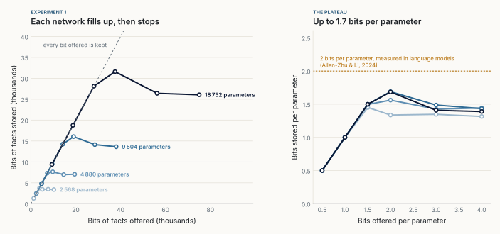
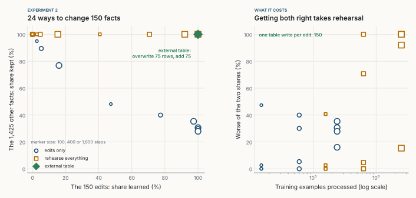
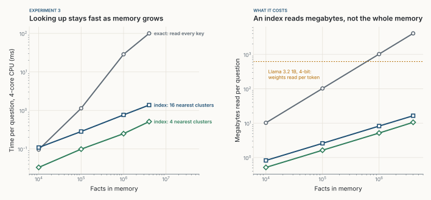
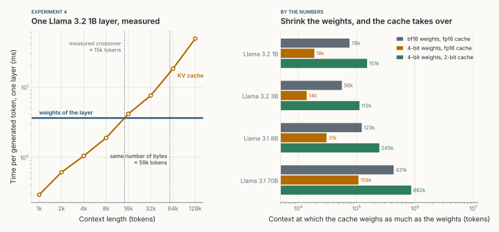
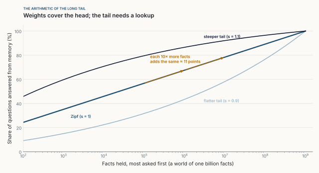
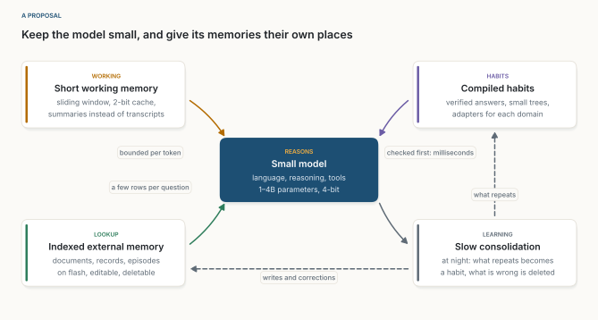

::: {.callout-note appearance="simple"}
**An experiment, October 2026.** Every number in Experiments 1 to 4 comes from [sim.py](sim.py), plain NumPy on a 4-core cloud CPU, with results in [results.json](results.json) and figures from [figs.py](figs.py). Other people's numbers are cited where they appear. The networks are deliberately tiny: they test the shape of an argument, not any product. This essay puts to the test two ideas from [Fast AI](../2026-10-11-fast-ai/index.qmd) and [An Ecosystem, Not an Oracle](../2026-10-17-an-ecosystem-not-an-oracle/index.qmd): bandwidth, and memory outside the weights.
:::

**In short.** A language model keeps what it knows in four places: its weights, its working memory (the KV cache), whatever it can look up, and the habits it has compiled. Each is paid for at a different moment, and for a small model on a laptop that decides the design. Four experiments led me to one rule: **keep in the weights what is used on every token; look up everything else, and keep what you look up short.**

::: {.callout-tip appearance="simple" icon="false"}
## Key takeaways

- **Weights are the densest memory, and the most expensive to read.** My networks held up to 1.7 bits per parameter, and a model reads all of them for every token.
- **Weights are hard to edit.** Fine-tuning on 150 changed or new facts never kept both the edits and the other facts. Rehearsing everything did, after 630,000 training examples. A table needed 150 writes.
- **Looking up is cheap; rereading what you looked up is not.** An index searched four million facts in 0.5 ms. But three retrieved passages then cost a 1B model 29 MB on every generated token.
- **Small models hit the working-memory wall first.** At 4-bit weights, the cache of Llama 3.2 1B outweighs its weights from about 19,000 tokens.
- **Knowledge has a long tail.** Under Zipf's law, each tenfold increase in facts held answers the same extra slice of questions. Weights cover the head; the tail belongs in a lookup.
:::

## 1. The question

Debates about small language models usually ask how much of a large model fits on a laptop. That treats a model as one block of knowledge to compress. I think the better question is *what should live where?*

Generating a token on a laptop is limited by memory bandwidth, not arithmetic: the machine reads every weight, and the whole cache of the conversation, for every token [@alizadeh2023]. So where knowledge lives decides what it costs.

{fig-alt="Four cards side by side. Weights, parametric memory: what the model knows, read in full for every token. KV cache, working memory: what it is reading now, grows with the context and is read for every token. Lookup, external memory: documents, records, past cases, a few rows only when asked. Habits, compiled memory: verified answers and small models, built once and reused in milliseconds. An arrow underneath runs from paid on every token to paid rarely."}

## 2. Experiment 1: how many facts fit in the weights

**Setup.** A fact is a key (a random vector of 32 numbers, standing for a question) and a value, one of $V = 256$ answers: $\log_2 256 = 8$ bits. The memory is a two-layer network,

$$
f_\theta(x) = W_2\,\mathrm{ReLU}(W_1 x + b_1) + b_2, \qquad |\theta| = 32h + h + 256h + 256,
$$

with hidden width $h \in \{8, 16, 32, 64\}$: 2,568 to 18,752 parameters. Each network learned $N$ facts, offering from half to four times as many bits as it has parameters, in 3,000 full-batch Adam steps, three seeds each. Following Allen-Zhu and Li [@allenzhu2025], I count the bits it holds as

$$
B(\theta) = \sum_{i=1}^{N} \max\!\Big(0,\; \log_2 V + \log_2 p_\theta(y_i \mid x_i)\Big),
$$

what its prediction knows about each answer beyond a uniform guess.

{fig-alt="Left, four lines of bits stored against bits offered, for networks of 2,568, 4,880, 9,504 and 18,752 parameters, each the mean of three seeds with a narrow band. Each follows the diagonal, where every bit offered is kept, then peaks and flattens slightly lower. Right, bits stored per parameter against bits offered per parameter, with small error bars: all four networks rise along the same line to a peak of 1.40, 1.53, 1.68 and 1.67, then settle near 1.4. Three amber diamonds for three times more training sit slightly higher: 1.80, 1.55 and 1.49. A dashed amber line at 2 marks the capacity of a perceptron and of language models."}

**Result.** Below capacity, every network kept every bit. Near capacity it peaked at 1.40 bits per parameter for the smallest network, 1.53 for the next, and 1.68 and 1.67 for the two largest, with seeds never more than 0.04 apart. Past capacity it stored less, not more: about 1.4 bits per parameter, with accuracy down to a fifth or a third. Three times more training lifted the peak to 1.80 but barely changed the decline (1.52 to 1.55, 1.45 to 1.49), so the decline is interference, not undertraining.

The number is old: Cover showed in 1965 that a perceptron stores about two bits per weight [@cover1965], and Allen-Zhu and Li measured about two bits per parameter in transformers [@allenzhu2025]. **Weights are a very dense memory**: an 8-bit fact costs about five parameters, under five bytes at 8-bit precision. At 4 bits, the precision most small models run at, Allen-Zhu and Li found the capacity cut by more than half.

## 3. Experiment 2: changing one's mind

**Setup.** A network of 18,752 parameters learned 1,500 facts perfectly. Then 75 facts changed and 75 new ones appeared. I updated it in two ways, each over 4 learning rates and 3 training lengths: fine-tuning on the 150 **edits only**, or **rehearsing everything**, all 1,575 facts. An external table got the same edits: overwrite 75 rows, add 75.

{fig-alt="Left, a scatter plot. Horizontal axis: share of the 150 edits learned. Vertical axis: share of the 1,425 other facts kept. Rehearse everything runs, as squares, sit along the top at 100 percent kept, from 0 to 100 percent of edits learned. Edits only runs, as circles, fall along a diagonal from 100 percent kept with no edits learned to about 30 percent kept with all edits learned. A green diamond at the top right marks the external table. Right, the worse of the two shares against training examples processed on a log scale: edits only runs stay below 50 percent; rehearse everything runs reach 100 percent at about 630,000 examples and above."}

**Result.** Fine-tuning on the edits alone never got both right. The runs that learned 97% or more of the edits kept only 28% to 35% of the other facts; the best compromise kept 48% and learned 47%. Rehearsing everything got both to 100%, after 630,000 training examples, a cost that grows with everything the network knows. The table needed 150 writes and 0.04 ms.

Catastrophic interference is not new [@mccloskey1989], and editing methods such as ROME and MEMIT do far better than plain fine-tuning [@meng2022; @meng2023], though models still degrade as edits accumulate [@gupta2024]. The point is the contrast: in a table, an edit is local by construction; in weights, every fact shares every parameter. Contacts change, prices change, a client asks you to delete their data. A memory you can overwrite row by row is one you can keep true.

## 4. Experiment 3: looking it up

**Setup.** I stored ten thousand to four million facts as unit vectors of 256 numbers, clustered around 2,000 topics as real embeddings are. A question is a stored key plus noise, a paraphrase. Exact search compares it with every key, $O(Nd)$. An inverted-file index (IVF) groups the keys into $c = 4\sqrt{N}$ clusters and searches only the $p$ nearest, $O\big((c + pN/c)\,d\big)$, which grows like $\sqrt{N}$ [@douze2024].

{fig-alt="Left, a log-log chart of time per question against facts in memory, from ten thousand to four million: exact search rises from 0.1 to 100 milliseconds; an index probing 16 clusters from 0.1 to 1.4 milliseconds; probing 4 clusters from 0.03 to 0.5 milliseconds. Right, share of questions answered with the right fact against time per question, for five noise levels: probing 1 cluster finds 80 to 95 percent in about 0.12 milliseconds; probing 4 clusters reaches the same share as exact search, 100 percent for four levels and 96 percent for the noisiest, in about 0.25 milliseconds, while exact search takes about 24 milliseconds."}

**Result.** Exact search took 29 ms over a million facts and 100 ms over four million. Probing 4 clusters took 0.25 and 0.5 ms, reading 5 and 11 MB. On harder questions, one cluster missed 5% to 20%, while four clusters matched exact search (95.5% against 96% at the noisiest level). My clustered keys flatter any index; real embeddings bend the curve later.

An external memory is less compact than weights: 1,024 bytes per fact here, or 8 to 64 bytes with compressed codes [@douze2024], against under five in the weights. But weights are read in full for every token. A lookup reads a few megabytes, only when a question needs it.

### What a looked-up fact really costs

In retrieval-augmented generation [@lewis2020], what the index finds is pasted into the prompt. From then on it sits in the working memory and is reread for every generated token.

{fig-alt="Horizontal bars on a logarithmic scale, in megabytes read per generated token for Llama 3.2 1B. A model ten times larger, 4-bit 12B: 6,200. Weights of the model, 4-bit 1B: 620. Conversation so far, 2,000 tokens, fp16 cache: 66. Three retrieved passages, 900 tokens, fp16 cache: 29. The same passages with a 2-bit cache: 4. The index search itself, spread over a 200-token answer: 0.05."}

Each token of context costs this model 32 KB. Three passages of 300 tokens add 29 MB to every generated token, over five hundred times the search itself. That is still only 5% of the 620 MB of weights, and far less than a model ten times larger, which would read 6,200 MB per token to answer about 11 more points of questions (Section 6). A lookup is cheap only if what it brings back is short: a fact, not three pages.

That is why recent architectures put the lookup *inside* the model, where a fetched fact never becomes context. Meta's memory layers read a few rows of a trainable table per token and beat dense models with more than twice the compute, most on factual questions [@berges2024]. DeepSeek's Engram adds a hashed n-gram table read in constant time [@engram2026]. Gemma 3n keeps per-layer embeddings on local storage [@gemma3n].

## 5. Experiment 4: the working memory

**Setup.** The KV cache stores a key and a value per token, layer and key-value head:

$$
\text{KV bytes per token} = 2 \cdot L \cdot n_{kv} \cdot d_h \cdot b.
$$

Each new token reads the whole cache and all the weights, so the cache weighs as much as the weights at

$$
T^{*} = \frac{|\theta| \cdot b_w}{2 \cdot L \cdot n_{kv} \cdot d_h \cdot b_{kv}}.
$$

I timed one layer shaped like Llama 3.2 1B [@llama32] generating a token over caches of 1,000 to 131,000 tokens.

{fig-alt="Left, a log-log chart of time per generated token for one layer against context length from 1k to 128k tokens: the weights are flat at 3.6 milliseconds; attention over the KV cache rises from 0.3 to 49 milliseconds, crossing the weights at about 15k tokens; a dotted line at 59k marks where cache and weights hold the same number of bytes. Right, horizontal bars of the context at which the cache weighs as much as the weights. Llama 3.2 1B: 76k with 16-bit weights, 19k with 4-bit weights, 151k with 4-bit weights and a 2-bit cache. Llama 3.2 3B: 56k, 14k, 112k. Llama 3.1 8B: 123k, 31k, 245k. Llama 3.1 70B: 431k, 108k, 862k."}

**Result.** The weights cost 3.6 ms per token at any context. Attention cost 0.3 ms at 1,000 tokens, matched the weights at about 15,000 and took 49 ms at 131,000. By bytes alone the crossover is 59,000; my NumPy attention is slower than a matrix product, so it came earlier.

The formula gives 76,000 tokens for Llama 3.2 1B in 16 bits. Quantise the weights to 4 bits and it falls to **19,000**: a long document, or one agent loop with a few tool outputs. For Llama 3.1 70B it is 108,000. **Shrinking the weights moves the bottleneck to the working memory.** The remedies all keep that memory short: grouped-query attention [@ainslie2023], sliding windows on five of every six layers in Gemma 3 [@gemma3], 2-bit caches [@liu2024kivi], which push the 1B crossover back to 151,000, and Cartridges, small caches trained offline that match in-context learning with 38.6 times less memory [@eyuboglu2026].

## 6. The arithmetic of the long tail

How much should stay in the weights? Questions are not uniform: models know popular facts far better than rare ones [@kandpal2023], and retrieval helps most on the rare ones [@mallen2023]. If the $k$-th most asked of $F$ facts is asked with probability proportional to $k^{-s}$ (Zipf's law), a memory holding the $K$ most asked answers

$$
\text{coverage}(K) = \frac{H_{K,s}}{H_{F,s}}, \qquad H_{n,s} = \sum_{k=1}^{n} k^{-s}.
$$

For $s = 1$, $H_n \approx \ln n + 0.577$, so each tenfold step adds the same share,

$$
\text{coverage}(10K) - \text{coverage}(K) \approx \frac{\ln 10}{\ln F + 0.577},
$$

about 11 points with a billion facts.

{fig-alt="Three rising curves on a logarithmic horizontal axis from a hundred to a billion facts. The Zipf curve with s equal to 1 rises in a nearly straight line, from about 25 percent at a hundred facts to 100 percent at a billion. Two amber arrows mark that each tenfold increase adds the same slice of about 11 points. A flatter tail with s equal to 0.9 lies below, a steeper tail with s equal to 1.1 above."}

A model ten times larger reads ten times more per token for 11 more points. An index ten times larger reads about three times more, once per question. The head belongs in the weights, where it is used constantly; the tail belongs in a lookup. Apple's hierarchical memories make this split in pretraining: a 160M model fetching 18M parameters from a 4.6B memory bank matched a regular model over twice its size [@pouransari2026].

## 7. What it means for small models and Fast AI

{fig-alt="Diagram. A dark card in the centre: small model, reasons; language, reasoning, tools; 1 to 4B parameters at 4 bits. Top left, working memory: sliding window, 2-bit cache, summaries instead of transcripts, labelled bounded per token. Bottom left, lookup: indexed external memory on flash, editable and deletable, labelled a few rows per question. Top right, habits: verified answers, small trees, adapters, labelled checked first, milliseconds. Bottom right, learning: slow consolidation at night. Dashed arrows run from consolidation to habits and to the external memory, labelled writes and corrections."}

1. **Keep in the weights what is used on every token:** language, reasoning, tool use, the structure of a domain. Not the price list.
2. **Keep the working memory short:** summaries rather than transcripts, a compressed cache, a window.
3. **Look up the long tail, and bring back little:** the fact, not the page. Every row can be inspected, corrected and deleted.
4. **Compile what repeats,** as in [Fast AI](../2026-10-11-fast-ai/index.qmd): a verified answer, a small tree or an adapter, checked before the model is called.
5. **Consolidate slowly:** what is looked up constantly may earn a place in a habit; what is wrong is deleted, in one line, not one training run.

Agent memory systems are building the top of this stack: MemGPT, now Letta, pages context like an operating system [@packer2023]; Mem0 and A-MEM extract and link memories across sessions [@chhikara2025; @xu2025amem]; Titans learns a memory at test time [@behrouz2024]. A small model has the least room in its weights and the least bandwidth to spare, so it gains the most from putting each memory in the right place.

## 8. Recent work, with code

| Work | Memory it addresses | Idea | Code |
|---|---|---|---|
| Physics of Language Models 3.3 [@allenzhu2025] | Weights | About 2 bits of knowledge per parameter | — |
| Memory Layers at Scale [@berges2024] | Weights, sparse | Trainable key-value lookup inside the model | [facebookresearch/memory](https://github.com/facebookresearch/memory) |
| Engram [@engram2026] | Weights, sparse | Hashed n-gram memory, constant-time lookup | [deepseek-ai/Engram](https://github.com/deepseek-ai/Engram) |
| Hierarchical memories [@pouransari2026] | Weights + bank | Small model, long-tail facts in a fetched memory bank | — |
| Titans [@behrouz2024] | Learned at test time | A neural memory updated during inference | [lucidrains/titans-pytorch](https://github.com/lucidrains/titans-pytorch) (unofficial) |
| KIVI [@liu2024kivi] | Working memory | 2-bit KV cache, no fine-tuning | [jy-yuan/KIVI](https://github.com/jy-yuan/KIVI) |
| Cartridges [@eyuboglu2026] | Working memory | A small cache trained offline per corpus | [HazyResearch/cartridges](https://github.com/HazyResearch/cartridges) |
| LLM in a Flash [@alizadeh2023] | Weights on flash | Load only the weights a token needs | — |
| Faiss [@douze2024] | External | Vector indexes, IVF and beyond | [facebookresearch/faiss](https://github.com/facebookresearch/faiss) |
| MemGPT / Letta [@packer2023] | External, agent | The context as virtual memory | [letta-ai/letta](https://github.com/letta-ai/letta) |
| Mem0 [@chhikara2025] | External, agent | Extract and update memories across sessions | [mem0ai/mem0](https://github.com/mem0ai/mem0) |
| A-MEM [@xu2025amem] | External, agent | Linked notes that reorganise themselves | [agiresearch/A-mem](https://github.com/agiresearch/A-mem) |
| llama.cpp | All, locally | Quantised weights and KV cache on a laptop | [ggml-org/llama.cpp](https://github.com/ggml-org/llama.cpp) |

: **Table 1.** Recent work on the four memories. Code links checked on 25 October 2026. Benchmarks of agent memory systems are still young, and the vendors' own scores often disagree with independent ones; I would compare them on your own data.

## 9. What this experiment does not show

- **My facts are random.** Real knowledge has structure a model can compress, so weights may do better than my networks.
- **My networks are tiny:** two layers, at most 19,000 parameters.
- **My questions are synthetic.** Real retrieval must embed a question first; it can miss, or find the fact and see the model ignore it.
- **Plain fine-tuning is the weakest editor.** Better methods narrow the gap, but still edit weights that every fact shares.
- **NumPy is not a serving engine**, which is why Figure 6 also gives the byte count.
- **Zipf is a model.** A specialist's questions may have a shorter tail, which argues for specialists.

## 10. Conclusion

We say a model *knows* something as if knowledge lived in one place. It lives in four, at four prices: dense weights read on every token, a working memory that grows with every token, a bulky but cheap and correctable lookup, and habits that cost almost nothing once built. Large models can afford to blur them. Small ones cannot, and that is their advantage. Keep in the weights what is used on every token, keep the working memory short, look up the long tail, compile what repeats.

::: {.read-next}
**Read next** · [An Ecosystem, Not an Oracle](../2026-10-17-an-ecosystem-not-an-oracle/index.qmd)  
The architecture these four memories fit into.
:::

::: {.small}
*The views in this essay are my own and do not describe any product or plan of my employer.*
:::

## References

::: {#refs}
:::
