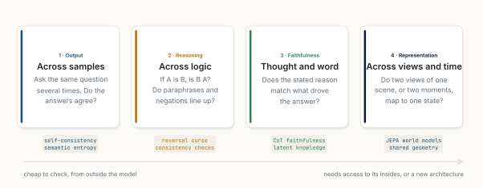
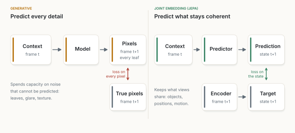
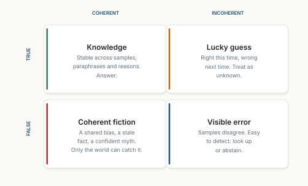
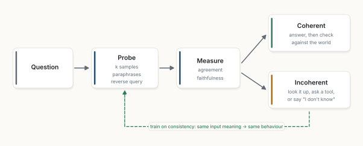

::: {.callout-note appearance="simple"}
**A thought essay with one experiment, October 2026.** Figures 1, 3, 4 and 5 are my own schematics. Figure 2 is measured: [sim.py](sim.py) trains ten small neural networks on the handwritten digits that ship with scikit-learn, on a 4-core cloud CPU, in under two minutes; results are in [results.json](results.json) and figures come from [figs.py](figs.py). The networks are tiny and the task is easy: the experiment tests the shape of an argument, not a language model. Every other claim is cited.
:::

**In short.** A line circulates online: the next scientific revolution *won't come from more parameters or larger models; it will come from understanding coherence.* As a statement about physics, I can't test it. As a statement about machine learning, I can, because in AI coherence is not a mystical invariant. It is a family of checks: do the answers agree, does the logic run both ways, does the stated reason match the real one, do two views of the world map to one state. Each check can be measured, used at run time, and trained for. My conclusion: **coherence will not replace scale, but it is what we should measure scale by, and a cheap signal for when a model should stop and look. It fails exactly where all the models share the same mistake.**

::: {.callout-tip appearance="simple" icon="false"}
## Key takeaways

- **Coherence has four working definitions in AI:** across samples, across logic, between thought and word, and across views and time.
- **Disagreement is a detector.** In my experiment, when ten networks all agreed, they were right 99.7% of the time; where they disagreed, the errors were. Published work finds the same for language models [@farquhar2024].
- **Coherence is a training target.** Several recent models are trained to agree with themselves rather than to reproduce every pixel or token [@assran2025; @song2023; @irpan2025].
- **Coherent is not true.** When every network learned the same misleading shortcut, agreement no longer told right from wrong: its detection score fell from 0.93 to 0.49, chance level.
- **One rule:** probe, measure agreement, answer when coherent, look up or abstain when not, check the coherent answers against the world, and train on what you learn.
:::

## 1. The claim, read as engineering

In physics, "coherence" has a precise meaning about waves and quantum states. I borrow only the word. In what follows it means *agreement*: between answers, between directions of a fact, between a model's reasons and its behaviour, between views of the world.

Read that way, the quote sets coherence against scale. That is a false choice, and the last few years show why. Larger models *did* become more coherent: they contradict themselves less, they hold a thread across longer tasks, and their internal representations grow more alike [@huh2024]. Scale bought coherence.

But scale bought it without measuring it. We trained on next-token loss and discovered coherence afterwards, as a side effect. The better reading of the quote is this: *coherence should become a first-class quantity, something we measure, report and optimise directly, not something we hope emerges.*

To do that, we need definitions. Figure 1 gives four.

{fig-alt="Four cards. One, output: across samples; ask the same question several times, do the answers agree; tagged self-consistency and semantic entropy. Two, reasoning: across logic; if A is B, is B A, do paraphrases and negations line up; tagged reversal curse and consistency checks. Three, faithfulness: thought and word; does the stated reason match what drove the answer; tagged CoT faithfulness and latent knowledge. Four, representation: across views and time; do two views of one scene, or two moments, map to one state; tagged JEPA world models and shared geometry. An arrow underneath runs from cheap to check from outside the model, to needs access to its insides or a new architecture."}

## 2. Four kinds of coherence

**Across samples.** Ask a model *Who wrote* Middlemarch? ten times. If it knows, every answer says George Eliot, in different words. If it is guessing, the answers scatter. Self-consistency turns this into a vote: sample several reasoning paths and keep the majority answer, which raised accuracy on maths benchmarks by up to 18 points [@wang2023sc]. Semantic entropy turns it into an alarm: group the answers by meaning and measure how spread they are; high spread flags likely confabulation [@kuhn2023; @farquhar2024]. SelfCheckGPT does the same for long text, sentence by sentence [@manakul2023].

**Across logic.** A model trained on "Tom Cruise's mother is Mary Lee Pfeiffer" often cannot answer "Who is Mary Lee Pfeiffer's son?". This *reversal curse* holds even for large models [@berglund2024]. More generally, a model's beliefs should obey simple rules: P(X) and P(not X) should add to one, and paraphrasing a question should not change the answer. Such checks catch errors even when nobody knows the right answer, which makes them useful for evaluating models that may be better than their evaluators [@fluri2024].

**Between thought and word.** A chain of thought is only useful if it is the real reason. Often it is not. Models nudged by a hidden bias, such as "the answer is always (A)", follow the bias and then write a plausible explanation that never mentions it [@turpin2023]. Reasoning models do the same: given a planted hint, they mostly used it without saying so [@chen2025cot]. Can we read the truth from inside instead? One method finds a direction in a model's activations that keeps its answers to a statement and to its negation consistent [@burns2023]. But later work showed such probes can lock onto other consistent features, such as a character's opinion in the prompt, rather than the model's own knowledge [@farquhar2023ccs; @levinstein2024]. Interpretability work now traces the internal steps behind an answer more directly [@templeton2024; @lindsey2025]. Faithfulness is coherence between the inside and the outside, and it is the hardest of the four to measure.

**Across views and time.** A world model should map two views of the same scene, or two moments of the same motion, to states that fit together. The same may hold across models: networks trained on different data, in different modalities, measure distances between concepts more and more alike as they grow, its authors argue [@huh2024]. This is where coherence becomes architecture (section 4).

## 3. Coherence as a signal, measured

The first use of coherence costs nothing to adopt: measure it at run time and act on it. I tested the idea on the smallest setup I could make honest.

**Setup.** Ten small neural networks, each trained on a different resampling of 898 handwritten digits, with a different random start; 899 other digits held out for testing. Each network gives one answer. This is an ensemble of independently trained models, not repeated samples from one language model, but the question is the same: *does agreement predict correctness?* I tested on the clean digits, and on the same digits with heavy pixel noise the networks never saw in training.

. Left: ten networks; digits are answered in order of how many networks agree, and the line shows the accuracy of the majority answer so far. AUROC measures how well agreement separates right from wrong answers (1 is perfect, 0.5 is chance). Right: the same setup, but every training digit carries a hint that is usually right; at test time the hint is always wrong. Means of three seeds; bands show the range.](figures/fig02.svg){fig-alt="Left, accuracy of the majority vote against share of digits answered, most agreed first. Clean digits: close to 100 percent until about 95 percent of digits are answered, ending at 97.6 percent when everything is answered; AUROC 0.92. Noisy digits: near 99 percent until about 75 percent are answered, then falling to 89.3 percent; AUROC 0.89. Right, against how often the hint was right during training, 50, 80, 90, 95 and 99 percent. Green line, agreement detects errors, AUROC: 0.93, 0.84, 0.78, 0.68, 0.49, reaching the dotted chance line at 0.5. Red line, the majority follows the wrong hint: 0.03, 0.07, 0.15, 0.25, 0.44."}

**Result.** Agreement worked as a detector (Figure 2, left):

- On clean digits, all ten networks agreed on 81% of them, and were right on 99.7% of those. One network alone was right 94.5% of the time; the majority, 97.6%.
- On noisy digits, a single network dropped to 77.9%. The networks now agreed fully on only 36% of digits, but were still right on 99.4% of those. Agreement fell where the task got hard, which is exactly what a warning signal should do.
- Agreement separated right from wrong answers with an AUROC of 0.92 on clean digits and 0.89 on noisy ones.

So agreement ranks answers by trust. The low-agreement ones can go to a lookup, a tool, or an honest "I don't know". This matters because today's training rewards guessing: benchmarks score an abstention like a wrong answer, so models learn to bluff [@kalai2025]. Asking a model how sure it is can help too [@tian2023], but agreement does not depend on the model's own sense of confidence.

**The cost.** Agreement is not free. Ten models, or ten samples, cost up to ten times the compute, and grouping free-text answers by meaning needs a second model to judge which answers say the same thing [@farquhar2024]. For a single digit the vote is trivial; for a paragraph it is not.

## 4. Coherence as a training target

The second use goes deeper: train for coherence directly.

**In vision and world models.** A generative model learns by predicting every pixel of the next frame, including leaves, glare and texture that no one could predict. Joint-embedding predictive architectures (JEPA) predict something else: the *representation* of the missing part, scored on whether it matches the encoding of the real thing [@assran2023; @bardes2024] (Figure 3). V-JEPA 2, trained this way on more than a million hours of video, was then adapted with under 62 hours of unlabelled robot video and then planned pick-and-place tasks zero-shot on robot arms in two labs whose data it had never seen [@assran2025]. The loss is not "reproduce the world"; it is "stay consistent with it".

{fig-alt="Two diagrams side by side. Left, generative, predict every detail: context frame t goes to a model, which outputs pixels of frame t+1, every leaf; a red arrow marks a loss on every pixel against the true pixels of frame t+1; a note says it spends capacity on noise that cannot be predicted: leaves, glare, texture. Right, joint embedding, predict what stays coherent: context frame t goes to a predictor, which outputs a predicted state t+1; frame t+1 goes through an encoder to a target state t+1; a green arrow marks a loss on the state; a note says it keeps what views share: objects, positions, motion."}

**In generation.** Consistency models train a network so that every point along a noisy trajectory maps to the same clean output. That constraint is what allows generation in one or two steps instead of hundreds [@song2023].

**In language models.** Consistency training asks a model to behave the same with and without an irrelevant cue: a leading question, a stated opinion, a jailbreak wrapper. Trained this way, models showed less biased reasoning [@chua2024] and less sycophancy and jailbreak success, whether the consistency was enforced on outputs or on internal activations [@irpan2025]. Nobody had to write the right answer.

**The trap.** Coherence alone is easy to game. A model that answers "42" to everything is perfectly consistent and useless; a JEPA whose encoder outputs a constant matches its target every time. Every method above therefore needs an anchor. JEPAs use architectural tricks to keep representations from collapsing [@assran2023]; consistency models are tied to real data at the end of the trajectory [@song2023]; consistency training uses the model's own answer to the *clean* prompt as the target [@irpan2025]. Coherence is a constraint, not an objective on its own.

## 5. Where coherence stops

Coherence has a hard limit, and the original quote skips it. **Coherent is not true.** A conspiracy theory can be perfectly self-consistent. So can a model trained on a stale or biased corpus. Figure 4 makes the point with a simple grid.

{fig-alt="A two by two grid. Columns: coherent, incoherent. Rows: true, false. Coherent and true: knowledge; stable across samples, paraphrases and reasons; answer. Incoherent and true: lucky guess; right this time, wrong next time; treat as unknown. Coherent and false: coherent fiction; a shared bias, a stale fact, a confident myth; only the world can catch it. Incoherent and false: visible error; samples disagree; easy to detect, look up or abstain."}

The second half of the experiment measures the bottom-left cell (Figure 2, right). I gave every training digit a ten-slot *hint* naming a digit, like a hint planted in a prompt. The hint was right some fixed share of the time, from 50% to 99%. At test time, the hint always named a wrong digit.

- With a weak hint (right 50% of the time), the networks mostly ignored it: the majority followed the wrong hint on 3% of digits, and agreement still detected errors (AUROC 0.93).
- As the hint grew more reliable in training, every network learned to lean on it. With a 99% reliable hint, the majority followed the wrong hint on 44% of digits, and agreement could no longer tell right answers from wrong ones: AUROC 0.49, chance level.
- A control ensemble trained without hints was unaffected: 97.6% correct with the same wrong hints present.

Ten models, ten random starts, ten different resamplings of the data, and they still agreed on the same mistake, because they all learned the same shortcut from the same data. Diversity among models protects against their independent errors, not against what they share. And the shortcut was not free: trained with the 90% hint, a single network got only 85% of *clean* digits right, against 94.5% without it, because it had learned to lean on a clue that was no longer there.

Language models are in a worse position than my ensemble. Repeated samples from one language model share not part of their training but all of it. A shortcut learned in training is therefore invisible to the self-consistency checks of section 3 by construction: every sample has it.

Asking the model to check itself does not fix this. Without outside feedback, language models asked to review their own reasoning often change right answers into wrong ones, and overall get worse [@huang2024selfcorrect].

So coherence is necessary, not sufficient. Internally it removes noise; externally, it must be anchored by retrieval, tools, tests and people. This is the same conclusion as [An Ecosystem, Not an Oracle](../2026-10-17-an-ecosystem-not-an-oracle/index.qmd), reached from a different side.

## 6. A design rule

Put together, the pieces give a loop (Figure 5).

{fig-alt="A flow diagram. Question leads to probe: k samples, paraphrases, reverse query. Probe leads to measure: agreement, faithfulness. Measure branches: coherent, answer, then check against the world; incoherent, look it up, ask a tool, or say I don't know. A small model box under probe feeds it. A dashed green line runs from the incoherent branch back to the model, labelled train on consistency: same meaning in, same behaviour out."}

1. **Probe.** For any answer that matters, ask more than once: several samples, a paraphrase, the reverse question.
2. **Measure.** Score agreement in meaning, not in words. Where you can see inside, check that the stated reason is the one used.
3. **Route.** Incoherent: retrieve, call a tool, or abstain. Coherent: answer, and when the stakes are high still check against the world, because shared mistakes look coherent too.
4. **Train.** Feed the inconsistencies back as training signal, anchored to clean examples. Same meaning in, same behaviour out.

For small, local models, the loop is especially affordable. Generating a token is limited by reading the weights from memory: about 620 MB for a 4-bit 1B model, and 6,200 MB for a 12B one, as computed in [Where Memory Lives](../2026-10-26-where-memory-lives/index.qmd). Five samples from the small model read half the bytes of one sample from the large one, and far fewer when the five run as a batch, since a batch reads the weights once. Their agreement then tells you when to reach for the external memory that essay describes.

## 7. Conclusion

The quote is right about one thing: more parameters alone will not tell us whether a model understands. It overreaches in another: coherence is not a universal invariant waiting to unify reality. In AI it is something humbler and more useful: a set of measurable agreements, between samples, between directions of a fact, between thought and word, between views of the world. Measure them, route on them, train for them, and anchor them in the world, because a mistake every model shares is the one coherence cannot see. That is a research programme, not a revolution, and it can start today.
