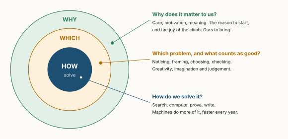
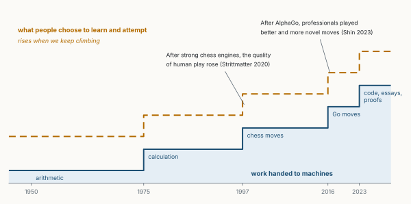
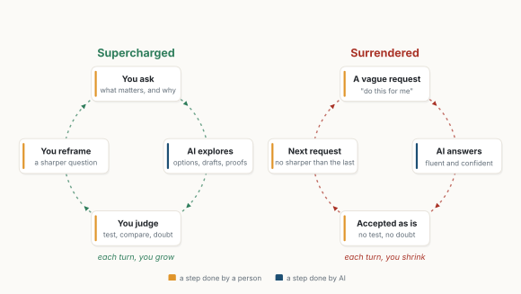
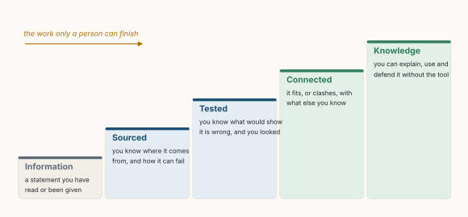

::: {.callout-note appearance="simple"}
**Essay, October 2026.** All figures are my own, drawn with the code in [figs.py](figs.py). Figures 3 and 5 use numbers from the studies cited in their captions; the others are schematics.
:::

**In short.** AI is getting very good at solving problems, and it will keep getting faster. If we measure ourselves by the pace at which we find answers, we have already lost, and it does not matter. The fear is old: Plato already worried that writing would give people the appearance of wisdom without the reality. What remains ours is setting the problems, which asks for creativity, imagination and judgement, and, underneath, caring about them. A machine has no reason of its own to want an answer. We do. Even if the deepest questions stay out of reach for us and for any machine, the motivation to pursue them and the joy of the climb may be what matters most. The risk is that we hand over the effort that builds these things, and children most of all.

::: {.callout-tip appearance="simple" icon="false"}
## Key takeaways

- Solving is being automated fast, but someone still has to say what counts as a good answer, and why it matters. As Nietzsche put it, the *why* comes before the *how*.
- Losing work can lift us. After superhuman Go programs appeared, professional players made better and more novel moves [@shin2023].
- AI evens out execution. What separates people now is judgement: knowing where the tool ends, and when to doubt it [@dellacqua2026; @lee2025critical].
- Effort builds both skill and motivation. Students who practised with a plain chatbot did 17% worse once it was taken away [@bastani2025]. For Spinoza, joy is the feeling of our own power to act growing; a tool that does the climbing for us can take it away.
- The skills that stay ours are imagination, judgement and the ability to tell information from knowledge. Choosing what is worth our life, and enjoying the pursuit, is not a task to automate.
:::

## 1. The oldest fear

In Plato's *Phaedrus*, Socrates tells a story. The Egyptian god Theuth brings a new invention to King Thamus: writing. It will make people wiser, he says, and improve their memory. The king is not convinced. Those who rely on it, he answers, will stop exercising their memory, and writing will offer them "the appearance of wisdom, not true wisdom" [@plato]. They will have heard many things without learning them.

Twenty-four centuries later, we have the same conversation about AI. In July 2025, an AI system reached gold-medal standard at the International Mathematical Olympiad [@deepmind2025imo]. A coding agent found a way to multiply two 4×4 complex matrices with 48 multiplications, the first improvement in 56 years on this case [@novikov2025alphaevolve]. By mid-2026, AI systems were settling problems posed by Paul Erdős that had stayed open for decades [@quanta2026]. The question everyone asks is Thamus's question: what will this do to us?

The usual answer is a race: how long before the machine is faster than me at *my* work? I think this is the wrong race. Speed is the machine's game, and we will lose it. A better question is what we are for, once speed is no longer our job.

Look at how these systems work. To run AlphaEvolve, a person writes down the problem and a program that scores any proposed answer. The machine then searches, far faster than we could. Without that scoring function there is nothing to search for. And behind the scoring function there is something even more human: a reason to care about this problem rather than another.

Nietzsche wrote that whoever has a *why* to live can bear almost any *how* [@nietzsche1889]. He was writing about suffering, not software, but the order he gives holds here too. The why comes first, and it gives the how its worth. Figure 1 is how I picture it. In the middle is *how*: solving. Machines take more of it every year. Around it is *which*: which problem, and what counts as a good answer. Around that is *why*: why it matters to us at all. The outer rings are not slower versions of the middle one. They are a different kind of thing.

{fig-alt="Three concentric circles. The core, dark blue, is HOW: solve; machines do more of it, faster every year. The middle ring, amber, is WHICH: noticing, framing, choosing, checking; creativity, imagination and judgement. The outer ring, green, is WHY: care, motivation, meaning, the reason to start and the joy of the climb; ours to bring."}

## 2. Losing work, gaining height

Thamus was half right. Writing did weaken one kind of memory. But it did not make us less wise; it changed what wisdom asks of us. Freed from memorising, people could compare texts, argue across centuries and build on each other's work. A century ago, the mathematician Alfred North Whitehead turned this into a rule: "Civilization advances by extending the number of important operations which we can perform without thinking about them" [@whitehead1911]. Every operation we hand over frees attention for something harder.

Games give us rare evidence, because the quality of a move can be measured. A study of 5.8 million moves by professional Go players between 1950 and 2021 found that after superhuman AI appeared in 2016, human moves became better, and more novel: players began trying moves no one had played before, and those new moves were good [@shin2023]. The study shows an association, not proof of cause, but the timing is striking. The machines did not end the game. The space of the game turned out to be bigger than people had thought, and they went exploring.

{fig-alt="A step chart over time. A lower blue staircase, work handed to machines, rises from arithmetic in 1950 to calculation in 1975, chess moves in 1997, Go moves in 2016, and code, essays and proofs in 2023. A dashed amber staircase above it, what people choose to learn and attempt, rises as well. A note: after AlphaGo, professionals played better and more novel moves."}

This is the hopeful half of my argument: losing much of our work may let us learn more advanced things than we ever had time for. In 1930, the economist John Maynard Keynes imagined his grandchildren freed from most work, and predicted that humanity would then face "its real, its permanent problem": how to use that freedom "to live wisely and agreeably and well" [@keynes1930].

I do not want to make this sound easy. For most people, work is first of all an income, and losing it is not a philosophical opportunity but a threat. How the gains of AI are shared is a real and urgent question, and this essay does not answer it. My subject is narrower: what work *means* to us, and what we should protect while the rest is decided. Even there, the upper line in Figure 2 does not rise by itself. It rises only for people who keep climbing, and climbing is effort.

## 3. Knowing where the tool ends

Socrates was called the wisest man in Athens, and he explained why: unlike others, he did not think he knew what he did not know [@platoapology]. With AI, this old virtue becomes a practical skill.

On execution, AI is a great equaliser. In a call centre with over 5,000 agents, an AI assistant raised productivity by 15% on average, mostly for the least experienced; the best agents gained little [@brynjolfsson2025]. In a creative-writing experiment, the least creative writers gained the most from AI ideas [@doshi2024]. Where good answers are known, the tool spreads them.

What it does not spread is judgement about its own limits (Figure 3). In a field experiment with 758 consultants, those using AI on tasks it handles well completed 12.2% more tasks and worked 25.1% faster. On a task chosen to lie just beyond what it could do, they were 19 percentage points *less* likely to reach the right answer than colleagues without AI [@dellacqua2026]. The tool did not say where its competence ended. Knowing that was the person's job.

![**Figure 3.** Same tool, different results. Consultants with AI on tasks inside and just beyond what AI does well [@dellacqua2026]. Percent changes, except correct answers, in percentage points.](figures/fig03.svg){fig-alt="Horizontal bar chart. Consultants on tasks AI does well: 12.2% more tasks completed, 25.1% faster. Consultants on a task just beyond AI: 19 percentage points fewer correct answers."}

Who does that job well? A survey of 319 knowledge workers gives a clue: the more people trusted the AI, the less critical thinking they reported; the more they trusted themselves, the more they reported [@lee2025critical]. So the difference between people does not disappear. It moves, from how well we execute to how well we doubt.

What matters is the loop each of us gets into (Figure 4). In one loop, you ask what matters, the AI explores, you judge, and you come back with a sharper question. In the other, a vague request gets a fluent answer, the answer is accepted, and the next request is no sharper than the last. The first loop is the upper line of Figure 2. The second quietly pulls it down.

{fig-alt="Two circular loops. Supercharged: you ask what matters and why, AI explores options, you judge by testing and doubting, you reframe a sharper question; each turn, you grow. Surrendered: a vague request, AI answers fluently, accepted as is, next request no sharper than the last; each turn, you shrink."}

## 4. Effort builds the skill, and the wish

Spinoza gave a definition of joy that I find more useful than any other: joy is our passage from a lesser to a greater perfection, the feeling of our own power to act increasing [@spinoza1677]. In this sense joy is not having the answer. It is becoming able to find it. Which means a tool that hands us the answer can give us the result and take the joy away.

Recent experiments suggest exactly this. In four studies with over 3,500 people, working with a generative AI made the work better. But when people then moved to a task on their own, the gain did not carry over, and they reported less intrinsic motivation and more boredom [@wu2025]. Psychology has a name for what was missing. People are moved from the inside when three needs are met: *autonomy*, the sense of choosing what you do; *competence*, the sense of getting better at something hard; and *relatedness*, doing it with and for others [@ryan2020]. An AI that sets the task and does the hard part can take away the first two without anyone noticing. An AI used to explore questions you chose, on problems you are learning to master, can feed all three.

That is why I worry most about children. An adult who hands a task to AI still has the skill built before. A child who never builds it has nothing to fall back on, and may never discover the pleasure of having worked something out.

The clearest evidence comes from a school in Turkey, where nearly a thousand high-school students practised mathematics with one of two AI tools (Figure 5). With a plain chat assistant, practice grades rose by 48%. With a tutor designed to give hints instead of answers, they rose by 127%. Then the AI was taken away for the exam. Students who had used the plain assistant scored 17% *lower* than students who never had AI. Students who had used the tutor did about as well as those without AI [@bastani2025].

![**Figure 5.** Practice with AI, then an exam without it. Change in grades compared with students who never had AI [@bastani2025].](figures/fig05.svg){fig-alt="Grouped bar chart. During practice with AI, grades rose 48% with a plain chat assistant and 127% with a tutor that gives hints. In the exam without AI, the plain assistant group scored 17% lower than the control; the tutor group about the same."}

Other studies point the same way. University students who revised essays with ChatGPT wrote better essays but learned no more [@fan2025]. Junior developers learning a new library scored 17% lower on what they had learned when AI wrote the code for them, in a study by Anthropic, the company that makes the Claude assistant [@anthropic2026skills].

The good news is in the same studies: design matters. A tutor that asks you to try first, and a learner who asks "why?", keep the effort where it belongs. Spinoza ended his *Ethics* with a sentence every student could keep: "all things excellent are as difficult as they are rare."

## 5. Imagination, judgement, and a well-made head

If solving becomes cheap, the skills that matter most are those of the middle ring. Einstein said it plainly. "The formulation of a problem is often more essential than its solution, which may be merely a matter of mathematical or experimental skill," he wrote with Leopold Infeld; raising new questions "requires creative imagination and marks real advance in science" [@einstein1938]. Ten years earlier he had put it more briefly: imagination is more important than knowledge, because knowledge is limited [@viereck1929].

Psychologists later measured this. In the 1970s, they found that art students who spent more time *finding* their problem, exploring and changing it before committing, produced more original work and had more successful careers years later [@getzels1976]. Donald Schön wrote that professionals do not simply solve the problems given to them: they *set* them [@schon1983]. What is new is that this is becoming the scarce part. In a large study, research ideas written by a language model were rated *more* novel than ideas from experts [@si2025ideas]. But when 43 researchers spent over 100 hours each carrying the ideas out, the AI ideas lost much more of their score, and their advantage disappeared [@si2025gap]. An idea that sounds new is cheap. Knowing which one is worth months of your life is not.

There is also a trap. When writers used AI-generated ideas, their stories were rated more creative, but they became more similar to each other [@doshi2024]. If everyone draws from the same model, the model's defaults become everyone's ideas. The creative edge lies in what you bring that the model would not: your experience, your taste, your stubborn questions. And this can be taught. When the OECD measured the creative thinking of 15-year-olds for the first time, scores varied widely between education systems: the OECD average was 33 out of 60, and Singapore reached 41 [@oecd2024pisa].

Under imagination and judgement lies a more basic skill, and it brings us back to King Thamus: the ability to tell information from knowledge. AI gives us unlimited information, fluent and confident: the appearance of wisdom, in endless supply. None of it is knowledge until someone has done some work on it (Figure 6). Montaigne asked for exactly this in a child's education more than four centuries ago: better a well-made head than a well-filled one [@montaigne1580]. AI can fill any head at no cost. The making is still ours to do, because the last step, being able to explain and defend something without the tool, happens in a person.

{fig-alt="Five rising steps. Information: a statement you have read or been given. Sourced: you know where it comes from and how it can fail. Tested: you know what would show it is wrong, and you looked. Connected: it fits, or clashes, with what else you know. Knowledge: you can explain, use and defend it without the tool."}

## 6. What a machine has no reason to want

Now the outer ring of Figure 1, which I believe matters most.

Aristotle opened his *Metaphysics* with the sentence "all human beings by nature desire to know" [@aristotle]. Not to possess answers: to know. The desire comes first. A machine works on whatever problem it is given. Whether future machines will ever have something like wishes of their own, nobody knows, and I will not pretend to. But it does not change our side of the question. A result is not valuable in itself. It is valuable to someone: a person with a need, a hope, an idea of how we should live. Deciding what is worth doing is not a technical step; it is a human one.

The philosopher Bernard Suits imagined a utopia like Keynes's, where machines do all the work. What would people do there? His answer: play games, which he defined as "the voluntary attempt to overcome unnecessary obstacles" [@suits1978]. We climb mountains although helicopters exist. We still play chess, decades after a computer beat the world champion, and millions still play it every day. The obstacle is unnecessary; the climb is the point. When machines can solve a problem, solving it ourselves becomes a choice, and choices are where meaning lives.

Some questions may stay out of reach forever, for us and for any machine: why there is something rather than nothing, what a good life is, what all of this means. Albert Camus wrote about Sisyphus, condemned to push a rock up a hill forever, and concluded that "one must imagine Sisyphus happy" [@camus1942]. The struggle toward the heights, he wrote, is enough to fill a human heart. I do not read this as resignation. I read it as a description of what makes us human: we keep asking, keep climbing, and find joy in it even without a final answer.

A machine may one day reach the top of every hill faster than we can. Being there first is not the same as being glad to be there. That gladness, the motivation to begin, the meaning found on the way, the joy of understanding something for yourself, is not a slower version of what machines do. It is the reason any of it is worth doing.

## 7. Conclusion

King Thamus feared that a new tool would give us the appearance of wisdom without the reality. He was right that it could; he was wrong that it must. The same is true of AI. On speed, the race is over, and that is fine. What remains is the part that was always ours: choosing which problems are worth our time, judging the answers, and caring about them. AI can help us climb higher than ever, as Go players did, if we keep making the effort. It can also make the climb feel pointless, if we let it take the part that gave us joy.

So for ourselves: write the question before opening the tool, decide what a good answer looks like, and keep doing some things by hand for the pleasure and the skill. For our children: let them try first, teach them to ask "how do you know?", reward good questions as much as right answers, and leave room for boredom and play, where imagination grows. The machine will find answers. Whether they matter, and the joy of looking for them, is up to us.
