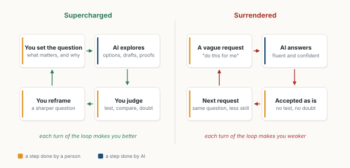
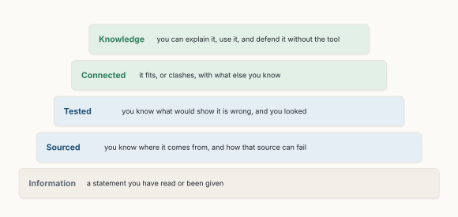

::: {.callout-note appearance="simple"}
**Essay, October 2026.** All figures are my own, drawn with the code in [figs.py](figs.py). Figures 2, 3 and 5 use numbers from the studies cited in their captions; figures 1, 4 and 6 are schematics.
:::

**In short.** AI is getting very good at solving problems. Proofs, code, analyses and drafts that once took weeks now take minutes. I believe this moves the value of human work from *solving* problems to *setting* them: noticing what is wrong, saying what the problem really is, and deciding whether it is worth solving at all. That move will not be felt the same way by everyone. In recent experiments, the same AI tool made some people much better and others worse. What makes the difference is not access to the tool. It is judgement, creativity and imagination. These skills grow through effort, and AI makes it very easy to skip the effort. That is why I worry most about children, and why I think the most important thing we can teach is how to tell information from knowledge.

::: {.callout-tip appearance="simple" icon="false"}
## Key takeaways

- Solving is being automated fast. Even the strongest AI discovery systems still need a person to say what counts as a good answer [@novikov2025alphaevolve].
- The same AI tool can widen the gap between people. Entrepreneurs who were already strong gained over 15%; weaker ones lost about 10%. The difference came from which advice they chose to follow [@otis2026].
- People with more confidence in AI report less critical thinking; people with more confidence in themselves report more [@lee2025critical].
- Students who practised with a plain chatbot did 17% worse on the exam than students without AI. A tutor that gave hints instead of answers removed most of the harm [@bastani2025].
- AI raises the average creativity of individuals but makes their work more alike [@doshi2024]. What stays valuable is what differs from the default.
- The skill to teach first is epistemic literacy: knowing the difference between a statement you have been given and something you actually know.
:::

## 1. Answers are getting cheap

In July 2025, an AI system reached gold-medal standard at the International Mathematical Olympiad, solving five of six problems in natural language within the time limits [@deepmind2025imo]. A few weeks earlier, a coding agent called AlphaEvolve had found a way to multiply two 4×4 complex matrices with 48 multiplications instead of 49, the first improvement in 56 years on this case [@novikov2025alphaevolve]. Since then the list has kept growing, with results once reserved for specialists now claimed by machines.

It is tempting to conclude that there is little left for people to do. I think the opposite is true, but the work changes shape.

Look at how AlphaEvolve works. A person writes down the problem, and, crucially, a program that scores any proposed answer. The system then searches, millions of times faster than we could. Without that scoring function there is nothing to search for. The machine solves; someone still has to say *what* to solve and *what good looks like*.

{fig-alt="Six boxes in a row: Notice, Frame, Choose, Solve, Check, Decide. Solve is filled dark blue and labelled machines, more and more. The first three are bracketed as problem setting, people stay in charge; the last two as judgement. A dashed arrow loops from Decide back to Notice: a good answer usually changes the question."}

## 2. Problem setting is a skill, not a mood

The idea is old. In the 1970s, psychologists followed art students and found that those who spent more time *finding* their problem, exploring and changing it before committing, produced more original work and had more successful careers years later [@getzels1976]. A few years later, the philosopher Donald Schön wrote that professionals do not simply solve problems given to them: they *set* them, by deciding which things to attend to and how to frame the situation [@schon1983].

What is new is that problem setting is becoming the scarce part. Generating ideas is not the same thing. In a large study, over 100 researchers rated research ideas written either by experts or by a language model. The AI ideas were judged *more* novel [@si2025ideas]. Then the authors had 43 researchers actually carry out the ideas, each spending more than 100 hours on one. After execution, the AI ideas lost much more of their score than the human ones, and their advantage disappeared [@si2025gap].

An idea that sounds new is cheap. Knowing which one is worth months of your life, before you start, is not. That judgement is what I mean by problem setting.

## 3. An amplifier, not an equaliser

Will AI make everyone equally capable? The evidence so far says: it depends on who sets the problem.

When the problem is set by someone else, AI tends to close gaps. In a call centre with over 5,000 agents, an AI assistant raised productivity by 15% on average, mostly for the least experienced agents; the best agents gained little [@brynjolfsson2025]. The questions came from customers and the good answers were already known. AI spread them.

When people must set the problem themselves, the picture changes (Figure 2). In a field experiment with 758 consultants, those using AI on tasks well suited to it completed 12.2% more tasks and worked 25.1% faster. On a task chosen to lie just outside what the AI could do well, they were 19 percentage points *less* likely to reach the right answer than colleagues without AI [@dellacqua2026]. The tool did not say where its competence ended. Knowing that was the person's job.

In Kenya, 640 small business owners were given an AI mentor on WhatsApp. On average, nothing changed. But owners who were already doing well improved their results by over 15%, while those who were struggling did about 10% worse [@otis2026]. The authors found that both groups asked similar questions and got similar advice. What differed was *which advice they chose to act on*.

![**Figure 2.** Same tool, different people. Left: consultants with AI, compared with consultants without, on tasks inside and outside what AI does well (the first two bars are percent changes; the third is a change in percentage points) [@dellacqua2026]. Right: entrepreneurs with an AI mentor, by performance before the study [@otis2026].](figures/fig02.svg){fig-alt="Two bar charts. Left: consultants with AI completed 12.2% more tasks and were 25.1% faster inside the frontier, but were 19 percentage points less likely to be correct outside it. Right: entrepreneurs who were high performers before the study gained over 15% with an AI mentor; low performers lost about 10%; the average effect was not detectable."}

So my reading is this: **AI levels execution, and widens judgement.** Where the question is fixed and the answers are known, it lifts the weakest. Where you have to decide what matters, it amplifies what you already bring.

## 4. Supercharged or surrendered

The difference shows up in how people use the tool, not only in what they know.

A survey of 319 knowledge workers, describing 936 real tasks, found a clear pattern. The more people trusted the AI, the less critical thinking they reported. The more they trusted themselves, the more they reported [@lee2025critical]. Their effort also moved: less gathering and producing, more checking, integrating and overseeing.

Meanwhile, we delegate more. In one large dataset of conversations with an AI assistant, the share where users handed over a whole task with little back-and-forth rose from 27% to 39% in under a year [@anthropic2025index] (Figure 3).

![**Figure 3.** The share of conversations with Claude in which the user delegates the whole task, from late 2024 to August 2025 [@anthropic2025index].](figures/fig03.svg){fig-alt="A line chart rising from 27% in late 2024 to 39% in August 2025: share of conversations where the whole task is handed over."}

Handing over a task is not bad in itself. I do it every day. The question is what happens to the person over time. Two small studies give a first hint. In one, students who wrote essays with a chatbot over several sessions showed weaker brain connectivity during writing, felt less ownership of their essays, and often could not quote what they had just written [@kosmyna2025]. It is a preprint with 54 participants, so I hold it lightly. In a randomised trial with about 50 junior developers learning a new library, those who used an AI assistant scored 17% lower on a test of what they had learned, with the largest gap on debugging. Those who used it to ask *why*, and to request explanations, learned much more than those who simply let it write the code [@anthropic2026skills].

Figure 4 shows the two loops I see. In the first, you set the question, the AI explores, you judge, and you come back with a sharper question. Each turn makes you better. In the second, a vague request gets a fluent answer, the answer is accepted as is, and the next request is no sharper than the last. Each turn makes you a little weaker, and you may not notice.

{fig-alt="Two loops side by side. Supercharged: you set the question, AI explores, you judge, you reframe; each turn makes you better. Surrendered: a vague request, AI answers fluently, accepted as is, next request with less skill; each turn makes you weaker."}

## 5. Why I worry about children

An adult who surrenders a task to AI still has the skill they built before. A child who never builds it has nothing to fall back on.

The clearest evidence comes from a school. Nearly a thousand high-school students in Turkey practised mathematics with one of two AI tools (Figure 5). With a plain chat assistant, their practice grades rose by 48%. With a tutor designed to give hints rather than answers, they rose by 127%. Then the AI was taken away for the exam. Students who had used the plain assistant scored 17% *lower* than students who never had AI. Students who had used the tutor did about as well as those without AI [@bastani2025]. Many had used the plain assistant as a crutch: it gave them the answer, so they never learned to find it.

![**Figure 5.** Practice with AI, then an exam without it. Change in grades compared with students who never had AI [@bastani2025].](figures/fig05.svg){fig-alt="Grouped bar chart. During practice with AI, grades rose 48% with a plain chat assistant and 127% with a tutor that gives hints. In the exam without AI, the plain assistant group scored 17% lower than the control; the tutor group about the same."}

A university study found the same pattern in writing. Students who revised their essays with ChatGPT got the best essay scores, but they learned no more than the others, and they spent less time thinking about their own thinking: they went back to the chatbot instead [@fan2025]. The authors call it *metacognitive laziness*.

The good news hides in both studies: the design of the tool matters. A tutor that asks you to try first, and a learner who asks "why?", keep the effort where it belongs. Learning needs friction. AI can remove all of it, or put back exactly the right amount.

## 6. Creativity and imagination as the core skills

If solving becomes cheap, I believe the skills that will matter most are creativity and imagination: the ability to see a problem nobody has written down yet, and to picture a world that does not exist yet and want to build it. Whether a result matters is not a property of the result. It depends on people: what they need, and what future they are trying to build. Machines can search a space; deciding which space is worth searching starts with imagining something different.

There is a trap here, and it is a subtle one. In an experiment where writers could use AI-generated ideas, their stories were rated more creative and better written, especially for the least creative writers. But the stories also became more similar to each other [@doshi2024]. Each person gained; the group lost variety. If everyone draws from the same model, the model's defaults become everyone's ideas. So the creative edge is not in using AI for ideas. It is in what you bring that differs from what the model would suggest anyway: your experience, your taste, your stubborn questions.

The good news is that creativity is not a fixed gift. In 2022, the OECD measured the creative thinking of 15-year-olds in dozens of countries for the first time. Scores differed widely between education systems: the OECD average was 33 out of 60, and Singapore reached 41. This suggests that what schools do makes a difference [@oecd2024pisa]. Employers see it too: in the World Economic Forum's 2025 survey, analytical thinking was the most sought-after core skill, and creative thinking was among those expected to grow most in importance [@wef2025].

## 7. Information is not knowledge

Underneath creativity and judgement there is a more basic skill, and I think it is the single most important one to teach: **epistemic literacy**, the ability to tell information from knowledge.

AI gives us unlimited information: fluent, confident, well formatted. None of it is knowledge until someone has done some work on it. Figure 6 is how I picture that work. A statement becomes knowledge when you know where it comes from and how that source can fail, when you know what would show it is wrong and you looked, when you see how it fits or clashes with what else you know, and finally when you can explain it, use it and defend it without the tool.

{fig-alt="A staircase of five steps from bottom to top: Information, a statement you have read or been given; Sourced, you know where it comes from and how that source can fail; Tested, you know what would show it is wrong and you looked; Connected, it fits or clashes with what else you know; Knowledge, you can explain it, use it and defend it without the tool."}

These questions are simple enough for a child and hard enough for a professor. They also happen to be the questions of a good problem setter. To ask "what would show this is wrong?" is already to frame a problem.

## 8. What I would do

For myself, at work:

1. **Write the question before opening the tool.** One sentence: what I want to know and why it matters. If I cannot write it, the AI cannot answer it.
2. **Decide what a good answer looks like.** Like AlphaEvolve's scoring function, but for my own work: a test, a counter-example I expect, a number I would not believe.
3. **Ask for options, not answers,** and then choose and say why.
4. **Keep one thing I do by hand,** for the skill, not the speed.

For children, at school and at home:

1. **Try first, then ask.** The tutor in the Turkish study worked because it made students attempt the problem before helping.
2. **Ask "why?" and "how do you know?"** of every answer, including the AI's, including mine.
3. **Reward good questions,** not only right answers. A question that changes the problem is worth more than a solution to the old one.
4. **Leave room for boredom and play.** Imagination grows in the gaps that a tool is very good at filling.

## 9. Conclusion

When answers become cheap, questions become valuable. The shift from problem solving to problem setting is not a loss for people; it is a promotion, but only for those ready to take it. AI will supercharge people who can notice, frame, choose and doubt, and quietly hollow out those who hand over the thinking along with the typing. Which group we end up in is not fixed by talent. It depends on habits, on the tools we design, and most of all on what we teach our children while they are still learning how to think. The question is the work. We should make sure everyone learns to ask one.
