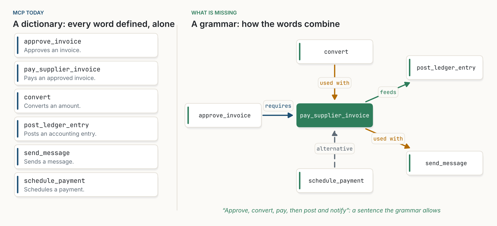
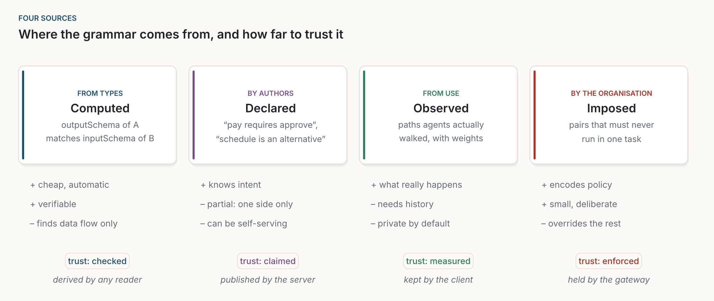
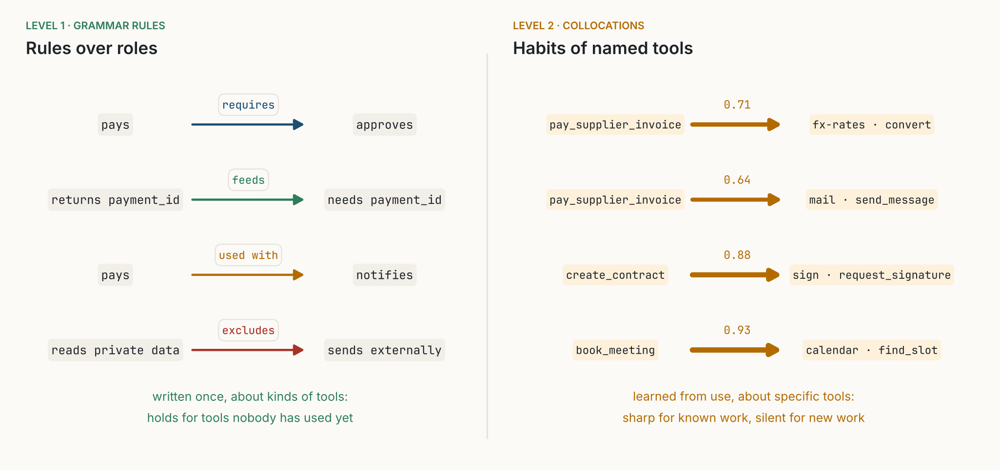
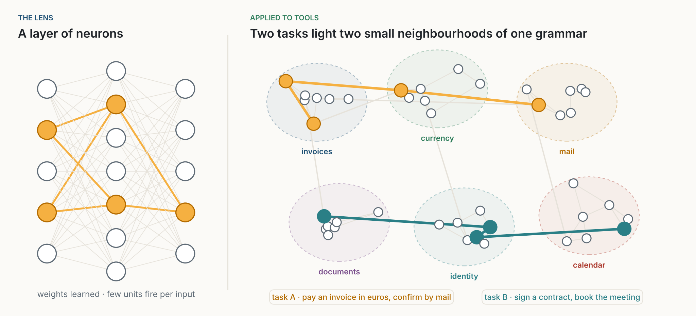

::: {.callout-note appearance="simple"}
**Essay, October 2026.** A follow-up to [The Interface Is Data](../2026-10-20-the-interface-is-data/index.qmd). The figures are my own, drawn with [figs.py](figs.py); all are schematics except Figure 3, which is plain counting. The roles, relations and JSON in Figures 2, 6 and 7 are a proposal of mine, not part of the MCP specification.
:::

**In short.** The Model Context Protocol (MCP) gave AI agents a dictionary. Every tool defines itself: a name, a description, a schema for what it takes and what it returns. What MCP does not have is a grammar, a way to say how tools combine: which one must come first, which one feeds which, which ones are used together, which ones replace each other, and which ones must never meet in the same task. Today every agent rebuilds that grammar inside its context window, on every run, and forgets it at the end. With a few dozen tools that works. With thousands it does not, and the usual fix, searching tool descriptions, finds tools that look like the request, not tools that complete each other. I argue that the missing piece is a kind of object, the relation between tools, published as data. A useful grammar works at two levels: rules about *kinds* of tools ("anything that pays requires an approval"), which carry over to tools nobody has used yet, and habits of *specific* tools, learned from use. Relations can come from four sources (schemas, authors, use and policy), and each source has its own owner and its own level of trust. None of this is new in principle: OpenAPI has links between operations, and the semantic web services of the 2000s described preconditions and effects. Those efforts stalled because writing a precise grammar cost too much and nothing could read an imprecise one. A language model can. The design principles come from neural networks (locality, sparse activation, plasticity, modularity and gating), but I no longer think we need to train a network to apply them.

::: {.callout-tip appearance="simple" icon="false"}
## Key takeaways

- **MCP is a dictionary.** Each tool is defined on its own. The links between tools exist only inside one agent's run.
- **The missing object is the relation.** MCP has first-class tools, resources and prompts, and groups of tools are being proposed. It has no typed relation between tools, so nobody can publish, share, version or check one.
- **Resemblance is not complementarity.** Searching descriptions finds tools like the request. A task needs tools that complete each other, and those rarely look alike.
- **A grammar has two levels.** Rules over roles ("pays requires approves") hold for tools never seen before. Habits of named tools ("this payment tool is usually followed by that converter") are sharp for known work and silent for new work.
- **Four sources, four owners.** Edges are computed from schemas by any reader, declared by servers, observed by clients and imposed by the organisation's gateway. Every edge should say where it came from.
- **This was tried before.** OpenAPI links and semantic web services described how operations connect. They lacked a reader that could use a cheap, imperfect grammar. A language model is that reader.
- **Edges are local; names are not.** Like links on the web, relations need no central map, but they do need stable names, which means a registry.
- **Borrow principles from neural networks, not the network.** Locality, sparse activation, plasticity, modularity and gating describe how the grammar should behave. A learned router is an optimisation for later.
:::

## 1. Points on a plane

Think of every MCP tool as a point. Its position is its meaning, what its description says it does. Two invoice tools sit close together; an invoice tool and a calendar tool sit far apart. A server publishes a handful of such points. A client connects to several servers and sees the union: a cloud of points with no lines between them [@mcpspec2025].

This is not a flaw. It is what made MCP so easy to adopt. A server does not need to know who else exists. Anyone can add a point, and every client can read it. That is the strength I described in [The Interface Is Data](../2026-10-20-the-interface-is-data/index.qmd): the interface became data, read when it is used.

But a task is never a point. "Pay this supplier invoice in euros and let them know" is a path: approve the invoice, convert the amount, pay, post the ledger entry, send a message. That path crosses three or four servers. Somebody has to draw it.

{fig-alt="Two panels of scattered points. Left, titled Today, a flat catalogue: grey circles with no connections and one dashed orange path through four highlighted points numbered 1 to 4, labelled 'the graph lives for one task, then it is forgotten'. Right, titled Proposed, a local graph: the same kind of points grouped into six coloured clusters named invoices, currency, mail, documents, identity and calendar, with thin edges inside each cluster and a few thick orange edges between clusters."}

Today, the agent draws it. The model reads the tool descriptions, reasons about the task and chooses each call. The path exists, but only in one place and for one moment: the context window of one run. When the run ends, the path is gone. The next agent facing the same task draws it again from scratch.

## 2. A dictionary without a grammar

A better image than points is language. MCP gives us a **dictionary**. Each entry defines one word clearly and in a standard form. What a dictionary does not tell you is how to build a sentence: which words go together, in what order, which ones can stand in for each other, which combinations are wrong. That is the job of a **grammar**.

{fig-alt="Two panels. Left, titled MCP today, a dictionary: every word defined, alone. Six cards list approve_invoice, pay_supplier_invoice, convert, post_ledger_entry, send_message and schedule_payment, each with a one-line description. Right, titled What is missing, a grammar: how the words combine. pay_supplier_invoice sits in the centre. approve_invoice points to it with 'requires'. convert points to it with 'used with'. It points to post_ledger_entry with 'feeds' and to send_message with 'used with'. schedule_payment points to it with a dashed 'alternative'. A caption reads: approve, convert, pay, then post and notify, a sentence the grammar allows."}

So what is missing from MCP is not an algorithm. It is a **kind of object**. MCP has first-class tools, resources and prompts. It has no first-class *relation* between them. As long as relations are not part of the vocabulary, nobody can publish one, share one, version one or check one. Every agent keeps its own private grammar, and nobody else can read it.

### Resemblance is not complementarity

The current answer to large catalogues is search. Tools stay out of the context and are found by matching the request against their descriptions [@anthropic2025advtools; @gan2025], sometimes server first, then tool [@fei2025mcpzero]. This finds tools that *resemble* the request. A task needs tools that *complete* each other.

"Pay this supplier invoice in euros" resembles the invoice tools. It does not resemble the ledger or the mail server, yet the task needs both. The relation between paying an invoice and posting a ledger entry is not in either description. It is in the use.

Recommender systems learned this long ago. Shops distinguish products that *substitute* for each other (two similar cameras) from products that *complement* each other (a camera and a memory card), and the two kinds of relation have to be learned differently [@mcauley2015]. The oldest working answer, "customers who bought this also bought that", does not look at descriptions at all: it counts what is used together [@linden2003]. Tool search today is stuck at the first kind of relation. A grammar is how we write down the second.

## 3. Why it matters now

With a few dozen tools, the agent can read every definition and draw the path itself. Nothing needs to be stored, nothing goes stale. The cost appears when catalogues grow, and two things grow with them.

{fig-alt="Two log-log charts against the number of tools, from 10 to 10,000. Left: tokens to list every definition rise from about 3,500 to 3.5 million, crossing a 200k-token context window near 570 tools and a 1M-token window near 2,900 tools. Right: possible four-step chains grow as N to the fourth, from ten thousand to ten to the sixteenth; edges in a sparse graph grow as 3N and workflows actually run as N over 2, many orders of magnitude lower."}

The first is the cost of looking. MCP-Zero counts about 4,600 tokens for the 26 tools of the GitHub server alone [@fei2025mcpzero]. A thousand tools fill a large context window before the task has begun.

The second is the space of compositions. With $N$ tools there are $N^k$ ordered chains of $k$ of them. The chains anyone actually uses are a vanishing fraction of that space. The useful structure is small, roughly linear in $N$, but nobody writes it down. So every run looks for it again inside a space that grows with the fourth power.

The field has noticed, and the answers so far tell the story:

- **Groups.** A proposal for MCP, SEP-1300, lets servers put tools into groups and tags, so a client can load one functional area at a time [@sep1300]. Groups are sets: they say which tools belong together, not how they combine. They are the right first step, and relations are the natural next one.
- **Prompts.** MCP servers can already publish prompts, templated workflows written in prose [@mcpspec2025]. A prompt is a sentence, not a grammar: it lives on one server, is chosen by the user and cannot be checked or combined with prompts from other servers.
- **Skills.** Agent Skills package instructions, scripts and tool use for one job [@anthropic2025skills]. Each skill contains a small grammar, written by hand, for one bundle.
- **Research systems** walk graphs of tool transitions learned from past runs [@liu2024toolnet] or follow dependency edges after a first search [@lumer2025graphrag], inside one system.

Each of these holds a piece of the grammar. None can be read by anyone else, because the protocol has nowhere to put a relation. The 2026 MCP roadmap focuses on transport, agent communication, governance and enterprise readiness [@mcproadmap2026]; as far as I can tell, typed relations between tools are not on it.

## 4. This was tried before

Describing how operations connect is an old idea, and it is worth asking why it did not take hold.

**OpenAPI links.** Since version 3.0, an OpenAPI description can say that a value returned by one operation is the input of another, with the exact field mapping: the `id` in the response of `createUser` becomes the `userId` parameter of `getUser` [@openapi30links]. That is precisely the *feeds* relation of this essay, standardised in 2017. It exists, it works, and few people use it. REST APIs got links between operations; MCP tools never did.

**Semantic web services.** In the early 2000s, OWL-S and WSMO described web services with inputs, outputs, preconditions and effects, so that software agents could find and compose them automatically [@owls2004; @wsmo2005]. "Requires" is a precondition; "feeds" is an output matched to an input. The vision was close to this essay's. It stalled, for two reasons: writing formal descriptions in shared ontologies cost far more than anyone would pay, and the reasoners that consumed them broke on anything imprecise.

What changed is the reader, the same argument I made in [The Interface Is Data](../2026-10-20-the-interface-is-data/index.qmd) for self-describing APIs. A language model does not need a perfect ontology. It can use a relation that is partial, approximate or written in plain words, and weigh it against everything else it knows. And one of the four sources below, observed use, needs no author at all. A grammar that was too expensive to write precisely for a strict reader becomes cheap enough to write roughly for a tolerant one.

## 5. Where the grammar comes from

If relations are to become data, the first questions are where they come from and who keeps them. I see four sources. They differ in cost, in trust, and in who owns them.

{fig-alt="Four cards. Computed, from types: the outputSchema of A matches the inputSchema of B; cheap and automatic, verifiable, finds data flow only; trust: checked; derived by any reader. Declared, by authors: 'pay requires approve', 'schedule is an alternative'; knows intent, partial because authors see one side only, can be self-serving; trust: claimed; published by the server. Observed, from use: paths agents actually walked, with weights; shows what really happens, needs history, private by default; trust: measured; kept by the client. Imposed, by the organisation: pairs that must never run in one task; encodes policy, small and deliberate, overrides the rest; trust: enforced; held by the gateway."}

### 5.1 Computed from types

Since its June 2025 revision, MCP lets a tool declare an `outputSchema`, the shape of what it returns, next to its `inputSchema` [@mcpspec2025]. That is enough to derive some edges with no one declaring anything. If one tool returns a `payment_id` and another requires one, the first probably *feeds* the second.

{fig-alt="Two schema cards. Left, pay_supplier_invoice, outputSchema: payment_id string, amount number, currency string, paid_at date-time. Right, post_ledger_entry, required inputSchema: payment_id string, account string, amount number. A thick green arrow joins the two payment_id fields, labelled 'feeds via payment_id'. A thin grey arrow joins the two amount fields, labelled 'same name, too weak alone'. A note says an identifier that one tool creates and another requires is strong evidence; a shared generic field is not."}

Computed edges are cheap, and anyone can derive them: the client, a gateway, a catalogue. They are also checkable, since a test can confirm that the output of one tool still fits the input of the other. Their limits are real. They find data flow, not intent; field names are noisy; and output schemas are optional in MCP. I have not measured how many public servers declare them today. If few do, this source is a promise rather than a resource, and the first practical step is simply to publish output schemas.

### 5.2 Declared by authors

Some relations only the author knows. That paying requires an approval first. That `schedule_payment` is an alternative to paying now. That a tool is usually followed by a notification. These are short statements, and MCP already lets a tool carry extra metadata where they could live. They belong to the server, and travel with its tools.

Declared edges carry intent, which no other source has. They are also partial, since an author sees only their own side of a workflow, and they can be self-serving: every server has a reason to declare edges toward itself.

### 5.3 Observed in use

Every agent already draws the grammar on every run. If clients kept the paths they walked, they could count which tools are used together and turn the counts into weights. This is the truest source: it shows what actually happens, including partners nobody thought to declare.

It is also the most sensitive. What an organisation's agents do is private, so observed edges belong to the client and stay inside the organisation by default, shared only as aggregated weights if at all. Counting them the same way everywhere needs a common trace format. That could be part of MCP, or a convention in an existing tracing standard such as OpenTelemetry; what matters is that it is shared.

### 5.4 Imposed by the organisation

A grammar does not only say what goes together. It can also say what must not. Simon Willison's "lethal trifecta" names a dangerous combination: an agent that reads private data, is exposed to untrusted content and can communicate externally [@willison2025]. Each tool may be safe on its own; the danger is in the combination. An organisation should be able to write that down as a rule, *excludes*, and have it enforced.

This rule does not belong to any server. A vendor publishes its tools; it does not decide what your company forbids. Policy edges belong to the client or the gateway that sits between agents and servers, and they override every other source.

## 6. A grammar at two levels

A grammar in the linguistic sense does not link specific words. It works on *kinds* of words: a verb takes an object, an adjective goes before a noun. Specific words that habitually appear together, "strong coffee" rather than "powerful coffee", are called *collocations*, and they are learned by use. A tool grammar needs both levels.

| In language | For tools | Example |
|---|---|---|
| parts of speech | roles: what kind of thing a tool does | *approves*, *pays*, *converts*, *notifies*, *reads private data* |
| grammar rules | relations between roles | anything that *pays* requires something that *approves* |
| collocations | relations between named tools, with weights | this payment tool is usually used with that converter (0.71) |
| a sentence | the path of one task | approve, convert, pay, post, notify |

: **Table 1.** The two levels of a tool grammar, by analogy with language.

{fig-alt="Two panels. Left, Level 1, grammar rules, rules over roles: pays requires approves; returns payment_id feeds needs payment_id; pays used with notifies; reads private data excludes sends externally. A note: written once, about kinds of tools, holds for tools nobody has used yet. Right, Level 2, collocations, habits of named tools: pay_supplier_invoice to fx-rates convert, 0.71; pay_supplier_invoice to mail send_message, 0.64; create_contract to sign request_signature, 0.88; book_meeting to calendar find_slot, 0.93. A note: learned from use, about specific tools, sharp for known work, silent for new work."}

The two levels fail in opposite ways, which is why both are needed. Collocations are precise for the work an organisation already does, and they say nothing about a tool that was installed yesterday or a workflow nobody has run. Rules over roles carry over to new tools immediately, but they are coarse: they say a payment needs *an* approval, not which one. A new tool that declares its roles fits into the grammar on the day it appears; use then sharpens the rules into collocations.

MCP already has the beginning of a role system. Tool annotations say whether a tool is read-only, destructive, idempotent or reaches the open world [@mcpspec2025]. These are parts of speech in all but name. The lethal-trifecta rule, for instance, can already be written partly over them: a tool with an open-world hint should not run in the same task as one that reads private data. What is missing is a small shared list of roles beyond those hints, and a way to write rules over them.

### 6.1 A starting vocabulary

Five relations are a reasonable start. They will not cover everything (conditions such as "if this fails, use the alternative", or order beyond *requires*, would come next), but they cover a lot.

| Relation | Meaning | Typical source |
|---|---|---|
| **requires** | must have run before | declared |
| **feeds** | its output is the other's input | computed |
| **used with** | often in the same task | observed |
| **alternative** | can replace the other | declared |
| **excludes** | must not run in the same task | policy |

: **Table 2.** A proposed starting vocabulary of relations, usable between roles or between named tools.

Each relation can point to a role or to a named tool, and each edge says where it came from so that a reader can weigh it.

{fig-alt="A dark code panel showing one JSON entry for a tool named pay_supplier_invoice, with a description, schemas, annotations destructiveHint true and openWorldHint true, and a _meta object with roles: pays, and a grammar list: requires role approves; usedWith role converts; requires tool approve_invoice; alternative tool schedule_payment. Four cards explain: parts of speech MCP already has, annotations as the start of a role system; roles, a small shared list; rules over roles, which apply to tools never seen before; edges to named tools, the author's local knowledge, with names unique per server so they need a registry. A note below says observed weights are kept by the client and policy rules by the gateway."}

### 6.2 What the protocol needs, and what it does not

What MCP itself would need is small:

1. **A place for relations.** Today a convention in `_meta`, which MCP already allows on tools [@mcpspec2025]; later a field of its own, if the convention proves useful. Tool groups, if adopted, are a natural home for rules that hold inside a group.
2. **A shared vocabulary.** A short list of roles, and the five relations above.
3. **Stable names.** See below.
4. **A shared way to count use.** Whether in MCP or in an existing tracing convention.

What it should *not* include is just as important: any particular way of using the relations. How a client ranks tools, walks the graph or loads a neighbourhood is the client's business. MCP should carry the grammar, not decide how to read it.

### 6.3 Edges are local; names are not

Could all of this live in a central registry instead? For composition, I think not. Early web directories sorted pages into folders and were overtaken by search that read the *links* pages carried themselves [@brin1998]. Links worked because each page published its own and nobody had to hold the map [@fielding2000]. MCP today is a web of pages without links, and each tool should carry its own.

But the web analogy cuts both ways. Links needed no central map, yet they did need a central *naming* system: a URL is only useful because DNS says what a domain is. The same holds here. An edge to "the `convert` tool on the `fx-rates` server" is only meaningful if `fx-rates` names the same server for everyone, and MCP tool names are unique only within one server. Rules over roles avoid the problem, which is one more reason to prefer them. Edges to named tools across servers need a registry that gives servers stable identities, and the MCP Registry is the obvious candidate [@mcpregistry2025]. So the honest position is: relations are local and decentralised; names are not. That is a modest layer, for identity, not a layer that holds the grammar.

## 7. Borrowing from neural networks

My first idea for this essay was to treat the tool ecosystem as a neural network: tools as neurons, edges as synapses, and a graph neural network [@gilmer2017] deciding which tools fire for each task. I built one in a small simulation. It worked, but no better than a plain walk along the edges, and it struggled on workflows it had never seen, exactly where rules over roles help. What survived was not the network. It was the principles.

{fig-alt="Left, a small three-layer neural network with grey connections; a few neurons are filled in orange and joined by orange connections, labelled 'weights learned, few units fire per input'. Right, six dashed clusters of tools named invoices, currency, mail, documents, identity and calendar, with grey edges. Task A, pay an invoice in euros and confirm by mail, lights an orange path through invoices, currency and mail. Task B, sign a contract and book the meeting, lights a teal path through documents, identity and calendar."}

Large neural networks work because they are built on a handful of ideas. Each of them becomes a design rule for a tool grammar:

| Concept | In a neural network | As a design rule for tools |
|---|---|---|
| **Locality** | a unit only receives messages from its neighbours | a tool knows only its neighbours; nobody holds the global map |
| **Sparse activation** | few units fire for any input [@olshausen2004; @shazeer2017] | a task loads one neighbourhood, never the catalogue |
| **Plasticity** | connections that fire together strengthen [@hebb1949] | observed edges strengthen with use and fade without it |
| **Modularity** | modules are assembled differently for each question [@andreas2016] | clusters that work together become units, across servers |
| **Gating** | the input decides which paths open | the task decides which edges count: a *notify* edge matters for a payment, not for a report |

: **Table 3.** Five principles borrowed from neural networks, and what each means for a tool grammar.

Sparse activation is the one that pays most directly. Instead of searching a catalogue of thousands, an agent finds one good starting tool by meaning, then loads its neighbourhood: a handful of tools that the grammar says belong with it. Search finds the door; the grammar shows the rooms behind it.

Modularity is where my first intuition about *entanglement* belongs. Some clusters of tools cannot be understood one at a time: what happens in invoicing tells you a lot about what will happen in currency and mail, whatever the description of any single tool says. Physicists call systems that cannot be described part by part *entangled* [@horodecki2009]. Nothing quantum happens in a tool catalogue, and the useful mathematics here is ordinary statistics. But the intuition holds. The unit of design is no longer the single tool. It is the group of tools that work together, which can be found from the edges themselves [@newman2006]. Groups and skills are such units, drawn by hand. A grammar lets them emerge from use and cross server boundaries.

## 8. Who reads the grammar

The strongest argument for relations as data is the one I made for tool descriptions: once something is data, many readers can use it, and most of them need no AI.

{fig-alt="A central green card, Tool grammar, data: typed edges, sources, weights. Six readers around it. Language model, needs AI: loads a neighbourhood, not the catalogue. Workflow engine, no AI: runs a known path without a model. Policy gateway, no AI: blocks pairs the grammar excludes. Contract tests, no AI: checks every feeds edge still type-checks. Catalogue, no AI: shows how tools combine, not just what. Small router, optional: learned later, once the same routes repeat."}

- **The language model** is the main reader. It does not need a smarter ranking function; it needs the right few tools in its context. Given a tool and its neighbourhood, a model reasons about them far better than it can about a list of thousands. It is also the reader that tolerates an imperfect grammar, which is what makes this attempt different from the last one.
- **A workflow engine** can run a path the grammar already knows, with no model at all.
- **A policy gateway** can block any call that would complete an *excluded* pair in the same task.
- **Contract tests** can check, on every release, that each *feeds* edge still type-checks.
- **A catalogue** can show people how tools combine, not just what each one does.
- **A small learned router** can come later, once the same routing decisions repeat often enough to be worth compiling, as I argued in [Fast AI](../2026-10-11-fast-ai/index.qmd) and [The Junior Colleague](../2026-10-18-the-junior-colleague/index.qmd). It is an optimisation, not the paradigm.

## 9. Objections

**"Keep MCP small. Composition belongs to clients and skills."** This is the strongest objection. My answer is that skills and groups prove the need: each skill contains a hand-made grammar, and each group is a set of tools someone decided belong together. But skills are written by one author and live inside one vendor, and groups say nothing about order or data flow. A short list of roles and five relations cost the protocol little. Leaving them out guarantees that every client invents its own version, and none can read the others'.

**"This is the semantic web again."** In ambition, yes. In economics, no. The semantic web needed precise descriptions written by people for strict machines. A tool grammar can start from what is free (schemas and observed use), add a little that authors know, and be read by a model that copes with gaps.

**"The model can work out complementarity by itself."** Often it can. A model knows that paying in euros may need a currency conversion. It does not know that *your* company requires `approve_invoice` before any payment, or that your ledger tool must follow your payment tool. Local conventions are exactly what a grammar records. It also saves the tokens and the time of working them out again on every run.

**"Declared edges will be gamed."** Some will. That is why every edge names its source. A client can trust computed and policy edges, discount declared ones from servers it does not know, and let observed weights correct both. A declared edge that nobody ever walks fades.

**"Observed edges leak what we do."** They should stay with the client by default. The protocol only needs a common way to count; sharing aggregated weights is a choice, not a requirement.

**"Structure will fence the model in."** The strength of the flat catalogue is that a model may draw a path nobody foresaw. A grammar should decide what to show first, not what is allowed, except for the *excludes* rules an organisation imposes on purpose.

**"Edges will go stale."** Tools change. Edges versioned with their tools, computed edges re-checked on every release, and observed weights that decay without use limit the damage. The flat catalogue never goes stale, but it never learns either.

## 10. What would prove me wrong

- **If context windows and tool search grow faster than catalogues**, so that an agent can always read every relevant description, then the grammar adds maintenance and little else.
- **If real tool descriptions carry the complementary signal**, so that "pay an invoice" does in practice sit close to "post a ledger entry" in embedding space, then search by meaning would do most of the work. This can be measured on real servers and real traces.
- **If computed edges turn out to be rare or noisy**, the cheapest source disappears. This is easy to check: count how many public MCP servers declare output schemas, derive *feeds* edges from them, and see how many a person would accept.
- **If OpenAPI links stay unused for the same reasons in MCP**, the problem is incentives, not the absence of a field, and a field alone will not help.
- **If groups and skills cover the frequent workflows**, the gain from a shared grammar would shrink to the long tail. I suspect the tail is where much of the value is, but that is a hypothesis.

## 11. Conclusion

MCP got the hardest part right. It turned every tool into a definition that any caller can read. What it left out, for good reasons at first, is how the definitions combine. Today every agent rebuilds that knowledge in its context window and throws it away at the end of the run.

What is missing is not a new central layer and not a trained network. It is a small grammar at two levels: rules about kinds of tools, which hold for tools nobody has used yet, and habits of specific tools, learned from use. Relations can be computed from schemas, declared by servers, observed by clients and imposed by the organisation, and each one should say where it came from. The idea is old; OpenAPI and the semantic web tried it. What is new is a reader that can use a grammar that is cheap, partial and imperfect. The ideas that make neural networks scale tell us how that grammar should behave, and we can borrow them without building a network.

A dictionary lets you look words up. A grammar lets you say something. MCP has the first. The second is what large ecosystems of tools now need.

## References

::: {#refs}
:::
