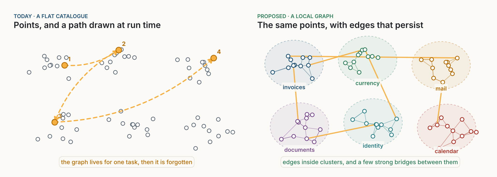
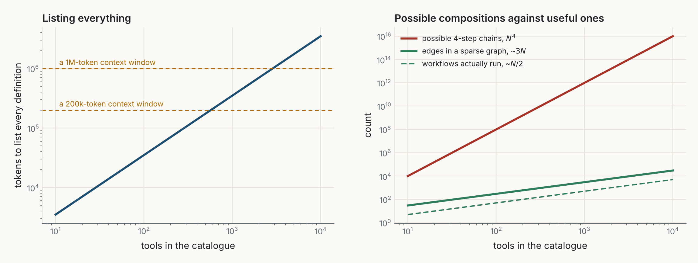
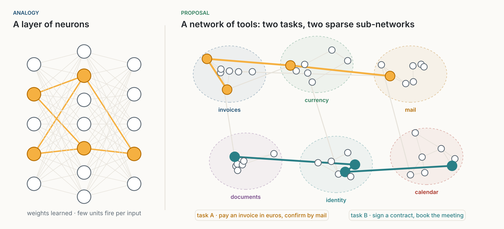
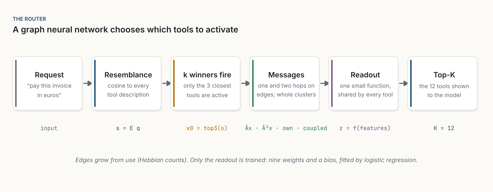
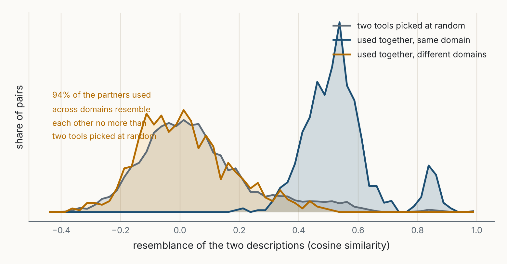
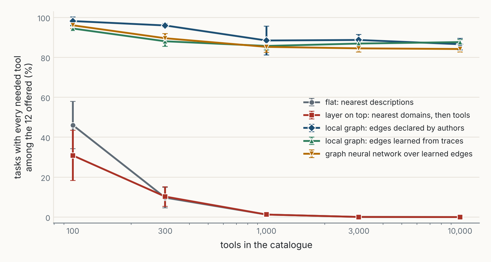
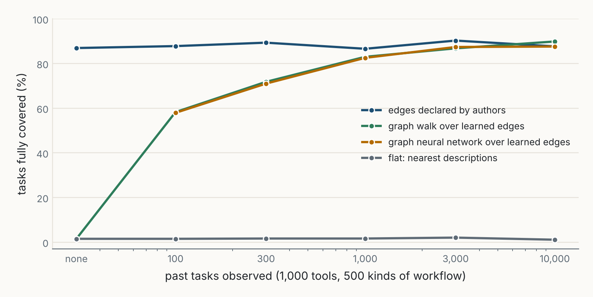
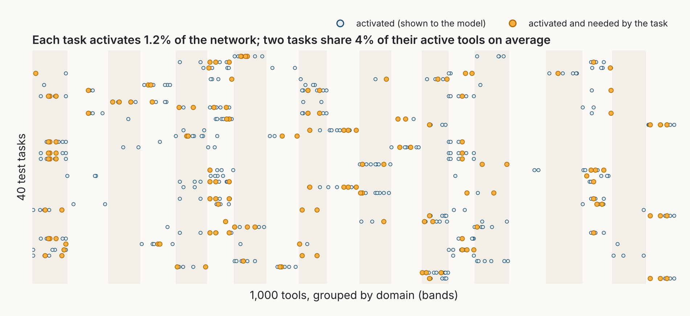
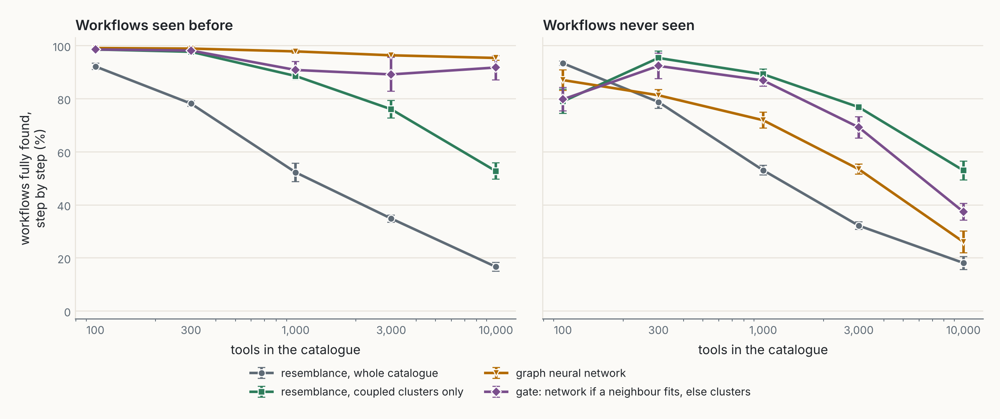
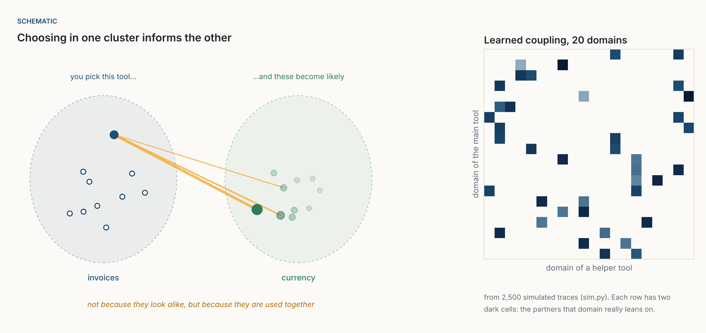

::: {.callout-note appearance="simple"}
**Working paper, October 2026.** A follow-up to [The Interface Is Data](../2026-10-20-the-interface-is-data/index.qmd), written as a short scientific paper: a model, a simulation, results with their limits, and predictions that could prove it wrong. Every number in Sections 5 and 6 comes from [sim.py](sim.py) (NumPy and SciPy, five random worlds per setting, results in [results.json](results.json)); the figures are drawn with [figs.py](figs.py). The world is synthetic and deliberately simple. It tests the shape of an argument, not any product. The JSON in Figure 11 is a proposal of mine, not part of the MCP specification.
:::

**Abstract.** The Model Context Protocol (MCP) lets every tool describe itself, but each description stands alone. A client sees a set of points; the links between them are drawn by the orchestrator during one run and then discarded. I argue that this flat design stops working when catalogues reach thousands of tools, and that the fix is not a central layer on top of MCP but a change of paradigm: treat the ecosystem as a network in which tools are neurons. Edges between tools grow from use, as in Hebbian learning. Each task activates a small, task-specific sub-network. A graph neural network (GNN) reads the edges and decides which tools fire. I test this in a simulated world of 100 to 10,000 tools in 20 domains. Choosing tools by resemblance to the request covered every needed tool in 46% of tasks with 100 tools and in none from 3,000. A layer on top, which picks the domain first, did no better. A graph walk over learned edges and a GNN with ten trained parameters both covered 84% to 96% of tasks at every size. Step by step, on workflows seen before, the GNN found every tool in 95% to 99% of workflows, against 17% to 92% for resemblance. On workflows never seen, it fell to 26% at 10,000 tools, below a simple rule that searches only the clusters most coupled to the current one (53%). A gate that switches between the two recovered part of the gap. Each task activated 1.2% of the network, and two tasks shared 4% of their active tools on average. I state the conditions under which the design should hold, five predictions, and a protocol to test them on real traces.

::: {.callout-tip appearance="simple" icon="false"}
## Contributions

1. **A diagnosis.** MCP is flat by design. The graph that links tools exists only inside one run, and search by resemblance cannot rebuild it, because tools that are used together across domains do not look alike.
2. **A model.** A tool ecosystem as a sparse network: tools as neurons, co-use as synapses, a task as an activation pattern, a GNN as the router, couplings between clusters as structure one level up.
3. **A protocol change, not a layer.** Each tool publishes its neighbourhood (typed, weighted edges), and clients keep the paths they walk. No central registry needs to hold the map.
4. **Evidence, in simulation.** Edges keep tool selection working up to 10,000 tools; a ten-parameter GNN matches a hand-made graph walk on one-shot selection and beats every baseline step by step on known workflows. New workflows remain hard: there, couplings between clusters do best.
5. **Predictions and a test.** Five falsifiable predictions, and a protocol to check them on real MCP traces.
:::

## 1. Introduction

MCP turned tools into data. A server lists its tools, each with a name, a description and a schema, and any client reads them at run time [@mcpspec2025]. I argued in [The Interface Is Data](../2026-10-20-the-interface-is-data/index.qmd) that this is the lasting change: an interface read when it is used, not bound once in code.

But each description stands alone. Mathematically, a client sees a set of points in a space of meaning. A task is not a point. "Pay this supplier invoice in euros and confirm it by mail" is a path across three servers: invoices, currency, mail. Today the orchestrator, a model in its loop, draws that path during the run. When the run ends, the path is gone.

{fig-alt="Two panels of scattered points. Left, titled Today, a flat catalogue: grey circles with no connections, and one dashed orange path through four highlighted points numbered 1 to 4, labelled 'the graph lives for one task, then it is forgotten'. Right, titled Proposed, a local graph: the same kind of points grouped into six coloured clusters named invoices, currency, mail, documents, identity and calendar, with thin edges inside each cluster and a few thick orange edges between clusters."}

With a few dozen tools, this is the right design. The model reads everything and draws good paths. With thousands of tools it cannot read everything, and the usual fix, a search over descriptions, finds tools that *resemble* the request. A task needs tools that *complete* each other. These are different things.

This paper asks two questions. Does the flat design need a layer on top, or a change in the protocol itself? And if the ecosystem needs structure, what kind? My answer to the second is the one the field already uses for large systems of simple units that combine differently for each input: a neural network. Not a network that computes inside the tools, but one whose units *are* the tools, whose connections grow from use, and whose activation pattern changes with every task.

## 2. Background and related work

**Tool selection at scale.** Listing every tool definition costs tokens; MCP-Zero counts about 4,600 for the 26 tools of the GitHub server [@fei2025mcpzero]. The current answers search instead of listing: tool search with deferred loading [@anthropic2025advtools], retrieval over tool descriptions [@gan2025], or a hierarchy that picks a server first, then a tool [@fei2025mcpzero]. The MCP Registry lists servers in one place [@mcpregistry2025]. Agent Skills bundle instructions and tool use for one job [@anthropic2025skills], and code execution exposes tools as a file tree [@anthropic2025codeexec]. All of these index the points. None stores how they combine.

**Tool graphs.** ToolNet walks a graph of tool-to-tool transitions learned from trajectories [@liu2024toolnet]. Graph RAG-Tool Fusion adds dependency edges to a first vector search and reports large gains over plain retrieval [@lumer2025graphrag]. These are the closest prior work. Neither proposes that the edges travel with the protocol, nor learns a router over them.

**Graph neural networks.** A GNN computes a value for each node from its own features and messages from its neighbours [@gilmer2017; @kipf2017]. Attention can make the weight of an edge depend on the nodes and the query [@velickovic2018]. Inductive GNNs work on nodes never seen in training [@hamilton2017]. For large graphs, a useful simplification passes the messages first and learns only the readout [@wu2019sgc; @frasca2020sign], and propagation can be tied to a personalised random walk [@klicpera2019]. Randomly hiding edges in training, DropEdge, makes a GNN less dependent on any single edge [@rong2020dropedge]. I use all of these ideas in their simplest form.

**Sparse, conditional networks.** Large neural networks increasingly activate only a small part of themselves for each input. In a mixture of experts, a learned gate sends each token to a few experts [@shazeer2017; @fedus2022]. Neural module networks assemble a different network of modules for each question [@andreas2016]. Sparse codes, where few units fire at once, are both efficient and robust [@olshausen2004; @ahmad2019]. A tool ecosystem already has this shape: many units, few active per task.

**Hebbian learning.** "Cells that fire together wire together": a connection strengthens when the units on both sides are active at the same time [@hebb1949]. Counting which tools are used in the same task is exactly that rule.

## 3. A model of a tool ecosystem

### 3.1 The flat catalogue

Let $\mathcal{T} = \{1, \dots, N\}$ be the tools visible to a client, and $e_i \in \mathbb{R}^D$ the embedding of tool $i$'s description, of unit length. A request $q$ is embedded the same way. The flat design ranks tools by resemblance,

$$
s_i = e_i^{\top} q,
$$

and shows the model the $K$ tools with the highest $s_i$. Nothing else is known about how tools relate.

Two quantities grow with $N$. Listing all definitions costs about $c \cdot N$ tokens, with $c$ a few hundred. The number of ordered chains of $k$ tools is $N^k$. The chains people actually use are a tiny, sparse part of that space: in my simulation about $N/2$ kinds of workflow, held by about $3N$ edges.

{fig-alt="Two log-log charts against the number of tools, from 10 to 10,000. Left: tokens to list every definition rise from about 3,500 to 3.5 million, crossing a 200k-token context window near 570 tools and a 1M-token window near 2,900 tools. Right: possible four-step chains grow as N to the fourth, from ten thousand to ten to the sixteenth; edges in a sparse graph grow as 3N and workflows actually run as N over 2, many orders of magnitude lower."}

### 3.2 Tools as neurons

I propose to read the ecosystem as a network, term by term:

| Neural network | Tool ecosystem |
|---|---|
| neuron | a tool |
| activation of a neuron for one input | the tool is chosen for one task |
| synapse and its weight | an edge between two tools, weighted by how often they are used together |
| learning rule | Hebbian: co-use strengthens an edge; disuse lets it decay |
| sparse activation | each task uses a handful of tools out of thousands |
| layers | the steps of a workflow |
| gating, attention | edges that count only when they fit the current request |
| architecture | the topology, which grows and changes as tools and uses change |

{fig-alt="Left, a small three-layer neural network with grey connections; a few neurons are filled in orange and joined by orange connections, labelled 'weights learned, few units fire per input'. Right, six dashed clusters of tools named invoices, currency, mail, documents, identity and calendar, with grey edges. Task A, pay an invoice in euros and confirm by mail, lights an orange path through invoices, currency and mail. Task B, sign a contract and book the meeting, lights a teal path through documents, identity and calendar."}

The analogy is useful in three ways and wrong in one. It is useful because it brings ready tools: sparse activation, learned routing, plasticity. It explains why the topology should change: a network whose connections are fixed by hand cannot adapt to new uses. And it suggests where to look for structure one level up, in modules and their couplings. It is wrong in that tools are not differentiable. Gradients do not flow through an API call. The network can learn *which tools to activate* from outcomes, but not change what a tool computes. In this paper, learning happens only in the edges and in a small router.

### 3.3 Edges that grow from use

Let $W_{ij}$ count the past tasks in which tools $i$ and $j$ were both used. This is a Hebbian rule with a learning rate of one: each co-activation adds one. I damp large counts and normalise symmetrically, as in a graph convolution [@kipf2017]:

$$
\hat{A} = D^{-1/2}\, \log(1 + W)\, D^{-1/2}, \qquad D = \mathrm{diag}\Big(\sum_j \log(1 + W_{ij})\Big).
$$

Edges declared by authors fit the same matrix: an author who knows that `pay_invoice` uses `convert_currency` sets the entry directly.

Tools also fall into clusters (servers, or domains). Let $M \in \{0,1\}^{N \times C}$ assign each tool to one of $C$ clusters, and let $P_{ab}$ be the share of tasks led by a tool of cluster $a$ that also used a tool of cluster $b$. $P$ is the coupling between clusters, a graph one level up.

### 3.4 The router as a graph neural network

The router chooses which $K$ tools to show the model. It works in four steps (Figure 4).

{fig-alt="A pipeline of six cards. Request, pay this invoice in euros. Resemblance, cosine to every tool description, s equals E q. k winners fire, only the 3 closest tools are active, x0 equals top3 of s. Messages, one and two hops on edges and whole clusters. Readout, one small function shared by every tool, z equals f of features. Top-K, the 12 tools shown to the model. A note says edges grow from use and only the readout is trained: nine weights and a bias, fitted by logistic regression."}

**First activation.** Only the $k = 3$ tools most similar to the request fire, each in proportion to its resemblance (a $k$-winners-take-all activation):

$$
x^{(0)}_i = \frac{s_i^{+}\, \mathbb{1}[i \in \mathrm{top}_k(s)]}{\sum_j s_j^{+}\, \mathbb{1}[j \in \mathrm{top}_k(s)]}, \qquad s_i^{+} = \max(s_i, 0).
$$

**Messages.** Activation spreads one and two hops along tool edges, $\hat{A} x^{(0)}$ and $\hat{A}^2 x^{(0)}$. It also spreads to every tool of the active clusters, $M M^{\top} x^{(0)}$, and to every tool of the clusters coupled to them, $M P^{\top} M^{\top} x^{(0)}$. Each message is scaled by its largest value.

**Features.** Each tool $i$ gets nine numbers: its resemblance $s_i$, the four messages it received, and the same four messages multiplied by $s_i^{+}$. The products make an edge count only when the tool at its end also fits the request. This is the simplest form of attention: the effective topology depends on the task.

**Readout.** A linear function shared by all tools gives a score, $z_i = w^{\top} h_i + b$, and the top $K$ are chosen. Only $w$ and $b$, ten numbers, are trained, by weighted logistic regression on past tasks, with hard negatives (the tools most similar to the request and the closest graph neighbours). Messages are passed once and only the readout is learned, as in SGC and SIGN [@wu2019sgc; @frasca2020sign]. A linear readout extrapolates sensibly and can be read.

**Step by step.** An agent can also ask for one tool at a time. Then $x^{(0)}$ is the set of tools already chosen, the request describes only the next step, and a second readout is trained the same way. To prepare it for workflows that have no edges yet, the edges between the target tools are hidden in half of the training examples (DropEdge, [@rong2020dropedge]).

**Gate.** A router that knows a workflow can rely on edges; one facing a new workflow cannot. The agent cannot tell which case it is in, but it can measure a symptom: how well the best graph neighbour of the chosen tools fits the current request,

$$
g = \max_{i:\ (\hat{A} x^{(0)})_i > 0.05} s_i^{+}.
$$

If $g \ge \theta$, the GNN decides; otherwise the router searches by resemblance inside the current cluster and the two clusters most coupled to it. The threshold $\theta$ is set on a small validation set, half known workflows and half new. This is a two-expert mixture with a hand-made gate [@shazeer2017].

## 4. Experimental setup

**World.** $N$ tools, from 100 to 10,000, in $C = 20$ domains, embedded in $D = 64$ dimensions:

$$
e_i = \mathrm{unit}\big(c_{d(i)} + 0.8\, v_{a(i)} + 0.55\, u_i\big),
$$

where $c_{d(i)}$ is the centre of the tool's domain, $v_{a(i)}$ its action (one of 12 shared by all domains: search, create, send, convert...), $u_i$ what is specific to the tool, and $\mathrm{unit}$ scales to length one. Shared actions make tools in different domains look alike: there is a "send" in mail, chat and SMS.

**Workflows.** Each domain leans on two partner domains. A workflow has a main tool and three helpers, each drawn at random from the main tool's domain or one of its partners. There are $N/2$ kinds of workflow; their popularity falls as $1/\text{rank}$. A request mostly describes the main tool:

$$
q = \mathrm{unit}\Big(e_{t_1} + 0.3 \sum_{j=2}^{4} e_{t_j} + 0.45\,\varepsilon\Big),
$$

with $\varepsilon$ random noise of unit length. A per-step request for helper $h$ says what it does and little about where it lives: $\mathrm{unit}(0.3\, c_{d(h)} + 0.8\, v_{a(h)} + 0.55\, u_h + 1.4\, \varepsilon)$.

**History.** The router learns from $5 \times N/2$ past tasks, drawn by popularity. The GNN is trained on up to 3,000 of them.

**Methods.** One-shot, choosing $K = 12$ tools from one request:

1. *Flat*: the 12 most similar tools.
2. *Layer on top*: the two closest domains (by centroid), then the 12 most similar tools inside them.
3. *Graph walk, declared edges*: the 3 most similar tools, then their neighbours weighted by count and by the seed's resemblance, with every true co-use edge declared.
4. *Graph walk, learned edges*: the same over Hebbian counts.
5. *GNN*: Section 3.4.

Step by step, choosing 3 candidates for each helper: *flat* (whole catalogue); *coupled clusters* (the current domain and its two most coupled domains only); *GNN*; *gate*.

**Metrics.** A task counts as covered only if *all* its tools are among those offered. Seen workflows are drawn by popularity from the known kinds; new workflows are freshly generated. 300 test tasks per world, five worlds per setting; I report mean and standard deviation over worlds.

## 5. Results

### 5.1 Resemblance is not complementarity

{fig-alt="Three overlapping distributions of cosine similarity between tool descriptions. Random pairs cluster around zero. Pairs used together from the same domain cluster around 0.5. Pairs used together from different domains lie on top of the random distribution, around zero. A note says 94% of the partners used across domains resemble each other no more than two tools picked at random."}

Tools used together inside a domain resembled each other (mean cosine 0.54). Tools used together across domains did not: mean 0.02, against 0.05 for random pairs, with 94% below 0.3. The relation between an invoice and an exchange rate is in neither description. It is in the use.

### 5.2 One-shot selection: flat search fails, edges hold

{fig-alt="Line chart against the number of tools on a log scale, 100 to 10,000. Flat search falls from 46% at 100 tools to 10% at 300, 1% at 1,000 and 0% from 3,000. The layer on top falls from 31% to 10%, 1% and 0%. Graph walk with declared edges: 98%, 96%, 89%, 89%, 87%. Graph walk with learned edges: 95%, 88%, 86%, 87%, 88%. Graph neural network: 96%, 90%, 85%, 85%, 84%."}

| tools | 100 | 300 | 1,000 | 3,000 | 10,000 |
|---|---:|---:|---:|---:|---:|
| flat | 46.1 | 9.7 | 1.3 | 0.1 | 0.0 |
| layer on top | 30.9 | 10.3 | 1.3 | 0.1 | 0.0 |
| graph walk, declared edges | 98.2 | 96.0 | 88.5 | 88.7 | 86.6 |
| graph walk, learned edges | 94.5 | 88.1 | 85.7 | 86.9 | 87.7 |
| GNN, learned edges | 96.1 | 89.6 | 85.3 | 84.5 | 84.2 |

: **Table 1.** One-shot coverage (%), mean over five worlds. Standard deviations are in Figure 6 and results.json.

Flat search collapsed: 46% of tasks covered with 100 tools, none from 3,000. The layer on top was no better, and worse at 100 tools, because once it commits to the main tool's domain, helpers from partner domains are out of reach. A hierarchy built on resemblance inherits the blind spot of resemblance. Every method that used edges held between 84% and 98% up to 10,000 tools. The GNN matched the hand-made graph walk within about three points, with ten learned parameters and no rule written for this world.

### 5.3 How fast the edges grow

{fig-alt="Line chart against the number of past tasks on a log scale, from none to 10,000. Flat search stays near 2%. Declared edges stay near 87% to 90%. Graph walk over learned edges starts at 2% with no history, then 58% after 100 tasks, 72% after 300, 83% after 1,000, 87% after 3,000 and 90% after 10,000. The graph neural network follows it closely: 58%, 71%, 83%, 87% and 88%."}

With no history, learned edges are worth nothing. After 100 past tasks, the walk and the GNN covered 58% of tasks; after 1,000, 83%; from about 3,000 they matched declared edges. Popular workflows are observed first, so the edges that matter most are learned first.

### 5.4 Sparse, task-specific activation

{fig-alt="A dot plot with 40 rows of tasks and 1,000 columns of tools grouped into domain bands. Each row has 12 small blue circles, clustered in two or three bands; orange dots mark the tools the task needed, nearly always among the blue ones. The title says each task activates 1.2% of the network and two tasks share 4% of their active tools on average."}

Each task activated 12 of 1,000 tools, 1.2% of the network, mostly in two or three domains. Two tasks shared 4% of their active tools on average. The same graph carried many different sub-networks, one per task, as in a sparse neural network or a mixture of experts.

### 5.5 Step by step: seen and new workflows

{fig-alt="Two line charts against the number of tools, 100 to 10,000. Left, workflows seen before: the graph neural network stays between 99% and 95%; the gate between 99% and 89%; coupled clusters fall from 99% to 53%; resemblance over the whole catalogue falls from 92% to 17%. Right, workflows never seen: coupled clusters 79%, 95%, 89%, 77%, 53%; the gate 80%, 92%, 87%, 69%, 37%; the graph neural network 87%, 81%, 72%, 54%, 26%; resemblance over the whole catalogue 93%, 79%, 53%, 32%, 18%."}

| tools | 100 | 300 | 1,000 | 3,000 | 10,000 |
|---|---:|---:|---:|---:|---:|
| *seen:* flat | 92.2 | 78.2 | 52.3 | 34.9 | 16.7 |
| *seen:* coupled clusters | 98.6 | 97.7 | 88.6 | 76.1 | 52.7 |
| *seen:* GNN | **99.1** | **98.9** | **97.9** | **96.4** | **95.4** |
| *seen:* gate | 98.6 | 98.2 | 90.9 | 89.2 | 91.8 |
| *new:* flat | **93.4** | 78.8 | 53.1 | 32.2 | 18.1 |
| *new:* coupled clusters | 79.0 | **95.4** | **89.3** | **76.9** | **53.0** |
| *new:* GNN | 87.1 | 81.3 | 71.9 | 53.5 | 26.1 |
| *new:* gate | 79.8 | 92.4 | 86.9 | 69.3 | 37.4 |

: **Table 2.** Step-by-step coverage (%), mean over five worlds. Best per column and group in bold.

On workflows seen before, the GNN found all three helpers in 95% to 99% of workflows at every size. Searching the whole catalogue fell from 92% to 17%; searching only the coupled clusters, from 99% to 53%.

On workflows never seen, the order reversed. The GNN fell to 26% at 10,000 tools, only eight points above flat search. Its learned weights trust edges, and a new workflow has none, so the familiar neighbours of the first tool crowd out the right one. The plain rule that searches the coupled clusters did best from 300 tools on (53% at 10,000), because it uses structure that carries over to new tasks: which *clusters* work together, not which tools.

The gate recovered part of the gap. Averaged over seen and new workflows at 10,000 tools, it scored 65%, against 61% for the GNN, 53% for the coupled clusters and 17% for flat search. At 1,000 tools, the coupled clusters alone (89%) were as good as the gate (89%) and better than the GNN (85%). With 100 tools, every method that used structure was beaten on new workflows by plain search (93%): the catalogue was small enough to search directly, and 250 past tasks were too few to learn the couplings well.

### 5.6 What the router learned

The readout is linear, so its weights can be read. For one-shot selection with 1,000 tools, the largest positive weights went to resemblance (10.3), to one-hop messages (5.9) and to coupled clusters (4.3). For step-by-step selection, the largest went to resemblance (16.7) and to resemblance times one-hop messages (18.5): a neighbour of the chosen tools counts mostly when it also fits the request. The router learned, unprompted, the attention-like rule that Section 3.4 made possible.

## 6. Discussion

### 6.1 A layer on top, or a new paradigm?

{fig-alt="Three panels. A, a layer on top: a red router or registry box with arrows to four servers; easy to add, one place to govern; a single point of truth and of failure; knows names, not how tools combine. B, edges in the protocol: four clusters of points with edges inside and between them; no centre, each node knows its neighbours; travels with the tool, versioned with it; authors see only their own side. C, edges from use: three traces turned into a small graph with edges of different thickness; weights show what is really used; finds partners nobody declared; needs history, private by default."}

The results argue against a central layer as the answer to composition. A registry is still needed to say which servers exist and which can be trusted [@mcpregistry2025]. But a layer that sorts tools by resemblance did no better than flat search (Table 1), and a layer that holds every edge becomes the one place where the whole map must be kept true.

The alternative is to change what a tool publishes (B) and what a client keeps (C). Each tool declares a few typed, weighted edges; each client counts the paths it walks. Nothing central holds the map. The web solved the same problem this way: pages carry their links [@fielding2000], and the global structure, found later by reading those links [@brin1998], was never planned. MCP today is a web of pages without links.

{fig-alt="A dark code panel showing one JSON entry for a tool named pay_supplier_invoice with a _meta object. Inside _meta, an edges list: requires approve_invoice; feeds post_ledger_entry; uses convert on the server fx-rates with weight 0.71; notifies send_message on the server mail; alternative schedule_payment. Then a cluster field set to accounts-payable. Four cards explain the parts: where it goes, typed edges, edges across servers with a weight learned from use, and membership in a sub-graph."}

MCP already lets a tool carry free metadata in `_meta` [@mcpspec2025], so edges can start as a convention there. The router of Section 3.4 needs nothing else: the edge matrix $\hat{A}$, the cluster assignment $M$ and the coupling $P$ can all be built from what tools declare and what clients observe.

### 6.2 A topology that changes

In this design, the topology is not fixed. It changes on three time scales:

- **Per task.** Each request activates a different sub-network (Figure 8), and the products in the readout make edges count only when they fit the request. The effective graph is different for every task.
- **Per day.** Every completed task adds co-use counts. New tools enter with their declared edges and gain weight as they are used; unused edges should decay, so the network forgets tools that are gone.
- **Per release.** Declared edges are versioned with their tools, so a new version of a server can rewire its neighbourhood.

A plastic network has a known failure mode: the rich get richer. If agents follow heavy edges, heavy edges get heavier, and a better new tool is never tried. Some exploration has to be built in, as in any recommender or bandit.

### 6.3 Couplings between clusters: entangled sub-graphs

Table 2 shows where tool-level edges stop helping: on new workflows. What carries over is structure between clusters. The invoice cluster leans on the currency cluster and the mail cluster, whichever tools a given task picks.

{fig-alt="Left, two dashed ellipses labelled invoices and currency; one invoice tool is filled in, and orange lines of different thickness run to three currency tools drawn larger than the others; captions say you pick this tool and these become likely, not because they look alike but because they are used together. Right, a 20 by 20 heat map of learned coupling, domain of the main tool against domain of a helper tool; most cells are empty and each row has about two dark cells, the partners that domain leans on."}

I find the word *entanglement* useful here, used carefully. Two quantum systems are entangled when their joint state cannot be written as a product of separate states, $|\psi_{AB}\rangle \neq |\psi_A\rangle \otimes |\psi_B\rangle$ [@horodecki2009]. A classical version fits clusters of tools. Let $J_{ab}$ be the share of tasks that use tool $a$ of cluster $A$ together with tool $b$ of cluster $B$. If the clusters were independent, $J$ would be the product of its margins and have rank one. A singular value decomposition, the classical cousin of the Schmidt decomposition, measures how far it is from that:

$$
J = \sum_k \sigma_k\, \mathbf{x}_k \mathbf{y}_k^{\top}, \qquad
S(A{:}B) = -\sum_k \lambda_k \log \lambda_k, \quad \lambda_k = \frac{\sigma_k^2}{\sum_j \sigma_j^2}.
$$

Here $\sigma_k$ are the singular values, $\mathbf{x}_k$ and $\mathbf{y}_k$ patterns of use inside $A$ and $B$ that go together, and $S(A{:}B)$ is zero when one pattern explains the coupling and grows with the number of distinct ways the clusters are used together. With the mutual information of the two clusters' use, it tells how strongly and in how many ways two sub-graphs are bound. Clusters themselves can be found by community detection on the edge graph [@newman2006].

The physics stops there. Nothing in a tool catalogue is quantum; every correlation in this paper is classical. The word is borrowed for three intuitions: some clusters cannot be understood one at a time; choosing in one changes what is likely in the other; and, as a weak echo of monogamy [@ckw2000], a tool coupled to everything (like "send an email") says little about any one partner. In the network reading, coupled clusters are modules that tend to fire together: the unit of design becomes the sub-network, not the tool.

### 6.4 Risks

**Edges can be attacked.** An edge is a recommendation. A malicious server could declare edges to itself from every popular tool. Declared edges across servers need the trust given to the servers themselves, and learned weights should count only paths that trusted clients actually walked.

**Traces are private.** What an organisation's agents do is sensitive. Learned edges should stay local by default, or be shared only as aggregated counts.

**Structure can fence in the model.** The strength of the flat plane is that a model may draw a path no one foresaw. The router chooses what to show first; the model must still be able to search beyond it.

## 7. Predictions and a test protocol

If the model is right, these should hold on real MCP deployments:

1. **P1. Resemblance misses partners.** For tools used together across servers, the cosine between descriptions is close to that of random pairs. *Wrong if* cross-server partners are much more similar than random pairs.
2. **P2. Flat search degrades with size.** At a fixed number of tools shown, full-task coverage by resemblance falls steeply between a few hundred and a few thousand tools. *Wrong if* it stays roughly flat.
3. **P3. Edges hold.** A router that reads co-use edges keeps coverage roughly constant as the catalogue grows. *Wrong if* it degrades as fast as flat search.
4. **P4. A thousand traces suffice.** For a catalogue of about a thousand tools, a few thousand past tasks give most of the gain of fully declared edges. *Wrong if* tens of thousands are needed.
5. **P5. Clusters carry over, tools do not.** On workflows never seen before, cluster couplings help more than tool edges. *Wrong if* tool edges help as much on new workflows as on known ones.

**Protocol.** Take an agent platform with logged MCP calls. Split the logs by time. Build edges and couplings from the first period. In the second, replay each task's first request and measure, for each router, whether every tool the task actually used is among the $K$ offered (one-shot) or among the top three at each step. Report coverage against catalogue size by sub-sampling servers, separately for workflows whose tool sets appeared in the first period and for those that did not.

## 8. Limitations

- **The world is synthetic.** Real descriptions are messier, real workflows are longer and branch, and real popularity is not exactly $1/\text{rank}$. The direction of the results should survive; the numbers will not.
- **The router is small on purpose.** A linear readout over fixed messages is the simplest GNN that works. Deeper or attention-based GNNs [@velickovic2018] may do better, especially on new workflows. They may also overfit history more.
- **Seen and new workflows are cleanly separated here.** In practice an agent never knows which case it is in. The gate is a first answer, not a solution; Table 2 shows it closes only part of the gap at 10,000 tools.
- **Coverage is not success.** A task can fail with every right tool on screen. I measure only whether the right tools were offered.
- **One embedding for requests and tools.** Real systems may use different encoders; the argument about resemblance holds for any of them, but the size of the effect will vary.

## 9. Conclusion

MCP made every tool a self-describing point. What it left out, for good reasons at first, is the space between the points. At a few dozen tools, a model can redraw that space on every run. At thousands, it cannot, and a layer that sorts tools by resemblance does not help, because tools that work together are related by use.

The paradigm I propose is the one we already use for large systems of simple units: a network. Tools are its neurons. Edges grow from use and are published with the tools. Each task lights a small, different sub-network. A graph neural network, here with only ten trained numbers, decides which tools fire, and the structure one level up, clusters that are used together, carries the network to tasks it has never seen.

In simulation, that network kept tool selection working from 100 to 10,000 tools, where flat search and a layer on top both failed. It did not solve new workflows; couplings between clusters did better there, and how to combine the two is the main open question. The next step is to test the five predictions of Section 7 on real traces.

## References

::: {#refs}
:::
