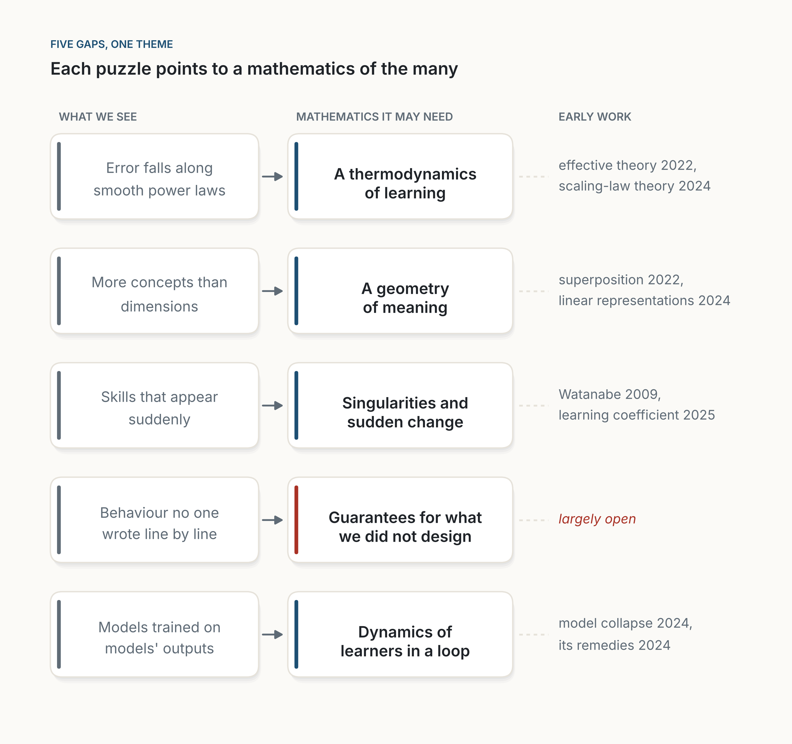

::: {.callout-note appearance="simple"}
**Essay, November 2026.** A short, speculative essay. The first half describes the mathematics that machine learning uses today, with sources. The second half guesses at the mathematics it may need next; those guesses are mine, and I mark them as hunches. I am an engineer who uses this mathematics, not a mathematician who invents it. The four figures are schematics of my own, drawn with [figs.py](figs.py): two timelines, a sketch of illustrative curves (not data), and a map of the essay's hunches.
:::

**In short.** If you open a modern AI model, you find very little new mathematics. The chain rule, matrices, gradient descent, probability and the Boltzmann distribution were almost all written down before 1950, most of them in the nineteenth century. That old toolbox is enough to *build* and *train* these systems. It is not enough to *explain* them: why they generalize when classical theory gives no reason they should, why their error falls along smooth power laws, why skills appear suddenly, what is going on inside them. We have been here before. Steam engines ran for a century before thermodynamics explained them, and when that explanation came, it was new mathematics and new physics, not a better manual for engines. My hunch is that machine learning is waiting for its Carnot. The mathematics it needs, I suspect, is a mathematics of very large, very typical systems: macroscopic laws for learning, a geometry of meaning, a theory of singular models and sudden transitions, guarantees for things we did not design, and the dynamics of machines that learn from a world they have already changed.

::: {.callout-tip appearance="simple" icon="false"}
## Key takeaways

- The mathematics inside AI is mostly old: calculus, linear algebra, probability, optimization, information theory. Machine learning has invented mathematics too, but mostly for simpler models than the ones we now use.
- That mathematics is enough to build the machines. It does not explain why they work.
- History suggests a pattern: the machine comes first, the mathematics that explains it comes later, and it is new.
- My hunch: the missing mathematics is about large, typical systems. Macroscopic laws, the geometry of representations, singularities and phase transitions, guarantees, and feedback loops.
- AI may help us prove things. Choosing the concepts that make a field understandable is still the harder, more human part.
:::

## 1. Open the box

Take a large language model apart, all the way down to the mathematics, and what you find is surprisingly old.

The model is a long chain of matrix multiplications, the algebra Arthur Cayley set out in 1858 [@cayley1858]. Between them sit simple non-linear functions. At the end, a function called softmax turns scores into probabilities; it is the same formula Ludwig Boltzmann used in 1868 for the distribution of energy among gas molecules [@boltzmann1868]. The number that controls it is still called the temperature. Training measures how surprised the model is by the next word, a quantity that comes from Claude Shannon's 1948 theory of communication [@shannon1948]. It then lowers that surprise step by step with gradient descent, which Augustin-Louis Cauchy proposed in 1847 for astronomical calculations [@cauchy1847]. The gradient itself is computed with the chain rule, part of the differential calculus whose notation and rules Leibniz published in 1684 [@leibniz1684]. Backpropagation, popularized as a way to train networks in 1986 [@rumelhart1986], is the chain rule organized cleverly so that it can run across billions of parameters.

The one ingredient that feels new is attention [@vaswani2017]: each word looks at the others and decides how much to take from each. Mathematically, it is a weighted average, with weights given by a softmax of dot products. The design is new and brilliant. The mathematics is not.

Image generators tell the same story. A diffusion model learns to turn noise back into an image by running a random process in reverse [@ho2020; @song2021]. That is the most mathematical corner of modern AI, and it confirms the pattern: the equation for running such a process backwards was published by Brian Anderson in 1982 [@anderson1982], on top of the stochastic calculus Kiyosi Itô developed in the 1940s [@ito1944].

This is not a criticism. A standard textbook, *Mathematics for Machine Learning*, covers what an engineer needs in four parts: linear algebra, analytic geometry, calculus and probability, plus some optimization [@deisenroth2020]. None of it would surprise a good student from 1950.

{fig-alt="A horizontal timeline from about 1660 to 2040. Blue points mark mathematical tools with their dates: differential calculus by Leibniz in 1684, Bayes' rule in 1763, least squares by Legendre in 1805, gradient descent by Cauchy in 1847, matrices by Cayley in 1858, the Boltzmann distribution (softmax) in 1868, Markov chains in 1906 and information theory by Shannon in 1948. A shaded band from 1950 onward is labelled 'the era of learning machines' and contains two orange points: backpropagation as a training method in 1986 and attention in the Transformer in 2017."}

## 2. Enough to build, not enough to explain

So the old mathematics is enough to *build* these machines. The trouble begins when we ask it to *explain* them.

Here are four things that working AI systems do and that the classical theory does not account for well.

**They generalize when they should not.** Classical learning theory warns that a model with far more parameters than training examples can simply memorize its data, and its guarantees then say nothing about new cases. Modern networks have far more parameters than examples, and they generalize anyway. In a famous experiment, Zhang and colleagues showed that standard networks can perfectly memorize images with *random* labels, which means they have the capacity to overfit, yet on real labels they generalize well [@zhang2017]. Whatever explains this, it is not the capacity bounds in the textbook. Belkin and colleagues then showed that test error, as models grow, can get worse and then better again, a "double descent" the classical picture did not predict [@belkin2019; @belkin2021].

{fig-alt="Two side-by-side plots of error against model size. Left, titled 'What the textbook predicted', subtitled 'too big a model overfits': a dashed training-error curve falls to zero at a vertical line, and a blue test-error curve forms a U, falling then rising steeply. Right, titled 'What we see', subtitled 'past the peak, bigger keeps getting better': the same training curve, and an orange test-error curve that falls, rises to a sharp peak at the vertical line labelled 'just big enough to memorize', then falls again and stays low. A note at the top reads 'Illustrative curves, not data'."}

**Their error follows laws we did not derive.** When language models are scaled up, their error falls along smooth power laws in the number of parameters, the amount of data and the compute, across several orders of magnitude [@kaplan2020]. These laws are measured, not derived. And they can be revised: two years later, a different team found that the best balance between model size and data was quite different from what the first laws had suggested [@hoffmann2022]. A law you can only measure, and whose constants move when someone measures more carefully, is a sign that the theory underneath is missing.

**Their skills appear suddenly.** In some training runs, a network memorizes its training set early, shows no sign of understanding for a long time, and then, much later, abruptly generalizes. The researchers who described it called it "grokking" [@power2022]. In one small case the mystery was solved by looking inside: a network learning addition modulo a prime had found, on its own, a method built on Fourier's sines and cosines [@nanda2023]. For large models, the picture is murkier. Abilities that seem to appear suddenly with scale [@wei2022] can look smooth when they are measured differently [@schaeffer2023], which is itself a sign that we do not yet know which quantities to measure. Sudden changes of behaviour when a smooth quantity is varied are what physicists call phase transitions. We see something like them in learning; we do not yet have a good theory of when and why they happen.

**We do not know what is inside.** Interpretability researchers find that networks seem to store more concepts than they have dimensions, by packing them along nearly perpendicular directions, a phenomenon called superposition [@elhage2022]. Researchers have since pulled millions of such directions, many of them readable as concepts, out of a production language model [@templeton2024]. Small, invisible changes to an input can flip a model's answer [@szegedy2014]. We can measure all of this. We cannot yet predict it from first principles.

I should be fair to the field here. Machine learning has not only borrowed mathematics; it has created some. Vapnik and Chervonenkis built a theory of how a learner generalizes from finite data [@vapnik1971]. Leslie Valiant defined what it means for something to be learnable at all [@valiant1984]. The needs of data science have reshaped probability in high dimensions [@vershynin2018]. That is real mathematics, and it was invented because learning machines asked for it. But it was built for an earlier generation of models, and the puzzles above are precisely the places where it stops predicting what we see.

Nor is the new theory empty. The neural tangent kernel describes very wide networks [@jacot2018]; mean-field theories describe how small networks learn [@mei2018]; statistical physics has been applied to learning for decades [@bahri2020]; there is now a whole book that builds an effective theory of deep networks from the ratio of depth to width [@roberts2022]. A theory of scaling laws links their exponents to the dimension of the data [@bahri2024]. And at least once, theory has changed practice: a study of infinitely wide networks led to a way of scaling a network so that training settings such as the learning rate, tuned on a small model, carry over to a large one [@yang2021]. Its authors tuned a 40-million-parameter model and transferred the settings to a 6.7-billion-parameter one, beating the published results for a model of that size [@yang2022]. These are, I think, early signs of a Carnot. But it is still fair to say that practice is far ahead of theory, and that most theory explains a simplified network rather than the systems we actually use.

## 3. The engine before the theory

We have seen this before, and the precedent is encouraging.

Thomas Newcomen's steam engine was pumping water out of mines from 1712. James Watt's separate condenser, which made it efficient, dates from 1769. Engines powered an industrial revolution. And for all that time, nobody could say what an engine fundamentally *was*, or what limited its efficiency. The answer came in 1824, when Sadi Carnot, a young French engineer, asked how much work could, in principle, be drawn from heat [@carnot1824]. He reasoned with the caloric theory, which treated heat as a fluid and was wrong. His central result survived anyway, and in the 1850s Clausius and others rebuilt it on firmer ground. An early theory does not need to be right to point the way. From his question came thermodynamics. Clausius named entropy in 1865 [@clausius1865]. In 1877, Boltzmann explained it as counting: entropy measures how many microscopic arrangements are compatible with what we see at the macroscopic scale [@boltzmann1877].

{fig-alt="Two timelines on the same time scale. The top lane, Engines, shows orange points for Newcomen's engine in 1712 and Watt's condenser in 1769, then green points for Carnot in 1824, Clausius naming entropy in 1865 and Boltzmann's entropy as counting in 1877. The bottom lane, Learning machines, shows orange points for the perceptron in 1958, backpropagation in 1986 and deep nets winning in 2012, followed by a dashed circle with a question mark labelled 'our Carnot'."}

Three things in that story matter for us.

First, the machine came first. Practice led, and theory followed by more than a century. That is not a scandal; it is how much of science has worked.

Second, the theory was *new*. Thermodynamics was not a better engineering manual for engines. It introduced concepts, like entropy and temperature in its modern sense, that did not exist before, and they turned out to matter far beyond engines: in chemistry, in biology, in information theory.

Third, the key move was to stop looking at the parts. Nobody explained the engine by tracking each molecule of steam. Boltzmann's insight was that, when there are enough molecules, a few macroscopic quantities obey exact laws, *because* the microscopic details average out. The large number was not the obstacle. It was the solution.

That third point is, I think, the most important one for machine learning. Our models have billions of parameters, and we keep trying to understand them parameter by parameter, neuron by neuron. Perhaps, like steam, they will be understood instead through the laws that only appear at scale.

The same pattern runs through the history of mathematics. Fourier invented his series to solve the problem of heat flow [@fourier1822]. Fisher invented much of modern statistics to analyse agricultural experiments [@fisher1925]. Shannon invented information theory to solve a problem of communication engineering [@shannon1948]. Physicists used Dirac's delta function for about two decades before Laurent Schwartz gave it a rigorous home in his theory of distributions [@schwartz1950]. A practical need pushed, and new mathematics appeared. Sometimes the opposite happens, and the mathematics is waiting: Riemann's geometry existed sixty years before Einstein needed it for gravity. Eugene Wigner called this the "unreasonable effectiveness" of mathematics [@wigner1960]. Machine learning will probably see both: some mathematics borrowed from shelves where it has been waiting, and some invented because nothing on the shelves fits.

## 4. Five mathematics we may need

What follows are hunches. Each points to a real gap, and each has early work around it, but nobody knows yet which, if any, will grow into a field. I list them because I think the shape of the missing mathematics is already visible, even if its content is not.

**A thermodynamics of learning.** The scaling laws are to AI what Boyle's law was to gases: an empirical regularity, precise and useful, with no derivation behind it. What we need is the equivalent of kinetic theory: a mathematics that starts from what training does at the microscopic scale and derives the macroscopic laws, with their constants, and says when they will break. That probably means new macroscopic quantities, the equivalents of temperature and entropy for a network in training, that summarize billions of parameters in a handful of numbers. Statistical physics has started this work [@bahri2020; @roberts2022], and the first derivations of scaling laws from properties of the data have appeared [@bahri2024]. What is missing is a theory that holds for the systems we actually train, not only for idealized ones.

**A geometry of meaning.** Inside a network, concepts seem to live as directions in a space of thousands of dimensions, packed more densely than the dimensions should allow [@elhage2022]. High-dimensional geometry is strange: in such spaces, almost all directions are nearly perpendicular, which is exactly what lets so many concepts coexist. There is evidence that many concepts are represented as straight lines in these spaces, and a first attempt to say exactly in which geometry "straight" should be measured [@park2024]. We already have a "geometric deep learning" that uses symmetry and group theory to design networks [@bronstein2021]. What we lack is a mathematics of the representations networks *learn* on their own: how concepts combine, how meaning is composed, which approximate symmetries emerge from data. I suspect this will need a geometry of soft, approximate structure, where the exact objects of classical geometry become statistical ones.

**A theory of singularities and sudden change.** Classical statistics assumes that each setting of a model's parameters gives a different behaviour, and that near the best setting the landscape looks like a smooth bowl. Neural networks violate both assumptions: many different parameter settings give the same function, and the landscape is full of singular points. Sumio Watanabe showed that, for such singular models, the right measure of complexity is not the number of parameters but a quantity from algebraic geometry, and that computing it uses Hironaka's resolution of singularities, a deep result from 1964 [@watanabe2009; @hironaka1964]. That is a striking case of mathematics waiting on a shelf. Since then, researchers have learned to estimate a local version of Watanabe's quantity for real networks, including transformer language models [@lau2025]. My hunch is that it is the beginning of a larger theory, one that would explain grokking and other sudden jumps in ability as transitions between singular regions, and predict when they will happen.

**A mathematics of guarantees for things we did not design.** Engineering has always relied on proofs about things we designed: this bridge carries that load, this program terminates. A trained network was not designed, line by line. It was grown. We want to state guarantees about it: that it will not do certain things, that its answers lie within a bound, that a small change in input will not flip its decision. The mathematics we have for proving properties of programs is not built for objects of this size and this kind. Verifying a learned function may need a new mixture of logic, probability and geometry: statements that are true not with certainty but with a quantified confidence, about functions nobody wrote.

**A dynamics of machines in a loop.** Models are increasingly trained on text that earlier models wrote, and they act in a world that their outputs have already changed. Recursive training on generated data can make models lose the rare parts of the original distribution, a failure called model collapse [@shumailov2024]. Whether that happens depends on how the loop is built: in some settings, keeping the real data and adding generated data to it, rather than replacing it, avoids the collapse [@gerstgrasser2024]. The answer depends on the structure of the loop, and we have no general theory of that structure. More broadly, many learning systems now learn from one another and from people who learn from them. That is a dynamical system of learners, closer to ecology or economics than to the fixed datasets of classical theory. Its mathematics, the long-run behaviour of populations of learners feeding on each other's outputs, barely exists.

These five have something in common. None is about a single small network. All are about large, typical behaviour: what happens when there are very many parameters, very many examples, very many interacting systems. That is why I keep coming back to Boltzmann.

{fig-alt="A map in three columns headed 'What we see', 'Mathematics it may need' and 'Early work'. Five rows: 'Error falls along smooth power laws' leads to 'A thermodynamics of learning', with 'effective theory 2022, scaling-law theory 2024'. 'More concepts than dimensions' leads to 'A geometry of meaning', with 'superposition 2022, linear representations 2024'. 'Skills that appear suddenly' leads to 'Singularities and sudden change', with 'Watanabe 2009, learning coefficient 2025'. 'Behaviour no one wrote line by line' leads to 'Guarantees for what we did not design', marked in red as 'largely open'. 'Models trained on models' outputs' leads to 'Dynamics of learners in a loop', with 'model collapse 2024, its remedies 2024'. The title reads 'Each puzzle points to a mathematics of the many'."}

The mathematics we lack is, I suspect, the mathematics of the many.

## 5. Two objections

The first objection is that we may not need any of this. Richard Sutton's "bitter lesson" is that, over seventy years, general methods that use more computation have beaten methods built on human insight [@sutton2019]. Engineering got here without theory. Why should it need theory now?

I take this seriously, and I think it is right about *building*. The bitter lesson says that our clever ideas about how to solve a task lose to scale. It does not say that understanding why scale works is useless. Steam engines improved for decades by trial and error; thermodynamics then told engineers where the limits were, and what to stop trying. We will need the same: to know what a system cannot do, how far a trend can go, and what might happen inside it that we would not like. Those are questions only theory can answer. And, as I argued in [Not Because It Is Useful](../2026-11-01-not-because-it-is-useful/index.qmd), wanting to understand is not only a means to better machines. It is a reason in itself.

The second objection is the reverse: AI will invent this mathematics for us. There is something to it. In 2024, systems from Google DeepMind solved four of the six problems at the International Mathematical Olympiad, at the level of a silver medal, with proofs checked by a computer [@deepmind2024; @hubert2025]. A year later, a model working in plain language solved five of the six, a gold-medal score [@deepmind2025]. Machines have also started to help with research itself: a search guided by a language model found new constructions for a long-studied problem in combinatorics [@romeraparedes2024], and machine learning pointed mathematicians to patterns that led to new results in knot theory and representation theory [@davies2021]. Machines are becoming real partners in mathematics.

But a proof is not the whole of mathematics. The hardest step in the stories above was never the proof. It was the *concept*: Carnot's idea of an ideal engine, Boltzmann's idea that entropy is counting, Shannon's decision to measure information without caring about meaning. Each was a choice of what to look at, made because it made a whole field suddenly understandable. Machines may well help with that too; the knot-theory work is a first glimpse, though there the machine found a pattern and the mathematicians turned it into a concept and a proof. I would not bet against more. But a concept is only useful if someone can think with it, and the test of the new mathematics will be whether *we* understand more because of it. That part, I suspect, will stay a collaboration.

## 6. What follows for the rest of us

If you work with machine learning and have no plans to invent mathematics, three things follow, I think.

Learn the old mathematics well. Linear algebra, probability and calculus are not a hurdle to clear before the interesting part; they are the language in which everything else, including the new mathematics, will be written.

Pay attention to where the old mathematics breaks. When a result surprises you, when a model generalizes better than it should, or fails suddenly, or a curve bends where no theory said it would, you are standing at the edge of the map. That is where the new mathematics will come from. It is worth writing those surprises down.

And keep some humility about explanations. Many of the stories we tell about why models work are, today, stories. Good ones, sometimes. But we are in the position of engineers in 1800: excellent at building engines, and honest enough to admit that we do not yet know what they are.

The steam engine ran for a century before someone asked the right question about it. When Carnot asked it, the answer reached far beyond engines. I do not know who will be machine learning's Carnot, or whether it will be one person, or a person working with a machine. But I suspect that the mathematics that explains these systems will matter far beyond them, as thermodynamics did. The machines we have built are, among other things, a question addressed to mathematics. It has not answered yet.

::: {.read-next}
**Read next** · [Not Because It Is Useful](../2026-11-01-not-because-it-is-useful/index.qmd)
AI can follow the scientific method better than we can. What moved science was never only the method, and never only the answer.
:::

::: {.small}
*The views in this essay are my own and do not describe any product or plan of my employer.*
:::

## References

::: {#refs}
:::
