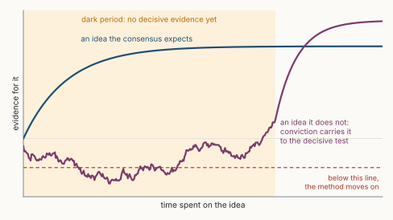
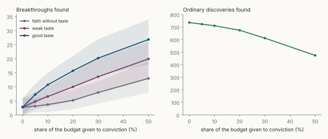

::: {.callout-warning appearance="simple"}
**A provocative paper, on purpose.** A thesis, the conjecture it rests on, a minimal model, a toy simulation and predictions that could prove it wrong. It starts from Poincaré's view that scientists pursue the harmony they sense in nature [@poincare1914] and Iain McGilchrist's claim that great discoveries are not made by following the scientific method [@mcgilchrist2026], and asks what they mean now that machines follow the method better than we do. Figures are my own; the simulation is in [sim.py](sim.py), with invented parameters.
:::

**Abstract.** The scientific method ranks ideas by how plausible they look given what is known, and tests the best first. AI trained on the literature does the same, with far more reach: the method, perfected. I model an idea by its consensus prior $\pi$, its value $V$ and its *dark period* $T$, the work needed before decisive evidence appears. The method pursues ideas with a high $\pi V / cT$, where $c$ is the cost of work. I conjecture that some groups of far ideas turn out true more often than the field believes, and that nothing in the literature tells which. The method ranks them last; AI makes it reach further, but along the consensus, not across it. Reaching them takes *conviction*: belief held above the evidence, guided by taste, kept through the dark period. In a toy field, the method finds no breakthroughs, the method with AI about three, and AI plus a fifth of the budget for conviction about ten. If testing became cheap enough to try every idea, conviction would stop mattering. Open science is far from that point. Six predictions could prove all this wrong.

::: {.callout-tip appearance="simple" icon="false"}
## Claims

1. **AI is the method, perfected.** It ranks ideas by the field's own sense of what is plausible.
2. **Great discoveries rank last (a conjecture).** For some groups of far ideas, the consensus prior is systematically below the share that turns out true.
3. **AI moves the method along the consensus, not across it.** Cheaper steps reach further down the same list.
4. **Conviction is the scarce input.** Believing in an idea beyond the evidence, long enough to reach the decisive test.
5. **Faith without taste is waste.** Conviction pays only when guided by a signal the literature does not contain.
6. **The limit.** If testing gets cheap enough to try every idea, conviction stops mattering. In open science the space of ideas grows and the world sets the pace of tests, so that point stays out of reach.
:::

## 1. Introduction

Ask a capable model what to try next in a research programme, and it will give a sensible, well-referenced answer, close to what the field already believes. That is not a flaw. It was trained on what the field has written and rewarded for answers experts rate as good.

If the method were the whole of science, AI would soon be its best practitioner, and some systems already aim to run the loop from idea to paper [@lu2024]. History suggests otherwise. Helicobacter pylori as a cause of ulcers [@marshall1984] and quasicrystals [@shechtman1984] were dismissed by experts for years. Their discoverers kept going when the method said stop.

My thesis: **AI does not change this. It makes it sharper.** The better we automate the method, the more clearly the part that is not the method stands out: choosing to believe in an improbable idea, and staying with it.

## 2. Background

**Beauty as a guide.** Poincaré wrote that the scientist studies nature "because he takes pleasure in it, and he takes pleasure in it because it is beautiful", meaning the harmony of its parts [@poincare1914, Book I, ch. 1]. On mathematical discovery, he argued that a sense of elegance acts as a sieve, letting through to awareness the few combinations worth checking [@poincare1914, Book I, ch. 3]. Taste is how discovery chooses where to look.

**Discovery outside the method.** @kuhn1962 separated puzzle-solving inside a frame from revolutions that change it. @polanyi1958 argued that knowing involves personal commitment and "intellectual passions". @feyerabend1975 denied that any single method covers the history of science. @mcgilchrist2026 argues that great advances came from breaking the rules; I take that conclusion without his account of the brain's hemispheres, which is debated.

**Consensus resists the new.** When a star scientist dies, outsiders enter the field and publish more-cited work [@azoulay2019]. Highly novel papers are more often among the most cited in the long run, but are recognised late [@wang2017]. Papers and patents have become less disruptive over six decades [@park2023].

**AI and the frontier.** Scientists who use AI publish and are cited more, while AI-heavy research covers a narrower range of topics [@hao2024]. Writers helped by AI write better stories that resemble each other more [@doshi2024]. Experts rated LLM research ideas *more* novel than their own, while the authors noted how little those ideas vary [@si2025].

## 3. A minimal model

Take a research idea $h$:

- $\pi$, the **consensus prior**: how plausible the field, and any model trained on its literature, finds $h$.
- $p$, the **true rate**: the share of ideas like $h$ that turn out true. A single idea is true or false, so $p$ belongs to a group of similar ideas. No one can observe it when deciding; it shows up only after testing. Usually $p \approx \pi$.
- $V$, the **value** of $h$ if true.
- $T$, the **dark period**: the work before any decisive evidence. Signals during it are weak and often discouraging (Figure 1).

With work costing $c$ per period, the method ranks ideas by expected value per unit of work under the consensus:

$$
\text{score}_{\text{method}}(h) = \frac{\pi \, V}{c \, T}.
$$ {#eq-method}

A far idea has a small $\pi$ and a long $T$, so it ranks last. That is right when $p \approx \pi$. It is wrong for **underrated far ideas**, where breakthroughs live:

$$
\mathcal{B} = \{\, h : \pi V < c\,T \le p\, V \,\}.
$$ {#eq-breakthrough}

Since $p$ is seen only after testing, $\mathcal{B}$ can be named only after the fact, and "the method misses what it underrates" is true by definition. The claim has content only if the gap between $p$ and $\pi$ is real and measurable. That is a conjecture, and the paper rests on it.

::: {.callout-note appearance="simple" icon="false"}
::: {#cnj-frontier}
## The underrated frontier

There exist groups of ideas, far from the consensus and with long dark periods, whose true rate $p$ is systematically larger than the consensus prior $\pi$ the field gives them before they are tested. Within such a group, nothing in the literature written before the tests separates the true ideas from the false ones.
:::
:::

It can fail in two ways. If no such group exists, the consensus is calibrated even at its edges, and the method is all discovery needs. If the literature already holds the separating signal, a good enough model will find it, and conviction adds nothing. The late recognition of novel work [@wang2017] fits the first part without proving it. Prediction P1 tests both.

{fig-alt="A chart of evidence for an idea against time spent on it. A blue curve, an idea the consensus expects, rises quickly and levels off. A purple curve, an idea the consensus does not expect, wanders near zero through a shaded dark period labelled no decisive evidence yet. It dips below a red dashed line labelled below this line, the method moves on. Then it rises steeply above the blue curve after the dark period ends. A label says conviction carries it to the decisive test."}

**What AI changes.** AI lowers $c$, and sometimes $T$ [@jumper2021]. In @eq-breakthrough this moves the boundary: the method reaches further down its list. But AI does not change $\pi$. A model trained on the literature *is* an estimate of $\pi$. Cheaper search still works through far ideas in consensus order, and finds underrated ones only by chance. **AI moves the method along the consensus, not across it.**

**Conviction.** An agent holds a private credence $q(h)$, its own estimate of $p$ before any test, informed by a taste signal $a$: a sense of coherence or rightness absent from the literature. In the simulation $a = \delta \cdot \mathbb{1}[h \text{ true}] + \varepsilon$, with standard noise $\varepsilon$; $\delta$ is the quality of taste, and $\delta = 0$ is faith without taste. Conviction means acting on $q$ instead of $\pi$, through the dark period. It pays exactly when

$$
P(h \text{ true} \mid a \text{ high}) > \pi ,
$$ {#eq-taste}

that is, when taste carries information the literature lacks: the second part of @cnj-frontier, seen from the agent's side, and my formal reading of Poincaré's sieve.

{fig-alt="Scatter plot of the true rate against the consensus prior, from 0 to 0.9. Blue dots for ordinary ideas lie along the diagonal labelled consensus is right. At consensus prior below 0.07, in a shaded band, grey dots for far ideas the consensus rightly doubts lie near zero. Purple dots for far ideas the consensus underrates sit at a true rate of 0.3. A label in the band says the method ranks these last and cannot tell them apart; taste can."}

## 4. A toy simulation

A field holds 5,000 ordinary ideas (prior from Beta(2, 6), calibrated, value 1, dark period 2) and 400 far ideas (prior 1–6%, value 20, dark period 8). It assumes @cnj-frontier: a quarter of the far ideas are underrated, with a true rate of 0.3; the rest are true only as often as the consensus says. Taste is weak ($\delta = 0.5$). Four strategies share a budget of 1,000 person-periods:

- **Method**: ranks by @eq-method, cost 1 per period.
- **Method with AI**: same ranking, cost 0.25 per period on ordinary ideas and 0.5 on far ones.
- **Conviction**: far ideas only, ranked by taste, each carried through its dark period.
- **Mixed**: method with AI on 80% of the budget, AI-assisted conviction on 20%.

A *breakthrough* is a far idea that turns out true. Each strategy runs 300 times.

| Strategy | Ordinary discoveries | Breakthroughs (90% range) | Runs with none |
|---|---:|---:|---:|
| Method | 270 | 0 (0–0) | 100% |
| Method with AI | 737 | 2.7 (0–6) | 5% |
| Conviction only | 0 | 19.3 (13–26) | 0% |
| Mixed | 674 | 9.6 (5–15) | 0% |

: **Table 1.** Means over 300 runs. All parameters are invented; see [sim.py](sim.py).

Without AI the method never reaches a far idea. With AI it reaches the most plausible far ideas, mostly wrong ones, and finds a few breakthroughs by luck. Conviction alone finds many but makes no ordinary progress, and four in five of its bets fail. The mixed strategy keeps 91% of the ordinary discoveries and finds three to four times the breakthroughs of the method with AI.

{fig-alt="Two line charts against the share of the budget given to conviction, from 0 to 50 percent. Left, breakthroughs found. All three lines start near 3 at zero. Good taste rises fastest, to about 27 at 50 percent. Weak taste rises to about 20. Faith without taste rises slowly, to about 13. Right, ordinary discoveries found, which fall gently from about 740 at zero to about 675 at 20 percent and 475 at 50 percent."}

With good taste, 10% of the budget buys almost four times the breakthroughs of the method with AI. Without taste, conviction is a lottery ticket. The numbers show that the argument holds together, not that the world works this way.

## 5. The cheap-testing limit

Lowering $c\,T$ has a limit, and it is the strongest objection to this paper. The method needs $\pi \ge c\,T / V$ to test an idea. As $c\,T$ falls toward zero, so does that threshold, and the underrated ideas get tested without anyone believing in them. With a budget $B$, the method tests about $B / c\,T$ ideas. If the field can formulate $N$ ideas, then once

$$
\frac{B}{c\,T} \;\ge\; N ,
$$ {#eq-limit}

ranking no longer matters: everything gets tested, and conviction is worth nothing. Call it a discovery singularity.

The toy model reaches it (Figure 4). When AI work is five times cheaper than in Table 1, the method tests every idea, and the mixed strategy adds nothing. In a field ten times larger, the same point needs work fifty times cheaper. The singularity is a race between the cost of testing and the size of the space of ideas.

{fig-alt="Line chart of breakthroughs found against how many times cheaper AI work is, from 1 to 50 on a log scale, with four lines. In the base field, the mixed strategy starts well above the method with AI, and both meet at the same plateau from 5 times cheaper. In the field ten times larger, the gap persists until about 50 times cheaper, where both lines meet."}

Open science is unlikely to win that race, for three reasons:

1. **The space of ideas grows with knowledge.** Every discovery adds combinations to try, Poincaré's "countless combinations". $N$ is a moving target.
2. **$T$ has a physical floor.** AI shortens computation, not a ten-year trial, an ecological time series, a new instrument, or a field's acceptance of a new frame.
3. **Only proposed ideas get tested.** If models generate ideas near the consensus (P3), far ideas never enter the pool, however cheap testing becomes.

Where these brakes are weak, the limit may already be near: games, code, mathematics with proof checkers, protein structure. Goals are fixed, checking is fast, and each result lowers the cost of the next. That is where AI already goes beyond the consensus [@silver2017; @fawzi2022]. Expect singularities domain by domain, not one for all of science.

## 6. What AI represents

**A mirror.** Much of what we called science is search, recombination and verification inside a frame. A machine now does that well, which shows what is left.

**A risk of convergence.** When everyone consults the same models trained on the same literature, each researcher improves while the field narrows [@hao2024; @doshi2024]. Science used to advance one funeral at a time [@azoulay2019]; a consensus held by a model has no one to bury.

**An opportunity.** Cheaper ordinary work leaves budget for long, unlikely bets. That happens only if someone chooses it. The default is more of the same, because the same is what the method ranks first.

## 7. Predictions

**P1. The gap is real and invisible in advance.** The direct test of @cnj-frontier. Restrict models to the literature before known breakthroughs (ulcers and bacteria before 1982, quasicrystals before 1984, plate tectonics before the 1950s). Have them rate those hypotheses, matched ordinary ones, and far ones from the same period that failed. Ratings give $\pi$; outcomes give $p$. I expect far groups with $p$ well above $\pi$, and ratings that do not separate true from false within them. *Refuted if* the breakthroughs rank as high as successful ordinary hypotheses, or the ratings already separate true far ideas from false ones.

**P2. AI-heavy fields narrow as they grow.** Output rises with AI adoption while topic diversity and disruption fall [@park2023; @hao2024]. *Refuted if* the heaviest adopters widen or become more disruptive, controlling for size.

**P3. Model ideas cluster.** AI-generated research ideas cover less of the space than as many ideas from independent experts, even when rated more novel [@si2025]. *Refuted if* their spread matches the experts'.

**P4. AI exceeds the consensus only where goals are fixed and checking is cheap.** *Refuted if* an open-ended AI system proposes and carries through a result experts first rated implausible and later accepted as major.

**P5. Conviction budgets pay in the tail.** Labs or funders that protect a budget for long, low-consensus bets chosen by people produce more top-1% outcomes over ten years, and more failures, than those that let AI triage everything. *Refuted if* the tails do not differ or favour triage.

**P6. Where testing outruns the space of ideas, conviction stops paying.** In domains where $c\,T$ falls faster than $N$ grows, such as mathematics with proof assistants, low-consensus human bets should lose their edge over machine search. *Refuted if* conviction keeps its edge there, or loses it in open domains where @eq-limit is far from holding.

## 8. Objections and limitations

**"Models already propose more novel ideas than experts."** They do [@si2025]. But an idea becomes a discovery only when someone carries it through its dark period, and generating many novel ideas is not choosing one to stake years on. If AI-proposed ideas start surviving their dark periods more often than human ones, claims 2 and 4 weaken.

**"Conviction can be built into machines."** Persistence is easy to program. A taste signal that meets @eq-taste is not. If a machine acquires one, for instance coherence across views [as I suggested in Coherence Is Measurable](../2026-10-26-coherence-is-measurable/index.qmd), this paper describes a phase, not a limit.

**"Faith is survivorship bias."** For every Marshall, many believed and were wrong. The model agrees: four in five conviction bets fail, and without taste it is a poor bet. The claim is not that believers are right, but that without them the underrated ideas are never tested.

**"Faith" is the wrong word.** I mean belief above the evidence plus commitment to act on it, closer to Polanyi's personal commitment [@polanyi1958] than to religious faith.

**Limits of the model.** It is static: ideas do not interact, and no discovery shifts the consensus. Values, shares and the true rate of 0.3 are invented. The true rate matters most, as the size of the gap: at 0.15 the mixed strategy finds 6.1 breakthroughs and the method with AI 1.9; at 0.10, 5.0 and 1.7. The ratio holds; the absolute gain shrinks. Taste is assumed independent of the consensus, though it is trained inside a field. And a field has dissenting schools, not one prior; AI could help them find each other.

## 9. Conclusion

AI is the scientific method, perfected. It ranks the world by what we already find plausible, and makes us much faster at it. If the conjecture holds, the discoveries that change a field rank last however good the ranking. In domains where testing becomes cheap enough to try everything, the method may become sufficient. In open science, where the world sets the pace of tests and every answer opens new questions, reaching those discoveries still takes a sense that an unlikely idea is beautiful enough to be true, and the will to stay with it in the dark.

Machines can tell us what is likely. Deciding what is worth believing long enough to prove it is still up to us.

::: {.read-next}
**Read next** · [The Joy of the Question](../2026-10-27-the-joy-of-the-question/index.qmd)
AI will solve more and more of our problems. What stays ours is choosing them, and caring about them.
:::

::: {.small}
*The views in this paper are my own and do not describe any product or plan of my employer.*
:::

## References

::: {#refs}
:::
