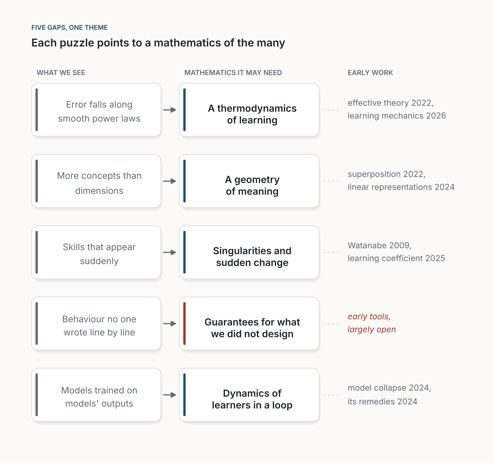

::: {.callout-note appearance="simple"}
**Analysis, November 2026.** An analysis of the mathematics that machine learning uses, the puzzles it cannot yet explain, and the theory that has started to appear, read against the history of thermodynamics. Unless stated otherwise, dates and results come from the cited sources. The 2026 results on AI and mathematics come partly from company announcements and press reports; where I rely on someone's account, I say whose. The five hunches in the second half are mine. I am an engineer and researcher who uses this mathematics and thinks about where it is going, not a mathematician who invents it. The figures are drawn with [figs.py](figs.py); one shows illustrative curves, not data.
:::

**In short.** If you open a modern AI model, you find very little new mathematics: matrices, the chain rule, gradient descent, probability and the Boltzmann distribution, most of it from the nineteenth century. That old toolbox is enough to *build* and *train* these systems. It is not enough to *explain* them: why they generalize when classical theory gives no reason they should, why their error falls along smooth power laws, why skills appear suddenly, what is going on inside them. Machine learning has produced real theory, but mostly for simpler models than the ones we use. We have been here before. Steam engines ran for a century before thermodynamics explained them, and the explanation, when it came, was new mathematics. My reading is that machine learning is still waiting for its Carnot, though the first signs are here. The mathematics it needs, I suspect, is a mathematics of very large, very typical systems: macroscopic laws for learning, a geometry of meaning, a theory of singular models and sudden transitions, guarantees for things we did not design, and the dynamics of machines that learn from a world they have already changed. Understanding large systems is not the same as betting on ever larger ones: a good theory should also tell us when bigger is a waste.

::: {.callout-tip appearance="simple" icon="false"}
## Key takeaways

- The mathematics inside AI is mostly old: calculus, linear algebra, probability, optimization, information theory. Machine learning has invented mathematics too, but mostly for simpler models than the ones we now use.
- That mathematics is enough to build the machines. It does not explain why they work.
- History suggests a pattern: the machine comes first, the mathematics that explains it comes later, and it is new.
- My hunch: the missing mathematics is about large, typical systems. Macroscopic laws, the geometry of representations, singularities and phase transitions, guarantees, and feedback loops.
- Understanding why scale works is not a bet on scale; a good theory should also say when bigger is wasteful.
- AI now proves research results, so far mostly by connecting existing concepts. When proofs become cheap, the scarce work is checking and understanding them.
:::

## The borrowed toolbox

Take a large language model apart, all the way down to the mathematics, and what you find is surprisingly old.

The model is a long chain of matrix multiplications with simple non-linear functions in between. At the end, softmax turns scores into probabilities; it is the formula Boltzmann used for the energy of gas molecules, and the number that controls it is still called the temperature. Training measures how surprised the model is by the next word, a quantity from Shannon's theory of communication, and lowers that surprise step by step with gradient descent. The gradient is computed with the chain rule. Backpropagation is the chain rule organized cleverly enough to run across billions of parameters. Even image generators, the most mathematical corner of modern AI, run a random process in reverse [@ho2020; @song2021], using an equation published in 1982 on top of stochastic calculus from the 1940s. Table 1 gathers the dates.

| Tool | Where it sits in a model | First published |
|---|---|---|
| Differential calculus and the chain rule | Computing gradients | Leibniz, 1684 [@leibniz1684] |
| Gradient descent | Training | Cauchy, 1847 [@cauchy1847] |
| Matrices | Every layer | Cayley, 1858 [@cayley1858] |
| Boltzmann distribution (softmax) | Probabilities over words; attention weights | Boltzmann, 1868 [@boltzmann1868] |
| Entropy, cross-entropy | The training loss | Shannon, 1948 [@shannon1948] |
| Stochastic calculus; reverse-time diffusion | Image generation | Itô, 1944 [@ito1944]; Anderson, 1982 [@anderson1982] |
| Backpropagation as a training method | Training | Rumelhart, Hinton and Williams, 1986 [@rumelhart1986] |
| Attention | Transformers | Vaswani and colleagues, 2017 [@vaswani2017] |

: **Table 1.** The main mathematical tools inside a modern model, with the usual date of first publication. The last two rows are new *designs* built from old mathematics: attention is a weighted average whose weights are a softmax of dot products.

This is not a criticism. A standard textbook, *Mathematics for Machine Learning*, covers what an engineer needs in four parts: linear algebra, analytic geometry, calculus and probability, plus some optimization [@deisenroth2020]. None of it would surprise a good student from 1950.

## The claim

Stated precisely, the claim of this analysis has three parts.

1. **Enough to build.** The mathematics used to design and train modern models (Table 1) is almost entirely older than the models.
2. **Not enough to explain.** For four phenomena (generalization in models with more parameters than examples, scaling laws, sudden changes in ability, and internal representations), no existing theory predicts from first principles how production-scale models behave: their exponents, constants, thresholds or features.
3. **New concepts will be needed.** The theory that does will need new macroscopic concepts, quantities that summarize billions of parameters the way temperature and entropy summarize a gas, and not only new results within existing frameworks.

The first part is a matter of record. The second is my reading of the literature as of November 2026. The third is a hunch, and the last sections say what would prove it wrong.

## What the old mathematics cannot explain

The old mathematics is enough to *build* these machines. The trouble begins when we ask it to *explain* them. Four things stand out.

**They generalize when they should not.** Classical learning theory warns that a model with far more parameters than training examples can simply memorize its data, and its guarantees then say nothing about new cases. Modern networks have far more parameters than examples, and they generalize anyway. Zhang and colleagues showed that standard networks can perfectly memorize images with *random* labels, which means they have the capacity to overfit, yet on real labels they generalize well [@zhang2017]. Belkin and colleagues then showed that test error, as models grow, can get worse and then better again, a "double descent" the classical picture did not predict [@belkin2019; @belkin2021].

{fig-alt="Two stacked plots of error against model size. Top, titled 'What the textbook predicted', subtitled 'too big a model overfits': a dashed training-error curve falls to zero at a vertical line, and a blue test-error curve forms a U, falling then rising steeply. Bottom, titled 'What we see', subtitled 'past the peak, error falls again': the same training curve, and an orange test-error curve that falls, rises to a sharp peak at the vertical line labelled 'just big enough to memorize', then falls again and stays low. A note at the top reads 'Illustrative curves, not data'."}

**Their error follows laws we did not derive.** When language models are scaled up, their error falls along smooth power laws in the number of parameters, the amount of data and the compute, across several orders of magnitude [@kaplan2020]. These laws are measured, not derived, and they can be revised: two years later, another team found that the best balance between model size and data was quite different, and their correction pointed toward smaller models, not bigger ones. A 70-billion-parameter model trained on more data beat one four times its size [@hoffmann2022]. A law whose constants move when someone measures more carefully is a sign that the theory underneath is missing. A power law also carries a warning that is easy to miss: each equal step down in error costs many times more than the last. The curves describe diminishing returns, not a promise.

**Their skills appear suddenly.** In some training runs, a network memorizes its training set early, shows no sign of understanding for a long time, and then abruptly generalizes, a behaviour called "grokking" [@power2022]. In one small case the mystery was solved by looking inside: a network learning addition modulo a prime had found, on its own, a method built on Fourier's sines and cosines [@nanda2023]. For large models the picture is murkier. Abilities that seem to appear suddenly with scale [@wei2022] can look smooth when they are measured differently [@schaeffer2023], which is itself a sign that we do not yet know which quantities to measure. We see something like phase transitions in learning; we do not have a good theory of when and why they happen.

**We do not know what is inside.** Networks seem to store more concepts than they have dimensions, by packing them along nearly perpendicular directions, a phenomenon called superposition [@elhage2022]. Researchers have since pulled millions of such directions, many of them readable as concepts, out of a production language model [@templeton2024]. Small, invisible changes to an input can flip a model's answer [@szegedy2014]. We can measure all of this. We cannot yet predict it from first principles.

## The theory so far

To be fair to the field: machine learning has not only borrowed mathematics; it has created some. Vapnik and Chervonenkis built a theory of how a learner generalizes from finite data [@vapnik1971], Leslie Valiant defined what it means to be learnable at all [@valiant1984], and the needs of data science have reshaped probability in high dimensions [@vershynin2018]. That theory was built for an earlier generation of models, and the puzzles above are the places where it stops predicting what we see.

Newer theory is real too. The neural tangent kernel describes very wide networks [@jacot2018]; mean-field theories describe how small networks learn [@mei2018]; statistical physics has long been applied to learning [@bahri2020]; an effective theory of deep networks is built on the ratio of depth to width [@roberts2022]; and a theory of scaling laws links their exponents to the dimension of the data [@bahri2024]. Theory has also changed practice at least once: a study of infinitely wide networks gave a way to tune training settings on a 40-million-parameter model and carry them over to a 6.7-billion-parameter one, beating published results for that size [@yang2021; @yang2022]. In 2026, fourteen researchers argued that these strands are converging into a scientific theory of deep learning, which they propose to call "learning mechanics" [@simon2026]. These are, I think, early signs of a Carnot. But practice is still far ahead of theory, and most theory explains a simplified network rather than the systems we actually use.

## A precedent: the engine before the theory

Thomas Newcomen's steam engine was pumping water out of mines from 1712. James Watt's separate condenser, which made it efficient, dates from 1769 [@hills1989]. Engines powered an industrial revolution, and for all that time nobody could say what an engine fundamentally *was*, or what limited its efficiency. The answer came in 1824, when Sadi Carnot asked how much work could, in principle, be drawn from heat [@carnot1824]. He reasoned with the caloric theory, which treated heat as a fluid and was wrong. His central result survived anyway, and in the 1850s Clausius and others rebuilt it on firmer ground. Clausius named entropy in 1865 [@clausius1865]. In 1877, Boltzmann explained it as counting: entropy measures how many microscopic arrangements are compatible with what we see at the macroscopic scale [@boltzmann1877].

{fig-alt="Two timelines on the same time scale. The top lane, Engines, shows orange points for Newcomen's engine in 1712 and Watt's condenser in 1769, then green points for Carnot in 1824, Clausius naming entropy in 1865 and Boltzmann's entropy as counting in 1877. The bottom lane, Learning machines, shows orange points for the perceptron in 1958, backpropagation in 1986 and deep nets winning in 2012, followed by a dashed circle with a question mark labelled 'our Carnot'."}

Four lessons carry over.

- **The machine came first.** Practice led, and theory followed by more than a century. That is how much of science has worked.
- **The theory was new.** Thermodynamics was not a better engineering manual. It introduced concepts, like entropy and temperature in its modern sense, that turned out to matter far beyond engines.
- **An early theory does not need to be right to point the way.** Carnot's caloric was wrong; his question was right.
- **The key move was to stop looking at the parts.** Nobody explained the engine by tracking each molecule of steam. When there are enough molecules, a few macroscopic quantities obey exact laws *because* the details average out. The large number was not the obstacle. It was the solution.

That last lesson matters most for machine learning. We keep trying to understand models with billions of parameters neuron by neuron. Perhaps, like steam, they will be understood instead through laws that only appear at scale. That is not an argument for ever larger machines. Thermodynamics did not make engines bigger; it made them better, by showing where the heat was wasted.

The same pattern runs through the history of mathematics. Fourier invented his series to solve the problem of heat flow [@fourier1822]; Fisher invented much of modern statistics to analyse agricultural experiments [@fisher1925]; Shannon invented information theory for communication engineering [@shannon1948]; physicists used Dirac's delta function [@dirac1930] for about two decades before Laurent Schwartz gave it a rigorous home [@schwartz1950]. Sometimes the mathematics is already waiting: Riemann presented his geometry in 1854, sixty years before Einstein needed it for gravity [@riemann1868; @einstein1915], an instance of what Wigner called the "unreasonable effectiveness" of mathematics [@wigner1960]. Machine learning will probably see both: mathematics borrowed from shelves where it has been waiting, and mathematics invented because nothing on the shelves fits.

## Five mathematics we may need

What follows are hunches. Each points to a real gap and has early work around it, but nobody knows yet which, if any, will grow into a field.

**A thermodynamics of learning.** The scaling laws are to AI what Boyle's law was to gases [@boyle1662]: an empirical regularity with no derivation behind it. We need the equivalent of kinetic theory: a mathematics that starts from what training does at the microscopic scale and derives the macroscopic laws, with their constants, and says when they will break. That probably means new macroscopic quantities, the equivalents of temperature and entropy for a network in training. Statistical physics has started this work [@bahri2020; @roberts2022], the first derivations of scaling laws from properties of the data have appeared [@bahri2024], and the proposed "learning mechanics" [@simon2026] is, in effect, a programme for exactly this. The field has a name now, if not yet its Boltzmann.

**A geometry of meaning.** Inside a network, concepts seem to live as directions in a space of thousands of dimensions, packed more densely than the dimensions should allow [@elhage2022]. In such spaces almost all directions are nearly perpendicular, which is what lets so many concepts coexist. There is evidence that many concepts are represented as straight lines, and a first attempt to say in which geometry "straight" should be measured [@park2024]. "Geometric deep learning" already uses symmetry and group theory to *design* networks [@bronstein2021]. What we lack is a mathematics of the representations networks *learn*: how concepts combine, how meaning is composed, which approximate symmetries emerge from data. I suspect it will be a geometry of soft, approximate structure, where the exact objects of classical geometry become statistical ones.

**A theory of singularities and sudden change.** Classical statistics assumes that each setting of a model's parameters gives a different behaviour, and that near the best setting the landscape looks like a smooth bowl. Neural networks violate both assumptions. Sumio Watanabe showed that, for such singular models, the right measure of complexity is not the number of parameters but a quantity from algebraic geometry, computed with Hironaka's resolution of singularities, a deep result from 1964 [@watanabe2009; @hironaka1964]: a striking case of mathematics waiting on a shelf. Researchers can now estimate a local version of Watanabe's quantity for real networks, including transformer language models [@lau2025]. My hunch is that this is the beginning of a larger theory that would explain grokking and other sudden jumps in ability as transitions between singular regions, and predict when they happen.

**A mathematics of guarantees for things we did not design.** Engineering has always relied on proofs about things we designed: this bridge carries that load, this program terminates. A trained network was not designed line by line; it was grown. We want guarantees about it: that it will not do certain things, that its answers lie within a bound, that a small change in input will not flip its decision. Early tools exist: some verify properties of small networks exactly [@katz2017], others certify that a classifier's answer cannot be flipped by changes below a given size [@cohen2019]. They do not yet scale to the systems we use, or to the properties we care most about. The mathematics we have for proving properties of programs is not built for objects of this size and kind. It may take a new mixture of logic, probability and geometry: statements true not with certainty but with a quantified confidence, about functions nobody wrote.

**A dynamics of machines in a loop.** Models are increasingly trained on text that earlier models wrote, and they act in a world their outputs have already changed. Recursive training on generated data can make models lose the rare parts of the original distribution, a failure called model collapse [@shumailov2024]; in some settings, keeping the real data and adding generated data to it avoids the collapse [@gerstgrasser2024]. The answer depends on the structure of the loop, and we have no general theory of that structure. Learners that learn from each other, and from people who learn from them, form a dynamical system closer to ecology or economics than to the fixed datasets of classical theory. Its mathematics barely exists.

{fig-alt="A map in three columns headed 'What we see', 'Mathematics it may need' and 'Early work'. Five rows: 'Error falls along smooth power laws' leads to 'A thermodynamics of learning', with 'effective theory 2022, learning mechanics 2026'. 'More concepts than dimensions' leads to 'A geometry of meaning', with 'superposition 2022, linear representations 2024'. 'Skills that appear suddenly' leads to 'Singularities and sudden change', with 'Watanabe 2009, learning coefficient 2025'. 'Behaviour no one wrote line by line' leads to 'Guarantees for what we did not design', marked in red as 'early tools, largely open'. 'Models trained on models' outputs' leads to 'Dynamics of learners in a loop', with 'model collapse 2024, its remedies 2024'. The title reads 'Each puzzle points to a mathematics of the many'."}

The five have something in common. None is about a single small network. All are about large, typical behaviour: very many parameters, very many examples, very many interacting systems. The mathematics we lack is, I suspect, the mathematics of the many.

## Two objections

**We may not need theory at all.** Richard Sutton's "bitter lesson" is that, over seventy years, general methods that use more computation have beaten methods built on human insight [@sutton2019]. Engineering got here without theory; why should it need theory now? I think the lesson has been right about the past and is a weaker guide to the future. Scale costs energy and money, and the supply of human-written text is finite: one study estimates that, if current trends continue, the largest training runs will use up the stock of public human text sometime between 2026 and 2032 [@villalobos2024]. The bitter lesson also says nothing against *understanding* why scale works. Steam engines improved for decades by trial and error; thermodynamics then told engineers where the limits were and what to stop trying. We will need the same: to know what a system cannot do, how far a trend can go, and what might happen inside it that we would not like. And, as I argued in [Not Because It Is Useful](../2026-11-01-not-because-it-is-useful/index.qmd), wanting to understand is not only a means to better machines. It is a reason in itself.

**AI will invent this mathematics for us.** In 2026, this stopped being a thought experiment. After competition milestones (olympiad silver in 2024 and gold in 2025 [@deepmind2024; @hubert2025; @deepmind2025]) and early help with research [@romeraparedes2024; @davies2021], machines reached research problems themselves. In May 2026, a general-purpose reasoning model from OpenAI disproved a conjecture Erdős made in 1946 about how many pairs of points in the plane can lie at the same distance; according to the company, external mathematicians checked the proof [@openai2026unit]. On 6 October, the company released more than 700 research papers produced with its models [@calegari2026], among them a proof of the "quasi-Riemann hypothesis", a weaker cousin of the Riemann hypothesis, which, Quanta reports, experts have studied and take seriously [@quanta2026]. A claimed solution to the Navier–Stokes Millennium Prize problem, announced in September, is disputed and, according to MIT Technology Review, has not been accepted by the Clay Mathematics Institute [@techreview2026]. Even setting that one aside, machines are now partners in mathematical research. On 1 November, in a guest post on Terence Tao's blog, the mathematician Frank Calegari called that release "a watershed in the history of mathematics" and wrote that AI "is now undeniably capable of making groundbreaking contributions across many areas of mathematics". He was just as blunt about its limits: "despite some tremendous ideas", the papers "are atrociously written and violate our community expectations of attribution. Some of them are even wrong" [@calegari2026].

But the hardest step in the stories above was never the proof. It was the *concept*: Carnot's ideal engine, Boltzmann's entropy as counting, Shannon's decision to measure information without caring about meaning. Each was a choice of what to look at, made because it made a whole field understandable. Here the quasi-Riemann proof is revealing. According to the experts Quanta spoke to, it introduced no new concepts: it found unexpected connections between existing ones [@quanta2026]. That is an extraordinary achievement, and the line between connecting old concepts and inventing new ones is thinner than my argument would like. Boltzmann's entropy was, in a sense, a new connection between mechanics and probability. So I hold this part loosely: machines may cross that line soon. Calegari makes a related point from inside mathematics: even if the release had solved every problem in the Langlands programme, thinking it had "solved number theory" "would be as naive as saying that the construction of the periodic table solved chemistry". Solving a central problem "is not the end but the first step to finding new playgrounds to explore" [@calegari2026]. And if proofs become abundant, the scarce work becomes checking them and understanding them. The test of the new mathematics will still be whether *we* understand more because of it.

## What I am not claiming

- **That there is no theory.** There is a great deal, some of it guiding practice. My claim is that it does not yet explain the systems we actually use.
- **That bigger is the future.** Double descent and scaling laws describe what happens, not what is worth doing. A theory of scale should tell us when to stop scaling.
- **That the five hunches are the right list.** They are guesses about the shape of what is missing. The new mathematics could come from somewhere none of them points to.
- **That machines cannot invent concepts.** The 2026 results suggest they may, soon. I am claiming only that, so far, the reported breakthroughs connect existing concepts rather than introduce new ones.
- **That the Carnot is far away.** It may be arriving now, with "learning mechanics" or something else. The claim is about the shape of the missing theory, not its date.
- **That the 2026 results are settled.** Some come from company announcements and press coverage; the Navier–Stokes claim in particular is disputed, and even an enthusiastic reader of the October release notes that some of its papers are wrong [@calegari2026].

## What would prove me wrong

- **Old mathematics turns out to be enough** (part 3 of the claim). If, by 2030, a theory derives the exponents *and* constants of scaling laws for real transformer training using only existing tools, with no new concepts, the claim that new mathematics is needed is wrong.
- **The parts are enough.** If interpretability explains large models neuron by neuron, with no need for macroscopic quantities, the "mathematics of the many" is wrong.
- **There are no real transitions.** If every sudden jump in ability turns out to be an artefact of measurement, the hunch about singularities and sudden change loses its main motivation.
- **Theory never reaches the design table.** If, by 2030, the leading labs still choose model size, data and training budget only from fitted curves and trial runs, with no derived theory telling them where the limits are, the bitter lesson wins this round, and my case for theory as a practical need is wrong.
- **The hunches stay empty.** If, by 2030, none of the five has produced a result that predicts something about production-scale models before it is measured, they were the wrong list.
- **A machine introduces a concept mathematicians adopt.** If an AI system proposes a new definition or structure that becomes a field of its own, the line I draw between proofs and concepts falls.

## What follows for practitioners

If you work with machine learning and have no plans to invent mathematics, five things follow, I think.

- **Learn the old mathematics well.** Linear algebra, probability and calculus are the language in which everything else, including the new mathematics, will be written.
- **Watch where it breaks.** When a model generalizes better than it should, fails suddenly, or a curve bends where no theory said it would, you are at the edge of the map. Write those surprises down.
- **Do not assume bigger is better.** Giving a model more time to reason when it answers can, on some problems, let a small model outperform one fourteen times larger [@snell2025]. The useful question is when a large model is needed and when a small, fast one will do, a theme I took up in [Fast AI](../2026-10-11-fast-ai/index.qmd).
- **Check before you trust, and understand before you build on it.** Calegari's verdict on the October papers, "tremendous ideas" but some "even wrong" [@calegari2026], is a reminder that when results become cheap to produce, the scarce work is verifying and understanding them. The same holds for a model's outputs, and for claims about models.
- **Keep some humility about explanations.** Many of the stories we tell about why models work are, today, stories. We are in the position of engineers in 1800: excellent at building engines, and honest enough to admit that we do not yet know what they are.

The steam engine ran for a century before someone asked the right question about it, and the answer reached far beyond engines. The machines we have built are, among other things, a question addressed to mathematics. The strange twist of 2026 is that the machines have started to help answer it. Whether we understand the answer will still be up to us.

::: {.read-next}
**Read next** · [Not Because It Is Useful](../2026-11-01-not-because-it-is-useful/index.qmd)
AI can follow the scientific method better than we can. What moved science was never only the method, and never only the answer.
:::

::: {.small}
*The views in this analysis are my own and do not describe any product or plan of my employer.*
:::

## References

::: {#refs}
:::
