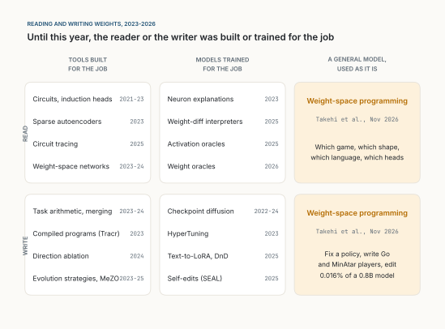

::: {.callout-note appearance="simple"}
**Analysis, November 2026.** A reading of *Sparks of Weight-Space Programming* by Rikiya Takehi, Jayden Teoh, Alex Zhang and Omar Khattab of MIT CSAIL [@takehi2026], published today as a blog post, placed against the work from 2023 to 2026 that reads or writes neural network weights, and read for what it means for [Fast AI](../2026-10-11-fast-ai/index.qmd): small, fast models that run on the customer's own machines. Unless stated otherwise, the numbers about the post's experiments come from the post itself; they are the authors' early, unreviewed results, though they have released the full logs. The model they use is called GPT-6 Astra in the post; I have not used it and cannot check anything about it beyond what they report. The second half, on an "incubator" for small models and how it would work on premise, is my own proposal. The figures are drawn with [figs.py](figs.py); Figure 2 plots the post's own table, Figures 1 and 3 are schematics.
:::

**In short.** For the whole history of deep learning, the weights of a network have been written by an optimizer. Since 2023, a growing body of work has trained special models to read weights or to generate them. The new post claims something different: a general-purpose frontier model, used as it is, can read a network's raw weights and say what it was trained to do, and can write weights directly, around a goal stated in plain language. It names the game a policy was trained on, finds the induction heads of a small transformer without running it, fixes a stuck control policy in one reply, writes game players from scratch that beat PPO trained for 100 million steps, and edits 0.016% of a 0.8-billion-parameter model to stop it looping, which raises MATH-500 from 7.9% to 48.1%. My reading: the results are real, but narrower than the headline. The model is best at turning a *program* it understands into neural form, and at removing an *obstacle* it can find; the authors' own control shows it could not add an ability a model lacked. That shape suits Fast AI very well. Fast AI already uses the large model once, before the loop, as a compiler; weight-space programming lets it compile into the small network itself, repair that network without a GPU cluster, and ship the fix as a patch of a few hundred kilobytes. On premise, the hard question is what leaves the building: a specification can, private data should not, and trained weights carry some of that data. I sketch an incubator that respects this line, and the experiment that would show whether it is worth building.

::: {.callout-tip appearance="simple" icon="false"}
## Key takeaways

- Between 2023 and 2026, weights were read by interpretability tools and trained readers, and written by optimizers, merging, compilers and trained generators. The reader or writer was always built or trained for that job.
- The new claim is that a general model, used as it is, can do both, sometimes without running the network at all.
- The strongest results are where a clean algorithm exists (Breakout, Go tactics, a car that must back up) or where one direction causes one failure (looping). The Qwen edit fixed loops; it did not teach mathematics.
- For Fast AI this means the large model can compile not only the memory but the small specialist itself: slow and expensive once, small and fast every time after.
- On premise, it offers repair without retraining and a fix shipped as a small, reviewable weight diff.
- The catch is data: trained weights carry some of their training data, so reading them with a remote model is a data transfer. Writing from a specification is not.
:::

## Weights were for optimizers

A neural network is, in the end, a long list of numbers. A program written in Python can be read by a person; a list of 17,253 floating-point numbers cannot, at least not by anyone I know. So the division of labour has been stable for decades. People write the architecture, the data and the loss. An optimizer, usually a variant of gradient descent, writes the weights. People then study the result from the outside, by running it.

The post's authors put this well. We have used large language models for a few years to optimize text: prompts and the programs around them [@khattab2024; @agrawal2026], whole harnesses [@lee2026], and the training code that trains models [@karpathy2026]. The justification was that text has no gradient, and a person can improve code by hand, so a language model could too. Weights were the exception. "Humans can 'optimize' code by hand," they write, "but they can't 'optimize' neural weights by hand, so those remained largely in the realm of symbolic algorithms" [@takehi2026].

The claim of the post is that this exception is ending. If it holds, it changes something I care about more than the benchmark scores: how a large model can help a small one.

## What came before: four ways to touch a weight, 2023 to 2026

To see what is new, it helps to sort the earlier work by two questions: does it *read* weights or *write* them, and is the reader or writer a tool built for the job, a model trained for the job, or a general model used as it is? Figure 1 places the main lines of work.

{fig-alt="A grid with two rows, read and write, and three columns: tools built for the job, models trained for the job, and a general model used as it is. Read, tools: circuits and induction heads 2021 to 2023, sparse autoencoders 2023, circuit tracing 2025. Read, trained models: weight-space networks 2023 to 2024, neuron explanations 2023, weight-diff interpreters 2025, activation and weight oracles 2025 to 2026. Write, tools: task arithmetic and merging 2023 to 2024, compiled programs with Tracr 2023, direction ablation 2024, evolution strategies and MeZO 2023 to 2025. Write, trained models: checkpoint diffusion 2022 to 2024, HyperTuning 2023, Text-to-LoRA and Drag-and-Drop 2025, self-edits with SEAL 2025. The general-model column, highlighted, holds weight-space programming, Takehi and colleagues, November 2026, for both reading and writing."}

**Reading, with tools built for the job.** Mechanistic interpretability traces circuits [@olah2020] and found the *induction heads* that let a transformer copy earlier text, with a method that multiplies weight matrices without running the model [@elhage2021]. Sparse autoencoders split activations into nameable features [@bricken2023; @cunningham2023], and circuit tracing draws whole computational graphs [@ameisen2025].

**Reading, with models trained for the job.** Weight-space networks are trained to take another network's weights as input and predict its properties, such as accuracy or the data it was trained on [@navon2023; @zhou2023; @lim2024]. Language models joined in, as explainers of single neurons [@bills2023], as readers of fine-tuning differences [@goel2025] and activations [@karvonen2025; @fraser2026], and, this autumn, of weights directly [@kabra2026].

**Writing, with tools.** Task arithmetic adds and subtracts the weight differences of fine-tuned models [@ilharco2023]; TIES, DARE and evolutionary search made merging more robust [@yadav2023; @yu2024; @akiba2025]. Refusal in many chat models is carried by one direction, and removing it from the weights removes the behaviour [@arditi2024]; facts can be located and edited [@meng2022]. Tracr compiled small programs directly into transformer weights [@lindner2023], and gradient-free optimizers write weights by trial and error [@salimans2017; @malladi2023; @qiu2026].

**Writing, with models trained for the job.** Generative models produce checkpoints [@peebles2022; @wang2024]; hypernetworks turn a task description or a few prompts into adapters [@phang2023; @charakorn2025; @liang2025; @neurogen2025]. SEAL lets a model write its own fine-tuning data, but gradients still apply the update [@zweiger2025].

The pattern across these four boxes is the one the post points out: "either the reader is trained for the task or training still does the writing" [@takehi2026]. The one exception they cite, AdderBoard, has coding agents set the weights of a tiny transformer by hand [@papailiopoulos2026]. The right-hand column of Figure 1 is what the post claims to fill.

## What the post claims

The authors define the idea in one sentence: "In Weight-Space Programming, a general-purpose LLM reads and writes a network's weights directly (i.e., not through an optimizer, and in particular not with gradient descent) around some natural language spec, sometimes even with no environment feedback at all" [@takehi2026].

Stated a little more formally, the claim has three parts. Let $W$ be the weights of a network with a known architecture, and let $M$ be a general-purpose language model.

1. **Read.** Given $W$ as text or as tensors, and a question $q$ about the network's behaviour, $M$ answers $q$ correctly more often than chance, without running the network.
2. **Fix.** Given $W$, a goal $g$ and little or no feedback, $M$ produces $W' = W + \Delta$ with a small $\Delta$, such that $W'$ meets $g$ better than $W$.
3. **Write.** Given only the architecture and a description of the task, $M$ produces $W$ from zero that performs well, with no data, no loss and no gradient.

The interesting resource is not tokens but *forward passes*: how often $M$ is allowed to run the network to see what it does. Several experiments allow none.

## The eight experiments

Table 1 gathers the setup and the main result of each experiment, as reported.

| # | Task (network; what Astra may use) | Result reported |
|-|------------|--------|
| 1 | Which game? (17k-weight PPO policy; weights as text, no tools) | Right game, four of four |
| 2 | Which shape? (24k-weight diffusion model; no forward pass) | Right shape, three of three |
| 3 | Which language, which heads? (7.2M-weight transformer, outer layers removed; Python, no running it) | Right language, three of three; every copying head, no false ones |
| 4 | Fix a car stuck on a ramp (172k-weight PPO policy; one reply, no tools) | 1,024 of 1,024 episodes succeed; 3.5% of weights changed |
| 5 | Write MinAtar players from zero (no data, tools or play) | Beat PPO at 100M steps in all three games (Table 2) |
| 6 | Write a Go player from zero (1.5M weights; 0 to 50 forward passes) | With 50 passes, beats the equal-sized PPO network |
| 7 | Which model is sycophantic? (Gemma 3 270M pairs) | Weights alone: failed. With attention patterns: three of three |
| 8 | Make Qwen3.5-0.8B better at math (10 to 50 forward passes) | MATH-500 7.9% → 48.1%; 0.016% of weights changed (Figure 2) |

: **Table 1.** The eight experiments of Takehi and colleagues [@takehi2026], in their order. The games in Experiment 1 are the authors' grid versions; MinAtar [@young2019] and Kinetix [@matthews2025] are standard benchmarks.

The zero-shot players of Experiment 5 deserve their own table, because they are the cleanest test of writing: no data, no tools, no rollouts, one reply.

| Game | PPO, 100M steps | PPO, 500M steps | Astra, one shot |
|---|---:|---:|---:|
| Breakout | 15.8 | 25.3 | 517.4 |
| Seaquest | 5.6 | 88.9 | 53.1 |
| Asterix | 25.8 | 55.2 | 53.2 |

: **Table 2.** Mean score over 1,000 episodes in three MinAtar games, from the post. PPO is the best of 3 to 10 seeds.

How the model does it matters more than the scores. In every case where the post shows the reasoning, the model does not search the weight space. It *understands* the network as a program. In Breakout, "Astra programs the first layer to compute where the ball would land, and the second layer is programmed to move the paddle to that position." In Go, it writes 336 lines of Python that mark stones and liberties in the first layers, propagate along chains in the middle ones, and score captures and saves in the last. In the car, it adds "a small separate path through a few units per layer" that backs the car up and then switches off. When reading, it rediscovers, unprompted, the weight-multiplication method that Elhage and colleagues used to find induction heads [@elhage2021].

Experiment 8 is the headline and the most instructive. Figure 2 plots its table.

![**Figure 2.** Experiment 8: Qwen3.5-0.8B after Astra's weight edit, for three budgets of forward passes. The last panel is the share of MATH-500 answers that run to the 32,768-token limit, which falls only with the largest budget. Data from Takehi and colleagues [@takehi2026], their table; chart my own.](figures/fig02.svg){fig-alt="Four small bar charts sharing a percentage axis from 0 to 100, each with four bars: base model, and the edited model with 10, 25 and 50 forward passes. MATH-500: 7.9, 12.3, 14.1, 48.1. GSM8K: 13.8, 25.7, 25.1, 67.1. IFEval: 21.0, 49.0, 39.9, 62.3. Share of MATH-500 answers that hit the token limit: 93.0, 87.2, 86.4, 33.1."}

The base model loops: it repeats itself and rarely finishes (85 of its first 96 practice answers ran to the token limit; Qwen's own model card warns of this). Astra traced the loops to one direction written by the MLPs of layers 15 and 19 and subtracted it from 64 output columns in each, 131,072 weights in all. This is, as the authors note, close in spirit to removing refusal by deleting one direction [@arditi2024], and to recent work on why reasoning models loop [@pipis2025]. Because looping is not specific to mathematics, instruction following improved too.

Then comes the control I respect most in the post. The authors tried the same thing on Gemma 3 270M, which rarely loops. Nothing worked: MATH-500 went from 6.8% to at most 7.7%, a gain Astra itself called not established. Their conclusion is careful: "Editing weights could remove an obstacle that hid an ability, but it could not add an ability the model lacked."

## My reading

**What I keep.** Three things seem solid to me, even at this early stage.

First, *reading without running* works on small networks, at least for coarse questions. Experiment 3 is the convincing one: with the input and output layers removed, nothing in the weights says which dimension is which letter, and still the model finds the copying heads that a measurement confirms, with no false positives. That is not pattern-matching on the first layer. It is structural reasoning about matrices.

Second, *writing works where a program exists*. Breakout has a clean algorithm (go where the ball will land), and the written network scores 20 times PPO at 500 million steps. Seaquest has no such short program (oxygen, divers, enemies, timing) and the written network reaches 60% of PPO. That gradient is the most informative thing in Table 2. It says weight-space programming is, at heart, *compilation by understanding*: Tracr did it for programs written in RASP [@lindner2023]; here the program lives in the model's reasoning and the target is an ordinary MLP.

Third, *a small, stated edit can fix a large failure*. A 0.016% change that is explained in a sentence ("this direction causes the loops; remove it") is a very different object from a full fine-tune. It can be reviewed.

**What I let go of.** The framing that the model "made Qwen better at math" overstates the result, and the authors' own Gemma control says so. The edit let the model *finish* answers it could already work out. That is valuable, but it is repair, not teaching.

I would also read the PPO comparisons with care. PPO on a 32-unit MLP is probably a weak baseline; 517 against 25 says as much about how hard a small network is to train with reinforcement learning as about the written one. The comparison the post does not run is a written network used as the *starting point* for PPO.

Forward passes are feedback too. In Experiment 8, ten or twenty-five passes barely moved the loops (87% and 86% still hit the limit), IFEval was *lower* at 25 than at 10, and then fifty passes changed everything. With one edit per budget, a scaling curve and a lucky search look the same.

And the samples are small: four games, three shapes, three languages, three sycophant pairs, one large model. Experiment 7 failed from weights alone. The model is one that most readers, including me, cannot try. None of this makes the results wrong; it makes them sparks, which is what the title says.

## A more advanced mind shaping a smaller one

Here is the part that interests me most, and it is not in the post.

There have been, until now, two ways for a large model to make a small one better. The first is *distillation*: the large model produces outputs, and the small one learns to imitate them by gradient descent [@hinton2015]. Many small models of the last two years were made this way, sometimes combined with pruning [@muralidharan2024]. The second is a *trained generator*: a hypernetwork that maps a description to weights [@charakorn2025; @liang2025]. In both, the small model's weights are still written by an optimizer, from examples.

Weight-space programming adds a third way, and it is strange. The large model does not show the small one examples. It reads the small one's weights, forms a theory of what it computes, and changes it. Table 3 puts the three side by side.

| | Distillation | Trained generator | Weight-space programming |
|---|---|---|---|
| What the teacher gives | Examples of its behaviour | A learned map from task to weights | A diagnosis and an edit |
| Who writes the weights | The student's optimizer | The generator | The teacher, directly |
| Needs data | Much | Many trained checkpoints | Little or none |
| Explains itself | No | No | In plain language |
| Good at | Transferring broad ability | Fast adaptation within a family | Starting points, repairs, audits |
| Weak at | Removing a specific flaw | Tasks unlike its training | Adding an ability the student lacks |

: **Table 3.** Three ways a large model can shape a small one. The first two columns summarize the cited work; the third summarizes the post, and the last two rows are my reading.

The human analogy is tempting, and it is half right. A good teacher does not only give examples; they notice the specific misconception behind a run of mistakes and address that one thing. Experiment 8 is exactly that: one misconception (a direction that never lets go), one correction. But a human teacher works *through* the student's own learning. Here the teacher bypasses it and edits the mind itself. That is more powerful, and less safe: the student has no say, and nothing in the student's own experience confirms the change. It is the difference between a tutor and a surgeon. We accept surgery, but we ask surgeons to state what they will cut and why, to check afterwards, and to keep records.

The Gemma result also fits the analogy uncomfortably well. You can clear an obstacle in a mind; you cannot, by editing, give it understanding it never formed. Ability still comes from learning. What a more advanced mind can do is give a smaller one a better start, remove what blocks it, and check it before it goes out into the world.

## An incubator for small networks

That suggests a concrete design, which I will call an incubator. It is a loop around ordinary training, in which a large model plays the role of a mentor to a small network (Figure 3).

{fig-alt="Five cards in a row joined by arrows: 1 Conceive, the mentor writes a first network from a spec; 2 Grow, ordinary training from that start on real data; 3 Examine, the mentor reads weights and probes for loops and shortcuts; 4 Operate, a small stated edit kept only if held-out tests agree; 5 Release, an audit note and the weight diff, reviewed like code. A dashed arrow loops from Operate back to Grow, labelled repeat while each edit pays for itself. Labels above the cards say where each stage runs: Conceive, spec only; Grow, on premise; Examine and Operate, local or remote; Release, on premise. A note below says the budget is forward passes and mentor tokens, counted against plain training, and that at most the specification leaves."}

1. **Conceive.** From a specification in plain language, the mentor writes a first network of the target size, as a program in neural form, the way Astra wrote the Breakout and Go players. Where the task has a known algorithm, this start may already be good; where it does not, it is at least structured.
2. **Grow.** Ordinary training, on real data, from that start. This is where ability comes from, and where the Gemma lesson applies: the mentor cannot skip it.
3. **Examine.** The mentor reads the trained weights, with a small budget of probes, looking for known failure modes: loops, shortcuts, a direction that tracks the user's opinion (the sycophancy of Experiment 7), dead units, a policy stuck in a local minimum (Experiment 4).
4. **Operate.** A small edit, stated in a sentence, kept only if held-out tests agree. Then back to training, so that the network can absorb the change.
5. **Release.** The network goes out with an audit note: what was examined, what was found, what was changed, and the weight diff itself.

The economics are simple to state. Let $C_\text{train}(s)$ be the cost of training from a starting point $s$ to a target quality, $C_\text{write}$ the mentor's cost to write the start, and $C_\text{fix}$ the cost of each examine-and-operate round. The incubator is worth it when

$$
\begin{aligned}
&C_\text{write} + C_\text{train}(s_\text{written}) + k \, C_\text{fix}\\
&\quad < \; C_\text{train}(s_\text{random}),
\end{aligned}
$$

or, more often in practice, when it reaches a quality that plain training does not reach at all, as with the stuck car. The post gives hints on both sides: a written start can be very good (Table 2), and a single repair can be worth more than any amount of extra training (the car never succeeded in 256 episodes after a billion steps). It gives no measurement of the left-hand side. That is the first experiment anyone should run.

## What it means for Fast AI on premise

On this site I have argued for what I call Fast AI: experts learn slowly, once, and then act fast on habit, so the large model should be used *before* the loop, as a compiler, and fast, explainable models should run the process (see [Fast AI](../2026-10-11-fast-ai/index.qmd)). I have also argued that local AI will be an ecosystem of small specialists, a shared memory and a thin harness, not one large model made small (see [An Ecosystem, Not an Oracle](../2026-10-17-an-ecosystem-not-an-oracle/index.qmd)). Many of the places where this matters most run on premise: a factory, a hospital, a bank, an administration, where hardware is modest, latency is tight, and data may not leave the building. Weight-space programming touches that picture in five places.

### 1. Compile into the weights, not only into the memory

In Fast AI, the large model compiles a task into a structured memory (a knowledge graph experts can inspect) and small models run on it. Weight-space programming adds a second compilation target: the small network itself. Experiment 5 is exactly this, with the rules and source code of a game turned into a 600→32→32→6 network in one reply. The resulting network is tiny, runs in microseconds on a CPU or an NPU, and needs no large model at run time. That is the Fast AI cost profile: slow and expensive once, cheap every time after.

I would keep one rule from the Fast AI essay: *let deep learning perceive and trees decide*. If a business rule is known and stable, a decision tree is cheaper, faster and easier to audit than any network, written or trained. A written network earns its place where the decision sits on top of perception (the rule needs features a tree cannot see), or where it must run fused with a perception model on the same accelerator. Writing a network to imitate a rule you already have in a table is a step backwards.

### 2. The mentor visits; it does not stay

The large model's cost is paid at build time and at repair time, never per decision. In Experiment 8 the whole repair took fifty forward passes of the 0.8B model and one session of the large one; the post does not report the large model's own cost. Compare that with the agent that "reads the manual every morning", which pays the large model on every run. For an on-premise customer, this is the difference between a recurring dependence on a remote model and an occasional visit by a specialist. Table 4 summarizes where each part would run.

| Stage | Where it can run | What it needs to see |
|---|---|---|
| Write a first network (large model) | Anywhere, including remote | The specification and the architecture |
| Train it (ordinary optimizer) | On premise | Private data |
| Examine it (large model, a few forward passes) | On premise, or remote if weights may leave | The trained weights and some probes |
| Repair it (large model, a Python kernel) | Same as above | The weights; no gradients |
| Run it (the small network only) | On premise, CPU or NPU | Live inputs |

: **Table 4.** Where each part of an incubated small model would run in an on-premise deployment. My own proposal, based on the setups of Experiments 5, 6 and 8 [@takehi2026].

### 3. Repair without a GPU cluster

On-premise teams rarely have the infrastructure, or the data pipeline, to fine-tune again every time a model misbehaves. The Qwen repair used a Python kernel "over the weights (no GPU)" and no training at all. The forward passes are not free, though: fifty of them, at an average of 64 answers that mostly ran to 32,768 tokens, come to the order of a hundred million generated tokens (my rough estimate from the post's settings). For a 0.8-billion-parameter model that is hours on one GPU, not a job for a CPU, but it is one machine, not a cluster. The edit changed 131,072 weights: about half a megabyte in 32-bit floats, a quarter in 16-bit (my arithmetic). That is a patch, in the software sense. It can be signed, shipped, applied and rolled back like any other patch, and a customer can keep the base model they already validated.

The limit is the one the Gemma control drew. A patch can remove a failure that hides an ability (loops, a stuck policy, a direction that tracks the user's opinion). It will not add an ability the model lacks; that still needs training, and data.

### 4. What leaves the building

This is the part I would think hardest about before selling anything. Private data should not leave the building. A specification usually can, but not always: in Experiment 5 the mentor also read the game's source code, and on premise the equivalent (business rules, process logic) can be confidential too. Trained weights sit in between: they are shaped by their training data, and published attacks have extracted verbatim training examples from language models [@carlini2021]. Sending a model trained on patient records to a remote mentor for "examination" is therefore a data transfer, whatever the contract calls it.

The setups in the post suggest a clean split. *Writing* from a specification (Experiments 5 and 6) needs no data at all, so it can be done by any mentor the customer is willing to show the specification to. *Training* happens on premise, on private data. *Examining* and *repairing* need the trained weights, so either the weights may leave, or the mentor must run inside. Today, only a frontier model has shown this ability at this level, and only in one lab's hands. Whether an open model that a customer can run locally can do the examination is, to me, the most important open question for on-premise use. Until it is answered, the safe on-premise recipe is: write remotely, train and run locally, and examine locally with the tools we already have.

### 5. Audit before deployment, and review the intent

Regulated customers ask what a model does before they let it run. Reading weights could add a new kind of evidence: not only "it passed these tests" but "here is what it computes, here is what we looked for and did not find". Experiment 7 is a warning, though: from weights alone, Astra saw many differences between an honest and a sycophantic model and could not say which mattered. Reading should add to evaluation, not replace it.

And every edit needs a stated intent. A 131,072-weight diff is not something a person will read; "remove the direction that causes loops in layers 15 and 19" is. That is the shift I argued for code in [Review the Intent, Not the Diff](../2026-10-22-review-the-intent-not-the-diff/index.qmd): humans own the intent, machines own the implementation, tests check one against the other. On premise, the intent note, the diff and the test results should ship together, and the customer should be able to refuse the patch.

A decision model of the kind I analysed in [The Junior Colleague](../2026-10-18-the-junior-colleague/index.qmd) is the natural first candidate for all five: small, narrow, often close to a program, trained on the agent's own states, and running next to the agent on the customer's machine.

## Where it breaks

- **Scale.** The networks that fit in context have at most 171,664 weights. The 0.8B edit used a Python kernel and fifty forward passes, and changed one direction. Nothing yet shows that a model can *understand* a large network as a whole, rather than find one handle in it.
- **Tasks without a program.** Writing works best where a short algorithm exists. Many tasks we give small models (perception, language, judgement) have none, and there the mentor can only repair and audit.
- **Written starts that resist training.** Nothing in the post tests a written network as a starting point for gradient training. Weights set by reasoning can push tanh units into saturation, where gradients vanish, so the *Grow* stage may stall or simply erase the written structure.
- **Adversarial weights.** A reader that can be fooled by weights crafted to look benign is an attack surface. None of the experiments tests this.

## What I am not claiming

Not that gradient descent is on its way out: the best results in the post still come from networks trained first or from tasks simple enough to program. Not that the incubator works; it is a design, with its test below. Not that written networks should replace decision trees where the rules are known. Nothing about GPT-6 Astra beyond what the post reports. And not that a model reading weights understands them the way we hope; it may have found a heuristic for small MLPs that fails silently at scale.

## What would prove me wrong

- **A model that adds an ability by editing.** If a weight edit, with no training, gives a model a skill it measurably lacked (not one hidden by a failure like looping), my distinction between repair and teaching falls. A replication of the Gemma control with a positive result would be the place to look.
- **Written starts that do not help training.** If PPO or supervised training from a mentor-written start reaches the same quality, at the same total cost, as training from a random start, the "Conceive" stage of the incubator is useless.
- **Repairs that do not survive training.** If a stated edit, followed by more training, is reliably undone, edits are cosmetic and the incubator's loop does not converge.
- **No local mentor.** If, by the end of 2027, no open model that runs on a single server can repeat Experiment 3 or the Qwen repair, then weight-space programming stays a remote service, and its on-premise value is limited to writing from specifications.
- **Gradient-free optimizers that match it.** If evolution strategies or forward-pass fine-tuning [@qiu2026; @malladi2023], given the same fifty forward passes, find an edit as good as Astra's on Qwen, then the reasoning is not what made the difference, and a cheap local optimizer would do.

The experiment I would run first is small: three MinAtar games, a 32-unit MLP, and four arms at equal compute: PPO from zero, PPO from a written start, the written network alone, and PPO with one examine-and-operate round halfway. I would run it twice, to keep two questions apart. First with the strongest mentor available, to test the incubator itself; then with an open model on one on-premise server, to test whether a local mentor is enough. If the second and fourth arms win the first run, the incubator is worth building; the second run says whether it can be built inside the building. If not, I will have learned something too.

::: {.read-next}
**Read next** · [Fast AI](../2026-10-11-fast-ai/index.qmd)
Learn slowly, once. Act fast, every time. Use the large model to build the memory, not to replace it.
:::

::: {.small}
*The views in this analysis are my own and do not describe any product or plan of my employer.*
:::

## References

::: {#refs}
:::
