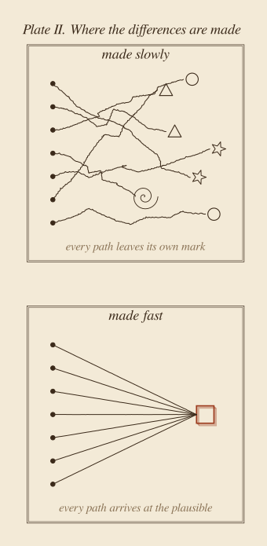

::: {.callout-note appearance="simple"}
**Essay, November 2026.** A philosophical essay about time: why we compress it, what AI adds to that habit, and what we lose when we do. It borrows one image from physics, light, as a metaphor rather than an argument. The two plates are schematics, my own, made with [figs.py](figs.py), and drawn on purpose in a style that is not this site's usual one: an essay about everything starting to look the same should not look like everything else.
:::

**In short.** We think of time as something we produce with, so we try to save it, and AI helps us save more. But time is also where we exist: where we think, where we are present to others, where we can be seen. Light offers a strange picture of what happens when time is removed. The fastest thing there is lives no time at all, and no one ever sees it pass: it makes everything else visible and is seen only at the moment it ends. When we compress our days, we drift towards that condition. Our work becomes more visible and we become less so, and the work itself starts to look like everyone else's. Grasping, inventing and integrating are made of time, and they are where the work becomes ours. AI is a kind of light: fast, everywhere, living nothing on the way. That is fine for a machine. Let the machines be light. We are what it is meant to show.

## 1. Time is where we exist

We speak of time as a resource. We save it, spend it, waste it, invest it. A good day is one in which much was produced; a lost day is one in which little was. In that language, time has value only through what comes out of it, and the obvious goal is to need less of it for the same output. AI fits that language perfectly. It is the best time-saving machine we have built.

But think of the moments when someone *had time* for you. A teacher who stayed after class. A colleague who did not look at their phone while you explained a problem. A friend who let a silence last. What they gave you was not output. It was presence. For that hour, you existed for them, fully, and they for you.

Having time is not only a way to produce. It is a way to exist. It is the space in which we think rather than react, in which a thought can be followed to its end, in which we can doubt, change our minds, and become someone slightly different from who we were in the morning. Augustine, after long pages of searching for what time is, concluded that it is a kind of stretching of the mind itself, a *distentio animi* [@augustine1909, XI.26]: the mind holding what has been, attending to what is, expecting what will be. Time, on that view, is not something we have. It is something we are stretched across.

And when it shrinks, we shrink with it. The sociologist Hartmut Rosa has described how the technologies that save time leave us feeling shorter of it than ever, because the saved minutes are immediately spent on doing more [@rosa2013]. A meeting becomes a message, a document becomes its summary, a person becomes their deliverables. Little by little, we appear to each other only as outputs: the report arrived, the ticket was closed, the dashboard was updated. The one who produced them is less and less visible.

That is the argument I want to make first. Shortening our time does not only cost us quality. It costs us presence. It makes us harder to see, by others and by ourselves.

## 2. Light is never seen passing

Physics offers an image of this that I cannot forget.

Imagine a photon leaving a star in a distant galaxy. For us, its journey lasts billions of years. Galaxies form and collide while it travels. For the photon, no time passes at all. Einstein's relativity says that a moving clock runs slow, and the faster it moves, the slower it runs [@einstein1920]. At six tenths of the speed of light, a clock ticks eight times while one at rest ticks ten. At the speed of light, it does not tick at all. Along the path of light, the time lived between departure and arrival, what physicists call *proper time*, is exactly zero.

A photon has no point of view, and physics allows no frame of reference that moves with light, so this is an image, not an experience. But the image has a second half. We never see light passing. We see *by* light: everything visible is visible because photons left it and reached us. A photon is seen only at the moment it is absorbed, which is the moment it ends. Light makes everything visible except itself.

That is the picture of where compression leads. The fastest thing in the universe lives nothing on the way and is never seen while it travels. It delivers, perfectly, and disappears into what it delivers.

{fig-alt="An engraved-style diagram on sepia paper. Two dots, A at the bottom labelled 'a question' and B at the top labelled 'an answer', are joined by four paths inside a hatched diamond, marked a to d. Path a, vertical, at rest, has ten tick marks. Path b, bent, at 0.6 c, has eight. Path c, at 0.9 c, about four. Path d, the outer path of light drawn in rust red, has none. A key below reads: a, at rest, time lived 10; b, at 0.6 c, 8; c, at 0.9 c, 4.4; d, light, 0."}

## 3. Time belongs to slow things

Turn the image around, and it says something about us.

We are slow. The Earth carries us around the sun at about thirty kilometres per second, roughly one ten-thousandth of the speed of light. Brian Greene describes everything as moving through spacetime at the same speed: light puts all of it into space, and what is nearly at rest puts nearly all of it into time [@greene1999, ch. 2]. We are almost entirely made of time. It is so present for us, so heavy, because we move so slowly. And as Figure 1 shows, between two moments the slow path is not the wasteful one. It is the one that holds the most time.

Henri Bergson called lived time *duration*, and gave the simplest example of it I know: "If I want to mix a glass of sugar and water, I must, willy-nilly, wait until the sugar melts" [@bergson1911, ch. 1]. The waiting is not wasted. The melting *is* the time it takes.

When we compress our days, we are trying, in a small way, to become light: to have the answer without the time between the question and the answer. And light is precisely the thing for which nothing happens on the way.

## 4. Fast, and the same

AI enters with a clear message: you can do more in less time. I agree, and I have argued for it in [Fast AI](../2026-10-11-fast-ai/index.qmd). Much of our work is repetitive, and doing it faster is simply good. Not all of our hours are worth living slowly, and I am glad to give some of them away.

But the message carries an unspoken second half: *since it was done fast, it is done.* Speed tells us how long something took. It tells us nothing about whether it was worth doing, or whether it is any good.

And there is a second effect, which I have started to see in my own work. When a process takes weeks, we live inside it, making small choices all along the way: what to show first, what to leave out, which word fits. The result carries the marks of the path, and through them, of the person who walked it. When it takes minutes, we barely see the process. We judge the result by whether it looks right, and "looks right" has a centre of gravity: the plausible, which is close to what has been done before. I see it when people use Claude, or any assistant, to build dashboards and reports. Each one is better than what most of us would have made by hand in the same time. Together, they look alike: the same cards, the same row of key figures, the same soft palette. The same look and feel, everywhere.

Research points the same way. In an experiment by Doshi and Hauser, stories written with ideas from a language model were judged more creative on average, but were also more similar to one another [@doshi2024]. Each person gained. The collection lost variety. One experiment is not a law, and every era has had its templates. But the mechanism is easy to see: light between two points always takes the same path. Only the slow traveller can wander, and arrive somewhere no one else has been.

{fig-alt="Two engraved-style panels on sepia paper. In the upper panel, 'made slowly', seven wavering lines start from seven dots on the left, cross each other and end at different shapes: circles, triangles, stars, a spiral. In the lower panel, 'made fast', seven straight lines from seven dots all converge on one small rust-red square."}

This is where the two halves of the argument meet. Sameness is what invisibility looks like from the outside. When the path disappears, so do the marks of the one who walked it. The result is good, and it is everyone's, and so it is no one's.

## 5. Where the work becomes ours

Three kinds of time behave like Bergson's sugar, and each is a place where the work becomes ours.

**The time to grasp.** I can read an explanation in two minutes and understand it a week later. A summary shortens the reading, not the grasping, because the grasping happens in me. No one can understand something on my behalf, and what I have understood, I can explain in my own words.

**The time to invent.** Poincaré described weeks of failure on a mathematical problem, then finding the answer the moment he stepped onto a bus, thinking of something else [@poincare1914, Book I, ch. 3]. Graham Wallas later named the stages: preparation, incubation, illumination, verification [@wallas1926]. AI helps with the first and the last. Incubation, the middle, looks exactly like doing nothing, which is why it is the first thing we cut. It is also where an idea takes the shape of the mind that holds it.

**The time to integrate.** You can roll out a tool in a day. You cannot roll out a new practice in a day, because a practice is what people do once they have stopped thinking about the tool, and it becomes a team's own only by being lived.

These are not slow because we are inefficient. They are made of time, the way a melody is: play it ten times faster and you do not get the same melody sooner, you get noise. And they are where we become visible in what we make. An idea we received carries no trace of us. An idea we grasped, invented or integrated carries our mark.

## 6. The objection: are we not more visible than ever?

The strongest objection to this essay is simple. Those who produce more and faster are surely *more* visible, not less. Their reports are everywhere, their names in every feed, their dashboards on every screen. In a world that sees through output, speed looks like the best way to be seen.

I think this confuses two kinds of visibility, and light shows the difference. When you look at a lit room, you see the table, the books, the faces. You do not see the light. Speed makes the *work* visible. It does not make the *person* visible; it can make them vanish into the work, the way light vanishes into what it illuminates. A colleague who ships ten reports a week is very visible as a source of reports. Whether anyone knows how they think, what they doubt, what they would have done differently, is another matter. That second visibility takes time: time to say something that is not yet a deliverable, and time for someone else to listen.

There is a softer objection too. Every generation has said new tools would make people shallow, and each time people found new ways to think deeply with them. Perhaps AI, by taking the tedious parts, gives us *more* time to exist. I think this is half right. But freed time does not stay free by itself. In 1930, Keynes imagined that productivity would bring his grandchildren a fifteen-hour week [@keynes1930]. The productivity came; we spent it on more output. The time to think has no defender. It does not appear on a dashboard, and it looks like idleness. Unless someone protects it on purpose, it is the first thing the saved hours will be spent on.

And yes, the physics is a metaphor. No deadline will bring us near the speed of light. I use the picture because it shows something I believe for other reasons: that what happens in us needs duration, and that duration is not a cost to be minimised but the medium in which we exist.

## 7. Let the machines be light

There is a way to read the metaphor that is not a warning.

AI is a kind of light. It is fast, it is everywhere, and it lives nothing on the way. It makes things visible: patterns in data, options in a design, the shape of a problem. It does not need to be seen itself, and it is not diminished by having no time. That is fine. That is what light is for.

The mistake would be to compete with it at its own speed: to try to become light ourselves, delivering everywhere and living nothing. We will lose that race, and we will disappear in the effort. The better division of labour is the one the universe already has. Light travels. Slow things are what it shows.

So when AI saves a day, I try to ask where the day went, not only what else can be shipped. I try to keep the parts of the process that make the work mine: the question, the structure, what to leave out. And I try to keep some time empty. The Greek word for leisure, *scholē*, is the root of our word *school*; Josef Pieper called leisure the basis of culture, a time in which we can receive what we cannot produce [@pieper1952].

A photon crosses the whole universe and lives nothing. It lights up everything, and no one ever sees it pass.

We are slow. That is why we have time, and why we can be seen.

Let the machines be light. We are what it is meant to show.

::: {.read-next}
**Read next** · [Not Because It Is Useful](../2026-11-01-not-because-it-is-useful/index.qmd)
AI can follow the scientific method better than we can. What moved science was never only the method, and never only the answer.
:::

::: {.small}
*The views in this essay are my own and do not describe any product or plan of my employer.*
:::

## References

::: {#refs}
:::
