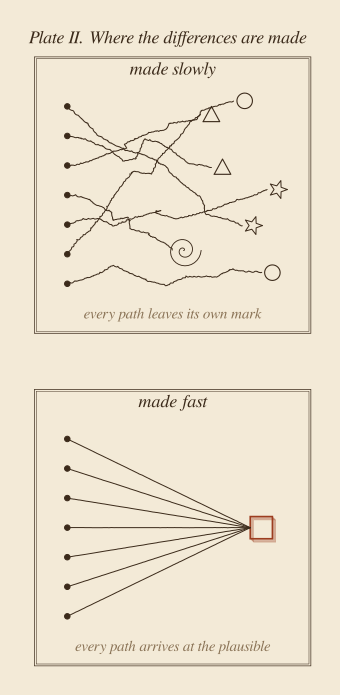

::: {.callout-note appearance="simple"}
**Essay, November 2026.** A philosophical essay about time: why we compress it every day, what AI adds to that habit, and what kind of time I think cannot be compressed at all. It borrows one image from physics, the photon, and uses it as a metaphor, not as an argument. The two plates are schematics, my own, made with [figs.py](figs.py). They are drawn on purpose in a style that is not this site's usual one: an essay about everything starting to look the same should not look like everything else. It sits next to [Fast AI](../2026-10-11-fast-ai/index.qmd), where I argued for doing more, faster, and asks what that argument leaves out.
:::

**In short.** We compress time every day: to fit the system, to produce more, to stay competitive. AI pushes the same way, and it delivers: we really can do more in less time. But there is a strange lesson in physics. Light, the fastest thing there is, lives no time at all: between its departure and its arrival, not a single instant passes for it. Time belongs to slow things, to things with mass, to us. And the slower a path between two moments, the more time it holds. If we keep compressing, we drift towards the condition of the photon: arriving everywhere, living nothing on the way, and arriving at the same place as everyone else. That is what I see when fast results start to look alike. Grasping, inventing and integrating are made of time. They are what happens on the slow path. We can protect that time. We cannot compress it without losing what it was for.

::: {.callout-tip appearance="simple" icon="false"}
## Key takeaways

- We compress time to keep up with a system that rewards output, and AI makes that easier than ever.
- For light, no time passes at all. Time, in the sense of something lived, belongs to slow things.
- Doing more in less time is real. It does not make what is done good.
- When the process disappears, we judge only results, and results judged that way converge on the same plausible look.
- Learning, inventing and integrating are made of duration. Compressing them does not speed them up; it stops them from happening.
- The useful question is not "how much time did AI save?" but "what did we do with the time it saved?"
:::

## 1. What, then, is time?

"What then is time?" asked Augustine, sixteen centuries ago. "If no one asks me, I know: if I wish to explain it to one that asketh, I know not" [@augustine1909, XI.14].

I recognise that answer. I know time very well in one form: as something that is missing. Most of my days begin with a kind of arithmetic. There is more to do than there is time, so I look for what can be shortened. A meeting becomes a message. A document becomes a summary of the document. A problem I would like to think about becomes a problem I would like to have solved.

I do not think I am unusual. We compress time because the world around us rewards it. A company is compared with its competitors on how fast it ships, a person with their colleagues on how much they deliver. Nobody has to tell us to hurry. The comparison does it for us.

The sociologist Hartmut Rosa calls this social acceleration, and he describes a paradox that anyone with an inbox will recognise [@rosa2013]. The technologies that save time should leave us with more of it, and yet we feel shorter of time than ever. We do not spend the saved minutes resting or thinking. We spend them doing more, and the more we do raises what is expected next. In 1930, Keynes imagined that his grandchildren, made rich by productivity, might work fifteen hours a week and face the real problem of how to use their freedom [@keynes1930]. The productivity came. The freedom mostly did not.

So the time we know best is the time of the clock: a quantity, divided into units, each of which can be saved, spent, or lost. The Greeks called it *chronos*. But Augustine, after pages of searching, came to a different conclusion. Time, he wrote, is a kind of stretching of the mind itself, a *distentio animi* [@augustine1909, XI.26]: the mind holding what has been, attending to what is, expecting what will be. Time is not only something we have. It is something we are stretched across.

That second kind of time is the one I want to think about. And to see it, I found it useful to look at something that has none.

## 2. Being a photon

Imagine being a photon of light.

You leave the surface of a star in a distant galaxy. For us, watching from Earth, your journey lasts billions of years. Galaxies form and collide while you travel. When you finally strike the eye of someone looking at the night sky, an enormous amount of time has passed.

For you, none has.

This is one of the strangest results of Einstein's relativity [@einstein1920]. A moving clock runs slow compared with one at rest, and the faster it moves, the slower it runs. At six tenths of the speed of light, a clock ticks eight times while a clock at rest ticks ten. At nine tenths, a little over four. At the speed of light itself, the clock does not tick at all. Physicists call the time a clock carries along its own path its *proper time*. Along the path of light, the proper time between departure and arrival is exactly zero.

I should be careful here. A photon has no point of view; physics does not even allow a frame of reference that moves with light. There is no "being a photon" in any literal sense. But the limit is clear, and as an image it is hard to forget: the fastest thing in the universe crosses it without living a single instant. It does not age on the way. Nothing can happen to it *in its own time*, because it has none. It cannot wait, hesitate, learn, or become anything other than what it was when it left.

The physicist Brian Greene puts it in a way I like [@greene1999, ch. 2]. Everything, he says, moves through spacetime at the same speed, the speed of light. An object at rest moves entirely through time. An object in motion diverts some of that movement into space, and so moves more slowly through time. Light puts everything into space, and nothing is left for time.

{fig-alt="An engraved-style diagram on sepia paper. Two dots, A at the bottom labelled 'a question' and B at the top labelled 'an answer', are joined by four paths inside a hatched diamond, marked a to d. Path a, vertical, at rest, has ten tick marks. Path b, bent, at 0.6 c, has eight. Path c, at 0.9 c, about four. Path d, the outer path of light drawn in rust red, has none. A key below reads: a, at rest, time lived 10; b, at 0.6 c, 8; c, at 0.9 c, 4.4; d, light, 0."}

## 3. Time belongs to slow things

Turn the image around and it says something about us.

We are slow. The Earth carries us around the sun at about thirty kilometres per second, which is about one ten-thousandth of the speed of light. Relative to light, we are almost perfectly still. And so, in Greene's picture, nearly all of our movement through spacetime is movement through time. Time is so present for us, so heavy, so impossible to ignore, because we move so slowly. It is not a defect of our condition. It is our condition.

There is a second lesson in Figure 1. Between two moments, the path that holds the most time is the slow, straight one. Every detour at high speed shortens the time lived on the way. A traveller who rushes off and comes back arrives younger than the one who stayed, with fewer ticks, fewer days, less lived. In relativity, the slow path is not the wasteful one. It is the full one.

And only things with mass can be slow. Light has no mass, and so it has no choice: it must move at the speed of light, and it lives no time. Everything that has mass, every atom, every cell, every person, moves more slowly than light, and so it has time. In [Work Has Mass](../2026-10-24-work-has-mass/index.qmd) I used mass as a metaphor for everything we make and must then carry. Here the metaphor turns: mass is also what gives us time. To have weight is to be the kind of thing to which something can happen, something that can be changed.

Henri Bergson spent his life arguing that lived time, which he called duration, is not a line of identical instants but the medium in which things ripen. He gave the simplest example I know: "If I want to mix a glass of sugar and water, I must, willy-nilly, wait until the sugar melts" [@bergson1911, ch. 1]. The waiting is not wasted. It is part of what happens. No hurry on my part changes it, because the melting *is* the time it takes.

So here is the thought I cannot shake. When we compress our days, we are trying, in a small way, to become photons: to arrive without the journey, to have the answer without living the time between the question and the answer. And a photon is precisely the thing for which nothing happens on the way.

## 4. AI says: you can do more

AI enters this story with a clear message. You can do more, in less time. A report that took a week takes an afternoon. A first version of a tool takes an hour. An analysis that needed a team needs a prompt and a person who can check it.

I agree with this message, and I have argued for it. In [Fast AI](../2026-10-11-fast-ai/index.qmd) I wrote about turning slow learning into fast habits. Much of the work we do is repetitive, and doing it faster is simply good. Nobody should mourn the hours spent copying numbers from one table into another. Not all time is duration in Bergson's sense; some of it is just waiting, and I am glad to lose it.

But the message has a second half that is easy to hear without anyone saying it: *since you can do it faster, you should.* And a third half, more dangerous still: *since it was done fast, it is done.*

Speed tells us how long something took. It tells us nothing about whether it was worth doing, whether it was the right thing, or whether it is any good. A bad idea executed in an afternoon is still a bad idea. It is only a cheaper one, and cheap bad ideas multiply. What is done fast arrives, like the photon, exactly as it left: nothing has had the time to happen to it on the way.

## 5. Everything starts to look the same

There is a second effect, and I have started to see it in my own work.

When the process takes weeks, we live inside it. We make small choices all along the way: what to show first, what to leave out, which word fits, which chart tells the story. Each choice is shaped by who we are, what we know, and what we struggled with. The result carries the marks of the path, the way a walker's route carries the marks of the ground.

When the process takes minutes, we barely see it. We ask, we receive, we judge the result, and we judge it by whether it looks right. The trouble is that "looks right" has a centre of gravity. A model produces what is plausible, and the plausible is, almost by definition, close to what has been done before. If many people ask for a dashboard, they receive many versions of the same good dashboard: clean cards, a row of key figures, a line chart, a soft palette. If many people ask for a report, the reports share a structure, a tone, even a rhythm of headings.

I see this today when people use Claude, or any other assistant, to produce dashboards and reports. Each one, alone, is better than what most of us would have made by hand in the same time. Together, they start to look alike. The same look and feel, everywhere. This site is not immune: its own figures have a house style, and that is why the two plates in this essay are drawn differently, by hand, as it were, on old paper.

There is research that points the same way. In an experiment by Doshi and Hauser, short stories written with ideas from a language model were judged more creative on average, but they were also more similar to one another [@doshi2024]. Each person gained. The collection lost variety.

{fig-alt="Two engraved-style panels on sepia paper. In the upper panel, 'made slowly', seven wavering lines start from seven dots on the left, cross each other and end at different shapes: circles, triangles, stars, a spiral. In the lower panel, 'made fast', seven straight lines from seven dots all converge on one small rust-red square."}

I do not want to overstate this. One experiment on short stories is not a law of nature, and sameness has always existed: every era has its fashion, every company its template. But I think the mechanism is real, and the photon helps me name it. Light takes the shortest path; all light between two points takes the same one. The slow traveller can wander, and in wandering, can arrive somewhere no one else has been. When we skip the process, we lose the place where differences are made. The result is good, and it is everyone's.

## 6. Three times that do not shrink

So what exactly is the time we lose? I see at least three kinds of time that behave like Bergson's sugar.

**The time to grasp.** Understanding something is not receiving it. I can read an explanation in two minutes and understand it a week later, after it has been turned over, misapplied, corrected. A summary can make the reading shorter. It cannot make the grasping shorter, because the grasping happens in me. No one can understand something on my behalf.

**The time to invent.** New ideas rarely arrive on schedule. Poincaré described working for weeks on a mathematical problem without success, then leaving for a geological excursion and finding the answer the moment he stepped onto a bus, while thinking of something else [@poincare1914, Book I, ch. 3]. The psychologist Graham Wallas later named the stages: preparation, incubation, illumination, verification [@wallas1926]. AI helps a great deal with preparation and with verification. Incubation is the stage in the middle, the one where nothing seems to happen. It is also the one we are most tempted to cut, because from the outside it looks exactly like doing nothing.

**The time to integrate.** Learning something is not the end. A new way of working has to settle into habits, into teams, into the way an organisation decides. That takes repetition, failure and conversation. You can roll out a tool in a day. You cannot roll out a new practice in a day, because a practice is what people do once they have stopped thinking about the tool.

These three are not slow because we are inefficient. They are slow because they are made of time, the way a melody is made of time: play it ten times faster and you do not get the same melody sooner, you get noise. Compressing them does not make them happen faster. It makes them not happen.

## 7. Two objections

The first objection is that this is nostalgia. Every generation has said that new tools would make people shallow. Writing was supposed to ruin memory; the printing press, attention; the internet, thought. Each time, people found new ways to think deeply with the new tools. Perhaps AI, by taking the tedious parts, gives us *more* time for incubation, not less.

I think this is half right. AI can give us time back. The question is what we do with it, and history is not encouraging. Keynes's fifteen-hour week did not fail because productivity failed, but because we spent the gain on more output. Freed time does not stay free by itself. It is filled, almost immediately, by whatever the system rewards. So I do not claim that AI destroys the time to think. I claim something narrower: that this time has no defender. Nobody measures it. It does not appear on a dashboard. It looks like idleness. Unless someone protects it on purpose, it is the first thing the saved hours will be spent on.

The second objection is that the physics is only a metaphor, and a loose one. That is true, and I want to say it plainly. The time pressure of a working day has nothing to do with relativistic speeds; no deadline will ever bring us close to the speed of light. What I borrow from physics is not a proof but a picture: that time, as something lived, belongs to slow things, and that the fastest possible path is also the one along which nothing happens. The picture could mislead if pushed too far. I use it because it shows something I believe for other reasons: that what happens in us needs duration, and that duration is not a cost to be minimised but the medium in which we change.

## 8. Leaving room

I do not have a method, and I am suspicious of anyone who offers one for this. But I can say what I am trying to do.

**Ask where the saved time went.** When AI saves a team a day, the honest follow-up is not "what else can we ship?" but "what did we do with that day?" If the answer is always "more of the same", the saving is real and the gain is not.

**Keep some of the process.** Not out of nostalgia, but because the process is where the choices are. When I build something with an assistant, I try to spend my time on the parts that make it mine: the question, the structure, what to leave out, the style. I let it carry the rest.

**Protect the empty time.** Incubation does not survive a calendar without gaps. A walk, an afternoon without a deliverable, a problem left open overnight. The Greek word for leisure, *scholē*, is the root of our word *school*. Josef Pieper argued that leisure in that old sense is not the absence of work but the basis of culture: a time in which we can receive what we cannot produce [@pieper1952]. I think it is also the basis of invention.

**Judge by more than speed.** "Done in an hour" is a fact, not a quality. The questions that matter are older: is it right, is it good, is it new, does it fit what we are trying to become?

Seneca wrote that life is not short, but that we make it short by wasting so much of it [@seneca49]. I think the waste he meant was not the slow hours. It was the hours spent busy on things that did not matter.

We now have tools that give us back many hours we spent on routine, and that is a real gift. But the time we are most eager to save, the slow, unproductive-looking time in which we grasp, imagine and invent, is not waste. It is the slow path between two moments, the one that holds the most time.

A photon crosses the whole universe and lives nothing. We cross a single afternoon and can be changed by it. That is the privilege of being slow. We can compress the work. We cannot compress the time in which we become able to do something new. The best we can do is leave it room.

::: {.read-next}
**Read next** · [Not Because It Is Useful](../2026-11-01-not-because-it-is-useful/index.qmd)
AI can follow the scientific method better than we can. What moved science was never only the method, and never only the answer.
:::

::: {.small}
*The views in this essay are my own and do not describe any product or plan of my employer.*
:::

## References

::: {#refs}
:::
