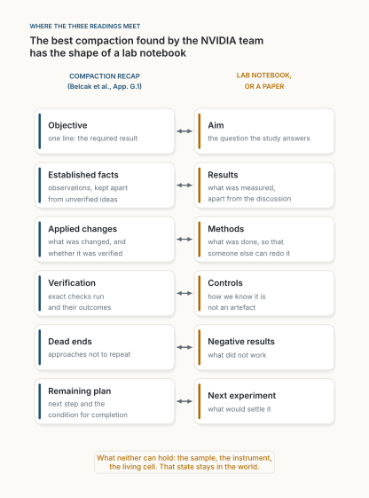

::: {.callout-note appearance="simple"}
**Analysis, November 2026.** Three posts I saved this week, read together: a technology executive's summary of NVIDIA's paper *You don't need long context* [@exec2026post; @belcak2026], Johannes Hermle's announcement of Anthropic's report on how researchers use Claude [@hermle2026post; @hermle2026], and Ramakrushna Mohapatra's explainer on multi-head, multi-query and grouped-query attention [@mohapatra2026]. I read the paper and the report in full. Every number taken from a source is cited where it is used. The figures are drawn with [figs.py](figs.py): Figure 1 is computed, Figures 2 and 3 plot the sources' numbers, Figure 4 is my own schematic.
:::

**In short.** The three posts are about one thing: what a system must hold in mind while it works, and what that costs. Grouped-query attention shrinks the memory per remembered token [@ainslie2023]. The NVIDIA paper shrinks the number of tokens kept: strong models lose little when their history is replaced by a short written state [@belcak2026, sec. 3–5]. The Anthropic report shows that AI is used where research tasks are formal and checkable, and least at the bench [@hermle2026]. The first two levers multiply, and all three meet in one place: the best compaction NVIDIA found has the shape of a lab notebook. What does not fit on the page, the sample, the instrument, the question worth asking, is where the bottleneck and the human part of the work remain.

::: {.callout-tip appearance="simple" icon="false"}
## Key takeaways

- **One resource, three levers:** bytes per remembered token (architecture), tokens remembered (the agent's harness), and which work can be put into tokens at all (the field).
- **Long context is mostly a habit.** Frequent compaction kept frontier models within a few points of full history, and selective reading often beat it [@belcak2026, sec. 3–4].
- **The good notepad is a lab notebook:** aim, facts, methods, checks, dead ends, next step.
- **You may not own the model; you can own the notepad.**
:::

## Three posts, one resource

The executive's post: late tokens cost up to 7 times more than early ones, aggressive compaction costs little accuracy, and "your agent doesn't need a photographic memory. It needs a good notepad. It's Guy Pearce in Memento and it still ships the PR" [@exec2026post]. Hermle's post: Claude is used most per researcher in computer science, mathematics and statistics, use tracks AI capability, and output could double in some fields, with physical work as the bottleneck [@hermle2026post]. Mohapatra's post: decoding is limited by memory, because every generated token reads the whole key-value (KV) cache; for a Llama 3 8B-shaped model, multi-head attention (MHA) stores 512 KiB per token, multi-query attention (MQA) 16 KiB, and grouped-query attention (GQA) sits between [@mohapatra2026].

What ties them is the **working state**: what a system keeps at hand to take its next step. For a transformer it is the KV cache [@pope2023]:

$$
\text{KV bytes} = B \times N, \qquad B = 2\,L\,H_{kv}\,d\,b,
$$

where $B$, the bytes per token, is set by the architecture ($L$ layers, $H_{kv}$ key-value heads of dimension $d$, $b$ bytes per number), and $N$, the tokens kept, is set by the harness that runs the model. The attention post is about $B$. The NVIDIA paper is about $N$. The Anthropic report is about what comes before both: which work can be turned into tokens at all.

## The first lever: bytes per token

The attention post's numbers check out: $2 \times 32 \times 32 \times 128 \times 2$ bytes is 512 KiB per token with 32 K/V heads, 128 KiB with the 8 that Llama 3 uses [@dubey2024], 16 KiB with one (my arithmetic, in [figs.py](figs.py)). GQA, introduced in 2023, keeps most of MHA's quality at most of MQA's speed [@ainslie2023]. Since then the lever has been pulled hard: DeepSeek's latent attention caches about 69 KiB per token for a 671-billion-parameter model (my arithmetic from its published configuration [@deepseek2024; @deepseek2024v3]), sliding windows and token eviction keep fewer tokens per layer [@xiao2024; @zhang2023h2o], and state space models carry a fixed-size state [@gu2023], which hybrids such as Nemotron-H use in place of most attention layers [@nemotronh2025]. Yet $N$ kept growing: several context windows now exceed *War and Peace* [@belcak2026, table 1].

## The second lever: tokens kept

The NVIDIA paper asks whether long contexts are necessary, and answers no [@belcak2026, sec. 1 and 6].

**The cost.** On H100 GPUs under load, serving a 256K window instead of 16K costs 3.6 times more per generated token for GLM 5.2, 5.6 for Kimi K2.6 and 7 for Qwen 3 Coder Next [@belcak2026, figs. 1 and 4]. So the post's "up to 7x" is right, with a nuance: it is about the window a server reserves, not the position of one token.

**The method.** A minimal agent, one Bash command per turn, runs in three regimes: full history; compaction when the context crosses a threshold, after which a fresh conversation starts from the task and a written recap; and compaction after every single action [@belcak2026, sec. 2.4]. Long documents stay on disk and are read with `grep` and bounded reads.

**The results.** Across six long-horizon benchmarks, compaction moves accuracy between −3.7 and +5.6 points for Claude Opus 4.5 and between −3.3 and +4.4 for GPT 5.6 Sol [@belcak2026, sec. 3]. On long-input tasks, selective reading usually *beats* pasting everything in: RULER recall rises from 62.5% to 95.7% for Opus [@belcak2026, table 15]. Figure 2 shows the most striking result.

![**Figure 2.** One action per context against full history and the best compaction, on SWE-bench Verified and Terminal-Bench 2.1. Top: accuracy. Bottom: the largest single context per task; full history reaches 130K to 200K tokens, one action per context a median of 7K to 9K. Data from Table 2 of the paper [@belcak2026]; chart my own.](figures/fig02.svg){fig-alt="Two charts, one above the other. Top, grouped bars of accuracy in percent for four cases, each with full history, best compaction and one action per context: Opus 4.5 on SWE-bench Verified 70, 75, 70; Opus 4.5 on Terminal-Bench 2.1 47, 53, 52; GPT 5.6 on SWE-bench Verified 84, 89, 82; GPT 5.6 on Terminal-Bench 2.1 88, 89, 84. Bottom, on a log scale from 5K to 200K tokens, the median and maximum of the largest context per task: full history medians 17K to 32K with maxima 130K to 200K; best compaction medians 19K to 24K with maxima 22K to 40K; one action per context medians 7K to 9K with maxima 15K to 37K."}

From this the authors propose a **semantic state space model**: a model trained to read a written state, take one action, and rewrite the state so that another instance can continue. Unlike Mamba's hidden state, this one is "explainable natural language" [@belcak2026, sec. 5.1].

Three caveats. The savings assume prices that follow serving cost; at today's flat prices, compaction sometimes costs *more*, as for GPT 5.6 Sol on SWE-bench Verified [@belcak2026, table 3]. The result holds for strong models: one open model collapsed from 53.0% to 3.6% under tight compaction [@belcak2026, app. D, table 9]. And the benchmarks have checkable ends; the authors themselves show that a task needing the *i*-th of many coin tosses must eventually fail under any fixed budget [@belcak2026, sec. 3.1].

## The levers multiply

Because the two levers act on different factors, their effects multiply (Figure 1).

![**Figure 1.** KV cache of one sequence for a Llama 3 8B-shaped model in FP16, by tokens kept (rows) and attention layout (columns), and how many sequences fit in 64 GiB, roughly what an 80 GB GPU has left after the weights. 32K is the median largest context of full-history agents in the paper, 8K the median with one action per context [@belcak2026, table 2]. Computed in figs.py; my own.](figures/fig01.svg){fig-alt="A grid of five rows and three columns. Rows: 256K, 128K, 32K, 16K and 8K tokens kept. Columns: MHA with 32 K/V heads and 512 KiB per token, GQA with 8 heads and 128 KiB, MQA with 1 head and 16 KiB. At 256K: 128 GiB (does not fit), 32 GiB (2 at once), 4 GiB (16). At 128K: 64 GiB (1), 16 GiB (4), 2 GiB (32). At 32K: 16 GiB (4), 4 GiB (16), 512 MiB (128). At 16K: 8 GiB (8), 2 GiB (32), 256 MiB (256). At 8K: 4 GiB (16), 1 GiB (64), 128 MiB (512)."}

From MHA at 256K (128 GiB, which does not fit) to GQA at 8K (1 GiB, 64 sequences at once), the cache shrinks 128 times: 4 from the architecture, 32 from the harness. That compares the window a server must reserve. For a typical task the factor is smaller: full-history agents peak at a median of 32K tokens [@belcak2026, table 2], so going to 8K saves 4 times, and GQA another 4, about 16 times in all. Either way the harness lever matches or beats the architecture, needs no retraining, and anyone who writes an agent can pull it today.

## The third lever: what can be written down

The report never mentions context or tokens. Reading its findings as a statement about what can be written down is my interpretation, and I flag it as such.

The Anthropic report classifies 207,049 research sessions from August and September 2026 by field and task, and adds a survey of 528 scientists [@hermle2026]. Computer science is 4.3% of the world's researchers but 32.7% of Claude Code sessions; data analysis is the largest task, ideation one of the smallest, although scientists rate it the most important [@hermle2026]. Use rises with how well AI could do a task, and that capability correlates with how well the task suits reinforcement learning (+0.78), that is, with having a checkable result; it falls with the physical share of the task (−0.57) [@hermle2026].

A simple production model, where the slowest step limits the rest, turns this into scenarios (Figure 3). With today's abilities widely adopted, output rises up to about 2x in statistics and computer science. If AI did every non-physical step, low-physical fields would reach 15 to 16 times, but bench sciences only 3 to 4, because physical steps take about 40% of their research time, against 4% in the median field [@hermle2026]. The authors call these "illustrative scenarios, not forecasts" [@hermle2026].

![**Figure 3.** Research output for a fixed budget, relative to no AI, in two scenarios of the Anthropic report. Top: today's abilities, widely adopted. Bottom: all non-physical steps done by AI; the darker bar is the low end of the stated range. Data from the report [@hermle2026]; chart my own.](figures/fig03.svg){fig-alt="Two horizontal bar charts, one above the other. Top, titled today's abilities, widely adopted: arts 1.35 times, anthropology 1.36, chemistry 1.41, computer science 1.96, statistics 2.02. Bottom, titled all non-physical steps automated: statistics, computer science, economics, mathematics, psychology and most social sciences 15 to 16 times; biology, chemistry, materials, agricultural and biomedical sciences 3 to 4 times."}

The worry behind it is old. Ideas are getting harder to find [@bloom2020], partly because each researcher must absorb more before contributing: the "burden of knowledge" [@jones2009]. Seen from the first two posts, that is science's long-context problem.

## Where the three meet

The NVIDIA team found that the best compactions are not faithful summaries but "carefully cherry-picked briefs for further execution" [@belcak2026, app. A]. Their recap asks for the objective, established facts kept apart from unverified ideas, changes made, checks run, dead ends, and the next step with "the condition for completion" [@belcak2026, app. G.1]. That is a lab notebook (Figure 4).

{fig-alt="Two columns of six cards joined by double arrows. Left, compaction recap: Objective; Established facts, observations kept apart from unverified ideas; Applied changes; Verification; Dead ends; Remaining plan, next step and the condition for completion. Right, lab notebook or a paper: Aim; Results; Methods; Controls; Negative results; Next experiment. A note at the bottom: what neither can hold: the sample, the instrument, the living cell; that state stays in the world."}

Science solved its long-context problem this way, at least since its first journals in 1665. No scientist holds the whole literature in mind. Each reads a compacted state (a review, a textbook), takes a few actions in a career, and writes back an updated state for someone else. Standing on the shoulders of giants is compaction across generations. Read together, the three sources say:

1. **What is checkable may compact well.** This is my hypothesis, not a finding of either source. AI is used where results can be checked [@hermle2026], and a written state works where the task has a verifiable end [@belcak2026].
2. **The world does not compact.** An experiment is the coin-toss case: observations with no structure until you have them. A cell culture's state is in no context window, which is why about 40% of bench research time resists AI [@hermle2026]. Polanyi said we know more than we can tell [@polanyi1966]; in the lab, much of it is in the hands.
3. **Read selectively.** Data analysis is half of Claude Code's science sessions [@hermle2026], and agents analyse best by querying, not by pasting [@belcak2026, sec. 4]. "A wealth of information creates a poverty of attention" [@simon1971].

## What it means for the next few years

**Prices that depend on context.** If a 256K window costs 3.6 to 7 times more to serve [@belcak2026, fig. 1], flat prices subsidise long contexts. Expect context tiers, and short-context agents as the default.

**Models trained to hand over.** The authors expect semantic state models to be "considerably more data-efficient to train" [@belcak2026, sec. 5.1]. Writing a good handoff, the skill the collapsing open model lacked, becomes a trained ability.

**Agents you can own.** At 8K tokens, a GQA model of Llama 3 8B's shape needs a 1 GiB cache (Figure 1), and the paper runs models locally because data "must remain on-device for privacy or cost reasons" [@belcak2026, sec. 2.3]. The executive's claim that cloud AI is aligned with its owner [@exec2026post] is an opinion the paper does not test. What it does show is that a short written state is portable: you can read it, audit it and hand it to another model. You may not own the model; you can own the notepad. That is the shared memory [Fast AI](../2026-10-11-fast-ai/index.qmd) needs.

**The bottleneck moves to the bench and to the question.** Lab automation turns physical steps into tool calls [@boiko2023], and what remains is ideation, about 4% of sessions today [@hermle2026].

**A state that can be audited, and attacked.** A written state can be read by a person, which a neural state never allowed. But whatever enters the notes is believed by every later instance. Keep provenance: where each fact came from, so it can be checked again, as I argued in [The Context Is the Wire](../2026-11-01-the-context-is-the-wire/index.qmd).

## A philosophical perspective

The paper ends by recalling that computability itself assumes "a bounded amount of input at a time and maintaining only a finite state of mind" [@belcak2026, sec. 6]. That is Turing's 1936 human computer, who sees a few symbols at a time and, when interrupted, leaves a note saying how to continue [@turing1937]. The single-action agent is Turing's computer, rediscovered at the cost of billions of parameters.

Remembering everything was never the goal. Borges's Funes remembers every leaf he has seen and cannot think: "To think is to forget differences, generalize, make abstractions" [@borges1942]. Nietzsche held that action needs forgetting [@nietzsche1874]. Full history is Funes; compaction is the forgetting that makes the next step possible.

Memento adds the warning. Leonard lives by notes [@nolan2000]; Clark and Chalmers would say such notes are part of the mind, like Otto's notebook [@clark1998]. But some of Leonard's notes are written to deceive him, and Plato's Thamus warned that writing gives a reminder, not memory, and the look of wisdom without the substance [@plato_phaedrus]. A mind made of notes is as trustworthy as its notes. That is why the best compaction records how each fact was checked.

And this is what stays ours. A compaction keeps what is relevant to the work ahead, and relevance depends on the aim. The model can write the brief once it has the objective; it cannot tell which objective is worth pursuing. Scientists use AI least for ideation and value it most [@hermle2026]. What remains human is the line at the top of the notebook: the aim, and what is worth remembering for. I argued the same in [Not Because It Is Useful](../2026-11-01-not-because-it-is-useful/index.qmd).

So keep the notebook short, checked and yours. You may not own the model; you can own the notepad.

## Limits

- **Three kinds of evidence.** The cache arithmetic is exact; the NVIDIA costs estimate a price that does not yet exist; the Anthropic data are model-classified sessions from a company that sells the model, and its acceleration figures are scenarios.
- **Analogies are analogies.** A paper is not a compaction prompt, and GQA groups are not research teams.
- **Short tasks.** Most SWE-bench Verified tasks were estimated at under an hour of human work [@chowdhury2024]. Research carries state for months.
- **My hypothesis.** That checkable work is what compacts well is my reading; neither source tests it.

## What would prove me wrong

- **Long context wins at equal cost.** If, by the end of 2027, full-history agents beat compacted ones by more than a few points at the same serving cost.
- **Compaction works without checks.** If written-state agents match full history on open-ended work with no verifiable end, my link between checkability and compaction is wrong.
- **Bench sciences catch up without labs.** If AI use per researcher in chemistry and biomedicine matches the formal sciences before lab automation spreads.

::: {.read-next}
**Read next** · [Where Memory Lives](../2026-10-26-where-memory-lives/index.qmd)
Four experiments on what a small model should remember and what it should look up, including when the KV cache outweighs the model.
:::

::: {.small}
*The views in this analysis are my own and do not describe any product or plan of my employer.*
:::

## References

::: {#refs}
:::
