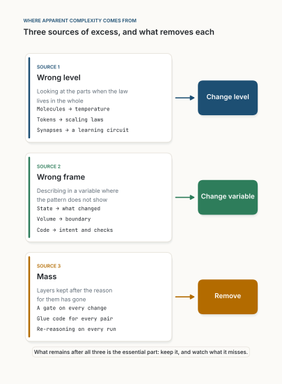
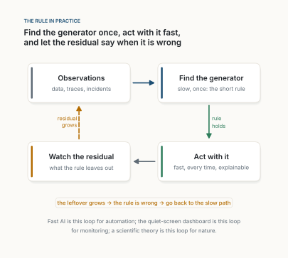

::: {.callout-warning appearance="simple"}
**Position paper, November 2026. A provocative paper, on purpose.** A short paper with a thesis, a measure, two small worked examples and predictions that could prove it wrong. It gathers one idea that runs, mostly unnamed, through every post on this site since September, from dashboards and agents to black holes. Figures are my own; the numbers in Figures 1 and 2 are computed by [figs.py](figs.py) and stored in [results.json](results.json).
:::

**Abstract.** We call a system complex when describing it takes a long time. I argue that this length is mostly a property of the description, not of the system. Formally, the *apparent* complexity $A(x)$ of a thing is the length of the description we actually use; its *intrinsic* complexity is the length of the shortest description that would regenerate it, a rule plus what the rule leaves out, $K(x) \lesssim L(G) + L(x \mid G)$. The gap $A - K$ is excess, and it has three sources: we look at the **wrong level**, we describe in the **wrong frame**, or we carry **mass**, layers kept after their reason has gone. Each has its own remedy: change level, change variable, remove. Two cautions keep the thesis honest. A short rule can be expensive to run, so simplicity of description is not simplicity of computation. And a short rule is a hypothesis, so it must carry its residual, the part it does not explain, as the alarm that says when it is wrong. I collect the evidence from twenty-six earlier posts, give two worked examples, and state five predictions, with what would refute each.

::: {.callout-tip appearance="simple" icon="false"}
## Claims

1. **The thesis.** Most of what we call complex is a short rule we have not found, not a long one we must accept.
2. **The measure.** Complexity is description length: a rule plus a residual. A good simplification makes the sum smaller, not just the rule.
3. **Three sources of excess.** Wrong level, wrong frame, and mass. Change level, change variable, remove.
4. **Short is not cheap.** A simple rule may be costly to run. Then pay the cost once, and reuse the result.
5. **Keep the residual.** A simple description is only safe while someone watches what it leaves out.
6. **The test.** In models, agents, processes and dashboards, the shorter complete description should do at least as well. Where it does not, the thesis is wrong.
:::

## 1. Introduction

One evening I opened a physics paper I could not follow, and my first reaction was: *it must be simpler than this* ([A Universe Without a Bottom](../2026-10-15-a-universe-without-a-bottom/index.qmd)). I meant it as a feeling. Three weeks and twenty-two posts later, I think it is a claim, and a testable one.

The posts were about very different things: dashboards, agents, code review, memory in small models, learning rules, time, black holes. Read together, they keep making one move. Something looks complicated; we find that most of the complication came from where we stood, what we measured, or what we refused to throw away; and what remains is short. The dashboard full of numbers becomes the one shape that changed. The agent that reasons from scratch on every run becomes a habit compiled once. Sixteen hours of review a day become a rule that fits in one line.

This paper states that move precisely, says where it comes from, and says where it fails. It is provocative on purpose: it claims that complexity, in most cases that matter to us, is an error of description, and that the right response is to look for a shorter one rather than to build tools for living with the long one.

## 2. Background

The idea is old, and none of the pieces here are mine.

**Description length.** Solomonoff and Kolmogorov defined the complexity of an object as the length of the shortest program that produces it [@solomonoff1964; @kolmogorov1965]. Rissanen turned this into a practical rule for science and statistics, minimum description length: the best model is the one that minimises the length of the model plus the length of the data given the model [@rissanen1978; @grunwald2007]. Gell-Mann and Lloyd called the first part *effective complexity*: the length of the regularities, with the randomness set aside [@gellmann1996].

**Levels.** Simon observed that complex systems that survive are nearly decomposable: hierarchies of parts that interact strongly inside and weakly between, so each level can be described almost on its own [@simon1962]. Anderson warned in the same spirit that each level has its own laws: *more is different* [@anderson1972].

**Software.** Brooks separated essential complexity, which belongs to the problem, from accidental complexity, which belongs to our tools and habits [@brooks1987]; Moseley and Marks argued that most of what makes large systems hard is accidental, mostly state [@moseley2006]. Gall put the engineering version bluntly: a complex system that works has evolved from a simple system that worked [@gall1975].

**The limits.** Wolfram showed that very short rules can produce behaviour with no known shortcut [@wolfram2002], and Bennett defined *logical depth*, the time a short program needs to produce its output, to separate the two [@bennett1988]. And on the side of taste, Hossenfelder argued that the wish for simple, beautiful laws has led physics astray as often as it has guided it [@hossenfelder2018].

What I add is narrower: a bookkeeping of where excess comes from, a rule for practice, and the claim that, in the domains this site covers, the excess is usually large.

## 3. A minimal definition

Take something we want to describe: a dataset, a codebase, a process, a pattern. Call it $x$.

- $A(x)$, the **apparent complexity**, is the length of the description we actually use: the raw data we store, the code we keep, the steps we follow.
- $G$ is a **generator**: a rule, model or program that reproduces $x$ up to some error. $L(G)$ is the length of the rule; $L(x \mid G)$ is the length of the **residual**, what the rule leaves out.
- $K(x)$, the **intrinsic complexity**, is the length of the shortest such pair:

$$
K(x) \;\approx\; \min_G \big[\, L(G) + L(x \mid G) \,\big].
$$ {#eq-two-part}

The **excess** is what we pay for describing $x$ badly:

$$
E(x) \;=\; A(x) - K(x) \;\geq\; 0 .
$$ {#eq-excess}

The thesis is that, for most systems people build or study, $E$ is large compared with $K$. As a bookkeeping device, not a theorem, I split it three ways:

$$
E \;\approx\; E_{\text{level}} + E_{\text{frame}} + E_{\text{mass}} .
$$ {#eq-sources}

$E_{\text{level}}$ is what we pay for describing parts when the regularity lives in the whole. $E_{\text{frame}}$ is what we pay for describing in a variable where the pattern does not show. $E_{\text{mass}}$ is what we pay for layers whose reason has gone. What is left, $K$, is the essential part in Brooks's sense.

Two quantities sit outside this sum and must not be confused with it. The first is **depth** $D(x)$: the time the shortest generator takes to run [@bennett1988]. A thing can be short and deep. The second is the residual itself, $L(x \mid G)$: it is not waste but the instrument that tells us whether $G$ is still right.

$K$ cannot be computed in general [@kolmogorov1965]. We only ever hold upper bounds: every description we find is one. So the thesis is a claim about how far our current bounds are from the truth, and about where to look to bring them down.

## 4. The arguments

### 4.1 Two small worked examples

**Short, and it looks it; short, and it does not.** Figure 1 stores three patterns of the same size, 128 rows of 255 cells, in three ways: raw, after a general-purpose compressor, and as the shortest Python program I wrote that prints it. Rule 90, a one-line rule, draws nested triangles; the compressor finds most of the regularity (4.0 KB to 375 bytes), and the program needs 134 bytes. Rule 30 is the same one-line rule with a different number. Its output looks random, and the compressor barely helps (1.7 KB), but the program is still 134 bytes. The apparent complexity of Rule 30 is a property of the compressor, not of the pattern.

The third panel is the honest twist. The "coin flips" were drawn from a seeded pseudo-random generator, so they too have a short program, 106 bytes. Looking at the pattern, neither you nor the compressor can tell. This is the uncomputability of $K$ in one picture: we can never be sure there is no shorter rule.

; numbers in [results.json](results.json).](figures/fig01.svg){fig-alt="Three rows. Left of each row, a pattern of 128 by 255 black and white cells, shown in its central 128 columns. Top, Rule 90 in navy: nested triangles. Middle, Rule 30 in amber: a triangle filled with irregular, random-looking texture. Bottom, coin flips in grey: uniform noise. Right of each row, three horizontal bars on a log scale: Raw, Compressor, Program. Rule 90: 4.0 KB, 375 B, 134 B. Rule 30: 4.0 KB, 1.7 KB, 134 B. Coin flips: 4.0 KB, 4.0 KB, 106 B."}

**The simplest complete description is the true one.** Figure 2 is the statistical version, the same lesson as in [Show What Changed, Not the Data](../2026-09-29-show-what-changed/index.qmd). Forty noisy points come from a quadratic. Fitting polynomials of rising degree, the residual keeps shrinking, so a model judged by fit alone keeps growing. Counting both parts of @eq-two-part, the total is shortest at degree 2, the law that produced the data. Simplicity here is not a taste; it is the length of a complete description, and it points at the truth.

.](figures/fig02.svg){fig-alt="Line chart, bits on the vertical axis against polynomial degree from 0 to 14. A grey residual line falls steeply from about 103 at degree 0 to about 28 at degree 2, then slowly to 20. An amber model-cost line rises steadily from about 3 to 40. A navy total line falls from 106 to a minimum of about 36 at degree 2, circled and labelled shortest total, degree 2, the true law, then rises to 60 at degree 14."}

### 4.2 The three sources, across the site

Table 1 reads the earlier posts against @eq-sources. Each row is something that looked complex, and the shorter description the post arrived at.

| Post | What looked complex | The shorter description | Source |
|---|---|---|---|
| [Show What Changed](../2026-09-29-show-what-changed/index.qmd) | A dashboard of hundreds of metrics | The difference between today's shape and last week's | Frame |
| [The Mathematics Still to Come](../2026-11-02-the-mathematics-still-to-come/index.qmd) | Billions of weights | Smooth power laws in size, data and compute [@kaplan2020] | Level |
| [A Universe Without a Bottom](../2026-10-15-a-universe-without-a-bottom/index.qmd) | Everything inside a black hole | One number per patch of its surface [@bekenstein1973] | Frame |
| [Decided in the Bulk](../2026-10-16-decided-in-the-bulk/index.qmd) | An image forming from noise | Large decisions first, then edges | Level |
| [Who Writes the Learning Rule?](../2026-11-04-who-writes-the-learning-rule/index.qmd) | A designed backward pass | A learning circuit that local rules fall into | Level |
| [Intent Is the Source](../2026-10-21-intent-is-the-source/index.qmd) | The code | Intent plus the checks that define it | Frame |
| [A Finite State of Mind](../2026-11-07-a-finite-state-of-mind/index.qmd) | A long agent history | A short written state, shaped like a lab notebook [@belcak2026] | Frame |
| [The Interface Is Data](../2026-10-20-the-interface-is-data/index.qmd) | $N \times M$ adapters | One description, read at run time | Mass |
| [Fast AI](../2026-10-11-fast-ai/index.qmd) | An agent reasoning from scratch on every run | A habit compiled once, and a loop kept for exceptions | Mass |
| [Stop Reviewing Pull Requests](../2026-10-23-stop-reviewing-pull-requests/index.qmd) | A human gate on every change | *Approve what you cannot undo; watch everything else* | Mass |
| [Work Has Mass](../2026-10-24-work-has-mass/index.qmd) | Frameworks layered on frameworks | Everything you make, you carry | Mass |

: **Table 1.** Eleven of the earlier posts, read as reductions of apparent complexity. The last column names the main source of excess in @eq-sources. {tbl-colwidths="[24,26,36,14]"}

{fig-alt="Three stacked cards, each with an arrow to a coloured box on the right. Source 1, wrong level: looking at the parts when the law lives in the whole; examples molecules to temperature, tokens to scaling laws, synapses to a learning circuit; remedy: change level. Source 2, wrong frame: describing in a variable where the pattern does not show; examples state to what changed, volume to boundary, code to intent and checks; remedy: change variable. Source 3, mass: layers kept after the reason for them has gone; examples a gate on every change, glue code for every pair, re-reasoning on every run; remedy: remove. At the bottom: what remains after all three is the essential part: keep it, and watch what it misses."}

**Level.** Temperature is the textbook case: no one describes a gas molecule by molecule. The same move appears whenever the regularity lives in the whole, and Simon's near-decomposability says why it so often works [@simon1962]. The claim in [The Mathematics Still to Come](../2026-11-02-the-mathematics-still-to-come/index.qmd) is that machine learning is still looking for this level: its systems are described weight by weight while its behaviour already follows a few smooth laws.

**Frame.** The same information can be long in one variable and short in another. A dashboard showing levels is long; the same system shown as change is mostly empty. An agent's history is long; the state it needs to continue is short, and the NVIDIA team found that strong models lose little when the history is replaced by it [@belcak2026]. Code is long; the intent and the checks that define correct code are shorter, which is the thesis of [Intent Is the Source](../2026-10-21-intent-is-the-source/index.qmd).

**Mass.** The most common source, and the least glamorous. A gate, a ceremony, an adapter or a layer of reasoning was added for a reason; the reason went, the layer stayed. [Work Has Mass](../2026-10-24-work-has-mass/index.qmd) gives the law: everything you make, you carry. AI makes this source worse, because it lowers the cost of adding a layer, not the cost of carrying it. Here the remedy is not a better description but a shorter system: remove.

### 4.3 Short is not cheap

Rule 30 has a 134-byte description, but to know its millionth row you must, as far as anyone knows, run it a million times [@wolfram2002]. A short rule can be deep [@bennett1988]. This is where simplicity is most often misread: "it is simple" is heard as "it is easy".

The posts suggest the answer: pay the depth once. [Fast AI](../2026-10-11-fast-ai/index.qmd) uses the large model as a compiler, slow and once, so that what runs every time is short and fast. [The Junior Colleague](../2026-10-18-the-junior-colleague/index.qmd) shows the same at the level of single choices: a small model trained on the large model's own runs took over most decisions in customer-service agents, 86.3% cheaper, as long as it knew when it was unsure. Distillation is the general version [@hinton2015]. The simple thing is not the computation; it is what the computation leaves behind.

### 4.4 Keep the residual

A short description is a hypothesis. Reality can move in a direction it does not cover, and then the description stays quiet while the world changes, which is the objection a reader raised in [What a Quiet Screen Cannot See](../2026-10-11-what-a-quiet-screen-cannot-see/index.qmd). The answer there generalises: the residual $L(x \mid G)$ is cheap to watch, and it grows when the rule stops fitting. The rule and its leftover belong together. Throwing away the residual to make the picture cleaner is not simplification; it is blindness.

{fig-alt="A loop of four cards. Observations (data, traces, incidents) leads to Find the generator (slow, once: the short rule), which leads, labelled rule holds, to Act with it (fast, every time, explainable), which leads to Watch the residual (what the rule leaves out), which leads back, by a dashed arrow labelled residual grows, to Observations. Below: the leftover grows, the rule is wrong, go back to the slow path. And: Fast AI is this loop for automation; the quiet-screen dashboard is this loop for monitoring; a scientific theory is this loop for nature."}

Put together, the rule is short enough to remember: **find the generator, pay its depth once, keep its residual, and remove what neither needs.**

## 5. Predictions and a test protocol

Each prediction names a domain from the site, a measurement, and the result that would refute the thesis there.

- **P1. Models.** Among models trained to the same training loss on the same task, those whose behaviour has a shorter description, measured by prequential coding [@blier2018], generalise better. *Refuted if* description length does not predict held-out error once training loss is controlled.
- **P2. Agents.** Replacing an agent's history with a short written state loses accuracy in proportion to how much of the task's state cannot be written down. *Refuted if* the loss is unrelated to that measure, or if long-history agents win consistently on tasks whose state fits on a page.
- **P3. Processes.** Teams that remove a layer whose reason no longer holds (a gate, a ceremony, a handover) deliver faster with no more failures; teams that add layers to AI-assisted work slow down without fewer failures. *Refuted if* removal raises failure rates in a stepped-wedge trial like the one in [Stop Reviewing Pull Requests](../2026-10-23-stop-reviewing-pull-requests/index.qmd).
- **P4. Monitoring.** A dashboard that shows only changes of shape plus a residual alarm detects regime shifts at least as early as a full dashboard, for a fraction of the reading time. *Refuted if* it misses shifts the full dashboard catches, at comparable false-alarm rates.
- **P5. The global test.** Across these domains, when we search seriously for a shorter complete description, we usually find one that does at least as well. *Refuted if* serious searches mostly come back with descriptions about as long as what we started with: then the world is as complex as it looks, and the essays on this site were lucky.

**Protocol.** For P1, a benchmark of small models on held-out tasks with prequential description length, as in @blier2018. For P2, the task suites of @belcak2026, with tasks annotated for how much of their state is physical or tacit. For P3 and P4, the stepped-wedge design of the review paper: teams adopt the change one at a time in random order, outcomes are measured from logs, not self-reports. P5 is a summary of the other four, judged a year from now.

## 6. Objections and limitations

**"More is different" [@anderson1972].** Higher levels have their own laws that cannot be read off the lower ones. I agree, and it supports the thesis: simplicity is found at the right level, not necessarily at the bottom. Reduction and simplification are different things.

**Irreducibility [@wolfram2002].** Some processes have no shortcut. Yes, and Figure 1 shows one. They are short to describe and deep to run; the thesis is about the first, and Section 4.3 deals with the second.

**Essential complexity is real [@brooks1987].** Some problems are hard in themselves. The thesis does not say $K$ is small; it says $E$ is usually large compared with $K$. P5 tests exactly that, and the bench in [A Finite State of Mind](../2026-11-07-a-finite-state-of-mind/index.qmd), with its samples, instruments and living cells, is a place where I expect $K$ to dominate.

**The wish for simplicity misleads [@hossenfelder2018].** It can, when simplicity is used as a criterion of truth before the data. Here it is a length to be measured, and every simple description must carry its residual. A beautiful rule with a growing residual is a wrong rule.

**Complexity is only moved, never removed.** Sometimes. Moving it to the right place, into checks, a compiler or a one-time slow path, is often the point. But the accounting must include where it went: a rule that is short because its complexity was pushed onto users has not reduced $E$.

**Survivorship.** The posts in Table 1 are the cases where I found a shorter description; the cases where I did not are not posts. This is the strongest reason to treat Table 1 as illustration, not evidence. The evidence has to come from P1 to P5.

**Limits of the formalism.** $K$ is uncomputable, so @eq-excess is a bound, not a measurement. The split in @eq-sources is a heuristic: the sources overlap, and the shares cannot be measured separately in general. The worked examples are toys chosen to illustrate, not to prove.

## 7. Conclusion

Poincaré said the scientist studies nature because it is beautiful, with the beauty of an order the mind can grasp [@poincare1914]. I would put it in plainer words: we look because we suspect it is shorter than it seems. Most of the time the suspicion is right, because most of the length was ours: the level we chose, the variable we measured, the layers we would not drop. What remains after that is the real thing, short or not, and the residual is how we stay honest about it.

When something looks complex, assume first that the description is wrong. It must be simpler than this, until the residual says it is not.

::: {.read-next}
**Read next** · [A Universe Without a Bottom](../2026-10-15-a-universe-without-a-bottom/index.qmd)
The evening where the feeling started: surfaces that know everything, and grains within grains.
:::

::: {.small}
*The views in this paper are my own and do not describe any product or plan of my employer.*
:::

## References

::: {#refs}
:::
