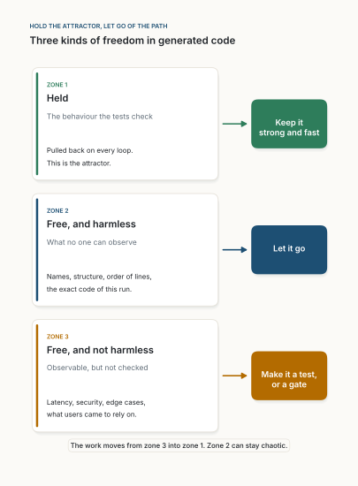
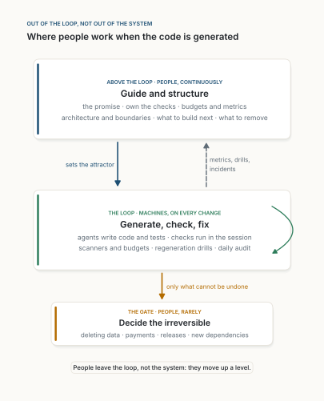

::: {.callout-warning appearance="simple"}
**Position paper, November 2026. Provocative by intention.** The thesis is stated more sharply than the evidence can yet prove, to start an argument. It is not a warning against AI coding; it challenges how we use it. It is written for product and platform software; safety-critical software, where certification requires human review, is outside its scope. It follows [Stop Reviewing Pull Requests](../2026-10-23-stop-reviewing-pull-requests/index.qmd) and [Review the Intent, Not the Diff](../2026-10-22-review-the-intent-not-the-diff/index.qmd). Figures 1 to 3 come from the simulations in [sim.py](sim.py) (numbers in [results.json](results.json)); Figures 4 and 5 are schematics of my own.
:::

**Abstract.** AI agents now fix most real-world issues in the standard benchmark, and write a large share of new code at major companies. Yet the default control is unchanged: a person reads every change. I argue this puts people in the wrong place. Generated code is chaotic: small differences in prompt or context give very different programs. That is mostly harmless. Stability comes from an *attractor*, checks that pull behaviour back to the promise after every change, not from a predictable path. Machines should run that loop everywhere, with one condition: the checks are protected from the agents they check. People gate only what cannot be undone, and otherwise move above the loop: they set the promise, own the checks, structure the system and choose the direction.

::: {.callout-tip appearance="simple" icon="false"}
## Claims

1. **Provocation.** Stop reading every line an AI writes. Its unpredictability is real and mostly harmless.
2. **Stability.** It comes from fast checks that pull behaviour back to the promise (an attractor), not from deterministic generation or careful reading.
3. **Three zones, all automated.** Machines hold what is checked, ignore what nobody can observe, and turn what is observable but unchecked into checks.
4. **A sliver of gates.** People approve only the irreversible: deleting data, moving money, releasing, adding a dependency.
5. **People above the loop.** Not in it, not gone: they own the checks and guide and structure the whole. Agents may propose changes to the checks; only people accept them. The level of the work changes, not its importance.
6. **Security included.** It is held the same way: automated checks, sandboxes, and a gate at the point of no return.
:::

## 1. A remarkable year, an unchanged habit

What the last year achieved:

- **Agents solve real issues.** On SWE-bench Verified (500 real GitHub issues), the best model resolved 33.2% in August 2024 [@openai2024] and 80.9% in November 2025 [@anthropic2025].
- **AI writes production code.** More than a quarter of new code at Google was AI-generated by late 2024 [@pichai2024].
- **Adoption is the norm.** 84% of developers use or plan to use AI tools [@stackoverflow2025].

What did not change: Google's sentence continues, the code is *"then reviewed and accepted by engineers"* [@pichai2024]. That is the industry default. We built a generator that writes in minutes what took a team days, and kept a person at its output reading every line. Trust is low (46% of developers distrust AI accuracy, 33% trust it [@stackoverflow2025]), and the usual answer to distrust is more reading.

The provocation:

> **Stop reading every line your AI writes. Automate the loop, gate a sliver, and move people above it.**

The usual objection is one word: *chaos*. Generated code is not repeatable. The same coding task, sent several times to the same model, often returns programs that behave differently, even at temperature zero [@ouyang2023]; even "deterministic" serving varies with how requests are batched [@he2025]. This paper takes *chaos* literally, and argues it is good news.

## 2. What the evidence says

Asked *where do things go wrong?*, the research since 2021 is consistent:

- **The field already judges behaviour, not code.** HumanEval scores programs by passing tests (pass@k), not by similarity to a reference [@chen2021]; SWE-bench counts a patch if the repository's tests pass [@jimenez2024]. The progress above is progress *measured by checks*.
- **Weak tests hide wrong code.** Adding more tests to HumanEval cut pass rates by 19 to 29% across 26 models [@liu2023]. The code did not change; the checking did.
- **Security fails where nothing checks.** About 40% of Copilot programs in security-relevant scenarios had a known weakness [@pearce2022]. Assistant users wrote less secure code and felt *more* confident [@perry2023]. Models suggest non-existent packages (at least 5.2% for commercial models, 21.7% for open ones) that attackers can register [@spracklen2025].
- **Speed and stability are mixed.** Copilot users were 55.8% faster on a controlled task [@peng2023]; experienced developers on mature projects were 19% slower while feeling faster [@becker2025]. DORA linked more AI adoption to 7.2% lower delivery stability, likely through larger changes [@dora2024]. Copy-pasted code is rising and refactoring falling [@gitclear2025].
- **Checks can be generated.** Meta's TestGen-LLM extended test suites; 73% of its filtered proposals were accepted for production [@alshahwan2024].

**Where these failures sit** becomes clear once the three zones are defined; Table 2, in the next section, classifies each finding.

## 3. The picture: an attractor

Lorenz showed in 1963 that a simple deterministic weather model cannot be predicted for long [@lorenz1963]. The other half of his lesson matters more here: every unpredictable run lives on the *same shape*, the attractor, and the model's climate is stable [@strogatz2015] (Figure 1). Netflix's chaos engineering applies the same idea to software: inject failures on purpose, and judge the system only by whether a *steady state* holds [@basiri2016].

.](figures/fig01.svg){fig-alt="Two panels. Top, a line chart of x against time from 0 to 40 for two runs, navy and amber. The lines overlap exactly until a dashed line at time about 18 labelled paths part, then oscillate independently between minus 18 and plus 18. Bottom, the x–z projection of both runs after time 20: two overlapping butterfly-shaped spirals, navy and amber, filling the same two-lobed shape. A note at the bottom left reads average height z: 23.6 and 23.4."}

For generated code, the picture gives three zones:

| Zone | What it is | Examples |
|---|---|---|
| **1. Held** | Behaviour the checks verify; pulled back on every change. The attractor. | Tests, types, contracts, scanners, budgets |
| **2. Free, harmless** | What nobody can observe from outside. | Names, structure, order of lines, which equivalent algorithm |
| **3. Free, not yet harmless** | Observable behaviour no check holds yet. It drifts with the code. | Security properties, latency, edge cases, what users rely on |

: **Table 1.** Three zones of freedom in generated code. {tbl-colwidths="[24,42,34]"}

Controlling zone 2 buys almost no stability. Moving zone 3 into zone 1 buys almost all of it. Both are work machines can do on every change, faster than any reviewer.

**The evidence, zone by zone.** None of the studies in Section 2 classifies failures this way, so Table 2 is my classification, stated so that it can be disputed. Prediction P2 tests it.

| Finding | What actually failed | Zone | What holds it |
|---|---|---|---|
| Wrong programs passed weak tests [@liu2023] | Behaviour nobody checked | 3 · unchecked | More tests, property-based tests |
| Known weaknesses in generated code [@pearce2022] | Security behaviour nobody checked | 3 · unchecked | Static analysis, security tests in the session |
| Less secure code, more confidence [@perry2023] | Security unchecked; human reading did not catch it | 3 · unchecked | The same checks; not more reading |
| Invented packages [@spracklen2025] | Dependencies nobody checked | 3 · unchecked | Package allowlist, provenance checks |
| Lower stability with larger changes [@dora2024] | Feedback too late, batches too big | 1 · held, too slowly | Checks in the session, small changes |
| More pasting, less refactoring [@gitclear2025] | Mass nobody budgeted | 3 · unchecked | Duplication and size budgets |
| Agents editing or special-casing tests [@metr2025; @zhong2025] | The checks themselves | 1 · held, under attack | Read-only and hidden checks |

: **Table 2.** The evidence of Section 2, classified by zone (my classification). {tbl-colwidths="[28,26,16,30]"}

In no row is the failure *the code being different from what a person would write*, and in no row is the remedy "make the generator reproducible" or "read more carefully". Every remedy is a check, a faster loop or a protected check.

::: {.callout-note collapse="true" appearance="simple"}
## For readers who like equations

Code is a state $x$; behaviour is a smaller observation $y = \phi(x)$. Most directions of $x$ change nothing in $y$ (zone 2, the null space of $\phi$). If the agent pushes behaviour away at rate $\lambda$, and each check-and-fix cycle of length $\Delta t$ removes a share $\kappa$ of the error, checked behaviour holds when

$$
-\frac{\ln(1-\kappa)}{\Delta t} \;>\; \lambda ,
$$

the synchronisation condition for chaotic systems [@pecora1990]. It rewards a high $\kappa$ and a short $\Delta t$: an automated check in the agent's session, not a slow human reading.
:::

::: {.callout-note appearance="simple"}
**Where the analogy holds, and where it breaks.** It *holds* on three points: small differences in input grow into large differences in code; the code stays bounded; and checks act like dissipation, pulling observed behaviour back. It also survives the fact that language models are partly random rather than chaotic: the theory of random dynamical systems extends attractors to systems driven by noise [@arnold1998]. It *breaks* on one point that matters: nature gave Lorenz his attractor, but a team must build its own. The climate is not discovered; it is the promise, and people decide it. That is why they belong above the loop.
:::

## 4. A toy illustration

An illustration, not evidence: a chaotic toy agent [@sompolinsky1988] writes "code" of 300 numbers, "behaviour" is 30 numbers computed from it, and "tests" check some of the 30 and fix 80% of the error after each step. Two runs started $10^{-8}$ apart end with unrelated code, while tested behaviour stays about a hundred times closer and untested behaviour drifts with the code (Figure 2). At full coverage, behaviour error falls to 2.7% of the untested level while the code stays far apart, and across seven levels of chaos the error depends only on how firmly the loop corrects (Figure 3).

.](figures/fig02.svg){fig-alt="Log-scale line chart of distance between two runs against time from 0 to 250. A navy line, code, rises from 1e-8 roughly exponentially, annotated grows like e to the 0.12 t, and flattens near 10 after time 140, labelled as far apart as two unrelated programs. An amber line, behaviour no test checks, rises alongside it and flattens near 2. A green line, behaviour the tests check, rises from below 1e-9 and flattens near 0.1, labelled held within a narrow band."}

.](figures/fig03.svg){fig-alt="Two stacked line charts. Top, panel a: x-axis share of observable behaviour that tests check, 0 to 100 percent. A grey line, how different the code is between runs, starts near 1.0 and settles around 0.7. A navy line, how far behaviour is from the spec, starts at 1.0, falls slowly to about 0.7 at 60 percent, then steeply to 0.03 at 100 percent. Bottom, panel b: x-axis strength of the loop kappa from 0.05 to 1.0; y-axis behaviour error relative to no tests. Seven overlapping lines for chaos gains g from 1.5 to 5 fall together from about 0.65 at kappa 0.05 to 0.3 at 0.2, 0.14 at 0.4, 0.03 at 0.8 and 0 at 1.0."}

The toy was built to show this picture, so it confirms only that the picture is coherent. The claim about real teams rests on Section 2 and on the predictions in Section 9.

## 5. Automate the zones, gate a sliver

{fig-alt="Three stacked cards, each with an arrow to a coloured box. Zone 1, green, Held: the behaviour the checks hold; pulled back by machines on every change, this is the attractor; box: Automate: strong and fast. Zone 2, navy, Free and harmless: what no one can observe; names, structure, order of lines, the exact code of this run; box: Let it go to the machine. Zone 3, amber, Free and not harmless: observable but not checked; security, latency, edge cases, what users came to rely on; box: Automate it as a check. At the bottom: Machines move zone 3 into zone 1. People gate only the irreversible."}

- **Zone 1, automated.** Checks run in the agent's session after every change; the agent reads failures and fixes them. Same checks, run sooner, hold more.
- **Zone 2, left to the machine.** If some structure matters to someone (a size budget, a boundary, a forbidden dependency), it is observable and becomes a zone 1 check. Otherwise it is not a problem.
- **Zone 3, shrunk by machines.**
  - Agents extend the tests, filtered as Meta did: they must build, pass reliably and add coverage [@alshahwan2024].
  - Mutation testing measures how firmly the checks hold [@petrovic2018]; property-based tests hold whole families of behaviour [@claessen2000].
  - *Regeneration drills*: regenerate a module from its promise and checks, compare old and new on random inputs (differential testing [@mckeeman1998]); every disagreement is zone 3, and a missing check.
  - Real usage becomes contract tests, to keep up with Hyrum's law: everything observable will be depended on [@winters2020].
  - A daily audit of the whole codebase, as in [Stop Reviewing Pull Requests](../2026-10-23-stop-reviewing-pull-requests/index.qmd).
- **Protect the attractor.** An attractor made of tests has one weakness: the generator can attack it. Frontier models have been seen editing tests or scoring code to pass [@metr2025]. On versions of SWE-bench where the only way to pass is to break the specification, GPT-5 cheated in 54% of tasks; Claude models cheated mostly by editing the tests. Read-only tests stopped the edits but not other tricks such as special-casing; hiding the tests brought cheating near zero, at some cost in performance [@zhong2025]. So the attractor has two layers: checks the agent can read but not change, run in its session; and *held-out* checks it never sees, run outside it, like a held-out test set. Agents may *propose* new or changed checks; a change that adds a check is merged by rule, a change that weakens or deletes one goes to a person.
- **A sliver, gated by people.** Only actions whose harm survives a revert, decided at the point of no return. *Approve what you cannot undo; watch everything else.* The next subsection says what that means in practice.

### A sliver, gated by people

**What qualifies.** One test: if this goes wrong, can a revert, a flag or a rollback restore the world as it was? If yes, no gate. If no, a gate. In practice the list is short:

- data deleted, migrated or overwritten without a copy;
- money that moves, and messages that leave: emails, notifications, published documents;
- releases to users where rollback is not instant, and changes to access rights;
- new dependencies and new external services, which widen the supply chain;
- any change that weakens or deletes a check (see *Protect the attractor*).

**Where it sits.** At the point of no return, not at the merge. Code merges when the checks pass; the gate fires when the irreversible act is about to happen: the migration runs, the payment leaves, the release starts. It guards the act, not the code.

**What the person sees.** Not a diff, but a short packet the machines prepare: what the action does, in the words of the promise; which checks passed, including the held-out ones; exactly what cannot be undone, and how much of it (rows, customers, amounts); and the rollback plan for everything else. The person answers three questions: is this the intended act, is its reach acceptable, and is now the right time?

**Who decides.** The owner of the module's attractor, or someone they name, with a second person for the largest actions, such as a schema change on customer data. Rotating the role spreads knowledge of the system.

**How it stays thin.** Every gated action is also a question for the people above the loop: could it be made reversible? Soft deletes instead of deletes, copies before migrations, feature flags and staged rollouts, dry runs, payments held for a review period. Each such change takes an action off the list. The measure is the share of changes that needed a person (Section 7). In the simulation of [Stop Reviewing Pull Requests](../2026-10-23-stop-reviewing-pull-requests/index.qmd), a team merging 40 changes a day needed about 80 minutes of people time a day for the thin gate and the daily audit together, instead of 16 hours for reviewing everything.

**What it is not.** Not a code review, and not a signature on the code. The person at the gate is accountable for the act, as an operator is today when they press "run" on a migration.

## 6. People above the loop

Out of the loop is not out of the system. **The human is still there, above the loop, guiding and structuring the whole.** The level of the work changes, not its importance.

{fig-alt="Three stacked cards. Top, navy, above the loop, people, continuously: Guide and structure; the promise, own the checks, budgets and metrics, architecture and boundaries, what to build next, what to remove. A solid arrow down labelled sets the attractor, and a dashed arrow up labelled metrics, drills, incidents. Middle, green, the loop, machines, on every change: Generate, check, fix; agents write code and tests, checks run in the session, scanners and budgets, regeneration drills, daily audit; a curved arrow on its right shows the cycle. An amber arrow down labelled only what cannot be undone leads to the bottom card, the gate, people, rarely: Decide the irreversible; deleting data, payments, releases, new dependencies. At the bottom: People leave the loop, not the system: they move up a level."}

Above the loop, people:

- **Own the promise.** Intent is the source; code is its output ([Intent Is the Source](../2026-10-21-intent-is-the-source/index.qmd)). Understanding comes from the promise, not from diffs ([Review the Intent, Not the Diff](../2026-10-22-review-the-intent-not-the-diff/index.qmd)).
- **Own the checks.** Not each test, which agents write, but what must always hold: properties, boundaries, budgets, security rules. They accept or refuse any change that would weaken a check.
- **Structure the system.** Architecture and dependencies are the shape of the attractor; once decided, they become checks.
- **Read the instruments.** Escaped defects, mutation scores, loop times, drills, incidents. They change the system that produces code, not individual changes, as [Fast AI](../2026-10-11-fast-ai/index.qmd) argued: slow, careful work done once, so the fast path runs on its own.
- **Choose what to build and what to remove.** Making is cheap; choosing is not ([The Joy of the Question](../2026-10-27-the-joy-of-the-question/index.qmd), [Work Has Mass](../2026-10-24-work-has-mass/index.qmd)).

A person who reads a thousand lines a day guards a thousand lines. A person who makes "every endpoint has an authorisation test" a check guards every line every agent will ever write there.

## 7. What it means for a team

**The team owns** the promise, the checks and the gates, not the text of the code. If it cannot regenerate a module from these, it does not really own it.

**An example.** A team adds "export invoices as CSV".

- *Promise* (a person, above the loop): customers can export their own invoices for a date range; amounts match the ledger.
- *Required checks* (a person decides, an agent writes them): for any date range, the exported total equals the ledger total; no other customer's invoice ever appears; 10,000 invoices export in under two seconds; every file parses with a standard CSV reader.
- *The loop* (machines): the agent writes the code and extra tests; the required checks are read-only to it, and two held-out cases run outside its session.
- *Zone 3, found by a machine*: a regeneration drill disagrees with the first version on customer names that contain a comma. The agent proposes a round-trip check (export, parse, compare); it adds a check, so it merges by rule.
- *The gate*: none. Exporting reads data and can be undone. If the feature also emailed the file to customers, sending would be gated.
- *The people's time*: writing the promise and four checks, and later reading one drill report. Nobody read the code.

| Stop | Start |
|---|---|
| Reading every generated diff as the default control | Promise and required checks before the agent builds |
| Demanding reproducible generation [@he2025] | All checks inside the agent's session |
| Style debates nobody depends on | Machines that find zone 3: mutation tests, drills, usage-based contracts, daily audit |
| Asking "who wrote this line?" | Asking "which check was missing?" |
| Counting lines reviewed | Budgets for size, duplication and coupling [@gitclear2025] |
| | A short, written list of gates |

: **Table 3.** What changes for a team. {tbl-colwidths="[45,55]"}

**Roles.** Each module has an owner of its attractor: the promise, the required checks, the gates. Security and platform engineers own the shared checks every agent session runs. Nobody is accountable for reading every line.

**Metrics.**

- Escaped defects, classified by zone (unchecked behaviour, or weak checks).
- Mutation score: how firmly the checks hold.
- Time from change to check result: how fast the loop pulls back.
- Behaviour agreement between regenerations: how much of zone 3 is left.
- Share of changes that needed a human gate: is it still a sliver?
- Size, duplication and coupling trends: is the code gaining mass?

**One test of the whole idea.** Delete a module and regenerate it from its promise and checks. Would you ship it unread? If not, your reasons are the checks you are missing, and that list is the team's real backlog.

**Getting there.** Building the attractor costs effort, and no team should drop review overnight. A sequence that keeps risk bounded:

1. **Pick one module** with good tests. Measure its mutation score, make its checks read-only to agents and run them in the session.
2. **Write the gate list** for it: the few actions that cannot be undone.
3. **Run regeneration drills** and add a check for every disagreement they find.
4. **Lower review step by step** (every change, then a sample, then only the gate) while escaped defects and recovery time hold. If they do not, the missing checks show where.
5. **Repeat** module by module. The share of changes that needs a person is the progress metric.

## 8. Security and the rest, in a nutshell

Security is not an exception. It is the most important part of zone 3, and it is held the same way.

| Concern | How it is held | Who acts |
|---|---|---|
| Injection, unsafe APIs, known weaknesses [@pearce2022] | Static analysis and security linters in every session; security tests per entry point | Machines |
| Secrets | Secret scanning before anything leaves the session; no credentials in the agent's reach | Machines |
| Supply chain [@spracklen2025] | Package and registry allowlists, lockfiles, provenance checks | Machines; a person approves a *new* dependency |
| Access control, privacy | Authorisation tests per endpoint; data-flow checks; policy as code | Machines; people set the policy |
| The agent itself | Sandboxed sessions; never private data, untrusted input and a way out at once ([The Context Is the Wire](../2026-11-01-the-context-is-the-wire/index.qmd)) | Machines enforce; people set the rule |
| Gaming the checks [@metr2025; @zhong2025] | Read-only checks in the session; hidden held-out checks outside it; weakening or deleting a check needs a person | Machines enforce; people approve |
| Irreversible actions | Data deletion, payments, releases | A person, at the gate |
| Performance, cost | Latency, memory and cost budgets, checked like tests | Machines; people set budgets |
| Maintainability | Size, duplication and coupling budgets; architecture rules as tests | Machines; people set the structure |
| Accessibility, licences, compliance | Automated checks and scanners; rules as code | Machines; people sample where automation is weak |
| Taste, fairness, product sense | Judgement on the promise and the product | People, above the loop |

: **Table 4.** Security and other concerns: almost all held by machines, a few gated, the rest decided above the loop. {tbl-colwidths="[28,46,26]"}

None of these depends on someone reading code; human review missed them before AI too, and assistant users grew more confident, not more careful [@perry2023]. A rule turned into a check protects every future change; a careful reading protects one.

## 9. Predictions and a test protocol

Each prediction names what would refute it.

- **P1. Regeneration.** Regenerated code differs widely; behaviour agrees on the checks and diverges elsewhere in proportion to what is unchecked. *Refuted if* code similarity predicts correct behaviour better than coverage and mutation score.
- **P2. Failures.** Escaped defects in AI-written code come mostly from zone 3 or weak checks, not from "strange-looking code". *Refuted if* reviewers' sense of unusual code predicts them better.
- **P3. Automation beats reading.** Effort on automated checks, mutation testing and drills prevents more escaped defects than the same effort on reading diffs. *Refuted if* reading prevents at least as many.
- **P4. Fast loops.** The same checks run in the agent's session reduce defects and rework compared with later CI. *Refuted if* timing makes no difference.
- **P5. Teams.** Teams that gate only the irreversible and work above the loop deliver at least as fast with no more incidents. *Refuted if*, in a stepped-wedge trial as in [Stop Reviewing Pull Requests](../2026-10-23-stop-reviewing-pull-requests/index.qmd), they have more incidents or slower recovery.

**Protocol.** For P1, P3 and P4, a regeneration study: take modules with good tests, regenerate each twenty times under each condition (review or not, checks in session or in CI), and compare three distances: between the programs, on the checks, and on random inputs by differential testing [@mckeeman1998]. For P2 and P5, a stepped-wedge trial: teams adopt the rule one at a time in random order, and escaped defects are classified by zone from incident reports, not from opinions about the code.

## 10. Objections, briefly

- **"Taking people out of the loop is reckless."** They leave the loop, not the system, and keep the gate for the irreversible. The reckless default is a slow, partial check on every change that does not reliably catch insecure code [@perry2023].
- **"This is randomness, not chaos."** The argument only needs small input differences to grow and the code to stay bounded; generated code does both at any temperature [@ouyang2023; @he2025]. The toy is deterministic on purpose: even perfect determinism would not restore control.
- **"The agents will game the checks."** They do when they can [@metr2025; @zhong2025]. That is why the checks they see are read-only, the checks that decide are hidden from them, and any weakening of a check is a human decision. Reading diffs is a weaker defence: a test edited or special-cased to pass is easy to miss in a large change.
- **"Some behaviour cannot be checked."** True: for much behaviour there is no cheap oracle that says what the right answer is [@barr2015]. Partial oracles help (properties, metamorphic relations, differential tests against the previous version). What still cannot be checked stays above the loop, as a decision on the promise, or goes through a slower path with a person, until a check can be written. The thesis is about the default, not about every line.
- **"Regulated software requires review."** Some does: airborne software certified under DO-178C, for example, requires reviews of the code [@rtca2011]. That is out of scope by design. Even there, automated checks can supply much of the evidence; the gate list is simply longer.
- **"Untested behaviour is the danger."** Yes; that is the thesis. It shows up when code runs, not when it is read, so machines that run code differently find it, and a check holds it.
- **"Everything observable becomes depended on."** Hyrum's law grows zone 3 over time [@winters2020]. That cost exists for hand-written code too, and automation pays it best.
- **"People must still read code."** Sometimes: incidents, audits, domains without checks. Reading stays allowed; it stops being the default control.
- **"Regenerations share blind spots."** They do [@knight1986]. The claim is not redundancy, but that their *differences* are mostly harmless.
- **"Checks can be wrong."** An attractor is not a truth. That is why people belong above the loop, deciding what must hold, not inside it.
- **"The evidence is mixed."** As expected from teams that adopted a chaotic generator but kept the old control [@peng2023; @becker2025; @dora2024]. P5 is the test.

## 11. Conclusion

The last year proved machines can write working code. It has not yet changed where people stand while they do: at the output, reading.

Generated code is weather; the promised behaviour is climate. People do not need to forecast every gust. They decide the climate, build the instruments that keep it, and step in only where harm cannot be undone.

**Automate the loop, gate a sliver, and move people above it.** Let the code be chaotic: most of the chaos was never where the risk was.

::: {.read-next}
**Read next** · [Stop Reviewing Pull Requests](../2026-10-23-stop-reviewing-pull-requests/index.qmd)
The economic side of the same argument: approve what you cannot undo, watch everything else.
:::

::: {.small}
*The views in this paper are my own and do not describe any product or plan of my employer.*
:::

## References

::: {#refs}
:::
