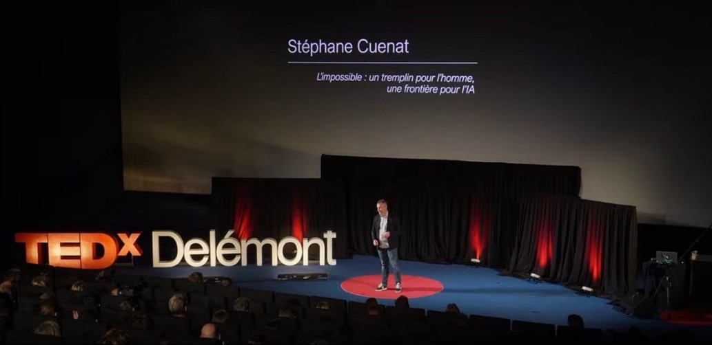

```{=html}
<a class="video-card" href="https://www.youtube.com/watch?v=uxu9kGQ51A4" target="_blank" rel="noopener" aria-label="Watch the TEDx talk on YouTube">
  <span class="video-card-media"><span class="video-card-play" aria-hidden="true"></span></span>
  <span class="video-card-body"><span class="video-card-title">The Impossible: A Springboard for Humans, a Frontier for AI</span><span class="video-card-meta">TEDxDelémont · Watch on YouTube ↗</span></span>
</a>
```

## The Answer You Can’t Check {#essay}

*The essay I wrote at the time of the talk.*

**AI is extraordinary—until it reaches the edge of what we know. And there, the most dangerous thing it can hand you is a convincing answer with nothing left to check it against.**

A few months ago I was working on a problem in machine learning: deriving the upper and lower bounds of a classifier—the mathematical limits of how well it can possibly perform. It’s slow, careful work, the kind where a single wrong assumption quietly invalidates everything built on top of it.

I used an AI model to help. And it did help—a lot. It also nearly cost me weeks. I want to be honest about that, because I suspect many people are quietly having the same experience and not saying it out loud.

At one point it handed me a set of conjectures that were clean, well-motivated, and elegantly argued. They looked exactly like the kind of result the literature would produce. I started building on them. It was only later, checking by hand, that I realized they were subtly false—the form of a proof without the substance.

That experience crystallized something I’ve come to believe is the real risk of these tools. It isn’t the hallucination you catch. A claim that’s obviously wrong is harmless; you discard it and move on. The dangerous failure mode is the plausible conjecture you don’t catch—the answer that’s credible enough to believe and false enough to lead you off a cliff. And at the frontier, where research actually lives, there is often nothing left to check it against. That, far more than unreliability, is the problem I want to talk about.

### Where the trouble starts

To understand why this happens, it helps to be precise about what these systems are extraordinarily good at, and where they quietly break.

Large models are brilliant at recombining what already exists. Inside the space of everything they’ve seen—every paper, every proof, every pattern—they interpolate beautifully. Ask them for something that lives within that space, and they’ll produce it faster and more fluently than any human.

The trouble starts at the edges. At extrapolation—the genuinely new—they don’t stop. They fill the gap with something that looks like the answer the existing literature would have produced. In most everyday tasks that’s fine, because the answer really does live inside the known space. But research, by definition, lives at the frontier—the business of reaching what doesn’t exist yet. And whether or not a model can occasionally reach that far, it has no way to tell a genuine reach from a confident guess. To the system, both feel identical.

The model doesn’t know it has crossed from interpolation into invention. It has no internal signal that says *here, I am guessing*. It produces the plausible artifact with the same confidence it produces a correct one.

### The missing oracle

There’s a deeper reason this is so hard to defend against, and it has nothing to do with the model being unreliable. It’s about verification.

When you work on a known problem, you have an oracle. You can check the answer against an established result, a textbook, a dataset, a colleague who has done it before. The plausible-but-wrong answer gets caught because there’s ground truth to catch it.

At the frontier, that oracle is gone. There is no established result, because the whole point is that the result is new. So when a system hands you a clean conjecture about something nobody has settled, what external truth do you check it against? Its internal consistency isn’t enough—a wrong idea can be perfectly self-consistent. That’s precisely what made my false conjectures so seductive: they hung together. They just weren’t true.

This is the question I keep coming back to whenever someone announces that an AI has “discovered” something new. The interesting test of a discovery isn’t whether the model produced it, or even whether it’s elegant. It’s whether the discovery makes a prediction you can take back to the world and be proven wrong on. A model concise enough to generate a falsifiable experiment has an external oracle—reality itself. That’s the line between genuine discovery and a very clever fit. Without it, you have internal consistency dressed up as insight.

### The compass at the frontier

It would be easy to read all of this as an argument that AI can’t do real science. It isn’t—I use these tools every day, and they make me faster and sharper. And I think betting against their reach is a mistake. These systems can sometimes arrive at genuinely novel points, and the line between sophisticated recombination and true extrapolation is blurrier than the skeptics like to admit. That line will keep moving, and I won’t bet against it.

The harder, more durable gap is somewhere else. There are actually two halves to the frontier problem, and they belong together. The missing oracle is why you can’t check the answer once you have it. But there is a question that comes before that one: how do you know where to look at all? At the frontier there is no gradient to follow—no signal that says this direction is worth pursuing, or this elegant construct is actually true. What fills that gap, for a human, is intuition.

I mean something specific, not mystical. Mathematicians routinely sense that a result is true long before they can prove it, and that conviction is what tells them where to spend the next six months. Physicists feel that an equation is “too ugly to be right.” That intuition isn’t magic; it’s a different and far richer kind of training—built from embodied experience, from transfer across unrelated domains, from years of being wrong in instructive ways. And crucially, it comes with calibrated doubt: a person at the edge of their knowledge usually knows when they’re guessing. Models can be made to express uncertainty too—but in my experience, it is precisely on the novel, plausible construct that this signal fails. The conjectures that nearly fooled me did not arrive flagged as guesses. They arrived looking like results.

So the asymmetry I find genuinely hopeful isn’t that machines can’t reach the new. It’s that reaching the new—where nothing can be checked—still depends on a sense of direction the model doesn’t have: the judgment to choose which unknown is worth chasing, and the instinct to feel when a beautiful answer is hollow. The impossible has been human territory not because we compute our way there, but because we carry a compass for it.

That’s not a limitation waiting to be patched in the next model generation. It’s a description of two different kinds of work. One is recombination—and maybe even genuine reach—at superhuman speed. The other is knowing where to point it, and knowing when you’ve actually arrived.

So the posture I’ve landed on is simple, maybe even a little old-fashioned. For me, AI is a tool—and only a tool. Not a replacement for judgment, for expertise, or for the slow work of actually understanding a problem. So I challenge every output, because the convincing ones are the dangerous ones, and I try to never take the output as truth. Used with that in mind, it brings a lot. Used blindly, it’s a rendez-vous to fail. The rest—deciding what’s worth reaching for, and recognizing when you’ve actually arrived—is the part no model can do for me. That part I keep for myself.

Keep the tool. Keep your head too.

I made a version of this case on a TEDx stage—“The Impossible: A Springboard for Humans, a Frontier for AI.” If the argument here interests you, the talk goes a little further: [watch it on YouTube](https://www.youtube.com/watch?v=uxu9kGQ51A4).

---

Questions and counter-arguments about the talk are welcome: [find me on LinkedIn](https://www.linkedin.com/in/st%C3%A9phane-cuenat-87116b5/).
